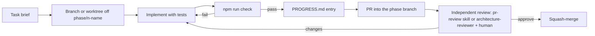

# Agent harness overview

**Purpose.** Read this when you are about to run a coding agent on Eternalus, or when you are
an agent starting a session. It explains the entry points per tool, the reading order, the
task loop and the difference between what tooling enforces and what review must catch. The
design rationale is in [`../architecture/16-agentic-harness.md`](../architecture/16-agentic-harness.md);
the requirements are in [`../requirements/04-agentic-instructions.md`](../requirements/04-agentic-instructions.md).

## 1. One instruction file, many tools

`AGENTS.md` at the repo root (and in `packages/core/`, `apps/client/`) is the canonical
instruction file. Every tool reaches it:

| Tool                           | How it finds the rules                                                     | Extra files in this repo                                                           |
| ------------------------------ | -------------------------------------------------------------------------- | ---------------------------------------------------------------------------------- |
| Claude Code                    | `CLAUDE.md` = `@AGENTS.md` at each level (imports)                         | `.claude/settings.json` (permissions, hooks), `.claude/skills/`, `.claude/agents/` |
| OpenAI Codex / ChatGPT         | Reads `AGENTS.md` natively (root → cwd chain)                              | `.agents/skills/` pointer stubs                                                    |
| Gemini CLI / Antigravity       | `.gemini/settings.json` lists `AGENTS.md` and `GEMINI.md` as context files | `GEMINI.md` pointers, `.agents/skills/`                                            |
| GitHub Copilot (agent, review) | Reads `AGENTS.md` natively                                                 | `.github/copilot-instructions.md` (six hard rules)                                 |
| Cursor                         | Reads `AGENTS.md` natively; reads `.claude/skills/` and `.agents/skills/`  | —                                                                                  |

Per-tool details and verification steps: [`tool-setup.md`](tool-setup.md).

## 2. Reading order for an agent

1. `AGENTS.md` (hard rules, definition of done, where code goes).
2. The nearest package `AGENTS.md` for the files you will touch.
3. The architecture doc whose `paths:` frontmatter matches those files
   (`grep -l "paths:" docs/architecture/*.md`), starting with
   [`../architecture/02-code-structure.md`](../architecture/02-code-structure.md).
4. The current phase doc in [`../plan/`](../plan/README.md) and the last entry of
   [`../plan/PROGRESS.md`](../plan/PROGRESS.md).
5. The task brief (issue or [`task-brief-template.md`](task-brief-template.md)) and, if the
   product owner left items, [`../../INBOX.md`](../../INBOX.md).

`scripts/hooks/session-start.mjs` prints this list at the start of every Claude Code session.

## 3. The task loop

- One concern per task, one task per branch. Parallel agents use separate worktrees
  ([`running-agents.md`](running-agents.md) §3).
- Agents never commit or push unless the human asks in that task; never on `main`.
- The review step is not optional: agents grade their own work generously (see the
  [harness research](../research/agentic-harness-research.md#3-anthropic-engineering-guidance)),
  so a second agent or a human walks [`checklists.md`](checklists.md).

## 4. Enforced by tooling vs checked in review

| Enforced automatically (hooks, CI)                                                | Checked in review (humans + reviewer agent)                                        |
| --------------------------------------------------------------------------------- | ---------------------------------------------------------------------------------- |
| Strict TypeScript, no `any`, banned ts-comments, zero lint warnings, no `console` | Placement in the right layer/folder; SOLID and DRY; strategies instead of switches |
| Core purity (no DOM/Node types, no React/Redux imports, no `Math.random`)         | Determinism beyond the lint rules (iteration order, sort comparators, wall clock)  |
| Test integrity (`.only`/`.skip` banned, every test asserts), coverage thresholds  | Tests assert behaviour, not coverage; product decisions were not made by an agent  |
| knip (dead code), Prettier, LF endings, lockfile sync, exact versions, docs check | Docs and frontmatter updated; PROGRESS entry; scope discipline                     |
| Claude Code hooks: per-file lint after edits, `check:quick` gate before stopping  | Commit messages, PR description, ADR when a guardrail changes                      |

## 5. Files in this folder

| File                                               | What it is                                                                  |
| -------------------------------------------------- | --------------------------------------------------------------------------- |
| [`running-agents.md`](running-agents.md)           | For humans: scoping tasks, parallel worktrees, reviewing AI PRs, recovering |
| [`tool-setup.md`](tool-setup.md)                   | Per-tool configuration and how to verify the harness works                  |
| [`task-brief-template.md`](task-brief-template.md) | Copy-paste brief with a worked example                                      |
| [`checklists.md`](checklists.md)                   | Definition of done, AI-PR review, architecture review, phase exit           |

## Related

- [`../architecture/16-agentic-harness.md`](../architecture/16-agentic-harness.md)
- [`../requirements/04-agentic-instructions.md`](../requirements/04-agentic-instructions.md)
- [`../process/git-workflow.md`](../process/git-workflow.md)
- [`../process/guardrails.md`](../process/guardrails.md)
