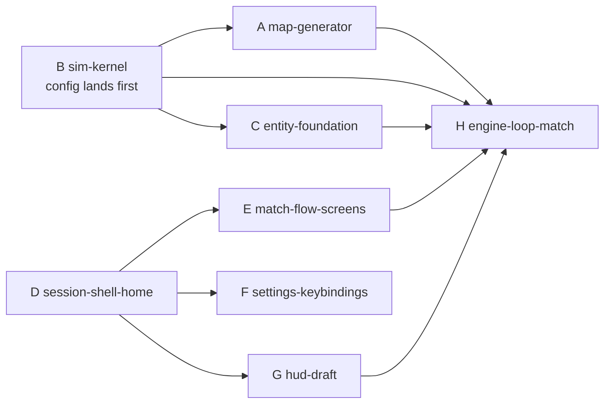

# Ultracode sessions — Sprint 1 (2026-10-03)

**Purpose.** Each section in §3 is a complete prompt for one Claude Code session running in its
own git worktree. Together they deliver the Sprint 1 demo (§4). §1 says in which order to start
them, §2 is the contract every session must honour so the branches merge cleanly. Sam runs the
human steps in §0; the sessions do the rest. Everything here follows `AGENTS.md`, the
architecture docs and the owner decisions of 2026-10-03
([decisions log](../../reference/game-design/13-owner-decisions-log.md)).

## 0. Human steps before the first session

```bash
cd /path/to/eternalus
git switch main && git pull
# 1. The Phase 1 integration branch (ADR 0007)
git switch -c phase/1-simulation-kernel-and-world && git push -u origin phase/1-simulation-kernel-and-world
# 2. Land the docs branch from the Cowork session first (plan re-cut, decisions log, this file):
#    push docs/inbox-decisions-2026-10-03 and open a PR into main (reviewer: anyone), then
#    `git merge origin/main` into the phase branch once it lands. Until then the sessions read
#    the docs from that branch: git merge docs/inbox-decisions-2026-10-03 into the phase branch locally.
# 3. One worktree per session (each needs its own npm install, Node 24 from .nvmrc)
for t in map-generator sim-kernel entity-foundation session-shell-home match-flow-screens settings-keybindings hud-draft engine-loop-match; do
  git worktree add .worktrees/$t -b feat/$t phase/1-simulation-kernel-and-world
  (cd .worktrees/$t && npm install)
done
# 4. Start a session in a worktree:  cd .worktrees/map-generator && claude   (then paste §3 prompt A)
```

Notes: `claude --worktree <name>` is the built-in alternative (creates `.claude/worktrees/<name>`,
also gitignored). Sessions commit on their task branch when the prompt says so and never push;
you push and open the PR into `phase/1-simulation-kernel-and-world` with the reviewer the prompt
names. When a PR merges, other worktrees run `git merge phase/1-simulation-kernel-and-world`.

## 1. Run order and dependencies



| Start      | Session                    | Track | Depends on                                                | Reviewer (DEC-05: feature owner picks) |
| ---------- | -------------------------- | ----- | --------------------------------------------------------- | -------------------------------------- |
| Day 1      | **B** sim-kernel           | A     | — (its first commit, `config/`, unblocks A)               | Sam picks (core-minded teammate)       |
| Day 1      | **D** session-shell-home   | B     | —                                                         | UI-minded teammate                     |
| Day 1      | **F** settings-keybindings | B     | D's slice names only (contract §2); merges after D        | UI-minded teammate                     |
| Day 1–2    | **A** map-generator        | A     | B's `config/` commit (start the audit parts immediately)  | **Aryan Walanj** (DEC-04)              |
| Day 2      | **E** match-flow-screens   | B     | D's `SessionController` + slices (prop-driven until then) | UI-minded teammate                     |
| Day 2      | **G** hud-draft            | B     | D's `MatchScreen` shell (prop-driven until then)          | UI-minded teammate                     |
| Day 3+     | **C** entity-foundation    | A     | B merged (stack on B's branch if B is still in review)    | Sam                                    |
| Week 2     | **H** engine-loop-match    | A+B   | A, B, C, D, E, G merged                                   | Sam + Aryan                            |
| Continuous | **R** review               | —     | any open PR                                               | the named reviewer                     |

Two sessions never edit the same file: the ownership table in §2.6 is the rule. If a session
needs a file another session owns, it stops and writes the need into `INBOX.md` "Requests".

## 2. Integration contract (every session reads this)

### 2.1 Decisions that changed since the architecture docs were written

- Assault is now **Warrior** everywhere (class `Warrior`, content id `warrior`, display name
  "Warrior"). The three MVP classes: `warrior`, `sentinel`, `magus`.
- The human player is their team's **Rover**; team is **random** per match (from the setup
  RNG stream). Max 10 Legends per team.
- Legend footprint radii: warrior 0.5 m, magus 0.75 m, sentinel 1.25 m (1 world unit = 1 m).
- Forest camps: lighter near lanes, heavier deeper into **the Unknown** (inter-lane area).
- Cathedral gem present from t = 0 (unbreakable, lightning on attackers). No building capture.
- Spawn schedule Option A (SpawnerTower light/60 s, BuffTower medium/120 s, Stronghold
  heavy/180 s to the worst lane). Breakability = fraction 2/3 of BuffTowers.
- Screen flow: `menu → loading → character-select (60 s) → pre-launch (10 s) → match-loading → match → results`
  ([reference 14](../../reference/game-design/14-interface-and-screen-flow.md), architecture 13 §2).
- Two-week sprints; presentation **2026-11-27**; S1 = Oct 5–16.

### 2.2 `packages/core` surface (owner: B, then C and A)

```ts
// packages/core/src/config/GameConfig.types.ts            (B)
export type MapConfig = {
  readonly numLanes: number; // 3
  readonly spawnTowersPerLane: number; // 1
  readonly buffTowersPerLane: number; // 1
  readonly campsPerSide: number; // 6
  readonly cornerCamps: number; // 4 (0 when cut)
  readonly worldWidth: number; // 1600 (TUNE)
  readonly worldHeight: number; // 900 (TUNE)
  readonly presetId?: string; // optional authored preset (rift/bounds polygons, lane curvature)
};
export type MatchConfig = {
  readonly legendsPerTeam: number; // 10
  readonly legendsPerLane: number; // 3
  readonly countdownSeconds: number; // 60
  readonly hordeSizes: { readonly light: number; readonly medium: number; readonly heavy: number }; // 16/8/4
  readonly initialHordesPerTeam: number; // 3
  readonly plannedMatchSeconds: number; // 1200 (TUNE; DEC-13 pending)
};
export type LimitsConfig = { readonly maxLegendsPerTeam: number; readonly maxUnitsPerTeam: number }; // 10 / 144
export type GameConfig = {
  readonly tickRate: number; // 30
  readonly map: MapConfig;
  readonly match: MatchConfig;
  readonly limits: LimitsConfig;
};
// createDefaultGameConfig(overrides?: DeepPartial<GameConfig>): GameConfig
// validateGameConfig(config: unknown): GameConfig   (throws ConfigValidationError with a path)

// packages/core/src/teams/teams.types.ts                  (A)
export type PlayableTeam = 'light' | 'dark';
export type Team = PlayableTeam | 'neutral';

// packages/core/src/map/MapGenerator.ts                   (A)
// class MapGenerator { generate(config: GameConfig, seed: number): MapDefinition }  (pure, deterministic)
// MapFeatureKind = 'stronghold' | 'spawner-tower' | 'buff-tower' | 'wall-segment' | 'gate' | 'turret'
//   | 'camp' | 'corner-camp' | 'capture-point' | 'cathedral' | 'obstacle'
// MapFeature gains: laneId?: string; team: Team; definitionId: string; minimapGlyph: MinimapGlyph

// packages/core/src/index.ts exports (cumulative): createDefaultGameConfig, validateGameConfig,
// GameConfig types, SeededRandom, StateHasher, Simulation, Command, GameEvents types, Snapshot types,
// MapGenerator, MapDefinition types, Team types, LEGEND_CLASSES (C), Entity families (C).
```

### 2.3 `apps/client` surface (owner: D, then E/F/G)

```ts
// apps/client/src/bridge/
//   store.ts        combineSlices(sessionSlice, matchSetupSlice, loadingSlice, settingsSlice, hudSlice, matchSlice, contentSlice)
//   hooks.ts        useAppSelector / useAppDispatch (.withTypes)
//   eventBus.ts     TypedEventBus<BridgeEventMap>   events.ts  BridgeEventMap (below)
//   Binding.types.ts  InputAction, InputChord, Binding   (F; D creates the file with the InputAction union only)
//   slices/sessionSlice.ts     { phase: SessionPhase; reason: string | null }
//   slices/matchSetupSlice.ts  { seed; playerTeam: PlayableTeam | null; selection: { classId: LegendClassId | null; specId: string | null };
//                                allies: RosterEntry[]; enemies: RosterEntry[]; countdownMs: number; revealMs: number }
//   slices/loadingSlice.ts     { group: AssetGroup | null; loaded; total; bytesLoaded; bytesTotal; status: 'idle'|'loading'|'ready'|'failed' }
//   slices/settingsSlice.ts    { bindings: Binding[]; audio: { master; music; effects }; video: { fullscreen; renderScale }; accessibility: { reduceMotion; colourBlindMode } }
//   slices/hudSlice.ts         { health: Bar; aether: Bar; xp: { level; current; next }; abilities: AbilitySlotState[]; announcements: Announcement[]; scores: TeamScore[] }
//   slices/matchSlice.ts       { clock: { tick: number; seconds: number }; result: MatchResultSummary | null }
//   slices/contentSlice.ts     { legendClasses: LegendClassCard[] }   // projected at boot from core (or the placeholder catalogue until C lands)

// BridgeEventMap: 'ui-intent' (UiIntent), 'session-phase' ({ phase, reason }), 'loading-progress',
//                 'match-clock' ({ tick, seconds }), 'hud-state' (HudSnapshot), 'announcement'
// UiIntent: { kind: 'start-match' } | { kind: 'navigate'; route: MenuRoute } | { kind: 'select-class'; classId; specId? }
//         | { kind: 'confirm-selection' } | { kind: 'cancel-match' } | { kind: 'leave-match' } | { kind: 'open-overlay'; overlay: 'pause' | 'settings' }
//         | { kind: 'close-overlay' } | { kind: 'update-binding'; action: InputAction; chord: InputChord } | { kind: 'reset-bindings' }
// SessionPhase: 'boot' | 'menu' | 'loading' | 'character-select' | 'pre-launch' | 'match-loading' | 'match' | 'results'
// MenuRoute: 'home' | 'loadouts' | 'profile' | 'settings' | 'about'
// RosterEntry: { legendId: string; displayName: string; classId: LegendClassId; specId: string | null; isBot: boolean; isPlayer: boolean; team: PlayableTeam }
// LegendClassCard: { classId: LegendClassId; displayName: string; blurb: string; specs: { specId; displayName; status: 'post-mvp' }[] }

// apps/client/src/game/SessionController.ts  (D)  owns the SessionPhase machine (architecture 13 §2 table incl. the three selection phases)
// apps/client/src/game/engine/time/SessionClock.ts (D)  port { now(): number; schedule(cb: () => void, delayMs: number): () => void }
//   + PerformanceSessionClock (real) + FakeSessionClock (tests)
// apps/client/src/ui/App.tsx (D)  the ONE place mapping SessionPhase → screen component (E/G add their components there, one line each)
// apps/client/src/game/content/placeholderCatalogue.ts (D)  three LegendClassCards until core content exists  // TODO(sam): replace when C lands
```

### 2.4 Shared visual language (owner: D; others consume)

`apps/client/src/styles/global.css` tokens: `--team-light-*` (gold/white/blue), `--team-dark-*`
(red/black/purple), `--surface-*`, `--text-*`, `--font-display`, `--font-body`, spacing scale,
`--radius-*`, `--motion-*` (respects `prefers-reduced-motion`). Theme switches by
`data-team="light|dark"` on the root element, set by `SessionController` when `playerTeam` is
assigned. No component defines its own colours; CSS Modules consume tokens only.

### 2.5 Placeholder art

No copyrighted assets. Backgrounds are CSS gradients/procedural canvas noise driven by a content
`BackgroundSet` (`{ id, team, layers: [{ kind: 'gradient' | 'particles' | 'image', ... }] }`) so
real images drop in later as content. Pedestals are CSS. Class portraits are SVG glyphs drawn
in code (own work).

### 2.6 File ownership (no two sessions touch the same file)

| Session | Owns (creates or edits)                                                                                                                                                                                                                                                                                                            | Must not touch                                                                                                    |
| ------- | ---------------------------------------------------------------------------------------------------------------------------------------------------------------------------------------------------------------------------------------------------------------------------------------------------------------------------------- | ----------------------------------------------------------------------------------------------------------------- |
| A       | `packages/core/src/{map,teams,content/maps}/**`, `packages/core/src/utils/geometry*`, `apps/client/src/game/engine/render/**`, `apps/client/src/game/views/**`, `apps/client/src/game/useMapCanvas.ts`, `packages/core/src/index.ts` (map/teams lines)                                                                             | `config/`, `state/`, `ui/`, `bridge/`                                                                             |
| B       | `packages/core/src/{config,utils (non-geometry),state,commands,diagnostics}/**`, `packages/core/src/Simulation.ts`, `packages/core/src/index.ts` (kernel lines)                                                                                                                                                                    | `map/`, `entities/`, client                                                                                       |
| C       | `packages/core/src/{entities,components,systems,content/legends,content/mobs}/**`, `packages/core/src/index.ts` (entity lines)                                                                                                                                                                                                     | `config/`, `state/` (ask B), `map/`, client                                                                       |
| D       | `apps/client/src/bridge/**` (except `Binding.types.ts` body), `apps/client/src/game/SessionController*`, `apps/client/src/game/engine/time/**`, `apps/client/src/game/content/**`, `apps/client/src/ui/App.tsx`, `ui/screens/{MainMenu,About,Loadout,Profile,Results}Screen*`, `ui/components/**`, `styles/global.css`, `main.tsx` | `ui/screens/{Loading,CharacterSelect,PreLaunch,MatchLoading,Settings,Match}Screen*`, `ui/hud/**`, `game/input/**` |
| E       | `ui/screens/{Loading,CharacterSelect,PreLaunch,MatchLoading}Screen*`, `ui/components/{Pedestal,RosterStrip,Countdown,ClassCard}*`, `bridge/slices/matchSetupSlice.ts` body (D creates the empty slice)                                                                                                                             | `SessionController` (request changes via D)                                                                       |
| F       | `bridge/Binding.types.ts` body, `game/input/**`, `game/engine/input/**`, `ui/screens/SettingsScreen*`, `ui/components/KeyGlyph*`, `ui/hud/PauseOverlay*`, `bridge/slices/settingsSlice.ts` body, `apps/client/src/data/**` (minimal facade, memory adapter)                                                                        | `App.tsx` (D adds the route)                                                                                      |
| G       | `ui/screens/MatchScreen*`, `ui/hud/**` (except `PauseOverlay`), `bridge/slices/hudSlice.ts` body                                                                                                                                                                                                                                   | `game/**`, `views/**`                                                                                             |
| H       | `apps/client/src/game/{Match,engine/loop,engine/render/ViewRegistry}*`, `game/views/EntityView*`, `bridge/MatchBridge.ts`, `bridge/slices/matchSlice.ts` body, removes `useMapCanvas.ts`                                                                                                                                           | screens, hud                                                                                                      |

## 3. Session prompts

Paste the **preamble** first, then the session block. Replace nothing; the prompts are complete.

### Preamble (paste at the top of every session)

```text
You are a senior engineer on Eternalus working in a dedicated git worktree on a task branch off
phase/1-simulation-kernel-and-world. Read, in this order: AGENTS.md; the package AGENTS.md for
the files you will touch; docs/agents/prompts/2026-10-03-ultracode-sessions.md §2 (the
integration contract — binding); docs/architecture/02-code-structure.md; then the architecture
docs named in your session block. Use the matching skills (new-entity, new-system, new-screen,
new-content, verify). Rules that matter most here: TypeScript only (ADR 0003); no new
dependencies; one class per file with companion .types.ts/.constants.ts; tests next to code,
deterministic; numbers in packages/core/src/content or config, never in code; the file-ownership
table in §2.6 is binding — if you need a file another session owns, stop and write the request
into INBOX.md "Requests for the agent" instead of editing it. Sam asks you to COMMIT on this
task branch as you complete each deliverable (Conventional Commits with an allowed scope, small
commits); never push, never merge, never touch main or the phase branch. Finish with
`npm run check` (verbatim result), an entry in docs/plan/PROGRESS.md, the sprint checkbox(es)
ticked in docs/plan/phase-1-simulation-kernel-and-world.md, and a PR description written to
docs/changelog/pr-<branch-name>.md using .github/pull_request_template.md.
```

### A — `feat/map-generator`: audit and fix the map code against the architecture (reviewer: Aryan Walanj)

```text
Session A: map audit and MapGenerator. Read docs/architecture/06-map-and-minimap.md (all,
including the "review notes for feat/map"), 09-hardware-abstraction.md §display, ADR 0009,
docs/reference/game-design/05-map.md and the decisions log rows DISC-14, DISC-42, DISC-11.
Current code on the phase branch: packages/core/src/content/maps/{map1.ts,map1Terrain.ts,
maps.types.ts}, packages/core/src/utils/geometry.types.ts, apps/client/src/game/engine/
{Renderer.ts,Renderer.types.ts,Camera.ts}, apps/client/src/game/views/{MapView,MiniMapView,
SceneView}*.ts, apps/client/src/game/useMapCanvas.ts. Audit it first (write
docs/reviews/2026-10-0X-map-code-audit.md: what is good, what violates which rule, what you
changed) and then make it fit the architecture:

1. Teams module: packages/core/src/teams/teams.types.ts with PlayableTeam and Team (§2.2);
   maps.types.ts imports it; remove the TeamId/FeatureOwner definitions from map types
   (keep type aliases exported from index.ts for one release with a @deprecated TSDoc).
2. Feature kinds become specific (§2.2 MapFeatureKind list); MapFeature gains laneId?, team,
   definitionId (content id of the structure it will spawn) and minimapGlyph. 'team-structure',
   'capital', 'crossing', 'side-objective' disappear (crossing → an 'obstacle' of kind
   bridge-segment; side-objective → 'corner-camp'; capital → 'stronghold').
3. MapGenerator (class, pure, deterministic: same config + seed → identical MapDefinition;
   MapBuilder inside, one step per method) placing: strongholds on the symmetry axis; numLanes
   straight lanes (MVP) fanned symmetrically between the strongholds; per lane,
   spawnTowersPerLane SpawnerTowers then buffTowersPerLane BuffTowers at parametric t positions
   from each stronghold; a wall ring around each stronghold with one gate per lane exit and
   turrets at ring vertices; one capture point per lane at the lane midpoint, the middle one
   kind 'cathedral'; campsPerSide forest camps split across the numLanes-1 inter-lane corridors
   ("the Unknown"), weight class by distance from the nearest lane (light near, heavy deep —
   DISC-42); cornerCamps corner camps; rift and out-of-bounds polygons from the preset or a
   default; obstacles scattered with the seeded RNG. Light west, Dark east, mirror symmetric.
   Until B's packages/core/src/config lands, define the MapConfig fields you need locally in
   map/MapGenerator.types.ts and switch to GameConfig.map the moment B's commit is on the phase
   branch (git merge phase/1-...).
4. map1Terrain.ts becomes an authored preset (content/maps/presets/map1Preset.ts) that only
   supplies rift/bounds polygons and lane curvature hints and must still honour every count;
   MAP_1 as a hardcoded MapDefinition is deleted; anything that imported it calls the generator.
5. WorldMap runtime skeleton (map/WorldMap.ts): walkability grid from the definition
   (cell size from config), no pathing yet.
6. Client: rename the Renderer class to Canvas2dRenderer behind a Renderer interface (port) in
   apps/client/src/game/engine/render/ (Renderer.ts = interface, Canvas2dRenderer.ts = the only
   class touching CanvasRenderingContext2D, Renderer.types.ts moves with them); MapView draws
   features by kind through a small FeatureGlyph lookup keyed by MapFeatureKind (content-ish
   constants, no switch); MiniMapView unchanged in behaviour but reads minimapGlyph. Keep
   useMapCanvas.ts as the temporary wiring but have it call MapGenerator with
   createDefaultGameConfig() (or your local defaults until B lands) and a fixed seed.
7. Tests: generator determinism (two calls, deep-equal); mirror symmetry of every team feature;
   unique ids; every point inside the world; counts follow config (numLanes 3→5 gives 5 lanes,
   5 capture points, 10 spawner + 10 buff towers per team with 1/1 per lane, campsPerSide
   corridors); DISC-42 weight ordering; the minimap proof ("new feature kind in config → appears
   in MiniMapView draw calls with no view code change") using a fake Renderer; fix
   packages/core/src/index.ts (duplicated header comment) and export the new API.
8. docs: update docs/architecture/06-map-and-minimap.md where the implementation diverged
   (keep it accurate, bump last-reviewed), packages/core/AGENTS.md folder table (map/, teams/).
Out of scope: GameLoop/Match (session H), entities (C), pathing/flow fields (Phase 3).
Done when: npm run check passes; the audit doc exists; all tests above pass; PR description
names Aryan Walanj as reviewer and lists every behavioural change for the feat/map author.
```

### B — `feat/sim-kernel`: the deterministic simulation kernel (Phase 1, sprint 1.1)

```text
Session B: simulation kernel. Read docs/architecture/03-game-model.md (all), 01 §ports,
15-diagnostics-and-runtime-testing.md §4 (Logger port) and §7 (replay hash),
docs/plan/phase-1-simulation-kernel-and-world.md sprint 1.1, and the research summary in
docs/research/game-architecture-and-performance-research.md §1 (determinism pitfalls).
Deliver, in this order, committing after each:
1. FIRST COMMIT (unblocks session A): packages/core/src/config/ — GameConfig.types.ts exactly
   as §2.2, createDefaultGameConfig(overrides) (deep merge, immutable result),
   validateGameConfig(unknown) with typed ConfigValidationError carrying the field path, tests
   for every rule (numLanes ≥ 1, counts ≥ 0, tickRate 30, caps). Tell Sam in PROGRESS.md that
   the commit is ready to merge into the phase branch early.
2. utils/: SeededRandom (sfc32 or splitmix32 from a 32-bit seed; nextFloat, nextInt(min,max),
   fork(streamName) for independent streams; serialisable state), deterministicMath.ts
   (wrapped sin/cos/atan2/sqrt/pow with a note on cross-engine differences), vec2.ts math on
   the existing Vec2 type from utils/geometry.types.ts (do not move that file — session A owns
   geometry), fnv1a.ts, RingBuffer.ts, IdGenerator.ts (deterministic ids from a counter).
3. state/: GameState (tick, rng, EntityStore with deterministic insertion order and removal
   with a RemovalCause union, teams, matchPhase placeholder, event ring buffer), GameEvents
   (typed synchronous channel: on/off/emit with the catalogue from 03 §4 as a GameEventMap;
   unknown events are compile errors), Snapshot types (structured-clone-safe DTO; prev+current
   for interpolation), StateHasher (FNV-1a over a canonical serialisation; hash() on Simulation).
4. commands/: the Command discriminated union per 03 §3 (move, stop, attack-target,
   cast-ability { slot }, intent, dev-spawn, dev-set-controller, dev-remove-entity, …),
   CommandQueue (next-tick application, deterministic order), applyCommand() dispatch via a
   registry object (no switch sprawl: one handler class per command kind in commands/handlers/).
5. diagnostics/Logger.types.ts (Logger port with OTel-style severities, structured attributes)
   + NullLogger + MemoryLogger; the Simulation takes a Logger.
6. Simulation.ts facade: constructor(config, seed, logger, systems = []), enqueueCommand(),
   step() (apply queued commands → run SystemPipeline in order → tick++ → emit tick-completed),
   snapshot(), on(), hash(). SystemPipeline + System interface live in systems/System.types.ts
   and systems/SystemPipeline.ts — create only those two files in systems/ (session C adds the
   real systems).
7. Tests: determinism (same seed + same commands twice → identical hashes after 3000 ticks, for
   10 seeds); replay fixture format (seed + command log + checkpoint hashes) with a
   runReplay() helper in packages/core/src/diagnostics/replay.ts; property-style seeded random
   command streams; every config rule; RNG stream independence.
8. Exports in index.ts; update packages/core/AGENTS.md folder table for the folders you created.
Out of scope: entities/components/systems beyond the pipeline (C), map (A), anything in apps/.
Done when: npm run check passes with core coverage ≥ 85 % (raise the threshold in
packages/core/vitest.config.ts in the same PR — thresholds only go up), PROGRESS entry, PR
description with the API summary for sessions A/C/H.
```

### C — `feat/entity-foundation`: Entity base, components, factory, first systems (sprint 1.2)

```text
Session C: entity foundation. Prerequisite: session B merged (or stack on feat/sim-kernel:
git rebase feat/sim-kernel and say so in the PR). Read docs/architecture/04-entity-architecture.md
(all), ADR 0006, 17-extension-recipes.md R1–R12, 05-abilities-weapons-and-loadouts.md §1 (slot
ids only), docs/reference/game-design/01-classes-and-subclasses.md and 02-entities-and-units.md,
decisions log rows DEC-06/DEC-08/DISC-51. Note: the remote branch
copilot/implement-entity-modules contains a JavaScript attempt at this (Entity.js, Unit.js,
Legend.js, Mob.js, EntityFactory.js, EntityRegistry.js, and a vitest config change to include
.js). It violates ADR 0003 (TypeScript only), the companion-file convention and the hook name
(installComponents instead of attachComponents); do NOT merge or port it file by file — read it
once for ideas, then implement the TypeScript design below. Sam will close that PR.
Deliver:
1. entities/Entity.ts (abstract: id, kind, definitionId, component registry with
   get<T>(Component class) / has / add; Template Method hooks attachComponents(ctx) and onSpawn,
   onRemove(cause)), Unit.ts, Legend.ts (abstract), Mob.ts (abstract), Structure.ts,
   Zone.ts, Obstacle.ts, Projectile.ts; concrete Warrior.ts, Sentinel.ts, Magus.ts under
   entities/legends/; LightMob/MediumMob/HeavyMob under entities/mobs/. Depth ≤ 3 below Entity.
2. components/: Transform, Health (base + layered shield bars: addShield(sourceId, max),
   removeShield(sourceId), applyDamage drains shields first and returns a breakdown), Movement
   (speed, maxSpeed, acceleration, mass, velocity), Team, Collider (circle | polygon), Vision
   (minimal). Each a class with encapsulated state, invariants and tests.
3. content/legends/{warrior,sentinel,magus}.ts (Type Object LegendDefinition: id, displayName,
   role blurb, footprintRadius 0.5/0.75/1.25, movement profile per 01-classes, size notes,
   abilitySlots placeholders, passive null for warrior) + content/mobs/{light,medium,heavy}-mob.ts
   + content/legends/LEGEND_CLASSES catalogue export + validateContent() test; placeholder
   training-dummy mob definition for later sessions.
4. entities/EntityFactory.ts + EntityRegistry.ts (kind → factory; the only file that knows
   concrete classes; defaultEntityRegistry.ts is the single place of change) and
   Legend/Mob/Structure definition lookups by id.
5. systems/: MovementSystem (acceleration-limited integration; no collisions yet), DeathSystem
   (removal only with RemovalCause; emits entity-died with killer when known), InvariantSystem
   with the InvariantRunner from 15 §2 and three invariants (HealthWithinBoundsInvariant,
   NoRemovalWithoutCauseInvariant, NoNaNTransformInvariant) each with a test that triggers it;
   register in SystemPipeline order per 03.
6. Tests: factory creates each kind with the right components; depth-3 rule guarded by a test
   that walks the prototype chain; Health worked example (1000 base + 3 × 1500 = 5500 total);
   MovementSystem determinism; the "add a fourth Legend class touches one content file, one
   class file and one registry line" check as a test over the registry.
7. index.ts exports; packages/core/AGENTS.md folder table; docs/architecture/04 bumps.
Out of scope: abilities, combat, structures' behaviour, AI, map placement (A/H), client.
Done when: npm run check passes; coverage threshold not lowered; PROGRESS entry; PR
description notes the Copilot branch supersession.
```

### D — `feat/session-shell-home`: session state machine, store, theme, home screen

```text
Session D: client session shell and home screen. Read docs/architecture/13-game-interface.md
(all, including the extended SessionPhase table), 01 §layers, 02 §client folders,
docs/reference/game-design/14-interface-and-screen-flow.md and 11-mvp-scope.md, apps/client/
AGENTS.md, ADR 0002/0004. You own the bridge, SessionController, App routing, theme tokens
and the home/about/loadouts/profile/results shells (§2.3, §2.4, §2.6). Deliver:
1. bridge/: store.ts (combineSlices of the seven slices in §2.3 — create every slice file with
   its state type and reducers; E/F/G fill the bodies of matchSetup/settings/hud), hooks.ts,
   eventBus.ts (TypedEventBus<BridgeEventMap>, the only singleton besides the store),
   events.ts (BridgeEventMap + UiIntent + SessionPhase + MenuRoute + RosterEntry +
   LegendClassCard types), Binding.types.ts containing ONLY the InputAction union from 13 §6.1
   (F adds the rest), connectBusToStore.ts (bus → dispatch).
2. game/engine/time/SessionClock.types.ts (port), PerformanceSessionClock.ts,
   FakeSessionClock.ts (tests) + contract test SessionClock.contract.ts.
3. game/SessionController.ts: State pattern over SessionPhase with the transition table of
   13 §2 including loading → character-select → pre-launch → match-loading; one SessionState
   class per phase under game/session/states/ (companion defaultSessionStates.ts is the only
   file listing them); countdowns via SessionClock (60 s select, 10 s reveal — values in
   game/session/sessionTiming.constants.ts for now and later in content); cancel-on-timeout to
   menu with reason 'select-timeout'; team assignment random from a SeededRandom-like source
   injected (until core lands, a tiny local LCG behind a Rng port in game/session/); builds
   RosterEntry[] (9 allied bots + the player as Rover, 10 enemy bots) from contentSlice cards;
   emits session-phase; sets data-team on <html>.
4. game/content/placeholderCatalogue.ts: the three LegendClassCards (warrior/sentinel/magus
   with blurbs from 01-classes and post-MVP spec slots) // TODO(sam): replace with
   @eternalus/core LEGEND_CLASSES when session C lands; a CatalogueSource port so the swap is
   one line in main.tsx.
5. ui/App.tsx: the single phase → screen map; for phases owned by other sessions render a
   named PlaceholderScreen component (ui/components/PlaceholderScreen.tsx) that E/G replace by
   editing one line. ui/screens/MainMenuScreen (options stacked left: Start match, Loadouts,
   Profile [display name "Chronicle" from content], Settings, About / credits; themed
   background from a BackgroundSet placeholder per §2.5; keyboard navigable), AboutScreen
   (credits + licence list placeholder), LoadoutScreen and ProfileScreen shells ("coming in
   S2", read-only), ResultsScreen shell. styles/global.css tokens per §2.4 (keep the existing
   reset). ui/components: Button, MenuList, Panel, ThemedBackground.
6. main.tsx composes Provider → App; SessionController constructed with real adapters; boot
   phase loads nothing yet but goes through loadingSlice so E's screens get real progress later.
7. Tests: SessionController transitions with FakeSessionClock (every row of the table,
   including select-timeout and illegal transitions throwing), roster building (sizes, player
   isRover, team mirroring), slices/reducers, server-render tests for each screen, App maps
   every SessionPhase to a component (exhaustiveness test).
Out of scope: the five flow screens (E), HUD (G), settings/bindings (F), persistence (S2).
Done when: npm run check passes with client coverage ≥ 55 % (raise the threshold); PROGRESS
entry; PR description lists the slice/event/type names E, F, G depend on.
```

### E — `feat/match-flow-screens`: loading, character select, pre-launch, match loading

```text
Session E: the start-match flow screens. Read docs/reference/game-design/14-interface-and-
screen-flow.md, docs/architecture/13-game-interface.md §2–§3 and §7, the §2.3/§2.4/§2.5
contract, apps/client/AGENTS.md. Build prop-driven screens first (so you can finish before
session D merges), then wire them when D lands (git merge phase/1-... and replace the
PlaceholderScreen lines in ui/App.tsx — that is the only edit you make in a D-owned file).
Deliver:
1. ui/screens/LoadingScreen (dynamic themed background: ThemedBackground with slow motion
   layers from a BackgroundSet, progress bar from loadingSlice, lore blurb line from content
   placeholder, respects reduce-motion).
2. ui/screens/CharacterSelectScreen: team banner (Light/Dark with the token theme), class cards
   from contentSlice (warrior/sentinel/magus; sub-class slots rendered disabled with
   "post-MVP"), selection → ui-intent select-class; allied roster on Pedestal components with
   the selected class glyph and loadout placeholder text; 60 s Countdown component driven by
   matchSetupSlice.countdownMs (the screen never owns a timer; SessionController does);
   confirm button → confirm-selection; cancel → cancel-match; keyboard accessible; a visible
   "match cancelled: no character selected" banner path on MainMenu is D's — emit the reason.
3. ui/screens/PreLaunchScreen: allied pedestals full width, 10 s timer from revealMs, enemy
   RosterStrip top right.
4. ui/screens/MatchLoadingScreen: friendly RosterStrip top, enemy bottom, centre progress from
   loadingSlice ('match' group), "Entering the Unknown…" style status lines from content.
5. ui/components: Pedestal, RosterStrip, Countdown, ClassCard, ClassGlyph (SVG drawn in code,
   one per class, own work), ProgressBar.
6. bridge/slices/matchSetupSlice.ts body: reducers for setTeam, setRosters, select, setCountdown,
   setReveal, reset; selectors (selectAllies, selectEnemies, selectSelection, selectCanConfirm).
7. Tests: server-render each screen in light and dark with a store fixture; countdown
   rendering at 60/10/0; ClassCard selection state; selectors; an accessibility check that
   every interactive element has a label and focus order follows the layout.
Out of scope: SessionController logic (D), HUD (G), real assets, matchmaking.
Done when: npm run check passes; the flow menu → loading → character-select → pre-launch →
match-loading renders end to end in `npm run dev` with D merged (record a short GIF or
screenshot list in the PR description); PROGRESS entry.
```

### F — `feat/settings-keybindings`: settings screen, rebinding, input mapping, pause overlay

```text
Session F: settings and keybindings. Read docs/architecture/13-game-interface.md §6–§7,
09-hardware-abstraction.md §1–§3 and §9, 14-persistence-and-resources.md §2 (facade shape
only), docs/reference/game-design/09-controls.md, research persistence-input-diagnostics §B.
Deliver:
1. bridge/Binding.types.ts body: InputChord ({ device: 'keyboard' | 'mouse' | 'gamepad';
   code: string; label: string }), Binding ({ action: InputAction; chords: InputChord[] }),
   BindingPreset; game/input/keybindings.ts: INPUT_ACTIONS metadata and DEFAULT_CHORDS record
   (WASD, 1–4 abilities, Z/C gadgets, P turret control, T ammo, M minimap, Esc pause, F1 dev
   menu — a missing default is a compile error); game/input/BindingResolver.ts (chord →
   action, conflict detection); game/input/InputMapper.ts (InputSnapshot → InputIntent;
   toIntent only, no Commands yet — H consumes it); game/engine/input/{InputDevice.types.ts
   port, KeyboardDevice.ts (KeyboardEvent.code, ignore repeat, preventDefault on bound keys
   except Tab, release-all on blur/visibilitychange), MouseDevice.ts (pointer events, side
   buttons via auxclick, contextmenu suppressed), FakeInputDevice.ts, InputDevice.contract.ts}.
2. ui/components/KeyGlyph.tsx (<KeyGlyph action="ability-1"/> renders the current chord label
   from settingsSlice; never a hardcoded key name) + Prompt.tsx templating.
3. ui/screens/SettingsScreen: tabs Controls / Audio / Video / Accessibility; Controls lists
   every InputAction with its chords; press-to-bind flow exactly as the requirements doc
   example (select "move-up" (W), press ArrowUp, Enter saves; Esc cancels); conflict detection
   with a swap/replace dialog; reset-to-default per action and all; mouse side buttons
   bindable; Audio/Video/Accessibility sliders/toggles bound to settingsSlice.
4. ui/hud/PauseOverlay: Esc opens an overlay inside the match with Resume / Settings (embeds
   SettingsScreen content) / Leave match (ui-intent leave-match); G's MatchScreen mounts it.
5. apps/client/src/data/persistence: PersistenceController facade (settings only for now:
   loadSettings/saveSettings), StorageAdapter port, MemoryStorageAdapter, SettingsRepository
   with SettingsDtoV1 + validate-on-read; StorageAdapter.contract.ts (describeStorageAdapter)
   run against the memory adapter. IndexedDbStorageAdapter is S2, not now; the facade is the
   single entry point from day one. SessionController calls it at boot/save (request the two
   call sites from D through INBOX.md if D has not exposed hooks; do not edit D's files).
6. Tests: resolver (chords, conflicts), InputMapper (held keys → intents), KeyboardDevice with
   synthetic events (code vs key, repeat, blur release), MouseDevice side buttons, KeyGlyph
   reflects a rebinding, the W→ArrowUp acceptance scenario through the store, repository
   round trip and corrupt-record quarantine, contract suite on the memory adapter.
Out of scope: gamepad implementation (port only), IndexedDB, Commands (H).
Done when: npm run check passes; rebinding W→ArrowUp updates every KeyGlyph in a render test;
PROGRESS entry; PR description lists the InputAction ids for G/H.
```

### G — `feat/hud-draft`: match screen shell and HUD placeholder

```text
Session G: HUD draft. Read docs/architecture/13-game-interface.md §3–§5, docs/reference/game-
design/14-interface-and-screen-flow.md §3, 11-mvp-scope.md (HUD items), decisions log Naming row
(name tags, bot icon). Battlefield 6 / Destiny 2 are inspiration for layout density only; no
copied assets. Deliver:
1. ui/screens/MatchScreen: hosts the existing <GameCanvas/> (do not edit it or
   useMapCanvas.ts; session A/H own them) full-bleed, with HUD layered on top in a CSS grid of
   named regions (top-left, top-centre, top-right, bottom-left, bottom-centre, bottom-right,
   centre); mounts F's PauseOverlay when it exists (until then a local stub behind the same
   prop); Esc → ui-intent open-overlay.
2. ui/hud/: HealthBar and AetherBar (layered bars support shield segments), XpBar/LevelBadge,
   AbilityBar (slots 1–4 + gadgets Z/C with cooldown sweep and <KeyGlyph action> labels —
   use D's InputAction union; glyph component from F when merged, a local stub until then),
   MinimapPanel (a positioned frame reserving the bottom-right area the canvas minimap draws
   into; later hosts MinimapView's own canvas), MatchClock, Scoreboard (team scores + kill
   feed placeholder), Announcer (toast queue from hudSlice.announcements with reduce-motion),
   NameTag (player names above characters: component + the non-spoofable bot icon as an inline
   SVG, never text; rendered from a list of screen-space anchors fed later by H),
   PerfOverlay stub (tick/render ms placeholders), DeveloperMenu stub (toggle only; actions
   listed disabled until Commands exist).
3. bridge/slices/hudSlice.ts body + selectors; a fixture hudState for stories/tests.
4. Tests: server-render MatchScreen with the fixture; AbilityBar shows cooldown fractions and
   glyph labels; NameTag renders the bot icon for isBot and never the string "[BOT]";
   Announcer queue order; layout regions exist.
Out of scope: canvas drawing, game loop, real data (H feeds hudSlice from snapshots).
Done when: npm run check passes; MatchScreen renders over the map canvas in npm run dev;
PROGRESS entry.
```

### H — `feat/engine-loop-match`: GameLoop, Match composition root, snapshot rendering (sprint 1.4–1.5)

```text
Session H: engine loop and Match. Prerequisites: A, B, C, D, E, G merged into the phase
branch. Read docs/architecture/08-game-engine.md (all), 09 §time, 13 §5 (bridge), 06 §minimap,
plan sprints 1.4–1.5. Deliver:
1. game/engine/loop/: FrameScheduler port, RafFrameScheduler, FakeFrameScheduler, GameLoop
   (accumulator, 5 × TICK_MS clamp, interpolation alpha, destroy()).
2. game/views/: ViewRegistry (entity kind → EntityView; defaultViewRegistry.ts single place),
   EntityView (default: circle of footprint radius in team colour + name tag anchor), SceneView
   draw order list extended with the entity layer; MinimapView draws entities through the same
   registry (proof test: a new kind appears on both with one registry line).
3. game/Match.ts composition root: Simulation (from core, with the generated map), GameLoop,
   Canvas2dRenderer, Camera (follow the player's Legend), InputMapper → PlayerController →
   Commands, views, MatchBridge (bridge/MatchBridge.ts publishes match-clock every 6th tick and
   hud-state at 10 Hz into matchSlice/hudSlice); replaces useMapCanvas.ts (delete it).
4. GameCanvas owns the Match lifetime (create on mount with the MatchSetup from the store,
   destroy on unmount); SessionController's match-loading → match transition calls into it.
5. A controllable placeholder Warrior spawned at the Light stronghold moving with WASD on the
   generated map, blocked by nothing yet (collision is Phase 1.3/2), camera following, minimap
   showing it; DeveloperMenu's "spawn N training dummies" wired to dev-spawn Commands.
6. Tests: GameLoop with FakeFrameScheduler (tick counts, clamp, alpha), Match wiring with
   fakes (renderer, scheduler, input), MatchBridge throttling, ViewRegistry proof, an end-to-end
   headless test: setup → 300 ticks of move commands → snapshot position changed
   deterministically.
Out of scope: combat, structures' behaviour, AI.
Done when: npm run check passes; the S1 demo flow (§4) works in npm run dev; tick ≤ 4 ms with
300 dummies on a dev laptop (record the number in PROGRESS).
```

### R — review session (run against every open PR before a human reviews)

```text
Review session. Use the pr-review skill (or the architecture-reviewer subagent) on branch
<branch> with base phase/1-simulation-kernel-and-world. Walk docs/agents/checklists.md §2 and
§3, confirm the file-ownership table of docs/agents/prompts/2026-10-03-ultracode-sessions.md
§2.6 was respected, and check the integration contract names (§2.2/§2.3) are used verbatim.
Output the structured review; do not edit files. Special case: for the remote branch
copilot/implement-entity-modules produce a request-changes review citing ADR 0003 (TypeScript
only), the companion-file convention, the attachComponents hook name and the unapproved vitest
config change (.js test inclusion), and recommend closing it in favour of session C.
```

## 4. Sprint 1 demo (definition of done for this prompt set)

In `npm run dev`: home screen (options on the left, themed background) → **Start match** →
loading screen (dynamic background, progress) → character select (team shown, three class
cards, allies on pedestals, 60 s countdown; timeout cancels back to home) → pre-launch
(allies 10 s, enemies top right) → match loading (friendly top, enemy bottom) → match: HUD
draft around a generated-map canvas with the minimap, a placeholder Warrior moving with
WASD, Esc opens the pause overlay with settings (W → ArrowUp rebinding updates the HUD
glyphs). `npm run check` green on the phase branch; every PR reviewed; PROGRESS entries for
each session; phase doc checkboxes for sprints 1.1–1.5 ticked where delivered.

## Related

- [`../../plan/README.md`](../../plan/README.md) §0 (re-cut)
- [`../../plan/phase-1-simulation-kernel-and-world.md`](../../plan/phase-1-simulation-kernel-and-world.md)
- [`../../architecture/13-game-interface.md`](../../architecture/13-game-interface.md)
- [`../../reference/game-design/14-interface-and-screen-flow.md`](../../reference/game-design/14-interface-and-screen-flow.md)
- [`../running-agents.md`](../running-agents.md), [`../checklists.md`](../checklists.md)
