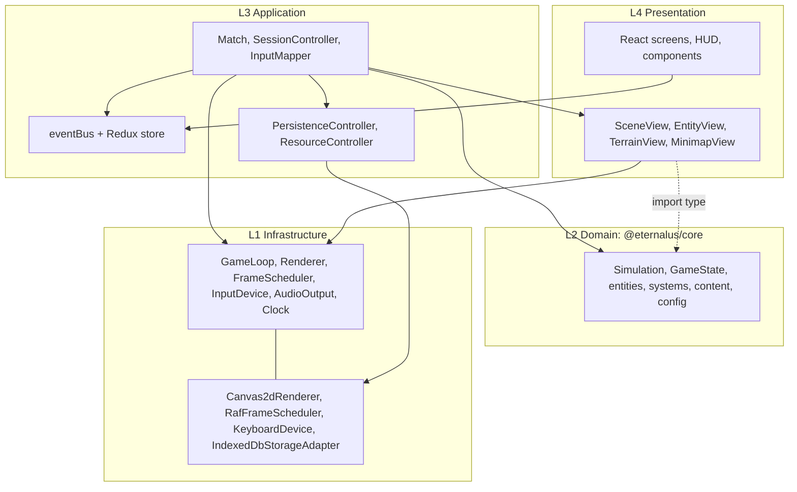

# Layered OOP model

**Purpose.** Read this when you need to decide _where_ a piece of code belongs and _what it may
import_. It defines the four layers, the dependency rules between them, the ports (interfaces) each
layer owns, the twelve architecture rules and their enforcement, the engine-portability contract
(what survives a later move to Unity or Unreal) and the SOLID principle each boundary serves. It
supersedes the layering sections of the old `docs/architecture.md`; nothing described here exists
as code yet (the repo is scaffolding), so every snippet is a **sketch** of what we will build.

## 1. The four layers

The layers are numbered by how much they know about Eternalus: L1 knows nothing about the game
(it could ship as a tiny generic engine), L2 knows the game rules but nothing about the browser,
L3 knows both and wires them together, and L4 only knows what L3 publishes.

| Layer | Name           | Location                                                                                                    | Contains                                                                                                                                                                                                                                                                             |
| ----- | -------------- | ----------------------------------------------------------------------------------------------------------- | ------------------------------------------------------------------------------------------------------------------------------------------------------------------------------------------------------------------------------------------------------------------------------------ |
| L4    | Presentation   | `apps/client/src/ui/`, `apps/client/src/game/views/`                                                        | React screens, HUD and components; Canvas views (`SceneView`, `EntityView`, `TerrainView`, `MinimapView`) that draw `Snapshot`s through the `Renderer` port                                                                                                                          |
| L3    | Application    | `apps/client/src/game/` (except `engine/` and `views/`), `apps/client/src/bridge/`, `apps/client/src/data/` | `Match` (composition root of a match), `SessionController` (boot → menu → loading → match → results), `InputMapper` (device → `InputAction` → `InputIntent`), `bridge/` (event bus + Redux store), `PersistenceController`, `ResourceController`                                     |
| L2    | Domain         | `packages/core/src/`                                                                                        | The simulation: `Simulation`, `GameState`, entities, components, strategies, systems, commands, `GameEvents`, content and config, map generation, AI controllers, physics, `MatchDirector`, diagnostics invariants, and the ports `Logger` and `Rng`                                 |
| L1    | Infrastructure | `apps/client/src/game/engine/`, adapters under `apps/client/src/data/`                                      | The mini engine as hardware abstraction: `GameLoop`, `FrameScheduler` + `RafFrameScheduler`, `Renderer` + `Canvas2dRenderer`, `Camera`, `KeyboardDevice`/`MouseDevice`/`GamepadDevice`, `AudioOutput` + `WebAudioOutput`, `Clock`; `IndexedDbStorageAdapter`, `MemoryStorageAdapter` |

Arrows are the only allowed import directions. Note the two deliberate asymmetries: L2 imports
nothing from the client at all (not even L1, which is physically inside `apps/client`), and the
composition root `Match` is allowed to import L4 views because binding abstractions to concrete
classes is its one job.

## 2. Who may import whom

| Folder (layer)                                                   | May import                                                                                                                  | Must never import                                                                   |
| ---------------------------------------------------------------- | --------------------------------------------------------------------------------------------------------------------------- | ----------------------------------------------------------------------------------- |
| `ui/` (L4)                                                       | `bridge/`, `ui/`, `styles/`                                                                                                 | `game/`, `data/`, `@eternalus/core`                                                 |
| `game/views/` (L4)                                               | `@eternalus/core` as `import type` only (`Snapshot` types), `game/engine/` port types (`Renderer`, `Camera`), `game/views/` | core classes or systems, `bridge/`, `ui/`, `data/`; views never mutate anything     |
| `game/Match.ts`, `game/SessionController.ts`, `game/input/` (L3) | `@eternalus/core`, `game/engine/`, `game/views/`, `game/input/`, `bridge/`, `data/`                                         | `ui/`                                                                               |
| `bridge/` (L3)                                                   | `@eternalus/core` as `import type` only, `bridge/`                                                                          | `game/`, `ui/`, `data/`                                                             |
| `data/` (L3 facades, L1 adapters)                                | `@eternalus/core` as `import type` only (domain types crossing the DTO boundary), `data/`                                   | `game/`, `ui/`, `bridge/`                                                           |
| `packages/core/src/` (L2)                                        | itself                                                                                                                      | anything under `apps/`, React, Redux, DOM, Canvas, Node                             |
| `game/engine/` (L1)                                              | browser APIs, `game/engine/`                                                                                                | `@eternalus/core`, `game/views/`, `game/input/`, `Match`, `bridge/`, `ui/`, `data/` |

Inside core the same idea repeats at folder level (`content/` and `utils/` at the bottom,
`Simulation.ts` at the top); the per-folder lists are in
[02-code-structure.md](02-code-structure.md).

## 3. Ports and adapters on top of the layers

Layering says who may know whom; ports and adapters say _how_ a higher layer uses a lower one
without depending on its concrete class. A **port** is an `interface` owned by the code that needs
the capability; an **adapter** is a class that implements it against a real API. Every adapter has
a test double so the code that depends on the port can be tested in Node.

| Port             | Owned by (file)                                      | Layer | Adapters (production / test)                                         | Injected by                             |
| ---------------- | ---------------------------------------------------- | ----- | -------------------------------------------------------------------- | --------------------------------------- |
| `Rng`            | `packages/core/src/utils/Rng.types.ts`               | L2    | `SeededRandom` (sfc32) / `SeededRandom` with a fixed seed            | `Simulation` from the match seed        |
| `Logger`         | `packages/core/src/diagnostics/Logger.types.ts`      | L2    | `ConsoleSink`, `RingBufferSink` (client) / `MemoryLogger`            | `Match` into `Simulation`               |
| `Renderer`       | `apps/client/src/game/engine/render/Renderer.ts`     | L1    | `Canvas2dRenderer` / `RecordingRenderer`                             | `Match` into views                      |
| `FrameScheduler` | `apps/client/src/game/engine/loop/FrameScheduler.ts` | L1    | `RafFrameScheduler` / `FakeFrameScheduler`                           | `Match` into `GameLoop`                 |
| `InputDevice`    | `apps/client/src/game/engine/input/InputDevice.ts`   | L1    | `KeyboardDevice`, `MouseDevice`, `GamepadDevice` / `FakeInputDevice` | `Match` into `InputMapper`              |
| `AudioOutput`    | `apps/client/src/game/engine/audio/AudioOutput.ts`   | L1    | `WebAudioOutput` / `NullAudioOutput`                                 | `Match`                                 |
| `Clock`          | `apps/client/src/game/engine/time/Clock.ts`          | L1    | `PerformanceClock` / `FakeClock`                                     | `GameLoop`                              |
| `StorageAdapter` | `apps/client/src/data/persistence/StorageAdapter.ts` | L3    | `IndexedDbStorageAdapter` / `MemoryStorageAdapter`                   | `main.tsx` into `PersistenceController` |

Two consequences worth spelling out. First, core defines only the two ports it genuinely needs
(`Rng`, `Logger`); everything else about the platform is invisible to it, which is what makes the
simulation runnable in Vitest, in a Web Worker later (decided, D8) or, translated, inside another
engine. Second, the engine's ports live _with_ their default adapters in `game/engine/` because
the engine is a self-contained library: `Match` (L3) sees only the port types and chooses the
adapter. The `StorageAdapter` port lives in L3 (`data/persistence/`) because its consumer, the
`PersistenceController`, is L3; its adapters are L1 in role even though they sit in the same
folder (decided, D3).

Constructor injection is the only wiring mechanism. There is no Service Locator and no singleton
apart from the Redux store and the bridge event bus (both in `bridge/`, both L3). If a class needs
a port, it takes it as a constructor parameter and the composition root (`Match`, `main.tsx` or a
test) passes the adapter.

## 4. The architecture rules

The twelve rules from `AGENTS.md`, restated with the planned folder names. "Review" means the
rule is checked by reviewers (and the `pr-review` skill) until a lint rule exists.

| #   | Rule                                                                                                                                                    | Why                                                                                               | Enforced by                                                                                                                              |
| --- | ------------------------------------------------------------------------------------------------------------------------------------------------------- | ------------------------------------------------------------------------------------------------- | ---------------------------------------------------------------------------------------------------------------------------------------- |
| 1   | `packages/core` imports nothing from React, the DOM, Canvas or Node                                                                                     | The simulation must run anywhere (tests, workers, replays, another engine) and stay deterministic | `packages/core/tsconfig.json` (`lib: ES2023`, `types: []`), ESLint `no-restricted-imports`                                               |
| 2   | Dependencies point `client → core` only                                                                                                                 | Keeps core independent and testable in isolation                                                  | ESLint `no-restricted-imports` (`@eternalus/client` banned in core), TypeScript project references                                       |
| 3   | Import core only as `@eternalus/core`                                                                                                                   | `packages/core/src/index.ts` is the contract; internals can change freely                         | The package `exports` map (deep paths do not resolve)                                                                                    |
| 4   | No import cycles                                                                                                                                        | Cycles hide bad layering and cause init-order bugs                                                | Review. Recommendation: `import/no-cycle` once an ESLint import plugin is approved                                                       |
| 5   | `ui/` imports only `bridge/`, `ui/`, `styles/`                                                                                                          | React must not reach into the engine; one data path (the store) keeps UI predictable              | Review. Recommendation: per-folder `no-restricted-imports` blocks (sketch in 02-code-structure.md §11)                                   |
| 6   | `game/views/` never imports core systems or mutates state; it uses `import type` from core only                                                         | Views are pure drawing; logic in views would desync rendering from the simulation                 | Review, same planned lint block                                                                                                          |
| 7   | Only `game/engine/render/Canvas2dRenderer.ts` touches the Canvas 2D context                                                                             | One place to optimise, batch or swap rendering; views stay testable with `RecordingRenderer`      | Review                                                                                                                                   |
| 8   | core never uses `Math.random`, `Date`, `performance.now`, `setTimeout`, `setInterval`; transcendental `Math.*` only inside `utils/deterministicMath.ts` | Determinism: same seed + same commands = same match                                               | ESLint `no-restricted-properties` (`Math.random`; `Math.sin`/`cos`/`atan2`/`exp`/`pow`, ADR 0012), tsconfig (no DOM/Node timers), review |
| 9   | The simulation advances only in fixed ticks; input and bots produce `Command`s applied on the next tick                                                 | Frame-rate independence and determinism                                                           | Design (`Simulation.step`, `GameLoop`) + review                                                                                          |
| 10  | Game state is the single source of truth; React shows throttled snapshots                                                                               | Avoids two sources of truth and 60 Hz React renders                                               | Design (`bridge/`) + review                                                                                                              |
| 11  | Tuning numbers and display names live in `packages/core/src/content/`, looked up by kebab-case ID                                                       | Tuning without code changes; stable IDs survive renames                                           | Review                                                                                                                                   |
| 12  | Systems communicate through typed `GameEvents`, not direct calls                                                                                        | Systems stay independent, reorderable and testable                                                | Review; the `System` interface receives a `SystemContext`, never another system                                                          |

The design in this folder adds six rules that are not yet in `AGENTS.md`. Recommendation: promote
them at the Phase 0 review.

| #   | Rule                                                                                                                             | Why                                                                                                                  |
| --- | -------------------------------------------------------------------------------------------------------------------------------- | -------------------------------------------------------------------------------------------------------------------- |
| A   | `GameConfig` is validated once and injected into `Simulation`; no module reads config from a global                              | "Change three values in a config file and the map adjusts" only works if there is exactly one config object          |
| B   | Every entity removal carries a `RemovalCause` and every death a killer or cause; an invariant checks it every tick               | The runtime monitoring the requirements ask for ("if something despawns without something else removing it, log it") |
| C   | `game/engine/` is generic: no game vocabulary (no "legend", "lane", "aether") appears in L1                                      | The engine stays swappable and the domain stays engine-free                                                          |
| D   | Constructor injection only; no Service Locator; the only singletons are the Redux store and the bridge event bus                 | Explicit dependencies are what make classes testable and translatable                                                |
| E   | Registries are the only places that list concrete classes: `EntityRegistry`, `AbilityRegistry`, `ViewRegistry`, `SystemPipeline` | The OCP litmus test: "new idea? add a class, a content entry and a registry line; nothing else changes"              |
| F   | Content definitions are immutable Flyweights; state stores IDs, never definition objects                                         | Snapshots, hashes and replays stay small and stable; hot-reloading content cannot corrupt state                      |

## 5. Engine portability

The long-term goal (requirements doc) is to move the finished design to a real engine in another
language. The layer model is what makes that a translation rather than a rewrite.

| Fate                                     | What                                                                                                                                                                                                                                                                                                                                           | How it translates                                                                                                                                                                                                                                                       |
| ---------------------------------------- | ---------------------------------------------------------------------------------------------------------------------------------------------------------------------------------------------------------------------------------------------------------------------------------------------------------------------------------------------- | ----------------------------------------------------------------------------------------------------------------------------------------------------------------------------------------------------------------------------------------------------------------------- |
| **Survives (translate line by line)**    | All of L2: the entity families and components, the strategies, the systems and their order, the `Command` union and `CommandQueue`, `GameEvents`, `GameState` and `Snapshot`, `MapGenerator`, the physics maths, the AI controllers, `MatchDirector` and the match rules, the diagnostics invariants, the content definitions and `GameConfig` | TypeScript `interface` → C# `interface` / C++ abstract class; `abstract class` → same; discriminated unions → tagged records or `std::variant`; string-literal unions → enums; `readonly` → `readonly`/`const`; content tables → ScriptableObjects, data assets or JSON |
| **Re-implemented against the same port** | `Renderer` (sprites, shapes, text), `FrameScheduler` (the engine's update callback), `InputDevice` (the engine's input system), `AudioOutput`, `StorageAdapter` (PlayerPrefs, SaveGame, files), `Logger` sinks                                                                                                                                 | One adapter class per port; the domain does not change                                                                                                                                                                                                                  |
| **Disposable**                           | React screens and HUD, Redux store and bridge, CSS Modules, `Canvas2dRenderer`, `RafFrameScheduler`, the browser devices, `IndexedDbStorageAdapter`, Vite and the npm tooling                                                                                                                                                                  | Replaced by the engine's UI toolkit and pipeline                                                                                                                                                                                                                        |

This is also why D1 chose full TypeScript: interfaces, abstract classes and access modifiers are the
constructs that map one-to-one onto C# and C++. Two habits keep the translation cheap: use
`interface` for every contract a class implements (structural typing does not exist on the other
side), and keep string-literal unions closed and small so they become enums.

## 6. SOLID and DRY, boundary by boundary

| Boundary                                                   | Principle | What it buys us                                                                                                                                                                                                  |
| ---------------------------------------------------------- | --------- | ---------------------------------------------------------------------------------------------------------------------------------------------------------------------------------------------------------------- |
| One layer per reason to change                             | SRP       | A rules change touches L2 only; a browser API change touches L1 only; a UI redesign touches L4 only; a new flow (rematch, spectate) touches L3 only                                                              |
| Registries and the `SystemPipeline` list                   | OCP       | New entity kinds, abilities, views and systems are added with a class plus a registry line; existing classes are not edited. The single place of change is the registry file                                     |
| Port + adapter pairs with contract tests                   | LSP       | `MemoryStorageAdapter` must pass the same contract test as `IndexedDbStorageAdapter`; `FakeFrameScheduler` the same as `RafFrameScheduler`. If a double could not substitute the real adapter, the port is wrong |
| Narrow ports and the `Simulation` facade                   | ISP       | Views see draw primitives, never the 2D context; systems see a `SystemContext`, never `Simulation`; the client sees four methods on `Simulation` (`enqueueCommand`, `step`, `snapshot`, `on`)                    |
| Ports owned by the consumer; adapters injected by the root | DIP       | L2 defines `Rng` and `Logger`; L3 injects them. L1 adapters implement ports they do not own. No layer news up a class from a layer above it                                                                      |
| One source of truth per fact                               | DRY       | Game state (not React state) is the truth; content by ID (not literals in code); one `GameConfig`; one keybindings table; one draw order in `SceneView`; one system order in `SystemPipeline`; one Redux store   |

## 7. Adding a new folder

Top-level folders are listed in [02-code-structure.md](02-code-structure.md); agents do not invent
new ones. When the team agrees a folder is needed:

1. Decide its layer and write its may-import list (a subset of what its layer allows in §2).
2. Add it to the tree and the folder table in `02-code-structure.md`, and to the folder table of
   the package `AGENTS.md` (`packages/core/AGENTS.md` or `apps/client/AGENTS.md`).
3. If it has an import boundary worth protecting, add a `no-restricted-imports` block for it in
   `eslint.config.js` (see `02-code-structure.md` §11 for the shape).
4. Do not add a barrel `index.ts` inside the folder: the only public surface of core is
   `packages/core/src/index.ts`, and client folders import by file path (knip flags unused
   re-exports, and barrels invite cycles).
5. If the folder introduces a new registry, add it to the "single place of change" list in
   `02-code-structure.md` §9 and write a recipe for it in `17-extension-recipes.md`.

## Related

- [02-code-structure.md](02-code-structure.md): the full planned tree and per-folder import lists.
- [03-game-model.md](03-game-model.md): `Simulation`, `GameState`, commands, events, snapshots.
- [04-entity-architecture.md](04-entity-architecture.md): the entity families and registries.
- [08-game-engine.md](08-game-engine.md) and [09-hardware-abstraction.md](09-hardware-abstraction.md): the L1 ports and adapters in detail.
- [14-persistence-and-resources.md](14-persistence-and-resources.md): `PersistenceController`, `StorageAdapter`, `ResourceController`.
- [17-extension-recipes.md](17-extension-recipes.md): step-by-step recipes for every kind of addition.
- [../requirements/01-architecture-principles.md](../requirements/01-architecture-principles.md): the principles these layers implement.
- [../decisions/](../decisions/): ADRs 0003 (TypeScript), 0004 (React + Redux), 0005 (IndexedDB), 0006 (entity model).
- Research: [../research/game-architecture-and-performance-research.md](../research/game-architecture-and-performance-research.md) §2 (entity models), §8 (workers), §10 (reference architectures).
