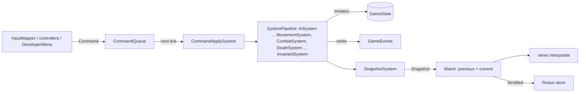

# Game model

**Purpose.** Read this when you work on anything that reads or changes match state: it defines the
`GameState` aggregate, the `Command` and `GameEvents` contracts through which state changes and is
observed, the `Snapshot` the client renders, the `Simulation` facade, the fixed-timestep and
determinism rules that make every match replayable, and the `GameConfig` that shapes the world.
Everything here is a **sketch** of planned code; the exact names are the ones to use when the code
is written. The existing loop, command and event design from the old `docs/architecture.md` is
carried over unchanged.

## 1. One tick, end to end



`Simulation.step()` runs the systems in the fixed order of the `SystemPipeline` (the list in
[02-code-structure.md](02-code-structure.md) §9), advances `tick`, and emits `tick-completed`.
Nothing outside core mutates state; nothing inside core reads the wall clock.

## 2. `GameState`, the aggregate root

```ts
// Sketch: packages/core/src/state/GameState.ts
export class GameState {
  public readonly config: GameConfig;
  public readonly rng: SeededRandom; // the only source of randomness
  public readonly entities: EntityStore; // deterministic, creation-order iteration
  public readonly world: WorldMap; // grid, cost field, flow fields, structures index
  public readonly teams: Readonly<Record<Team, TeamState>>; // score, structures alive, buffs, spawn counters (18 §3.4)
  public readonly hordes: HordeRegistry; // Horde aggregates (not entities)
  public readonly events: GameEvents;
  public readonly recentCommands: RingBuffer<TimedCommand>; // post-mortem context; recent events: events.recentEvents() (§4)

  public get tick(): number;
  public get phase(): MatchPhase;
  public advanceTick(): void; // called once per step(), by Simulation only
  public setPhase(next: MatchPhase): void; // called by MatchDirector only; emits 'phase-changed'
}
```

`EntityStore` keeps entities in insertion order (DEC-20), which is creation order: every `EntityId`
comes from a monotonically increasing counter (`utils/IdGenerator`) and is never reused. `forEach`
visits in that order, which is the iteration order every system uses (research
[§1](../research/game-architecture-and-performance-research.md#1-fixed-timestep-interpolation-and-determinism)).
Ids are strings (`entity-12`), so code that needs a total order compares them as strings or keeps
store order; it never sorts them as numbers. `remove(id, cause)` is the only way out and always
carries a `RemovalCause` (`'died' | 'despawned' | 'consumed' | 'dev-removed' | 'match-ended'`, plus
the killer for `'died'`); an invariant checks no entity disappears any other way. The store never
exposes a `Map` for iteration.

`GameState` is mutable only inside `Simulation.step()`, and only through component methods that
guard their own invariants (`Health.applyDamage` clamps; `Team.setTeam` emits `team-changed`).
It stores **ids of content**, never definition objects, so hashing, snapshots and replays see plain
numbers and strings ([§11](#11-content-by-id-never-embedded)).

## 3. Commands

Every change of intent enters as a `Command`: a plain, serialisable, discriminated object with the
actor's id. Player input, bots and the developer menu produce the same union, so the recorded
command log is a complete replay and cheats are replayable too.

```ts
// Sketch: packages/core/src/commands/Command.types.ts (fields per type in `CommandPayloads`)
export type Command =
  | { readonly type: 'move'; readonly actorId: EntityId; readonly direction: Vec2 }
  | { readonly type: 'stop'; readonly actorId: EntityId } // clears heading and attack target (18 §6.1)
  | { readonly type: 'attack-target'; readonly actorId: EntityId; readonly targetId: EntityId }
  | {
      readonly type: 'cast-ability';
      readonly actorId: EntityId;
      readonly slot: AbilitySlot;
      readonly aim: Aim;
    }
  | { readonly type: 'intent'; readonly actorId: EntityId; readonly intent: InputIntent } // the human's per-tick input (11 §4.1)
  | { readonly type: 'pick-up'; readonly actorId: EntityId; readonly targetId: EntityId }
  | { readonly type: 'throw'; readonly actorId: EntityId; readonly aim: Aim }
  | { readonly type: 'interact'; readonly actorId: EntityId; readonly targetId: EntityId }
  | {
      readonly type: 'dev-spawn';
      readonly kind: EntityKind;
      readonly definitionId: string;
      readonly team: Team;
      readonly at: Vec2;
      readonly count: number;
    }
  | {
      readonly type: 'dev-spawn-mobs'; // one horde (13 §4, 18 §3.5)
      readonly team: PlayableTeam;
      readonly definitionId: string;
      readonly count: number;
      readonly origin: SpawnOrigin; // a structure, `{ lane, t }` or a point
    }
  | { readonly type: 'dev-remove-entity'; readonly entityId: EntityId }
  | {
      readonly type: 'dev-set-controller';
      readonly entityId: EntityId;
      readonly controllerId: ControllerId;
    }
  | { readonly type: 'dev-set-assert-level'; readonly level: AssertLevel };
```

- `CommandQueue` is drained once (DEC-20), at the start of each `step()`, in enqueue order; a
  command enqueued while a step runs (a bot deciding during `AiSystem`) waits for the next drain, so
  every command applies exactly one tick boundary after it was issued. The client enqueues the
  human's commands first, then controllers enqueue in store order during `AiSystem`, so the order is
  deterministic.
- `applyCommand(command, handlers, ctx)` dispatches to the handler registered for
  `command.type` (DEC-20): one `CommandHandler` class per type in `commands/handlers/`, listed in
  `commands/defaultCommandHandlers.ts` (the single place of change, 02 §9). The registry's type
  needs a handler for every union member, so a new command does not compile until its handler
  exists. A handler validates (actor alive, slot ready, caps such as `maxLegendsPerTeam` not
  exceeded) and returns a `CommandRejectReason` instead of throwing; `applyCommand` announces it
  as `command-rejected`.
- `dev-*` commands are the developer menu (requirements: add/remove Legends, spawn mobs from
  chosen origins, sim mode). They are ordinary commands so they appear in the log, respect the
  caps, and are covered by the same tests. `Match` only forwards them when the developer menu is
  enabled.

## 4. `GameEvents`, the typed channel

```ts
// Sketch: packages/core/src/state/GameEvents.ts
export class GameEvents {
  public on<K extends keyof GameEventMap>(type: K, handler: GameEventHandler<K>): Unsubscribe;
  public off<K extends keyof GameEventMap>(type: K, handler: GameEventHandler<K>): void;
  public emit<K extends keyof GameEventMap>(type: K, payload: GameEventMap[K]): void; // synchronous
  public recentEvents(): readonly TimedEvent[];
}
```

Events are synchronous, emitted during the tick and delivered to listeners in subscription order;
listeners that need to change state defer the change to their own system's pass (Nystrom's Observer
plus a deferred queue, research §2). `GameEvents` keeps the most recent events in a `RingBuffer`
(`recentEvents()`, capacity in `GameEvents.constants.ts`) for invariant reports. Payload objects for
high-frequency events (`damage-applied`) may be pooled (Recommendation, profile first).

| Event                               | Payload                                                | Emitted by                        | Typical listeners                                                  |
| ----------------------------------- | ------------------------------------------------------ | --------------------------------- | ------------------------------------------------------------------ |
| `entity-spawned`                    | `{ entityId, kind, team }`                             | `EntityFactory` via `SpawnSystem` | `SnapshotSystem`, views                                            |
| `entity-removed`                    | `{ entityId, cause: RemovalCause, killer? }`           | `DeathSystem` only                | `HordeSystem`, `ProjectilePool`, invariants                        |
| `damage-applied`                    | `{ targetId, amount, absorbed, source: DamageSource }` | `DamagePipeline`                  | `ProgressionSystem` (assists), `AiSystem` (aggro)                  |
| `entity-died`                       | `{ entityId, killer: DamageSource }`                   | `DeathResolver`                   | `DeathSystem`, `ProgressionSystem`, `Scoring`                      |
| `structure-destroyed`               | `{ entityId, kind, team, lane }`                       | `StructureSystem`                 | `SpawnSystem` (enraged hordes), `StructureSystem` (walls, shields) |
| `shield-bars-changed`               | `{ entityId, bars }`                                   | `StructureSystem`                 | HUD, views                                                         |
| `capture-progress`                  | `{ pointId, team, progress, checkpoint }`              | `CaptureSystem`                   | HUD, `MinimapView`                                                 |
| `capture-point-owner-changed`       | `{ pointId, from, to }`                                | `CaptureSystem`                   | `Scoring`, `MatchDirector`, `StatusEffectSystem`                   |
| `phase-changed`                     | `{ from, to }`                                         | `MatchDirectorSystem`             | `SpawnSystem`, `Announcer`                                         |
| `ability-cast`                      | `{ casterId, abilityId, slot }`                        | `AbilitySystem`                   | views (VFX), `Announcer`                                           |
| `status-applied`                    | `{ entityId, statusId, sourceId }`                     | `StatusEffectApplier` (DEC-41)    | views, HUD                                                         |
| `status-expired`                    | `{ entityId, statusId, sourceId }`                     | `StatusEffectSystem`              | views, HUD                                                         |
| `horde-spawned` / `horde-dissolved` | `{ hordeId, lane, team, memberIds }`                   | `SpawnSystem` / `HordeSystem`     | `MinimapView`                                                      |
| `level-up`                          | `{ entityId, level }`                                  | `ProgressionSystem`               | `AbilitySystem` (scaling), HUD                                     |
| `team-changed`                      | `{ entityId, from, to, cause }`                        | `Team` component                  | `HordeSystem`, views                                               |
| `boss-summoned`                     | `{ entityId, kind }`                                   | `SpawnSystem` (timeline)          | `Announcer`, `AiSystem` (camps turn aggressive)                    |
| `command-rejected`                  | `{ command, reason }`                                  | `applyCommand`                    | `DeveloperMenu`, tests                                             |
| `collision-anomaly`                 | `{ entityId, from, to, colliderId }`                   | `CollisionSystem`                 | `InvariantSystem`, `Logger`                                        |
| `invariant-violated`                | `{ invariantId, tick, details }`                       | `InvariantRunner`                 | `Logger`, `PerfOverlay`, tests (throw)                             |
| `tick-completed`                    | `{ tick }`                                             | `Simulation`                      | `Match` (publish snapshot, throttle to the store)                  |

Systems subscribe in their constructor and never call another system. `Simulation.on()` exposes
the same channel to the client; the bridge re-publishes a throttled subset to React.
`GameEventMap` (`state/GameEvents.types.ts`) lives below `commands/`, so a payload that carries a
higher layer's value types it structurally: `command-rejected.command` is `{ type: string }`,
`ability-cast.slot` a string.

## 5. `Snapshot`

`SnapshotSystem` is the last system of the tick and produces an immutable, structured-clone-safe
DTO: plain objects, arrays, numbers and strings, no class instances, functions or `Map`s, so it
can be `postMessage`d to a Worker later without change (decided, D8; research §8).

```ts
// Sketch: packages/core/src/state/Snapshot.types.ts
export type Snapshot = {
  readonly tick: number;
  readonly phase: MatchPhase;
  readonly entities: readonly EntitySnapshot[]; // store (creation) order
  readonly hordes: readonly HordeSnapshot[];
  readonly teams: Readonly<Record<Team, TeamSnapshot>>;
  readonly player: PlayerSnapshot | null; // HUD data for the human Legend
  readonly mapRevision: number; // increments when destructible terrain changed
};

// One group per component; a group is null when the entity has no such component, so a view
// never draws a made-up value (DEC-17).
export type EntitySnapshot = {
  readonly id: EntityId;
  readonly kind: EntityKind;
  readonly family: EntityFamily;
  readonly definitionId: string;
  readonly team: Team | null;
  readonly transform: {
    readonly x: number;
    readonly y: number;
    readonly radius: number;
    readonly facing: number;
  } | null;
  readonly health: {
    readonly current: number;
    readonly max: number;
    readonly shieldBars: readonly number[];
  } | null;
  readonly statusIds: readonly StatusEffectId[];
  readonly anim: AnimState;
};
```

`Match` keeps the two latest snapshots (`previous`, `current`); `SceneView.draw(previous, current,
alpha)` pairs the entities of both by id (both arrays are in store order; an entity spawned or
removed between them is in one only) and lerps positions (the research's "two positions per
entity, stored in the snapshot, never in the entity"). `mapRevision` lets `TerrainView` and
`MinimapView` rebuild their cached layers only when terrain changed (Dirty Flag).

## 6. The `Simulation` facade

```ts
// Sketch: packages/core/src/Simulation.ts
export type SimulationOptions = {
  readonly config: GameConfig;
  readonly content: ContentCatalogue;
  readonly seed: number;
  readonly logger: Logger;
  readonly debug?: DebugConfig; // { assertLevel: 'off' | 'light' | 'heavy'; heavyEvery: number }
};

export class Simulation {
  public constructor(options: SimulationOptions); // validates config and content, builds the pipeline
  public get tick(): number;
  public enqueueCommand(command: Command): void; // applied at the start of the next step()
  public step(): void; // exactly one tick, never fractional
  public snapshot(): Snapshot;
  public on<K extends keyof GameEventMap>(type: K, handler: GameEventHandler<K>): Unsubscribe;
  public hash(): number; // StateHasher over the canonical state
  public exportReplay(): Replay;
  public dispose(): void;
}
```

The facade is what the client, tests and replays drive; its constructor is the composition root of
core (registries, `SystemPipeline`, `MatchDirector`, `InvariantRunner`). It takes every dependency
through `SimulationOptions`: no globals, no module-level singletons.

## 7. The fixed-timestep contract

The simulation advances only in whole ticks of `TICK_MS = 1000 / config.tickRate` (30 ticks/s,
decided D9). Rendering happens on every animation frame and interpolates between the last two
ticks. The loop lives in the client's `GameLoop` (L1); the contract it must honour is this:

```
requestAnimationFrame(t)
  accumulator += min(t - lastT, MAX_FRAME_MS)   // clamp: a background tab cannot demand thousands of ticks
  while accumulator >= TICK_MS:
      Match.tick()        // human InputIntent → Commands, simulation.step(), rotate previous/current
      accumulator -= TICK_MS
  Match.render(alpha = accumulator / TICK_MS)    // views lerp between previous and current
```

- `MAX_FRAME_MS = 5 * TICK_MS` (`TUNE`, from the existing design; Fiedler caps at 0.25 s and
  four steps per frame, research §1). The game slows down instead of spiralling.
- `step()` is called exactly once per tick and never with a fraction. Core never learns `t`.
- Bots decide during tick N (`AiSystem`) and their commands apply in tick N+1, like the human's.
- Tests drive `GameLoop` with `FakeFrameScheduler` and drive `Simulation` directly with `step()`.

## 8. Determinism rules

Same seed + same command log = same match, bit for bit, on the same machine and browser. The
JavaScript-specific hazards and their rules (research §1, table "Determinism pitfalls"):

| Hazard                                    | Rule in core                                                                                                                                                                                                | Enforcement                                                       |
| ----------------------------------------- | ----------------------------------------------------------------------------------------------------------------------------------------------------------------------------------------------------------- | ----------------------------------------------------------------- |
| `Math.random()`                           | Only seeded RNGs: `GameState.rng` (`SeededRandom`, sfc32, seeded from the match seed), which systems reach as `SystemContext.state.rng`, and the `Rng` that `MapGenerator` creates from its seed (ADR 0009) | ESLint `no-restricted-properties` (exists)                        |
| `Date`, `performance.now`, timers         | Time is `tick`; durations are ticks converted from seconds at load                                                                                                                                          | tsconfig (no DOM/Node types); planned `no-restricted-globals`     |
| `Map`/`Set`/object iteration order        | Never drive simulation order from a `Map`; iterate `EntityStore` (creation order) or arrays built in tick order                                                                                             | Review; `EntityStore` API exposes no `Map`                        |
| `Array.prototype.sort` comparators        | Comparators are pure and total; ties broken by entity id                                                                                                                                                    | Review; `utils/compareById`                                       |
| Transcendental `Math.*`                   | `sin`, `cos`, `atan2`, `exp`, `pow` only through `utils/deterministicMath.ts`; steering works with vectors, never angles                                                                                    | ESLint `no-restricted-properties` with a file override (ADR 0012) |
| Update order and removal during iteration | Fixed `SystemPipeline` order; spawns and removals are deferred to `SpawnSystem`/`DeathSystem`                                                                                                               | Design + `InvariantSystem`                                        |
| Floats                                    | Doubles are fine for single-machine replays; revisit fixed point only for networked lockstep                                                                                                                | None needed                                                       |

## 9. `StateHasher` and replays

`StateHasher` computes a 32-bit FNV-1a hash (offset basis `0x811c9dc5`, prime `0x01000193`,
`Math.imul`; research
[persistence C3](../research/persistence-input-diagnostics-research.md#c3-testing-a-running-game-properties-replays-golden-hashes-soak-tests))
over a canonical serialisation of its own (DEC-20): `tick`, `phase`, the RNG state, then every
entity in store order with its component fields in a fixed order, including state the client never
sees (velocity). It does not hash the snapshot, so the hash covers what the snapshot leaves out; a
component with simulation state adds its fields in `StateHasher`. `Simulation.hash()` is cheap
enough to call every N ticks in tests and on demand from the developer menu.

```ts
// Sketch: packages/core/src/diagnostics/Replay.types.ts
export type Replay = {
  readonly versions: { readonly core: string; readonly content: string; readonly schema: number };
  readonly seed: number;
  readonly config: GameConfig;
  readonly commands: readonly { readonly tick: number; readonly command: Command }[];
  readonly checkpoints: readonly { readonly tick: number; readonly hash: number }[];
};
```

A replay is seed + config + command log + versions; `runReplay(replay, createTarget)` builds a
fresh `Simulation` through the factory it is given (so `diagnostics/` never imports
`Simulation`), feeds the commands at their ticks, and compares `hash()` at each checkpoint.
Replays are the regression-test format (fixtures under `__fixtures__/`, format in
[15](15-diagnostics-and-runtime-testing.md) §7), the bug-report format (the developer menu can dump
one) and the match-history record persisted by `ReplayRepository`.

## 10. `GameConfig`

The world is generated from config (decided, D7): change `numLanes` and the map, the towers, the
flow fields and the spawn schedule follow. Config is a plain object, validated once, injected into
`Simulation` and never imported as a global (rule A in 01-layered-oop-model.md §4).

```ts
// Sketch of the target: the integration contract §2.2 fields (config/GameConfig.types.ts) plus
// the three planned MatchConfig fields
export type GameConfig = {
  readonly tickRate: number;
  readonly map: MapConfig; // 06 §2: counts, world size, nav cell size and preset; lane and rift layout is MapLayout content
  readonly match: MatchConfig;
  readonly limits: LimitsConfig;
};

export type MatchConfig = {
  readonly legendsPerTeam: number;
  readonly legendsPerLane: number;
  readonly countdownSeconds: number;
  readonly hordeSizes: { readonly light: number; readonly medium: number; readonly heavy: number };
  readonly initialHordesPerTeam: number;
  readonly plannedMatchSeconds: number;
  readonly hordeSpawnIntervalSeconds: number;
  readonly capturePoints: CapturePointConfig;
  readonly timeline: readonly MatchTimelineEntry[];
};

export type LimitsConfig = {
  readonly maxLegendsPerTeam: number;
  readonly maxUnitsPerTeam: number;
};
```

The MVP defaults live in `config/defaultGameConfig.ts` (marked `TUNE` where provisional) and the
requirement ceilings in `config/GameConfig.constants.ts`; this table records where each comes from.

| Field                                     | Meaning                                                                | Source                                     |
| ----------------------------------------- | ---------------------------------------------------------------------- | ------------------------------------------ |
| `tickRate`                                | the one supported rate                                                 | decided, D9                                |
| `numLanes`                                | odd, so the Cathedral sits on the middle lane                          | requirements doc, MVP list; 06 §2          |
| `spawnTowersPerLane`, `buffTowersPerLane` | per lane and team                                                      | requirements doc                           |
| `campsPerSide`                            | placed between lanes                                                   | requirements doc                           |
| `cornerCamps`                             | **MVP-if-time**; 0 disables                                            | game doc, Outer (Corner) Camps             |
| `legendsPerTeam`, `legendsPerLane`        | the lane Legends plus the Rover                                        | game doc, Minions and lanes; contract §2.1 |
| `maxLegendsPerTeam`, `maxUnitsPerTeam`    | caps the developer menu and spawners respect                           | requirements doc, developer menu           |
| `countdownSeconds`                        | only the initial hordes spawn                                          | requirements doc                           |
| `hordeSizes`, `initialHordesPerTeam`      | one initial horde per lane, from the stronghold                        | requirements doc                           |
| `plannedMatchSeconds`                     | the target match length                                                | DEC-13 (pending)                           |
| `capturePoints`, `timeline`               | one capture point per lane, the middle one the Cathedral; timed events | game doc, Capture zones; 12                |

`validateGameConfig(config: unknown)` throws a `ConfigValidationError` naming the first offending
field (`path`) and its `rule` (integration contract §2.2), and returns the config typed when every
rule holds; `Simulation` validates in its constructor, so it never starts on a bad config. The rules
live in `config/validateGameConfig.ts`, cross-field rules after the fields they read: whole numbers
where counts are meant, `tickRate` the supported rate, caps within the requirement ceilings,
`maxUnitsPerTeam >= initialHordesPerTeam * hordeSizes.light`, the map rules of 06 §2; timeline
entries ordered is a `Recommendation:`, and `campsPerSide` need not divide by the corridors
(DEC-14). Time fields are authored in seconds and converted to ticks once at construction, so
systems only ever see ticks. `Match` builds the config from `createDefaultGameConfig()` plus
developer-menu overrides (`map.presetId` picks a `MapPreset`, which shapes the ground and the lanes
but never sets a count, DEC-14); tests build it inline with
`createDefaultGameConfig({ map: { numLanes: 5 } })` and assert the derived counts.

## 11. Content by ID, never embedded

Entities carry a `definitionId`; systems resolve it through the injected `ContentCatalogue`
(`content.legend('warrior')`), which returns a shared immutable definition (Flyweight). State,
snapshots, replays and hashes therefore contain only ids, and a definition can be re-tuned (or
hot-reloaded in development, research §9) without touching a running `GameState`. The client
loads the same catalogue through `loadDefaultContent()` for the loadout screen and for sprites, so
a view never needs anything from the entity beyond its `definitionId`.

## 12. Implementation status

The simulation kernel (sprint 1.1, PR #13) implements §2–§10 as written, with these interim gaps,
each closed by the session or phase named:

- `Simulation` takes `(config, seed, logger, systems = [])` (Sprint 1 brief); it becomes
  `SimulationOptions` when content and `debug` arrive (four parameters at most, CONTRIBUTING §4).
  No `exportReplay()` or `dispose()` yet. Its `EntityFactory` has an empty registry until session
  C passes `createDefaultEntityRegistry()` (marked `TODO` in `Simulation.ts`).
- `move`, `stop`, `attack-target`, `cast-ability`, `intent` and `dev-set-controller` are routed to
  `UnsupportedCommandHandler` (rejected `not-supported`) until their systems exist; `pick-up`,
  `throw`, `interact` and `dev-set-assert-level` are not in the union yet.
- `dev-spawn` and `dev-remove-entity` spawn and remove directly and emit `entity-spawned` /
  `entity-removed` themselves until `SpawnSystem` / `DeathSystem` exist (session C).
- `GameState.snapshot()` builds the snapshot until `SnapshotSystem` exists; `Snapshot` carries
  `tick`, `phase` and `entities`, and `EntitySnapshot` its identity, `team`, `transform`
  (`x`, `y`, `radius`) and `health` (`current`, `max`) groups only. `MatchPhase` lives in
  `state/GameState.types.ts` and stays `countdown` until `match/` exists (phase 4).
- `GameState` has no `world` yet; it has `hordes`, `teams` (the spawn
  counters only), the generated `map` and its `routes` since minion plan M1, and `ai`, `space`
  and `hordeRequests` since M2a (11, 18); `EntityFactory` keeps its
  own id counter until session C switches it to `IdGenerator`. `MatchConfig` has no
  `hordeSpawnIntervalSeconds`, `capturePoints` or `timeline` yet (they arrive with their systems).
- `Simulation.step()` applies the queued commands itself, before the pipeline (Sprint 1 brief),
  until `CommandApplySystem` heads the default `SystemPipeline` (§1).
- `Replay` has no `versions` yet (they arrive with the content catalogue).
- `map/` still reads its own `MapConfig`, `DEFAULT_MAP_CONFIG`, `MapRandom` and
  `validateMapConfig` until session A swaps to `GameConfig` and `SeededRandom` (06 §10).

## Related

- [01-layered-oop-model.md](01-layered-oop-model.md): why core owns no platform code.
- [02-code-structure.md](02-code-structure.md): where `state/`, `commands/` and `config/` sit.
- [04-entity-architecture.md](04-entity-architecture.md): what an entity in the store looks like.
- [06-map-and-minimap.md](06-map-and-minimap.md): how `MapGenerator` consumes `GameConfig`.
- [08-game-engine.md](08-game-engine.md): `GameLoop`, the accumulator and interpolation.
- [12-game-story-and-match-director.md](12-game-story-and-match-director.md): `MatchPhase` and the timeline.
- [15-diagnostics-and-runtime-testing.md](15-diagnostics-and-runtime-testing.md): invariants, hashes and soak tests.
- Research: [game architecture §1, §8, §9](../research/game-architecture-and-performance-research.md), [persistence A3, C3](../research/persistence-input-diagnostics-research.md).
