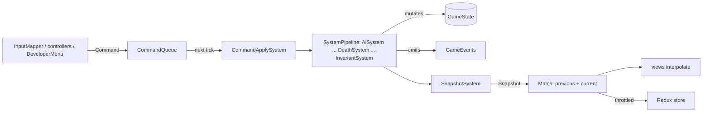

# Game model

**Purpose.** Read this when you work on anything that reads or changes match state: it defines the
`GameState` aggregate, the `Command` and `GameEvents` contracts through which state changes and is
observed, the `Snapshot` the client renders, the `Simulation` facade, the fixed-timestep and
determinism rules that make every match replayable, and the `GameConfig` that shapes the world.
Everything here is a **sketch** of planned code; the exact names are the ones to use when the code
is written. The existing loop, command and event design from the old `docs/architecture.md` is
carried over unchanged.

## 1. One tick, end to end



`Simulation.step()` runs the systems in the fixed order of the `SystemPipeline` (the list in
[02-code-structure.md](02-code-structure.md) §9), advances `tick`, and emits `tick-completed`.
Nothing outside core mutates state; nothing inside core reads the wall clock.

## 2. `GameState`, the aggregate root

```ts
// Sketch: packages/core/src/state/GameState.ts
export class GameState {
  public readonly config: GameConfig;
  public readonly rng: SeededRandom; // the only source of randomness
  public readonly entities: EntityStore; // deterministic, ascending-id iteration
  public readonly world: WorldMap; // grid, cost field, flow fields, structures index
  public readonly teams: Readonly<Record<TeamId, TeamState>>; // score, structures alive, buffs
  public readonly hordes: HordeRegistry; // Horde aggregates (not entities)
  public readonly events: GameEvents;
  public readonly recentCommands: RingBuffer<TimedCommand>; // post-mortem context
  public readonly recentEvents: RingBuffer<TimedEvent>;

  public get tick(): number;
  public get phase(): MatchPhase;
  public advanceTick(): void; // called once per step(), by Simulation only
  public setPhase(next: MatchPhase): void; // called by MatchDirector only; emits 'phase-changed'
}
```

`EntityStore` keeps entities in slots indexed by a monotonically increasing `EntityId` from
`IdGenerator`, with a free list so slots are reused but ids never are; `forEach` visits in
ascending id order, which is the iteration order every system uses (research
[§1](../research/game-architecture-and-performance-research.md#1-fixed-timestep-interpolation-and-determinism)).
`remove(id, cause)` is the only way out and always carries a `RemovalCause`
(`'died' | 'despawned' | 'consumed' | 'dev-removed' | 'match-ended'`, plus the killer for
`'died'`); an invariant checks no entity disappears any other way. The store never exposes a `Map`
for iteration.

`GameState` is mutable only inside `Simulation.step()`, and only through component methods that
guard their own invariants (`Health.applyDamage` clamps; `Team.setTeam` emits `team-changed`).
It stores **ids of content**, never definition objects, so hashing, snapshots and replays see plain
numbers and strings ([§11](#11-content-by-id-never-embedded)).

## 3. Commands

Every change of intent enters as a `Command`: a plain, serialisable, discriminated object with the
actor's id. Player input, bots and the developer menu produce the same union, so the recorded
command log is a complete replay and cheats are replayable too.

```ts
// Sketch: packages/core/src/commands/Command.types.ts
export type Command =
  | { readonly type: 'move'; readonly actorId: EntityId; readonly direction: Vec2 }
  | { readonly type: 'stop'; readonly actorId: EntityId }
  | { readonly type: 'attack-target'; readonly actorId: EntityId; readonly targetId: EntityId }
  | {
      readonly type: 'cast-ability';
      readonly actorId: EntityId;
      readonly slot: AbilitySlot;
      readonly aim: Aim;
    }
  | { readonly type: 'pick-up'; readonly actorId: EntityId; readonly targetId: EntityId }
  | { readonly type: 'throw'; readonly actorId: EntityId; readonly aim: Aim }
  | { readonly type: 'interact'; readonly actorId: EntityId; readonly targetId: EntityId }
  | { readonly type: 'dev-spawn-legend'; readonly team: TeamId; readonly definitionId: LegendId }
  | { readonly type: 'dev-remove-legend'; readonly entityId: EntityId }
  | {
      readonly type: 'dev-spawn-mobs';
      readonly team: TeamId;
      readonly definitionId: MobId;
      readonly count: number;
      readonly at: Vec2;
    }
  | {
      readonly type: 'dev-set-controller';
      readonly entityId: EntityId;
      readonly controllerId: ControllerId;
    }
  | { readonly type: 'dev-set-assert-level'; readonly level: AssertLevel };
```

- `CommandQueue.enqueue(command)` stamps the command with `tick + 1`; `CommandApplySystem` drains
  exactly the commands stamped for the current tick, in enqueue order. The client enqueues the
  human's commands first, then controllers enqueue in ascending actor id during `AiSystem`, so the
  order is deterministic.
- `applyCommand(command, ctx)` is an exhaustive `switch`: adding a member to the union is a
  compile error until its case exists. It validates (actor alive, slot ready, caps such as
  `maxLegendsPerTeam` not exceeded) and emits `command-rejected` with a reason instead of throwing.
- `dev-*` commands are the developer menu (requirements: add/remove Legends, spawn mobs from
  chosen origins, sim mode). They are ordinary commands so they appear in the log, respect the
  caps, and are covered by the same tests. `Match` only forwards them when the developer menu is
  enabled.

## 4. `GameEvents`, the typed channel

```ts
// Sketch: packages/core/src/state/GameEvents.ts
export class GameEvents {
  public on<K extends keyof GameEventMap>(type: K, handler: GameEventHandler<K>): Unsubscribe;
  public emit<K extends keyof GameEventMap>(type: K, payload: GameEventMap[K]): void; // synchronous
}
```

Events are synchronous, emitted during the tick and delivered to listeners in subscription order;
listeners that need to change state defer the change to their own system's pass (Nystrom's
Observer plus a deferred queue, research §2). `GameState.recentEvents` keeps the last few hundred
in a `RingBuffer` for invariant reports. Payload objects for high-frequency events
(`damage-applied`) may be pooled (Recommendation, profile first).

| Event                               | Payload                                                | Emitted by                        | Typical listeners                                                  |
| ----------------------------------- | ------------------------------------------------------ | --------------------------------- | ------------------------------------------------------------------ |
| `entity-spawned`                    | `{ entityId, kind, team }`                             | `EntityFactory` via `SpawnSystem` | `HordeSystem`, `SnapshotSystem`, views                             |
| `entity-removed`                    | `{ entityId, cause: RemovalCause }`                    | `DeathSystem` only                | `HordeSystem`, `ProjectilePool`, invariants                        |
| `damage-applied`                    | `{ targetId, amount, absorbed, source: DamageSource }` | `DamagePipeline`                  | `ProgressionSystem` (assists), `AiSystem` (aggro)                  |
| `entity-died`                       | `{ entityId, killer: DamageSource }`                   | `DeathResolver`                   | `DeathSystem`, `ProgressionSystem`, `Scoring`                      |
| `structure-destroyed`               | `{ entityId, kind, team, lane }`                       | `StructureSystem`                 | `SpawnSystem` (enraged hordes), `StructureSystem` (walls, shields) |
| `shield-bars-changed`               | `{ entityId, bars }`                                   | `StructureSystem`                 | HUD, views                                                         |
| `capture-progress`                  | `{ pointId, team, progress, checkpoint }`              | `CaptureSystem`                   | HUD, `MinimapView`                                                 |
| `capture-point-owner-changed`       | `{ pointId, from, to }`                                | `CaptureSystem`                   | `Scoring`, `MatchDirector`, `StatusEffectSystem`                   |
| `phase-changed`                     | `{ from, to }`                                         | `MatchDirectorSystem`             | `SpawnSystem`, `Announcer`                                         |
| `ability-cast`                      | `{ casterId, abilityId, slot }`                        | `AbilitySystem`                   | views (VFX), `Announcer`                                           |
| `status-applied` / `status-expired` | `{ entityId, statusId, sourceId }`                     | `StatusEffectSystem`              | views, HUD                                                         |
| `horde-spawned` / `horde-dissolved` | `{ hordeId, lane, team, memberIds }`                   | `SpawnSystem` / `HordeSystem`     | `HordeSystem`, `MinimapView`                                       |
| `level-up`                          | `{ entityId, level }`                                  | `ProgressionSystem`               | `AbilitySystem` (scaling), HUD                                     |
| `team-changed`                      | `{ entityId, from, to, cause }`                        | `Team` component                  | `HordeSystem`, views                                               |
| `boss-summoned`                     | `{ entityId, kind }`                                   | `SpawnSystem` (timeline)          | `Announcer`, `AiSystem` (camps turn aggressive)                    |
| `command-rejected`                  | `{ command, reason }`                                  | `applyCommand`                    | `DeveloperMenu`, tests                                             |
| `collision-anomaly`                 | `{ entityId, from, to, colliderId }`                   | `CollisionSystem`                 | `InvariantSystem`, `Logger`                                        |
| `invariant-violated`                | `{ invariantId, tick, details }`                       | `InvariantRunner`                 | `Logger`, `PerfOverlay`, tests (throw)                             |
| `tick-completed`                    | `{ tick }`                                             | `Simulation`                      | `Match` (publish snapshot, throttle to the store)                  |

Systems subscribe in their constructor and never call another system. `Simulation.on()` exposes
the same channel to the client; the bridge re-publishes a throttled subset to React.

## 5. `Snapshot`

`SnapshotSystem` is the last system of the tick and produces an immutable, structured-clone-safe
DTO: plain objects, arrays, numbers and strings, no class instances, functions or `Map`s, so it
can be `postMessage`d to a Worker later without change (decided, D8; research §8).

```ts
// Sketch: packages/core/src/state/Snapshot.types.ts
export type Snapshot = {
  readonly tick: number;
  readonly phase: MatchPhase;
  readonly entities: readonly EntitySnapshot[]; // ascending id
  readonly hordes: readonly HordeSnapshot[];
  readonly teams: Readonly<Record<TeamId, TeamSnapshot>>;
  readonly player: PlayerSnapshot | null; // HUD data for the human Legend
  readonly mapRevision: number; // increments when destructible terrain changed
};

export type EntitySnapshot = {
  readonly id: EntityId;
  readonly kind: EntityKind;
  readonly family: EntityFamily;
  readonly definitionId: string;
  readonly team: TeamId;
  readonly x: number;
  readonly y: number;
  readonly facing: number;
  readonly radius: number;
  readonly health: number;
  readonly maxHealth: number;
  readonly shieldBars: readonly number[];
  readonly statusIds: readonly StatusEffectId[];
  readonly anim: AnimState;
};
```

`Match` keeps the two latest snapshots (`previous`, `current`); `SceneView.draw(previous, current,
alpha)` walks both id-sorted arrays together and lerps positions (the research's "two positions per
entity, stored in the snapshot, never in the entity"). `mapRevision` lets `TerrainView` and
`MinimapView` rebuild their cached layers only when terrain changed (Dirty Flag).

## 6. The `Simulation` facade

```ts
// Sketch: packages/core/src/Simulation.ts
export type SimulationOptions = {
  readonly config: GameConfig;
  readonly content: ContentCatalogue;
  readonly seed: number;
  readonly logger: Logger;
  readonly debug?: DebugConfig; // { assertLevel: 'off' | 'light' | 'heavy'; heavyEvery: number }
};

export class Simulation {
  public constructor(options: SimulationOptions); // validates config and content, builds the pipeline
  public get tick(): number;
  public enqueueCommand(command: Command): void; // applied at the start of the next step()
  public step(): void; // exactly one tick, never fractional
  public snapshot(): Snapshot;
  public on<K extends keyof GameEventMap>(type: K, handler: GameEventHandler<K>): Unsubscribe;
  public hash(): number; // StateHasher over the canonical state
  public exportReplay(): Replay;
  public dispose(): void;
}
```

The facade is what the client, tests and replays drive; its constructor is the composition root of
core (registries, `SystemPipeline`, `MatchDirector`, `InvariantRunner`). It takes every dependency
through `SimulationOptions`: no globals, no module-level singletons.

## 7. The fixed-timestep contract

The simulation advances only in whole ticks of `TICK_MS = 1000 / config.tickRate` (30 ticks/s,
decided D9). Rendering happens on every animation frame and interpolates between the last two
ticks. The loop lives in the client's `GameLoop` (L1); the contract it must honour is this:

```
requestAnimationFrame(t)
  accumulator += min(t - lastT, MAX_FRAME_MS)   // clamp: a background tab cannot demand thousands of ticks
  while accumulator >= TICK_MS:
      Match.tick()        // human InputIntent → Commands, simulation.step(), rotate previous/current
      accumulator -= TICK_MS
  Match.render(alpha = accumulator / TICK_MS)    // views lerp between previous and current
```

- `MAX_FRAME_MS = 5 * TICK_MS` (`TUNE`, from the existing design; Fiedler caps at 0.25 s and
  four steps per frame, research §1). The game slows down instead of spiralling.
- `step()` is called exactly once per tick and never with a fraction. Core never learns `t`.
- Bots decide during tick N (`AiSystem`) and their commands apply in tick N+1, like the human's.
- Tests drive `GameLoop` with `FakeFrameScheduler` and drive `Simulation` directly with `step()`.

## 8. Determinism rules

Same seed + same command log = same match, bit for bit, on the same machine and browser. The
JavaScript-specific hazards and their rules (research §1, table "Determinism pitfalls"):

| Hazard                                    | Rule in core                                                                                                             | Enforcement                                                   |
| ----------------------------------------- | ------------------------------------------------------------------------------------------------------------------------ | ------------------------------------------------------------- |
| `Math.random()`                           | Only `GameState.rng` (`SeededRandom`, sfc32, seeded from the match seed); systems receive it through `SystemContext`     | ESLint `no-restricted-properties` (exists)                    |
| `Date`, `performance.now`, timers         | Time is `tick`; durations are ticks converted from seconds at load                                                       | tsconfig (no DOM/Node types); planned `no-restricted-globals` |
| `Map`/`Set`/object iteration order        | Never drive simulation order from a `Map`; iterate `EntityStore` (ascending id) or arrays built in tick order            | Review; `EntityStore` API exposes no `Map`                    |
| `Array.prototype.sort` comparators        | Comparators are pure and total; ties broken by entity id                                                                 | Review; `utils/compareById`                                   |
| Transcendental `Math.*`                   | `sin`, `cos`, `atan2`, `exp`, `pow` only through `utils/deterministicMath.ts`; steering works with vectors, never angles | Planned `no-restricted-properties` with a file override       |
| Update order and removal during iteration | Fixed `SystemPipeline` order; spawns and removals are deferred to `SpawnSystem`/`DeathSystem`                            | Design + `InvariantSystem`                                    |
| Floats                                    | Doubles are fine for single-machine replays; revisit fixed point only for networked lockstep                             | None needed                                                   |

## 9. `StateHasher` and replays

`StateHasher` computes a 32-bit FNV-1a hash (offset basis `0x811c9dc5`, prime `0x01000193`,
`Math.imul`; research
[persistence C3](../research/persistence-input-diagnostics-research.md#c3-testing-a-running-game-properties-replays-golden-hashes-soak-tests))
over a canonical serialisation: `tick`, the RNG state, then every entity in ascending id order
(`id`, `kind`, position bits, health, team, phase-relevant component fields). `Simulation.hash()`
is cheap enough to call every N ticks in tests and on demand from the developer menu.

```ts
// Sketch: packages/core/src/commands/Replay.types.ts
export type Replay = {
  readonly versions: { readonly core: string; readonly content: string; readonly schema: number };
  readonly seed: number;
  readonly config: GameConfig;
  readonly commands: readonly { readonly tick: number; readonly command: Command }[];
  readonly checkpoints: readonly { readonly tick: number; readonly hash: number }[];
};
```

A replay is seed + config + command log + versions; `runReplay(replay, deps)` builds a
`Simulation`, feeds the commands at their ticks, and compares `hash()` at each checkpoint. Replays
are the regression-test format (fixtures under `__fixtures__/`), the bug-report format (the
developer menu can dump one) and the match-history record persisted by `ReplayRepository`.

## 10. `GameConfig`

The world is generated from config (decided, D7): change `numLanes` and the map, the towers, the
flow fields and the spawn schedule follow. Config is a plain object, validated once, injected into
`Simulation` and never imported as a global (rule A in 01-layered-oop-model.md §4).

```ts
// Sketch: packages/core/src/config/GameConfig.types.ts
export type GameConfig = {
  readonly tickRate: number;
  readonly map: MapConfig; // 06 §2: numLanes, spawnTowersPerLane, buffTowersPerLane, campsPerSide, cornerCamps, world size, lanes, rift
  readonly match: MatchConfig;
  readonly limits: LimitsConfig;
  readonly mapPreset: MapPresetId;
};

export type MatchConfig = {
  readonly legendsPerLane: number;
  readonly roversPerTeam: number;
  readonly countdownSeconds: number;
  readonly hordeSpawnIntervalSeconds: number;
  readonly initialHordes: number;
  readonly hordeSizes: Readonly<Record<MobWeightClass, number>>;
  readonly capturePoints: CapturePointConfig;
  readonly timeline: readonly MatchTimelineEntry[];
};

export type LimitsConfig = {
  readonly maxLegendsPerTeam: number;
  readonly maxUnitsPerTeam: number;
};
```

| Field                             | MVP default (`TUNE`)                                                                                           | Source                           |
| --------------------------------- | -------------------------------------------------------------------------------------------------------------- | -------------------------------- |
| `tickRate`                        | 30                                                                                                             | decided, D9                      |
| `numLanes`                        | 3                                                                                                              | requirements doc, MVP list       |
| `spawnTowersPerLane`              | 1                                                                                                              | requirements doc                 |
| `buffTowersPerLane`               | 1                                                                                                              | requirements doc                 |
| `campsPerSide`                    | 6 (placed between lanes)                                                                                       | requirements doc                 |
| `cornerCamps`                     | 4, **MVP-if-time** (0 disables)                                                                                | game doc, Outer (Corner) Camps   |
| `legendsPerLane`, `roversPerTeam` | 3 and 1 (10 v 10)                                                                                              | game doc, Minions and lanes      |
| `maxLegendsPerTeam`               | 10                                                                                                             | requirements doc, developer menu |
| `maxUnitsPerTeam`                 | 144 (engineered for hundreds)                                                                                  | requirements doc                 |
| `countdownSeconds`                | 60 (only the initial hordes spawn)                                                                             | requirements doc                 |
| `hordeSpawnIntervalSeconds`       | 60                                                                                                             | requirements doc                 |
| `initialHordes`                   | 3, one per lane, from the stronghold (48 light units)                                                          | requirements doc                 |
| `hordeSizes`                      | light 16, medium 8, heavy 4                                                                                    | requirements doc                 |
| `capturePoints`                   | `{ perLane: 1, checkpoints: 3, ... }`; the middle one is the Cathedral                                         | game doc, Capture zones          |
| `timeline`                        | `[{ at: 'quarter', event: 'spawn-mini-bosses', lanes: 'outer' }, { at: 'mid', event: 'summon-greater-boss' }]` | game doc                         |

`validateGameConfig(config)` returns a list of problems (integers where required, `tickRate`
within a sane range, `maxUnitsPerTeam >= initialHordes * hordeSizes.light`, timeline entries
ordered, `campsPerSide` divisible by the number of gaps between lanes; the last two are
`Recommendation:`), and `Simulation` refuses to start on any problem. Time fields are authored in
seconds and converted to ticks once at construction, so systems only ever see ticks. `Match`
builds the config from a `MapPreset` plus developer-menu overrides; tests build it inline with
`createDefaultGameConfig({ map: { numLanes: 5 } })` and assert the derived counts.

## 11. Content by ID, never embedded

Entities carry a `definitionId`; systems resolve it through the injected `ContentCatalogue`
(`content.legend('assault')`), which returns a shared immutable definition (Flyweight). State,
snapshots, replays and hashes therefore contain only ids, and a definition can be re-tuned (or
hot-reloaded in development, research §9) without touching a running `GameState`. The client
loads the same catalogue through `loadDefaultContent()` for the loadout screen and for sprites, so
a view never needs anything from the entity beyond its `definitionId`.

## Related

- [01-layered-oop-model.md](01-layered-oop-model.md): why core owns no platform code.
- [02-code-structure.md](02-code-structure.md): where `state/`, `commands/` and `config/` sit.
- [04-entity-architecture.md](04-entity-architecture.md): what an entity in the store looks like.
- [06-map-and-minimap.md](06-map-and-minimap.md): how `MapGenerator` consumes `GameConfig`.
- [08-game-engine.md](08-game-engine.md): `GameLoop`, the accumulator and interpolation.
- [12-game-story-and-match-director.md](12-game-story-and-match-director.md): `MatchPhase` and the timeline.
- [15-diagnostics-and-runtime-testing.md](15-diagnostics-and-runtime-testing.md): invariants, hashes and soak tests.
- Research: [game architecture §1, §8, §9](../research/game-architecture-and-performance-research.md), [persistence A3, C3](../research/persistence-input-diagnostics-research.md).
