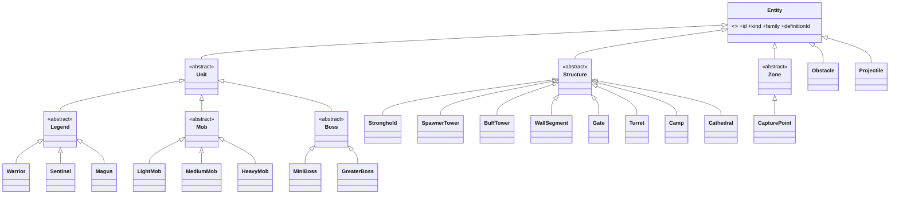

# Entity architecture

**Purpose.** Read this before you add or change anything that lives in a match: a Legend, mob,
boss, structure, zone, obstacle or projectile, a component, a strategy or a content definition.
It fixes the family tree (decided, D4/D10/D11, ADR 0006), the `Entity` base class, what goes in a
component versus a strategy versus a definition, and the one registry that knows concrete classes.
The litmus test for every design here: **a new idea is a new class plus a content entry plus one
registry line; nothing else changes.** All code is a **sketch**.

## 1. The family tree

Shallow inheritance for taxonomy (at most three levels below `Entity`), components for state,
strategies for behaviour that varies by kind, systems for per-tick logic, Type Object definitions
for data. This is the EC hybrid of 0 A.D., OpenRA and Excalibur, not a data-oriented ECS (research
[§2](../research/game-architecture-and-performance-research.md#2-oop-entity-hierarchies-vs-ecs-vs-hybrid)).



| Family (abstract)       | Concrete kinds (`EntityKind`)                                                                      | Installs                                                                                                           | Owned per tick by                                              | Status                                                   |
| ----------------------- | -------------------------------------------------------------------------------------------------- | ------------------------------------------------------------------------------------------------------------------ | -------------------------------------------------------------- | -------------------------------------------------------- |
| `Unit`                  | (abstract: mobile things)                                                                          | `Transform`, `Health`, `Movement`, `Combat`, `Team`, `Collider` (circle), `StatusEffects`, `Vision`, `Carry`       | `MovementSystem`, `CollisionSystem`, `CombatSystem`            | MVP                                                      |
| `Legend`                | `warrior` (rename pending), `sentinel`, `magus`; `flying` reserved                                 | plus `Abilities` (3 + ultimate + 2 gadget slots), `Loadout`, `Progression`                                         | `AbilitySystem`, `ProgressionSystem`, controllers              | MVP; `flying` **post-MVP** (D12)                         |
| `Mob`                   | `light-mob`, `medium-mob`, `heavy-mob`                                                             | `Unit` set; belongs to a `Horde` or a `Spawner`; `team` may be `neutral`                                           | `HordeSystem`, `PathingSystem`, `MinionController`             | MVP                                                      |
| `Boss`                  | `mini-boss`, `greater-boss` (the Eternal)                                                          | `Unit` set with a multi-move FSM in `BossController`; zone-restricted                                              | `BossController`                                               | MVP-if-time (mini-boss), MVP-if-time (greater boss)      |
| `Structure`             | `stronghold`, `spawner-tower`, `buff-tower`, `wall-segment`, `gate`, `turret`, `camp`, `cathedral` | `Transform`, `Health` (layered shield bars), `Team`, `Collider` (polygon footprint); `Spawner`, `Vision` as needed | `StructureSystem`, `SpawnSystem`, `TurretController`           | MVP (turrets, camps MVP; corner camps MVP-if-time)       |
| `Zone`                  | `capture-point`                                                                                    | `Transform`, `Capturable`, `Team`; no `Collider`                                                                   | `CaptureSystem`                                                | MVP                                                      |
| `Obstacle` (concrete)   | `obstacle` with data-driven `kind`: tree, rock, bridge-segment                                     | `Transform`, `Collider`, optional `Health` (breakable), carry weight                                               | `StructureSystem` (breakability), `Carry` via `PickUpStrategy` | MVP (static); felling, burning, throwing **MVP-if-time** |
| `Projectile` (concrete) | `projectile`                                                                                       | `Transform`, `Movement`, `Collider`, `Team`; pooled                                                                | `MovementSystem` (swept), `CombatSystem`                       | MVP                                                      |

Subclasses exist only where an instance genuinely needs different lifecycle code (a Legend levels
up and respawns; a Mob despawns with its horde; a Structure never moves). Everything tunable is a
definition field; everything swappable is a strategy chosen by a definition field.

## 2. The `Entity` base class

```ts
// Sketch: packages/core/src/entities/Entity.ts
export abstract class Entity {
  public readonly id: EntityId;
  public readonly definitionId: string;
  public abstract readonly kind: EntityKind; // concrete class id; the EntityRegistry key
  public abstract readonly family: EntityFamily; // 'legend' | 'mob' | 'boss' | 'structure' | 'zone' | 'obstacle' | 'projectile'
  protected readonly components = new ComponentSet(); // this entity's component registry

  /** Template Method: the order is fixed here; subclasses fill in the hooks. Called once by EntityFactory. */
  public spawn(ctx: SpawnContext): void {
    this.attachComponents(ctx); // required: install this family's components from the definition
    this.onSpawn(ctx); // optional: small per-class setup (initial aether, formation slot)
    ctx.events.emit('entity-spawned', { entityId: this.id, kind: this.kind, team: this.team });
  }

  /** Called by DeathSystem only, always with a cause. */
  public retire(cause: RemovalCause, ctx: RemoveContext): void {
    this.onRemove(cause, ctx);
    this.components.clear(); // pooled entities drop their references here
  }

  public get<T extends Component>(type: ComponentType<T>): T; // missing component = bug, throws
  public find<T extends Component>(type: ComponentType<T>): T | undefined;
  public has(type: ComponentType<Component>): boolean;

  protected abstract attachComponents(ctx: SpawnContext): void;
  protected onSpawn(_ctx: SpawnContext): void {}
  protected onRemove(_cause: RemovalCause, _ctx: RemoveContext): void {}
}
```

There is deliberately **no `onTick` hook**. Systems own per-tick logic and iterate components in
a fixed order (Update Method at system level, research §2); entities own data and the small
invariants that guard it. If a class seems to need its own per-tick code, it needs a component
and a system instead. Recommendation: keep it that way until profiling or a real case argues
otherwise, then decide by ADR.

`ComponentSet` is a per-entity map from component type to instance; it is not one of the global
registries. Components are looked up by class (`entity.get(Health)`), never by string.

## 3. Components: data plus invariants

Components are classes with private state and methods; systems call the methods, never poke the
fields. Each component guards its own invariants so a bug shows up where it happens.

| Component       | Encapsulated state                                                               | Invariants it guards                                                     | Key methods                                                                                       |
| --------------- | -------------------------------------------------------------------------------- | ------------------------------------------------------------------------ | ------------------------------------------------------------------------------------------------- |
| `Transform`     | `position: Vec2`, `facing`, `radius`                                             | position finite                                                          | `moveBy`, `lookAt`                                                                                |
| `Health`        | `base`, `current`, `shieldBars: ShieldBar[]` (one per living allied `BuffTower`) | `0 <= current <= base`; bars drain before base; bar count ≤ towers alive | `applyDamage(amount, source)`, `heal`, `addShieldBar(sourceId, max)`, `removeShieldBar(sourceId)` |
| `Movement`      | `speed`, `maxSpeed`, `acceleration`, `mass`, `velocity: Vec2`                    | `0 <= speed <= maxSpeed`; mass > 0                                       | `accelerateToward`, `applyImpulse` (knockback), `stop`                                            |
| `Combat`        | `weaponId`, `attackStrategy`, `targetingStrategy`, `targetId`, `cooldownTicks`   | cooldown never negative                                                  | `canAttack(tick)`, `setTarget`, `beginAttack`                                                     |
| `Abilities`     | `slots: Record<AbilitySlot, AbilityRuntime>`                                     | one runtime per slot                                                     | `runtime(slot)`, `forEachReady`                                                                   |
| `Progression`   | `xp`, `level`, `curveId`                                                         | level never decreases; xp ≥ 0                                            | `addXp(amount) → levelsGained`                                                                    |
| `Team`          | `team: Team` (type from `teams/teams.types.ts`)                                  | transitions emit `team-changed`                                          | `setTeam(next, cause)`, `isAlly(other)`, `isEnemy(other)`                                         |
| `Collider`      | `shape: Circle \| ConvexPolygon`, `layer`, `isSolid`                             | shape convex                                                             | `bounds()`                                                                                        |
| `StatusEffects` | `active: StatusEffectRuntime[]`                                                  | stacks ≤ `maxStacks`; no duplicates when `stacking: 'refresh'`           | `apply(definition, sourceId, tick)`, `expire`, `has(flag)`                                        |
| `Carry`         | `carriedId: EntityId \| null`, `maxWeight`, `pickUpStrategy`                     | carried entity exists and is carryable                                   | `canCarry(target)`, `pickUp`, `release`                                                           |
| `Loadout`       | the resolved `Loadout` (weapons, artifacts, abilities, varieties)                | validated against content on set                                         | `apply(loadout)`                                                                                  |
| `Vision`        | `radius`, `revealedUntilTick`                                                    | radius ≥ 0                                                               | `canSee(target)`                                                                                  |
| `Spawner`       | `spawnTableId`, `intervalTicks`, `nextSpawnTick`, `guardIds`                     | next spawn ≥ current tick                                                | `isDue(tick)`, `schedule(tick)`                                                                   |
| `Capturable`    | `ownerTeam`, `progress`, `checkpoint`, `contestedBy`                             | `0 <= progress <= 1`; checkpoint ∈ 1..3                                  | `advance(team, amount)`, `reset`                                                                  |

Cross-component calls go through the entity (`entity.get(Team)`), not through a global lookup.
Pairs that are always used together (`Combat` and `Movement`) may hold a direct reference,
following West's warning about manager-mediated calls (research §2).

## 4. Strategies: behaviour that varies by kind

A strategy is a stateless, shared object selected by a definition field and resolved through the
`StrategyRegistry` at spawn. Systems call the interface; they never branch on `kind`.

| Interface           | Contract                                           | MVP implementations                                                                                                                                                            | Selected by            |
| ------------------- | -------------------------------------------------- | ------------------------------------------------------------------------------------------------------------------------------------------------------------------------------ | ---------------------- |
| `TargetingStrategy` | `selectTarget(self, perception): EntityId \| null` | `NearestEnemyTargetingStrategy`, `AggroPriorityTargetingStrategy` (data-driven priority list), `StickyTurretTargetingStrategy`, `CommandedTargetingStrategy` (player picks)    | `definition.targeting` |
| `AttackStrategy`    | `attack(attacker, targetId, attack, ctx): void`    | `MeleeAttackStrategy`, `RangedProjectileAttackStrategy`, `BeamAttackStrategy` (Death Ray, MVP-if-time)                                                                         | `weapon.attack`        |
| `MovementStrategy`  | `desiredVelocity(self, ctx): Vec2`                 | `FlowFieldMovementStrategy` (hordes), `SeekArriveMovementStrategy`, `LeashedChaseMovementStrategy` (camps), `DirectedMovementStrategy` (Legends), `StationaryMovementStrategy` | `definition.movement`  |
| `PickUpStrategy`    | `canPickUp(self, target)`, `pickUp`, `throw`       | `LightPickUpStrategy` (Warrior), `GrabPickUpStrategy` (Sentinel, applies crushed), `LevitatePickUpStrategy` (Magus); `GraspPickUpStrategy` **post-MVP**                        | `definition.pickUp`    |

Strategies use the seeded `Rng` from the context and vectors only (no angles), so they stay
deterministic. Adding a strategy is a class and a `defaultStrategyRegistry.ts` line.

## 5. Type Object definitions

Every kind is described by an immutable definition in `content/`, keyed by a kebab-case id and
validated at load. Definitions support single-parent data inheritance (`extends`) resolved
copy-down by `ContentCatalogue` so the runtime never walks a chain (research §9).

```ts
// Sketch: packages/core/src/content/EntityDefinition.types.ts
export type EntityDefinitionBase = {
  readonly id: string; // 'warrior', never renamed once used
  readonly kind: EntityKind; // which concrete class builds it
  readonly displayName: string; // 'Warrior (formerly Assault)' lives here, not in code
  readonly extends?: string; // single parent, same family
  readonly sprite: SpriteRef;
  readonly minimapGlyph?: MinimapGlyph; // 06 §8; absent = DEFAULT_MINIMAP_GLYPH
};

export type LegendDefinition = EntityDefinitionBase & {
  readonly kind: LegendKind;
  readonly stats: UnitStats; // health, aether, radius, movement { speed, maxSpeed, acceleration, mass }
  readonly abilityIds: readonly [AbilityId, AbilityId, AbilityId];
  readonly ultimateId: AbilityId;
  readonly passiveId: AbilityId | null;
  readonly defaultActionId: AbilityId | null; // Magus: 'revive'
  readonly pickUp: PickUpStrategyId;
  readonly uniqueWeaponId: WeaponId;
  readonly allowedArtifactIds: readonly ArtifactId[];
  readonly defaultLoadout: LoadoutTemplate;
};
```

| Definition            | Distinctive fields                                                                                                                                                                            |
| --------------------- | --------------------------------------------------------------------------------------------------------------------------------------------------------------------------------------------- |
| `MobDefinition`       | `weightClass`, `stats`, `movement`, `targeting`, `attack`, `aggro` (acquisition range, leash ticks, aggro cooldown, priority order, as data), `xpValue`, `strengthByDistance` curve id        |
| `BossDefinition`      | `stats`, `moves: BossMoveDefinition[]` (FSM states with ability ids and transition rules), `zoneRestriction`, `rewards` (team XP, permanent buff id, final-hit item, MVP-if-time)             |
| `StructureDefinition` | `footprint` (convex polygon), `baseHealth`, `shieldPerBuffTower` (`TUNE` 1.25 spawner / 1.5 buff / 2.0 wall, game doc), `breakableWhen` rule id, `spawnTable?`, `aura?`, `turret?`, `guards?` |
| `ObstacleDefinition`  | `kind` (tree, rock, bridge-segment), `breakable`, `health?`, `weight` (which `PickUpStrategy` may lift it), `blocksPathing`, `fallDamage?` (MVP-if-time)                                      |

Definitions are Flyweights: shared, immutable, referenced by id from state
([03-game-model.md](03-game-model.md) §11).

**Validation (DEC-22).** `loadDefaultContent()` builds the catalogues and runs `ContentValidator`
once, at load, never at import time. The validator knows no rule in particular: each rule is a
class with `check(definition, content): readonly string[]`, so a rule sees the whole catalogue and
can check the ids a definition names (dangling references), and the validator reports every
broken rule at once in one `ContentValidationError`. The rules are listed in one file,
`content/defaultContentRules.ts` (`createDefaultContentRules()`); a new rule is a class and one
line there.

## 6. `EntityFactory` and `EntityRegistry`

```ts
// Sketch: packages/core/src/entities/EntityRegistry.ts
export class EntityRegistry {
  public register<K extends EntityKind>(kind: K, factory: EntityFactoryFn<K>): void; // throws on duplicates
  public create(kind: EntityKind, id: EntityId, definition: EntityDefinition): Entity;
}

// Sketch: packages/core/src/entities/defaultEntityRegistry.ts — the ONLY file that names concrete classes
export function createDefaultEntityRegistry(): EntityRegistry {
  const registry = new EntityRegistry();
  registry.register('warrior', (id, def) => new Warrior(id, def));
  registry.register('sentinel', (id, def) => new Sentinel(id, def));
  registry.register('magus', (id, def) => new Magus(id, def));
  registry.register('light-mob', (id, def) => new LightMob(id, def));
  // ... one line per concrete kind
  return registry;
}
```

`EntityFactory.spawn(definitionId, params, ctx)` looks the definition up in the `ContentCatalogue`,
asks the registry for `definition.kind`, takes a fresh id from `IdGenerator` (or a pooled instance
for projectiles), runs `entity.spawn(ctx)` and adds it to the `EntityStore`. Systems, controllers
and `applyCommand` only ever call the factory; `new Warrior(...)` appears in exactly one file.
That is the OCP in one sentence: a new kind touches the registry file and nothing that consumes
entities.

## 7. `Horde`, the composite

A horde is **not** an entity. It is a Composite of Mob ids with a lane, a formation and a leader,
managed by `HordeSystem`: it elects the lowest surviving id as leader, dissolves when empty (emitting
`horde-dissolved`) and gives `PathingSystem` one flow-field target per horde. Sizes come from
`GameConfig.match.hordeSizes` (`TUNE` light 16, medium 8, heavy 4, requirements doc). Spelling is
**horde** everywhere in our code and docs.

## 8. Team is a property, not a class (D10)

The requirements doc sketches a `NeutralEntity` branch (camps, bosses). We deviate, deliberately:
`Team` is a component holding `'light' | 'dark' | 'neutral'`, because team membership changes at
runtime. A Magus revives fallen entities "to fight for their team", a minion that kills a Legend
ascends, a capture point changes owner, and a developer-menu command may re-team a unit. A class
cannot change its base class; a component can change its value and emit `team-changed`. Camps
are `Camp` structures (neutral spawners) and bosses are `Boss` units with `team: 'neutral'`;
"neutral" queries are a filter on `Team`, not an `instanceof`. Nothing is lost: every place the
old design would have said `NeutralEntity` now says `team === 'neutral'`.

## 9. Sub-classes and specialisations (D11, post-MVP)

Assassin/Knight/Paladin, Colossus, Necromancer/Druid/Mage and Hover/Strafe arrive after the MVP
as `LegendSpecDefinition` data (stat modifiers, ability overrides, pick-up strategy, skin) that the
existing class consumes; no new code class. Only unique behaviour earns a class, and note the
depth budget: `Entity → Unit → Legend → Warrior` already uses the three levels, so an
`Assassin extends Warrior` is forbidden. A behaviour-unique specialisation becomes a **sibling**
concrete kind under `Legend` (`Necromancer extends Legend`) whose definition `extends: 'magus'`
for its data; shared behaviour is reached through strategies and components, never through a
fourth inheritance level.

## 10. Renaming is cheap by rule

Display names live in content (`displayName: 'Warrior (formerly Assault)'`), so a rename the
players see is a one-line content change. Renaming the class is a file rename plus the imports
and the `extends` clause of its subclasses (an IDE refactor), exactly as the requirements doc asks.
The content **id** (`'warrior'`) is the one thing that does not change once used, because replays,
loadouts and match history reference it; if the team ever insists, that is a persistence migration
(Recommendation: do not).

## 11. Object pooling

`ProjectilePool` (Object Pool, research §6) keeps fixed-size arrays of `Projectile` instances:
`acquire()` resets every field and assigns a fresh `EntityId`, `release()` nulls references so a
pooled object keeps nothing alive. Pooled projectiles still flow through `EntityFactory` and the
`EntityStore`, so events, invariants and snapshots see them like any entity. Particles are
client-side (views) and pooled there; mobs may be pooled later if profiling shows spawn churn.

## 12. Worked example: adding a fourth Legend class

`flying` (rename pending, post-MVP) needs a unique movement layer, so it is a class, not data.

| Step | File                                                                                                    | Change                                                                                     |
| ---- | ------------------------------------------------------------------------------------------------------- | ------------------------------------------------------------------------------------------ |
| 1    | `packages/core/src/content/legends/flying.ts`                                                           | `FLYING: LegendDefinition` with `kind: 'flying'`, stats, ability ids, pick-up `'grasp'`    |
| 2    | `packages/core/src/content/legends/legendCatalogue.ts`                                                  | one line: `flying: FLYING`                                                                 |
| 3    | `packages/core/src/content/abilities/eagleEye.ts`, `firestorm.ts` + catalogue lines                     | the class's abilities (data; new effect classes only if an effect kind is missing)         |
| 4    | `packages/core/src/entities/legends/Flying.ts` (+ `.test.ts`)                                           | `class Flying extends Legend` overriding `attachComponents` to add an `Altitude` component |
| 5    | `packages/core/src/entities/strategies/AirborneMovementStrategy.ts` + `defaultStrategyRegistry.ts` line | the unique behaviour                                                                       |
| 6    | `packages/core/src/entities/defaultEntityRegistry.ts`                                                   | one line: `registry.register('flying', (id, def) => new Flying(id, def))`                  |
| 7    | `apps/client/src/data/resources/AssetManifest.ts`                                                       | sprite entries referenced by `FLYING.sprite`                                               |
| 8    | `docs/reference/game-design/01-classes-and-subclasses.md`, changelog                                    | status update                                                                              |

Untouched: every system, every other class, `LoadoutScreen` (lists classes from the catalogue),
`LegendView` (draws by `definitionId`), the minimap, keybindings, the store. The content
validation test and the replay fixtures pass unchanged. The `new-entity` skill walks these steps.

## 13. Implementation status

Sprint 1.2 (PR #14) implements §1–§3, §5 and §6 with these interim differences, each closed by the
session or phase named:

- `Entity`, `Unit`, `Legend` and `Mob` keep the sprint 1 API (`installComponents`, `onRetire`,
  `addComponent`/`getComponent`/`findComponent`/`hasComponent`, `family` as a string) because the
  simulation kernel (PR #13) builds on it. Every family reads its spawn context through
  `SpawnContextReader`, which checks it at runtime because `spawn` takes `unknown`.
- Units install `Transform`, `Health`, `Movement`, `TeamMembership`, a circle `Collider` and
  `Vision`, plus `Combat` when the definition has an `attack` (sprint 2.2, PR #34); `StatusEffects`
  and `Carry` arrive with their systems (Phase 2–3).
- `Combat` (sprint 2.2) holds `attack` (the definition's `UnitAttack`: `strategy`, `damage`,
  `reach`, `interval`, authored in seconds and loaded as ticks), `targetId` and `readyAtTick`, with
  `canAttack(tick)`, `setTarget` and `beginAttack`. Until weapons land (05 §10) the attack lives on
  the unit definition, not `weaponId`; `targetingStrategy` waits for the AI. `AttackStrategy` gets
  the attacker entity and a `DamageDealer` port in its context, because `entities/` may not import
  `combat/`; `defaultStrategyRegistry.ts` is a typed record per behaviour (`attack` today), so a
  missing id does not compile. The team
  component is `TeamMembership` because the type `Team` owns that name.
- Shipped kinds: `warrior`, `sentinel`, `magus`, `light-mob` (the training dummy only),
  `obstacle` and `projectile`. Other mobs are SCRUM-59; structures and zones get concrete kinds in
  Phase 2 and 3.

## Related

- [03-game-model.md](03-game-model.md): `EntityStore`, events and snapshots the entities feed.
- [05-abilities-weapons-and-loadouts.md](05-abilities-weapons-and-loadouts.md): `Abilities`, `Loadout`, `Progression` in depth.
- [07-structures-obstacles-and-destructibles.md](07-structures-obstacles-and-destructibles.md): the `Structure` and `Obstacle` families in depth.
- [10-physics.md](10-physics.md): `Collider` shapes, `Movement` kinematics, swept projectiles.
- [11-game-ai.md](11-game-ai.md): the controllers that drive units.
- [17-extension-recipes.md](17-extension-recipes.md): recipes for every family, component and strategy.
- [../decisions/](../decisions/): ADR 0006, the entity-model decision record.
- Research: [game architecture §2, §6, §9](../research/game-architecture-and-performance-research.md).
