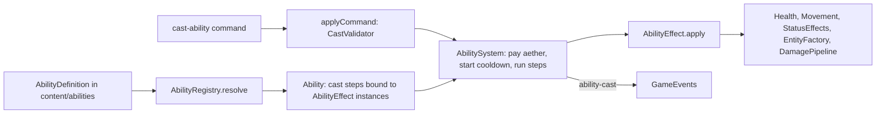

# Abilities, weapons and loadouts

**Purpose.** Read this before you add or change an ability, an ultimate, a variety, a restriction,
a status effect, a weapon, an artifact, a loadout slot or anything about XP and levels. It fixes
the `Ability` contract, the `AbilityDefinition` content shape, the `AbilityEffect` and
`AbilityRestriction` strategies, the per-slot `AbilityRuntime` (cooldown, aether, ultimate
charge), the status-effect and damage pipelines in `combat/`, weapons and artifacts as
definitions, the `Loadout` model with its validator, and `Progression`. The requirements doc's
own acceptance test governs every choice: "adding abilities, changing abilities, adding
restrictions to abilities should all be extremely simple". Everything below is a **sketch**; §18
says what is built and where the code differs (ADR 0026).

## 1. Composition, not subclassing

No ability is a class. An ability is an immutable `AbilityDefinition` (Type Object) that lists
**effects** in order; each effect kind is one stateless `AbilityEffect` strategy resolved through
the `AbilityRegistry`. Varieties, restrictions, scaling and cooldowns are fields on the
definition. This is the research's "fixed set of pre-defined behaviours selected by data"
([research §2](../research/game-architecture-and-performance-research.md#2-oop-entity-hierarchies-vs-ecs-vs-hybrid),
Type Object) rather than the Subclass Sandbox the same section lists (`class Fireball extends
Ability { activate() }`): with a sandbox every ability is a class, every restriction an `if`
inside it and every variety a subclass of a subclass. With composition an ability that recombines
existing effects is **content only**, which is what the requirements ask for (OCP; SRP: an
effect class has one reason to change, a definition another).



One effect vocabulary, many consumers (DRY): abilities and ultimates, artifacts, weapon on-hit
lists, status-effect periodic ticks and boss moves (`BossMoveDefinition.effectId`,
[11-game-ai.md §4.6](11-game-ai.md#46-bosscontroller-miniboss-mvp-greaterboss-mvp-corner-camp-bosses-post-mvp))
all carry `AbilityEffectSpec[]` and run through the same registry.

## 2. `AbilityDefinition` (content)

```ts
// Sketch: packages/core/src/content/abilities/AbilityDefinition.types.ts
export type AbilitySlotKind = 'ability' | 'ultimate' | 'gadget' | 'default-action' | 'passive';
export type AbilityTargeting =
  | { readonly kind: 'self' }
  | { readonly kind: 'aimed'; readonly range: number } // a point from Aim, clamped to range
  | { readonly kind: 'target-unit'; readonly range: number; readonly filter: TargetFilter }
  | { readonly kind: 'directional' }; // dashes: the aim vector, no range

export type AbilityDefinition = {
  readonly id: AbilityId; // 'blade-runner'; never renamed once a save or a release stores it
  readonly displayName: string; // 'Death Ray (working title)' lives here, not in code
  readonly classId: LegendId; // abilities are class-specific (game doc); enforced by LoadoutValidator
  readonly slot: AbilitySlotKind;
  readonly cooldownTicks: number; // authored as cooldownSeconds; converted once at load (03 §10)
  readonly aetherCost: number; // 0 for ultimates (charge meter) and passives
  readonly castTicks: number; // wind-up before the first step; 0 = instant
  readonly channelTicks: number; // > 0 locks the caster for the duration (Death Ray, Revive)
  readonly interruptedBy: readonly StatusEffectId[]; // ['stun', 'knockup'] cancels a channel
  readonly targeting: AbilityTargeting;
  readonly effects: readonly AbilityEffectSpec[]; // the cast timeline, in order (§4)
  readonly varieties: readonly AbilityVariety[]; // loadout-selectable patches; [] when none
  readonly restrictions: readonly AbilityRestrictionSpec[]; // predicates as data (§5)
  readonly scaling: Readonly<Record<string, { readonly perLevel: number }>>; // { amount: { perLevel: 0.04 } }
  readonly icon: SpriteRef;
};

export type AbilityVariety = {
  readonly id: VarietyId; // 'physical' | 'magical' for Blade Runner
  readonly displayName: string;
  readonly patches: readonly EffectPatch[]; // { path: [0, 'onEnd'], append: {...} } | { path: [1, 'stacks'], set: 2 }
  readonly unlockLevel?: number; // Ultimate Plus (MVP-if-time): a level-gated variety, Recommendation
};
```

Content files follow [02-code-structure.md §4](02-code-structure.md#4-naming):
`content/abilities/bladeRunner.ts` exports `BLADE_RUNNER` written against `AbilityAuthoring`
(the same shape with seconds instead of ticks, `satisfies` for compile-time checks,
[research §9](../research/game-architecture-and-performance-research.md#9-config-driven-and-data-driven-design));
`abilityCatalogue.ts` lists them. `loadDefaultContent()` builds the catalogues (resolving `extends`
and converting seconds to ticks) and runs `ContentValidator` once with the rule classes listed in
`content/defaultContentRules.ts` (04 §5, DEC-22). Each rule's `check(definition, content)` sees the
whole catalogue, so the rules cover: every `effects[].kind` and `restrictions[].kind` is registered, every
`statusId`, `definitionId` and `projectileId` resolves, every variety patch path exists, every
id in a class's `abilityPool` is an ability of that class, each kit (the class's `defaultKit`
and a Legend spec's own `kit`) takes its ids from that pool with its first three of
`slot: 'ability'` and its last of `slot: 'ultimate'` (DEC-198; ADR 0026 decision 1), and each
class's `allowedArtifactIds` have `slot: 'gadget'`. A typo fails at boot, never mid-match.

## 3. `AbilityEffect` strategies

```ts
// Sketch: packages/core/src/abilities/AbilityEffect.ts
export interface AbilityEffect<S extends AbilityEffectSpec = AbilityEffectSpec> {
  readonly kind: S['kind']; // the AbilityRegistry key, e.g. 'knockback'
  validate(spec: S, content: ContentCatalogue): readonly ContentProblem[]; // at load, from a content rule (§2)
  apply(spec: S, cast: CastContext): void; // during AbilitySystem's pass, this tick
}

export type CastContext = {
  readonly casterId: EntityId;
  readonly abilityId: AbilityId;
  readonly slot: AbilitySlot;
  readonly origin: Vec2; // caster position at the step
  readonly facing: Vec2; // unit vector, never an angle (10-physics.md §10)
  readonly aim: Aim; // { point: Vec2; targetId: EntityId | null } from the command
  readonly potency: number; // Progression scaling × status modifiers, computed once per cast
  readonly tick: number;
  readonly rng: Rng; // the seeded stream from SystemContext
  readonly state: GameState;
  readonly damage: DamagePipeline;
  readonly factory: EntityFactory;
  targets(shape: EffectShape, filter: TargetFilter): readonly EntityId[]; // SpatialHash query, id-sorted
};
```

Effects are stateless Flyweights (one instance per kind, like controllers). They call component
methods (`Health.applyDamage`, `Movement.push`; ADR 0026 decision 4), the `StatusEffectApplier`
and the `DamagePipeline`, never each other and never a system (rule 12). The catalogue, aligned with
[more-abilities.md §1](../reference/suggestions/more-abilities.md#1-the-abilityeffect-catalogue-these-proposals-compose):

| `kind`       | Class (`abilities/effects/`) | Does                                                                                                    | Key spec fields                                                     | Status                                       |
| ------------ | ---------------------------- | ------------------------------------------------------------------------------------------------------- | ------------------------------------------------------------------- | -------------------------------------------- |
| `damage`     | `DamageEffect`               | Damage to every target in `shape` through `DamagePipeline`                                              | `amount`, `damageType`, `shape`, `falloff?`, `structureMultiplier?` | MVP                                          |
| `heal`       | `HealEffect`                 | Restores base health to allies in `shape`                                                               | `amount` or `fractionOfMax`, `shape`                                | MVP (Revive; Sanctuary proposed)             |
| `buff`       | `BuffEffect`                 | Applies a positive `StatusEffectDefinition` to self or allies                                           | `statusId`, `durationSeconds?`, `stacks?`, `shape`                  | MVP (Veil, Imbue, Berserk, passives)         |
| `debuff`     | `DebuffEffect`               | Applies a negative status to enemies                                                                    | `statusId`, `durationSeconds?`, `stacks?`, `shape`, `filter?`       | MVP (Shockwave, Rip & Tear)                  |
| `dash`       | `DashEffect`                 | Moves the caster along `aim` with swept collision; collects units on the path                           | `distance`, `durationTicks`, `teleport?`, `onPath`, `onEnd`         | MVP (Blade Runner, Fury dash, Meteor Fall)   |
| `knockback`  | `KnockbackEffect`            | `Movement.push` from the centre, less for heavier targets, summed per tick; `knockup` adds `knockup`    | `distance`, `knockup?`, `shape` (DEC-208; ADR 0026 decision 4)      | MVP (Slam, Shockwave, Nova)                  |
| `zone`       | `ZoneEffect`                 | Spawns an `EffectZone` (`Zone` family, kind `effect-zone`) with a lifetime; children `onEnter`/`onTick` | `shape`, `lifetimeSeconds`, `everyTicks`, `follow?`, `grow?`        | MVP (Death Ray, Nova, flame trail)           |
| `projectile` | `ProjectileEffect`           | Spawns a pooled `Projectile`; children `onHit`; `pierce` or burst                                       | `speed`, `radius`, `range`, `pierce?`, `onHit`                      | MVP (weapons; Hamstring proposed)            |
| `summon`     | `SummonEffect`               | Spawns entities from a definition, owned by the caster, with an expiry (`RemovalCause` `'despawned'`)   | `definitionId`, `count`, `lifetimeSeconds`, `controllerId?`         | MVP-if-time (Soul Orb; Shield Wall proposed) |
| `reveal`     | `RevealEffect`               | Grants allied `Vision` over an area or marks targets                                                    | `shape`, `durationSeconds`, `markStatusId?`                         | post-MVP (Eagle Eye; `Vision` beyond MVP)    |
| `revive`     | `ReviveEffect`               | Returns an intact allied corpse to play at a health fraction                                            | `healthFraction`, `corpseMaxAgeSeconds`, `reviveLockoutSeconds`     | MVP (Magus default action)                   |

Shapes and filters are shared types: `EffectShape` is `self`, `circle { radius }`,
`cone { radius, cosHalfAngle }`, `line { length, width }` or `path` (the dash capsule);
`TargetFilter` is `{ team: 'allies' | 'enemies' | 'all'; includeSelf?; facing?: 'toward-caster';
families? }`. Cones and "facing" are dot products on unit vectors, so they are deterministic across
browsers. Every spec may carry `delaySeconds` (converted to `delayTicks`), which is what turns a
list of effects into a timeline. `EffectZone` is a new concrete `Zone` kind (depth 2) carrying an
`AreaEffect` component (`casterId`, `abilityId`, `varietyId`, step path, `expiresTick`,
`nextTick`; `Recommendation:`) so its state is ids only; a `Projectile` likewise carries a
`payload` naming the weapon attack or the ability step whose `onHit` list runs on impact.

## 4. Composing an ability: two worked examples

`AbilityRegistry.resolve(abilityId, varietyId)` applies the variety's patches to the effect list,
binds each spec to its `AbilityEffect` instance and returns a cached `Ability` (§14). When
`AbilitySystem` starts a cast it creates a `CastInstance` (`abilities/CastInstance.ts`: caster,
aim, the bound steps and their due ticks); each tick it fires the steps whose `delayTicks` have
elapsed, in list order, and drops the instance after the last one. A multi-stage ultimate is
therefore data. Nova (game doc: ring stun with minor knockback, collapse that pulls, explosion
with concussion, blind for enemies looking at you; **MVP**):

```ts
// Sketch: packages/core/src/content/abilities/nova.ts (magnitudes: Recommendation, balancing.md; N/X are placeholders)
const RING = { kind: 'circle', radius: 6 } as const;
export const NOVA = {
  id: 'nova',
  displayName: 'Nova',
  classId: 'magus',
  slot: 'ultimate',
  cooldownSeconds: 0,
  aetherCost: 0,
  castTicks: 0,
  channelTicks: 0,
  interruptedBy: [],
  targeting: { kind: 'self' },
  effects: [
    {
      kind: 'zone',
      shape: RING,
      grow: { from: 1, to: 6 },
      lifetimeSeconds: 2,
      follow: 'caster',
      onEnter: [
        { kind: 'debuff', statusId: 'stun', durationSeconds: 0.5 },
        { kind: 'knockback', impulse: 40 },
      ],
    },
    {
      kind: 'zone',
      delaySeconds: 2,
      shape: RING,
      lifetimeSeconds: 1.5,
      everyTicks: 1,
      onTick: [{ kind: 'debuff', statusId: 'pulled', durationSeconds: 0.1 }],
    },
    {
      kind: 'damage',
      delaySeconds: 3.5,
      shape: RING,
      amount: 300,
      damageType: 'magical',
      falloff: { kind: 'closer-is-more', max: 1.5 },
    },
    { kind: 'knockback', delaySeconds: 3.5, shape: RING, impulse: 80 },
    { kind: 'debuff', delaySeconds: 3.5, shape: RING, statusId: 'concussion', durationSeconds: 3 },
    {
      kind: 'debuff',
      delaySeconds: 3.5,
      shape: RING,
      statusId: 'blind',
      durationSeconds: 1.5,
      filter: { team: 'enemies', facing: 'toward-caster' },
    },
  ],
  varieties: [],
  restrictions: [],
  scaling: { amount: { perLevel: 0.04 } },
  icon: { atlasId: 'abilities', frame: 'nova' },
} satisfies AbilityAuthoring;
```

Blade Runner's Physical and Magical varieties (game doc, **MVP**) are patches over one dash:

```ts
// Sketch: packages/core/src/content/abilities/bladeRunner.ts
const PATH = { kind: 'path' } as const;
const END = { kind: 'circle', radius: 1.5 } as const;
export const BLADE_RUNNER = {
  id: 'blade-runner',
  displayName: 'Blade Runner',
  classId: 'warrior',
  slot: 'ability',
  cooldownSeconds: 12,
  aetherCost: 35, // TUNE: Recommendation in balancing.md
  castTicks: 0,
  channelTicks: 0,
  interruptedBy: [],
  targeting: { kind: 'directional' },
  effects: [
    {
      kind: 'dash',
      distance: 8,
      durationTicks: 9,
      onPath: [{ kind: 'damage', amount: 120, damageType: 'physical', shape: PATH }],
      onEnd: [],
    },
  ],
  varieties: [
    {
      id: 'physical',
      displayName: 'Physical',
      patches: [
        { path: [0, 'onPath'], append: { kind: 'knockback', impulse: 30, shape: PATH } },
        {
          path: [0, 'onEnd'],
          append: { kind: 'debuff', statusId: 'stun', durationSeconds: 0.5, shape: END },
        },
      ],
    },
    {
      id: 'magical',
      displayName: 'Magical',
      patches: [
        { path: [0, 'onPath', 0, 'damageType'], set: 'magical' },
        {
          path: [0, 'onPath'],
          append: {
            kind: 'zone',
            shape: PATH,
            lifetimeSeconds: 3,
            everyTicks: 15,
            onTick: [{ kind: 'debuff', statusId: 'burn' }],
          },
        },
        { path: [0, 'onEnd'], append: { kind: 'debuff', statusId: 'burn', shape: END } },
      ],
    },
  ],
  restrictions: [{ kind: 'not-while-carrying' }],
  scaling: { amount: { perLevel: 0.04 } },
  icon: { atlasId: 'abilities', frame: 'blade-runner' },
} satisfies AbilityAuthoring;
```

Neither needs a class. Death Ray is a channelled `zone` with a `line` shape that follows the
caster's facing (`follow: 'caster-facing'`, `everyTicks: 15`, `channelTicks: 120`); Imbue's
Support variety patches the buff's `shape` from `self` to a circle and lowers its magnitudes; Slam
is `damage` + `knockback { knockup: true }` with `structureMultiplier`. Combos (Slam + Shockwave
explosion, opposing Death Ray lock; **MVP-if-time**) are `ComboRule` listeners on `ability-cast`
in `abilities/combos/` with a `defaultComboRules.ts` list, never code inside either ability.

## 5. `AbilityRestriction` predicates as data

```ts
// Sketch: packages/core/src/abilities/AbilityRestriction.ts
export type AbilityRestrictionSpec =
  | { readonly kind: 'not-while-carrying' }
  | {
      readonly kind: 'near-structure';
      readonly kinds: readonly EntityKind[];
      readonly radius: number;
      readonly team: 'allied' | 'any';
    }
  | { readonly kind: 'requires-target'; readonly filter: TargetFilter }
  | { readonly kind: 'not-under-status'; readonly statusIds: readonly StatusEffectId[] }
  | { readonly kind: 'not-in-enemy-aura' }
  | { readonly kind: 'min-level'; readonly level: number };

export interface AbilityRestriction<S extends AbilityRestrictionSpec = AbilityRestrictionSpec> {
  readonly kind: S['kind'];
  check(
    spec: S,
    caster: Entity,
    state: GameState,
  ): { ok: true } | { ok: false; reason: AbilityRejectReason };
}
```

"Cannot cast while carrying" is `{ kind: 'not-while-carrying' }` (class
`NotWhileCarryingRestriction`, [02 §4](02-code-structure.md#4-naming)); "only near a BuffTower or
the Stronghold" (the upgrade and loadout-change rule, reference 08) is
`{ kind: 'near-structure', kinds: ['buff-tower', 'stronghold'], radius: 8, team: 'allied' }`. A
new **rule** is a class plus a registry line; a new **use** of a rule is a line in a content file.
Class ownership is deliberately not a runtime restriction: `classId` on the definition is checked
once by `LoadoutValidator` (§12), so `CastValidator` never asks "which class am I?" (ADR 0026
decision 2).

## 6. `Abilities`, `AbilityRuntime`, aether and the ultimate meter

```ts
// Sketch: packages/core/src/abilities/AbilityRuntime.ts (one per slot, owned by the Abilities component)
export type AbilitySlot =
  | 'ability-1'
  | 'ability-2'
  | 'ability-3'
  | 'ability-4'
  | 'gadget-1'
  | 'gadget-2'
  | 'default-action';
export const ULTIMATE_SLOT: AbilitySlot = 'ability-4'; // "4 being ultimate" (requirements doc)
export type AbilityRejectReason =
  | 'empty-slot'
  | 'dead'
  | 'on-cooldown'
  | 'not-enough-aether'
  | 'not-charged'
  | 'casting'
  | 'cannot-cast'
  | 'no-target'
  | 'restricted'
  | 'unavailable'; // the ability has no effects yet (ADR 0026 decision 3)

export class AbilityRuntime {
  public readonly slot: AbilitySlot;
  public abilityId: AbilityId | null;
  public varietyId: VarietyId | null;
  public cooldownUntilTick: number; // stamped at cast, never decremented per tick
  public charge: number; // 0..1, ULTIMATE_SLOT only; written by ProgressionSystem only
  public pendingCast: Aim | null; // set by applyCommand, consumed by AbilitySystem the same tick
  // No cast rule here: abilities/CastValidator decides (§7; ADR 0026 decision 2).
  public reset(tick: number, ability: Ability): void; // loadout change: full cooldown, charge = 0 (game doc)
}

// Sketch: packages/core/src/components/Abilities.ts (04 §3)
export class Abilities {
  public aether: number;
  public maxAether: number;
  public aetherRegenPerTick: number; // scaled by Progression and aura statuses
  public readonly slots: Readonly<Record<AbilitySlot, AbilityRuntime>>;
  public runtime(slot: AbilitySlot): AbilityRuntime;
  public forEachReady(tick: number, fn: (runtime: AbilityRuntime) => void): void;
  public spend(cost: number): void; // throws below zero: an invariant, not a game rule
}
```

Aether is the game doc's mana: a cast needs the cooldown elapsed **and** `aether >= aetherCost`;
`AetherRegenSystem` refills it every tick (DEC-201; ADR 0026 decisions 5 and 6). The rate is set
for the class's base capacity and grows in the same ratio as the maximum aether, so a full refill
takes the same time at every level. An allied BuffTower or Stronghold aura raises it; the
Stronghold's bonus shrinks with the share of its team's BuffTowers that have fallen. The rate,
the bonus and the aura radius live in `content/abilities/aetherRegen.ts`. The ultimate uses
`charge` instead: it fills from kills, assists and objective damage, never passively, and loses
a small `N%` on death
(`TUNE`, game doc). A match mode can also give each Legend a start share of the meter as it spawns
(a Duel's half meter, DEC-380 (1); FR-059's list of sources is under revision for it). The numbers are one typed record in `content/progression/ultimateCharge.ts`
(its type in `content/progression/progression.types.ts`), priced by the `UltimateCharge` helper
that `ProgressionSystem` owns, the only writer of `charge` (DEC-283 (3), HC-B7):

```ts
// Sketch: packages/core/src/content/progression/progression.types.ts
export type UltimateChargeDefinition = {
  readonly fullMeter: number;
  readonly legendKill: number;
  readonly assist: number; // paid on `assist-earned`, scoring's own window (DEC-79)
  readonly mobKill: Readonly<Record<MobKind, number>>; // by weight class
  readonly structureDamagePerPercent: number;
  readonly bossDamagePerPercent: Readonly<Record<string, number>>; // by mob definition id
  readonly bossKill: Readonly<Record<string, number>>; // by mob definition id, in place of mobKill
  readonly checkpointReached: number; // each Legend present
  readonly deathLoss: number; // TUNE: "a small N%" (game doc)
};
```

A new source of charge is one field here and one listener in `UltimateCharge`. Mid-match class
switching (**post-MVP**; its ultimate setback on a switch is in
[06-abilities-and-progression.md](../reference/game-design/06-abilities-and-progression.md)
"Ultimates", marked "needs work") adds its own field when it arrives; the MVP class is fixed for the match. Ultimate Plus (**MVP-if-time**) is a variety with `unlockLevel`, not a second
ability.

## 7. Cast lifecycle: `applyCommand` and `AbilitySystem`

1. `InputMapper` (human) or a controller (bot) enqueues `cast-ability { actorId, slot, aim }`
   ([03 §3](03-game-model.md#3-commands)); gadgets are the same command with `slot: 'gadget-1' |
'gadget-2'`, so artifacts need no second path.
2. `CommandApplySystem` → `applyCommand`: the actor is alive and owns the slot; the
   `CastValidator` that `Simulation` injects into the handler (ADR 0026 decision 2) checks that
   the ability is built, then cooldown, aether or charge, `casting`, the `cannot-cast` flag on
   `StatusEffects` and the countdown hold (DEC-88), targeting range and every restriction in
   order. Failure emits `command-rejected { command, reason }` (the HUD greys the slot with the
   reason); success sets `pendingCast`.
3. `AbilitySystem` (after `AiSystem`, before `MovementSystem`) walks Legends in id order: for each
   `pendingCast` it checks the cast again with the same `CastValidator` (a cast that now fails
   emits `command-rejected` and spends nothing; ADR 0026 decision 2), spends aether or zeroes
   `charge`, stamps `cooldownUntilTick = tick +
cooldownTicks` (cooldowns start at cast), builds the `CastInstance` and emits `ability-cast {
casterId, abilityId, slot }`; then it advances every live `CastInstance` (wind-up, due steps,
   channel interruption when an `interruptedBy` status is present) and ticks every `EffectZone`
   (its `onTick` children) through the same effects. `AetherRegenSystem` runs right after it, so
   a cast pays before the tick's refill (ADR 0026 decision 6).
4. Effects mutate components and the pipeline; deaths resolve in `DeathSystem`; nothing here calls
   another system.

Each targeting strategy in `abilities/targeting/` states `usesAim`: whether the cast reads the
aim the player gives it (false for a cast that aims itself, such as Fury's dash). The registry
binds it to each ability and `loadDisplayContent` publishes it as `AbilityDisplay.usesAim`
(§15), so the client decides "cast at once, no pointer needed" from the ability in the slot,
never from the slot or the targeting kind (DEC-283 (8), `INBOX.md` HC-Q62 (1)).

Passives (`slot: 'passive'`: Wrecking Run, Studious (name pending), Necromancy) are applied once
by `Legend.onSpawn` as permanent `buff` effects, so they are ordinary statuses with modifiers.
The Magus default action (Revive, **MVP**) sits in `default-action` with the `revive` effect and
a `requires-target` restriction on intact corpses (`corpseMaxAgeSeconds`, `TUNE`).

## 8. Status effects

```ts
// Sketch: packages/core/src/content/status-effects/StatusEffectDefinition.types.ts
export type StatusStacking = 'refresh' | 'intensity' | 'duration' | 'independent' | 'permanent';
export type StatusEffectDefinition = {
  readonly id: StatusEffectId;
  readonly displayName: string;
  readonly polarity: 'buff' | 'debuff' | 'form';
  readonly durationTicks: number | null; // null = permanent
  readonly stacking: StatusStacking;
  readonly maxStacks: number;
  readonly controlClass: 'none' | 'soft' | 'hard'; // hard control × the target's controlResistance, then 'control-immune'
  readonly modifiers: readonly StatModifier[]; // { stat: 'moveSpeed', op: 'mul', value: 0.7 } per stack
  readonly flags: readonly StatusFlag[]; // 'cannot-move' | 'cannot-cast' | 'cannot-attack' | 'untargetable' | 'hidden' | 'control-immune'
  readonly periodic: {
    readonly everyTicks: number;
    readonly effects: readonly AbilityEffectSpec[];
  } | null; // bleed, burn
  readonly onExpire: readonly AbilityEffectSpec[]; // e.g. apply 'control-immune' after a stun
  readonly appliesTo: 'units' | 'structures' | 'all';
};

// Sketch: packages/core/src/combat/StatusEffectRuntime.ts (one per active instance in StatusEffects.active)
export class StatusEffectRuntime {
  public readonly statusId: StatusEffectId;
  public readonly sourceId: EntityId;
  public stacks: number;
  public appliedTick: number;
  public expiresTick: number | null;
  /** The only place that knows the stacking modes: one closed switch, one case per mode. */
  public static apply(
    active: StatusEffectRuntime[],
    def: StatusEffectDefinition,
    sourceId: EntityId,
    tick: number,
  ): StatusEffectRuntime;
}
```

`StatusEffectApplier` (DEC-41) is the one way a status lands: it resolves the id, refuses missing,
dead and immune targets and emits `status-applied`. `StatusEffectSystem` walks `StatusEffects`
components in id order: it fires `periodic` effects through the registry, expires instances
(`status-expired`) and runs `onExpire`. `StatusEffects` recomputes its cached modifier table
(`StatusEffects.multiplier('moveSpeed')`) whenever its list changes (DEC-41), so `MovementSystem`,
`DamagePipeline` and `AbilityRuntime` each read one number. Mode semantics and the full id table
(bleed, burn, concussion, blind, stun, knockup, crushed, marked, enraged, ascended, invisible,
sundered, slowed, rooted, taunted, pulled, staggered, control-immune, eternal, hallowed,
emboldened, hexed) are in
[more-abilities.md §7](../reference/suggestions/more-abilities.md#7-proposed-status-effects); a
new status is content only, a new stacking mode is one union member and one `case`.

**Implementation status (sprint 2.2, SCRUM-228).** The MVP set (`bleed`, `concussion`, `stun`,
`blind`, `enraged`, `crushed`) is authored in `content/status-effects/` as `AuthoredStatusEffect`
(seconds; `enraged.maxStacks: 'structures-per-lane'`) and loaded by `loadStatusEffects` into
`StatusEffectDefinition` (`durationTicks`, `everyTicks`, every cap resolved from config), which
validates at load. Modifiers are `op: 'mul'`, whose stacks compound, or `op: 'add'`, whose stacks
add (the `veteran` damage bonus, DEC-164); `value` counts once per stack, and a stat is (1 + every
`add`) × every `mul`. `StatusEffectRuntime` sits in
`components/` next to `StatusEffects`, which holds and pools it (`components/` may not import
`combat/`); its stacking switch is `reapply`, with `refresh` and `intensity` so far, and periodic
ticks count from the first application. Every unit gets `StatusEffects`; anything without it
(structures) is immune. The component recomputes its multiplier table and flags when its list
changes, not per tick. `combat/StatusEffectApplier` (not in the sketch above) is the one way in and out and emits every
status event: `apply` (by id) emits `status-applied`; `removeStacks` takes stacks off with one
`status-stacks-lost` (a lost minion level, DEC-353), or `status-expired` when none stay; `remove` ends a status early (auras, holds)
and `expire`, called by `StatusEffectSystem`, removes the timed-out ones, both with
`status-expired`. `DefaultSystemPipeline` loads the statuses for the match's config and builds the
one applier, next to the one `DamagePipeline`, so later producers (turret concussion 2.3, gate
fire 2.4, enraged 3.3) receive it there. Minion plan M5b adds `veteran` and `rallied` (minion XP,
MS-16, `balancing.md`), applied by `VeterancySystem`.
`periodic.effects` are `StatusTickSpec`s shaped like `AbilityEffectSpec`, run by `StatusTickEffect`
strategies (`combat/defaultStatusTickEffects.ts`, `DamageStatusTick`) until the `AbilityRegistry`
lands; their damage goes through the match's one `DamagePipeline` with `kind: 'status'`, crediting
the applier. Readers: `MovementSystem` (`moveSpeed`, `cannot-move`), `CombatSystem`
(`cannot-attack`; `attackSpeed`, fixed when a hit lands), `StatusModifierStep` (`damageDealt`, `damageTaken`); `CastValidator` (`cannot-cast` and the `aetherCost` stat, §18). Whether the applier's `remove` / `expire` (and so `status-expired`) are covered by
DEC-41 is still open. `blind` has no hard miss (DEC-42): its aim wobble and the client vignette are
follow-ups. `StatusStacksWithinMaxInvariant` runs every tick. `polarity`, `controlClass` and
`onExpire` (`apply-status` specs, run by the applier's `expire` on time-out only, credited to the
same source, ids checked at load) are built: `stun` is followed by `control-immune` (0.5 s), and the
applier refuses `hard` control on a `control-immune` target (SCRUM-228, `feat/status-control-immune`).
`stun` and `crushed` are both followed by `control-immune`; re-applying an active stun restarts its
timer by owner ruling (DEC-99), so `control-immune` follows only when it runs out, and a producer
that re-applies a stun before it ends can hold a target until it stops.
Not built yet: `controlResistance` (bosses, Eternal), `appliesTo` (the component is the gate), the `duration`,
`independent` and `permanent` modes, and a max-health stat (the FR-029 aura). `StatusEffectSystem`
runs before movement. Fury adds two optional status fields, `onHit` and `grants` (§18, "Fury").

## 9. Combat pipeline (`combat/`)

```ts
// Sketch: packages/core/src/combat/DamagePipeline.ts
export type DamageType = 'physical' | 'magical' | 'true';
export type DamageSource = {
  readonly attackerId: EntityId | null;
  readonly kind: 'weapon' | 'ability' | 'status' | 'structure' | 'environment';
  readonly definitionId: string; // the weapon, ability, status or structure id
};
export class DamagePipeline {
  /** source → outgoing modifiers → incoming modifiers → structure multiplier → shields → base; emits damage-applied. */
  public apply(
    targetId: EntityId,
    amount: number,
    type: DamageType,
    source: DamageSource,
    ctx: SystemContext,
  ): DamageResult;
}
```

The order is fixed and every multiplier is data: attacker statuses (`imbue`, `enraged`, the minion
strength-by-distance curve), target statuses (`sundered`, `marked`, `hexed`), the target's
`damageMultipliers` keyed by the attacker's `damageClass`
([07 §4](07-structures-obstacles-and-destructibles.md#4-gates)), `Collider.isUnbreakable`
(rejects), then `Health.applyDamage`. `DeathResolver` turns an overflow into `entity-died {
entityId, killer: DamageSource }` and records the cause for `DeathSystem` (rule B). A death by
attacker-less damage that credits a killer (the Cathedral gem's statuses, DEC-346) names the
victim's last enemy damager inside the assist window as the attacker, keeping the gem's source kind
and id; it is decided there, once, so every reader of `entity-died` sees the same killer. Only a
hit in the victim's current life counts: a respawn or a Duel round reset forgets the last one.
That is why every ability, weapon, status tick and gate fire names a `DamageSource`: "extra
effective against Sentinels" and "reduces protections (stacks)" are modifiers, never branches in `CombatSystem`.

**Implementation status (sprint 2.2, PR #34).** `DamagePipeline.apply(state, targetId, amount,
source)` is built and is the only caller of `Health.applyDamage`. Each modifier above is a
`DamageStep` (`adjust(hit, state) → amount`, 0 blocks) and **the order is the list in
`combat/defaultDamageSteps.ts`**; shields-then-base stays inside `Health`. The steps today are
`BreakabilityStep` (first: an unbreakable wall or gate rejects the hit before any multiplier,
which gives the same result as §9's late check; 07 §3), `FriendlyFireStep` (no damage between same-team entities; awaiting the owner's sign-off in
`INBOX.md`), `StatusModifierStep` (`damageDealt` / `damageTaken`; 05 §8), `MinionStrengthStep`
(the minion strength-by-distance curve, its base-stat point moved toward the enemy for each lane
tower the enemy has lost there, DISC-24; [18](18-minion-system.md) MS-16) and
`BossMinionDamageStep` (a boss takes only its share of a lane minion's hit, balancing.md; the
shares are `BOSS_MINION_DAMAGE_TAKEN` in `content/mobs/minionModifiers.ts`). Interim differences:
no `DamageType` yet (nothing reads it; it joins `DamageHit` and
`apply` with the first resistance); the pipeline itself emits `entity-died` with the killer, so
`DeathResolver` is not a separate class yet. The gem's kill credit is `KillCredit`, which the
pipeline asks on each landed hit (it keeps the `LastEnemyHit` component) and before
`entity-died`. `BossMinionDamageStep` stands in for the target's
`damageMultipliers` keyed by the attacker's `damageClass` above: mobs have neither field yet, so
the step keys its own table by boss id and finds a lane minion by horde membership; a
`damageClass` on lane minions and `damageMultipliers` on the boss replace it. `GameState.killerOf` keeps this tick's killers, so
`DeathSystem` removes with the cause `died` and puts the killer on `entity-removed`;
`no-death-without-killer` (15) flags a death without one.
`DefaultSystemPipeline` builds the match's one `DamagePipeline` and injects it into every system
that deals damage. `CombatSystem` (after movement, before death) runs each unit's `Combat` target
through its `AttackStrategy` (melee only) when in reach (edge to edge) and off cooldown;
`attack-target` sets the target and rejects allies, itself and dead targets (`invalid-target`) and
units with no attack (`cannot-attack`).

## 10. Weapons

```ts
// Sketch: packages/core/src/content/weapons/WeaponDefinition.types.ts
export type WeaponClass = 'glove' | 'bow' | 'sword' | 'spear' | 'battle-axe' | 'staff';
export type AttackStrategyId = 'melee' | 'ranged-projectile' | 'beam'; // 'beam' reserved (04 §4)
export type WeaponAttack = {
  readonly strategy: AttackStrategyId;
  readonly reach: number;
  readonly damage: number;
  readonly damageType: DamageType;
  readonly intervalTicks: number;
  readonly projectile?: ProjectileSpec;
  readonly onHit: readonly AbilityEffectSpec[];
};
export type WeaponDefinition = {
  readonly id: WeaponId;
  readonly displayName: string;
  readonly weaponClass: WeaponClass;
  readonly attacks: readonly WeaponAttack[]; // first attack whose reach covers the target wins: melee-with-ranged-flex is data
  readonly heavyAttack: (WeaponAttack & { readonly cooldownTicks: number }) | null; // Wuuthrad, Lightbringer
  readonly parry: {
    readonly windowTicks: number;
    readonly onParry: readonly AbilityEffectSpec[];
  } | null;
  readonly grants: readonly StatusEffectId[]; // permanent statuses while equipped (the Magus staff's potency)
  readonly damageClass: string; // key into StructureDefinition.damageMultipliers
  readonly damageMultipliers: Readonly<Record<string, number>>; // { sentinel: 1.5 }: "extra effective against Sentinels" (TUNE)
  readonly allowedClasses: 'any' | readonly LegendId[];
  readonly uniqueTo: LegendId | null;
  readonly sprite: SpriteRef;
};
```

Until weapons land, a unit's basic attack is `UnitDefinition.attack` (same shape as `WeaponAttack`
minus `onHit` and `projectile`; `interval` authored in seconds, converted to ticks at load like
movement speeds). `Combat.weaponId` names the equipped weapon; `CombatSystem` calls the weapon's `AttackStrategy`
(`attack(self, target, weapon, ctx)`,
[04 §4](04-entity-architecture.md#4-strategies-behaviour-that-varies-by-kind)):
`MeleeAttackStrategy` applies `damage` and `onHit` in the tick; `RangedProjectileAttackStrategy`
spawns a pooled `Projectile` whose `payload` names the weapon attack, so `CombatSystem` runs
`onHit` on `projectile-hit`. A heavy attack arrives as `attack-target` with `mode: 'heavy'`
(`Recommendation:` one optional field on the existing command; **MVP-if-time**) and uses its own
cooldown on `Combat`; a parry is a `parrying` status with a window. Non-unique weapons are usable
by any class (reference 07: the class table's bias is a bias); `uniqueTo` locks the class weapons.

| Weapon (`id`)                               | Class      | Attacks (`TUNE`, reference 07)                                                          | Unique to | Status                  |
| ------------------------------------------- | ---------- | --------------------------------------------------------------------------------------- | --------- | ----------------------- |
| Raptor Talons (`raptor-talons`)             | glove      | melee physical; `onHit: bleed`                                                          | —         | MVP                     |
| Obsidian bow (`obsidian-bow`, name pending) | bow        | ranged magical projectile; `onHit: sundered` (stacks)                                   | —         | MVP                     |
| A Fine Line (`a-fine-line`)                 | staff      | melee physical + ranged magical, both `pierce`                                          | —         | MVP                     |
| Staff (`magus-staff`)                       | staff      | melee physical, ranged magical; `grants: ['spell-potency']`                             | magus     | MVP                     |
| Wuuthrad (`wuuthrad`)                       | battle-axe | melee physical, long reach; heavy: `concussion`; `damageMultipliers.sentinel`           | —         | MVP-if-time             |
| Lightbringer (`lightbringer`)               | sword      | melee magical + physical; heavy (cooldown): stun, concussion, blind; parry: blind, stun | —         | MVP-if-time             |
| Short blades (`short-blades`)               | glove      | fast melee; throwable (a persistent projectile, retrieve or regenerate)                 | warrior   | MVP-if-time             |
| Barricades (`barricades`)                   | —          | movement lock, `mass` change, moving collider, knockback absorption                     | sentinel  | post-MVP ("needs work") |

**Implementation status (SCRUM-183 / SCRUM-287, first slice).** `content/weapons/` holds
`WeaponDefinition` (`id`, `displayName`, `weaponClass`, `attacks`, `allowedClasses`, `uniqueTo`;
`attacks` are `UnitAttack`s, seconds authored and ticks once loaded) and `weaponCatalogue.ts`;
`loadWeapons` converts and validates at load. A Legend's damage comes from its weapon, never from
the Legend: `LegendDefinition` has no `attack` and must name its weapon with
`defaultLoadout.primaryWeaponId`, the one field of the design's `LoadoutTemplate` built so far;
`KnownWeaponRule` checks every Legend names one and that it resolves. The shipped catalogue is the
three default weapons from the table above, with each class's `balancing.md` basic attack as
`TUNE` numbers until the owner sets weapon numbers and default weapons (`INBOX.md`): Warrior
`raptor-talons`, Sentinel `wuuthrad` (no MVP spear or battle axe is named yet; Wuuthrad is MVP-if-time), Magus `magus-staff` (melee only). `EntityFactory` passes the
injected weapon source in the spawn context, `Legend` builds `Combat` from the weapon's first attack
and `Combat.weaponId` names it, so the `DamageSource` is the entity plus its weapon; mobs keep
their own `attack` and name their own definition (04 §5). Not built yet: ranged attacks and flex
(projectiles, sprint 2.3), `onHit`, `heavyAttack`, `parry`, `grants` (ability framework, 4.2),
`damageType`, `damageClass`, `damageMultipliers`, `sprite`, the `AttackStrategy` contract's
`weapon` argument, and `allowedClasses` / `uniqueTo` enforcement in a loadout (`WeaponAllowedRule`,
SCRUM-290).

## 11. Artifacts (gadgets Z and C)

An artifact is an `AbilityDefinition` with `slot: 'gadget'` (`ArtifactDefinition =
AbilityDefinition & { slot: 'gadget' }` in `content/artifacts/`); its **modes** (Mortar: impact or
air burst, physical or magical; Soul Orb: Cast Forward as a `summon` turret or Follower as a
`summon` companion) are its `varieties`, chosen in the loadout and applied at spawn, which is the
game doc's "selected before spawn". Casting is `cast-ability { slot: 'gadget-1' }` from the
`gadget-1` / `gadget-2` `InputAction`s; there is no artifact runtime, no artifact system and no
second HUD path (Phase 4.4's done-when). Slots are **MVP**; Mortar and Soul Orb are
**MVP-if-time**; the second Sentinel artifact and the Warrior artifact are INBOX decisions
([more-weapons.md](../reference/suggestions/more-weapons.md)).

## 12. Loadout

```ts
// Sketch: packages/core/src/loadout/Loadout.types.ts
export type LoadoutSlot =
  | 'primary-weapon'
  | 'secondary-weapon'
  | 'passive'
  | 'artifact-1'
  | 'artifact-2'
  | 'armour-set'
  | 'ability-1'
  | 'ability-2'
  | 'ability-3'
  | 'ultimate'
  | 'skin';
export type AbilityChoice = { readonly abilityId: AbilityId; readonly varietyId: VarietyId | null };
export type Loadout = {
  readonly classId: LegendId;
  readonly specId: LegendSpecId | null; // gameplay spec (ADR 0018); null until built (HC-Q17)
  readonly primaryWeaponId: WeaponId; // MVP
  readonly secondaryWeaponId: WeaponId | null; // MVP-if-time
  readonly passiveId: AbilityId | null; // MVP-if-time (Magus: Studious or Necromancy)
  readonly artifacts: readonly [AbilityChoice | null, AbilityChoice | null]; // slots MVP, items MVP-if-time; varietyId = mode
  readonly abilities: readonly [AbilityChoice, AbilityChoice, AbilityChoice]; // MVP
  readonly ultimate: AbilityChoice; // MVP; a choice where a class has two
  readonly armourSetId: string | null; // post-MVP, kept in the type (reference 08)
  readonly skinId: string | null; // post-MVP
};

// Sketch: packages/core/src/loadout/LoadoutValidator.ts
export interface LoadoutRule {
  readonly id: string;
  check(loadout: Loadout, content: ContentCatalogue): readonly LoadoutProblem[];
}
export type LoadoutProblem = {
  readonly slot: LoadoutSlot;
  readonly ruleId: string;
  readonly message: string;
};
export class LoadoutValidator {
  public constructor(private readonly rules: readonly LoadoutRule[]) {}
  public validate(loadout: Loadout, content: ContentCatalogue): readonly LoadoutProblem[]; // every problem, not the first
}
export function validateLoadout(
  loadout: Loadout,
  content: ContentCatalogue,
): readonly LoadoutProblem[]; // public API, default rules
export function autoBuildLoadout(classId: LegendId, content: ContentCatalogue): Loadout; // from LegendDefinition.defaultLoadout
export function repairLoadout(
  saved: Loadout,
  content: ContentCatalogue,
): { loadout: Loadout; repaired: readonly LoadoutSlot[] };
```

Default rules (`loadout/rules/*Rule.ts`, listed in `defaultLoadoutRules.ts`): `ContentExistsRule`
(every id resolves; the others skip unresolved ids), `RequiredSlotsRule`, `ClassOwnsAbilityRule`
(`classId` and slot kind match), `VarietyExistsRule`, `NoDuplicateAbilityRule`,
`WeaponAllowedRule` (`allowedClasses`, `uniqueTo`), `ArtifactClassRule`, `PassiveOwnedRule`. The
same validator runs in core tests, in `EntityFactory` when a Legend spawns (a failure is a
diagnostic event and the factory substitutes `autoBuildLoadout`, reference 08) and in the
`LoadoutScreen` through the public API, so there is one definition of "valid"; bots use
`autoBuildLoadout`, so there is one definition of "sensible". `repairLoadout` is what
`LoadoutRepository` calls when a saved loadout names content that no longer exists. Changing an
ability or the ultimate in-match (**MVP-if-time**) goes through the `Loadout` component's
`apply(loadout)`, which calls `AbilityRuntime.reset` on every changed slot: full cooldown, meter
to zero (game doc).

## 13. Progression

```ts
// Sketch: packages/core/src/components/Progression.ts (04 §3) and content/progression/
export class Progression {
  public xp: number;
  public level: number;
  public readonly curveId: LevelCurveId;
  public upgradeIds: readonly UpgradeId[]; // ability tree, post-MVP: always [] in the MVP
  public addXp(amount: number, curve: LevelCurveDefinition): number; // levels gained; level never decreases
  public potency(scaling: { readonly perLevel: number }): number; // 1 + perLevel × (level − 1)
}
export type LevelCurveDefinition = {
  readonly id: LevelCurveId;
  readonly xpToNext: readonly number[];
  readonly cap: number;
};
export type LevelScalingDefinition = {
  readonly healthPerLevel: number;
  readonly aetherPerLevel: number;
  readonly basicAttackPerLevel: number;
}; // TUNE
```

`ProgressionSystem` listens to `entity-died` and `structure-destroyed`, and its `UltimateCharge`
helper to `entity-died`, `damage-applied` (objective damage), `checkpoint-reached` and
`assist-earned` (scoring's assist window, so the meter keeps no window of its own; DEC-283 (3),
HC-B7), and, in a mode with a start share, `entity-spawned`. It defers the awards to its own pass, applies XP from
`content/progression/xpSources.ts` (per-source amounts, share radius, damage bias;
`Recommendation:` balancing.md), emits `level-up { entityId, level }`, raises the `Health` base
max and `Abilities.maxAether` by the class's `LevelScalingDefinition`, and pays the ultimate
meter from the `UltimateChargeDefinition` record (§6). Ability potency is read at cast time (`CastContext.potency`), so
`AbilitySystem` needs no listener. A match mode can start every Legend at its curve's cap
and with a share of its ultimate meter (`ProgressionContent.duel`, the Duel's one
`DUEL_RULES.progression` slice, so a new Duel progression rule is one more field there):
`ProgressionSystem` raises each Legend as it spawns, with the same per-level raises, and announces
no award; `UltimateCharge` pays the share with the cause `start` (DEC-380 (1)). The **ability tree** (post-MVP, D12) is an extension point,
not a design: an `AbilityUpgradeDefinition` (`{ id, abilityId, tier, unlockLevel, patches }`) is
applied by `AbilityRegistry.resolve` exactly like a variety, `Progression.upgradeIds` records the
choice, and an `upgrade-ability` command carries the `near-structure` restriction from §5; "only
N upgrades per tier" and "forgetting has a cost" become rules on that command. The MVP runtime
does not change when it arrives.

## 14. `AbilityRegistry`: the single place of change

```ts
// Sketch: packages/core/src/abilities/AbilityRegistry.ts
export interface Ability {
  readonly id: AbilityId;
  readonly varietyId: VarietyId | null;
  readonly definition: AbilityDefinition;
  readonly steps: readonly CastStep[]; // { delayTicks, effect: AbilityEffect, spec: AbilityEffectSpec }
  readonly restrictions: readonly {
    readonly rule: AbilityRestriction;
    readonly spec: AbilityRestrictionSpec;
  }[];
}
export class AbilityRegistry {
  public registerEffect(effect: AbilityEffect): void; // throws on a duplicate kind
  public registerRestriction(restriction: AbilityRestriction): void;
  public resolve(
    abilityId: AbilityId,
    varietyId: VarietyId | null,
    upgradeIds?: readonly UpgradeId[],
  ): Ability; // cached Flyweight
}

// Sketch: packages/core/src/abilities/defaultAbilityRegistry.ts: the ONLY file that names effect and restriction classes
export function createDefaultAbilityRegistry(content: ContentCatalogue): AbilityRegistry {
  const registry = new AbilityRegistry(content);
  registry.registerEffect(new DamageEffect());
  registry.registerEffect(new KnockbackEffect());
  // ... one line per effect kind (§3)
  registry.registerRestriction(new NotWhileCarryingRestriction());
  // ... one line per restriction kind (§5)
  return registry;
}
```

`ComposedAbility` is the only MVP implementation of `Ability`, built by `resolve`; the interface
exists so an ability that genuinely cannot be composed could implement it directly later, which
would be an ADR-recorded exception, not a habit. OCP in one sentence: a new ability is a content
file plus a catalogue line; a new effect or restriction kind is one class plus one line here;
`AbilitySystem`, `applyCommand`, the HUD and every other ability stay untouched.

## 15. HUD contract

The HUD never reads core objects. `SnapshotSystem` fills `Snapshot.player`
([03 §5](03-game-model.md#5-snapshot)) for the human Legend with the data only the player has,
the ability slots. Every value the Legend has as an entity (definition, health, aether, level and
XP, status effects) stays in its `EntitySnapshot` groups, once each; `MatchBridge` joins the two
by `entityId` (DEC-232):

```ts
// Sketch: packages/core/src/state/Snapshot.types.ts (player part)
export type AbilitySlotSnapshot = {
  readonly slot: AbilitySlot;
  readonly abilityId: AbilityId | null;
  readonly varietyId: VarietyId | null;
  readonly cooldownRemainingTicks: number;
  readonly cooldownTicks: number;
  readonly charge: number | null; // ultimate only
  readonly isReady: boolean;
  readonly blockedBy: AbilityRejectReason | null;
};
export type PlayerSnapshot = {
  readonly entityId: EntityId; // the Legend's EntitySnapshot, which holds everything else (DEC-232)
  readonly slots: readonly AbilitySlotSnapshot[]; // ability-1..4, gadget-1, gadget-2, default-action, granted, in that order
};
```

`Match`'s `MatchBridge` publishes the joined record (throttled) as the `hud-state` bridge event into `matchSlice`; `AbilityBar`
(`ui/hud/`) maps `selectAbilitySlots` and renders each slot as its icon, a cooldown sweep and
`<KeyGlyph action={slot.slot} />`. The slot ids `ability-1` … `ability-4`, `gadget-1`, `gadget-2`
are the same string literals as the `InputAction`s in `keybindings.ts`
([09 §3](09-hardware-abstraction.md#3-the-mapping-pipeline-device--inputaction--command)), so the
glyph needs no mapping table and a rebinding updates every prompt with no code change;
`default-action` is a contextual prompt on `<KeyGlyph action="interact" />` (`Recommendation:`).
Display names and icons come from the display catalogue the client builds at boot (core's
`loadDisplayContent()` and the client's own presentation data), joined with the player's selection
by a selector (`selectHudKit`), never from entities; there is no `hud-kit` event.
`AbilityDisplay` also carries `usesAim`, taken from the targeting strategy the registry binds to
the ability (§7): `false` for a cast that aims itself (Fury's dash). The client's `AbilityCasts`
casts such an ability at once in both cast modes, needing no pointer point, and sends the
Legend's own position when the pointer has had none (core ignores the aim). `PlayerHudSnapshot`
carries `grantedAbilityId` (the ability in the `granted` slot, `null` while none), and the
`GrantedPrompt` HUD element shows the key bound to `granted` beside that ability's display name
while it is set (DEC-283 (7), HC-Q61 (3)).
`AetherBar` and `HealthBar` read the same record; `LoadoutScreen` edits a `Loadout` value and calls
`validateLoadout` through the public API.

## 16. Tests

- **Content** (`content/abilities/abilityCatalogue.test.ts`): `validateContent()` passes; every
  effect and restriction kind is registered; every variety patch path resolves; each
  `LegendDefinition` references the right slot kinds.
- **Unit** (`effects/*Effect.test.ts`, `restrictions/*Restriction.test.ts`,
  `AbilityRuntime.test.ts`, `StatusEffectRuntime.test.ts`, `DamagePipeline.test.ts`,
  `LoadoutValidator.test.ts`): one file per class, a minimal `GameState`, assert component calls
  and events; the stacking table is table-driven; the loadout fixture set
  (`loadout/__fixtures__/badLoadouts.ts`) must report every violation.
- **Scenario per ability and variety** (`abilities/scenarios/<abilityId>.test.ts`): drive a real
  `Simulation`, enqueue `cast-ability`, `step()` N ticks, assert the documented effect (Blade
  Runner Physical: the caster moved `distance`, units on the path took damage and a knock-back
  (ADR 0026 decision 4), the
  unit at the end is stunned; Magical: a flame `EffectZone` exists for 3 s and applies `burn`),
  the cooldown and aether accounting, and that `command-rejected` carries the right reason when
  cast early or broke.
- **Determinism** (`abilities/scenarios/determinism.test.ts`): the same seed and command log twice
  give equal `hash()` checkpoints; a replay fixture casting every MVP ability lives in
  `__fixtures__/`
  ([research C3](../research/persistence-input-diagnostics-research.md#c3-testing-a-running-game-properties-replays-golden-hashes-soak-tests)).
- **Litmus** (`abilities/litmus.test.ts`): registers a throwaway `FakeBoltEffect` and a
  `FAKE_BOLT` definition and asserts a cast works with no other change (the Phase 4.2 metric).
- **Invariants** (`diagnostics/invariants/`): `CooldownAndAetherBoundsInvariant` (light),
  `NoCastWhileNotReadyInvariant` (light: every `ability-cast` had a ready runtime),
  `StatusStacksWithinMaxInvariant` (light), `UltimateNeverFillsPassivelyInvariant` (heavy:
  charge deltas match charge events), `LoadoutValidOnSpawnInvariant` (light),
  `LevelMatchesXpInvariant` (heavy).

## 17. Recipes and MVP status

- **Add an ability**: one content file in `content/abilities/` plus its catalogue line; one
  `<Kind>Effect` class plus one `defaultAbilityRegistry.ts` line only if an effect kind is
  missing; a scenario test. Nothing else changes (`new-ability` skill,
  [17 R8](17-extension-recipes.md#r8-add-an-ability)).
- **Add a variety, a restriction use, a status effect, a weapon or an artifact**: content only.
  **Add a restriction kind**: one `<Rule>Restriction` class, one registry line, one test.
- **Add a loadout slot**: one field on `Loadout`, one `LoadoutRule`, one DTO migration
  ([14](14-persistence-and-resources.md)), one `LoadoutScreen` row.

| Item                                                                                                                                                                       | Status                                                                              |
| -------------------------------------------------------------------------------------------------------------------------------------------------------------------------- | ----------------------------------------------------------------------------------- |
| The framework (§2–§9), 3 abilities + ultimate per class, aether, charge rules, XP scaling, `Loadout` + validator + auto-build, `AbilityBar` glyphs                         | **MVP**                                                                             |
| Veil, Blade Runner (both varieties), Rip & Tear, Slam, Imbue (both varieties), Shockwave; one ultimate per class (Fury; Berserk or Meteor Fall; Death Ray or Nova); Revive | **MVP** (third abilities and ultimate picks: INBOX; proposals in more-abilities.md) |
| Raptor Talons, obsidian bow, A Fine Line, Magus staff; gadget slots Z/C                                                                                                    | **MVP**                                                                             |
| Wuuthrad, Lightbringer, Short blades, Mortar, Soul Orb, secondary weapon, passive slot, in-match loadout changes, Ultimate Plus, combos, `summon`                          | **MVP-if-time**                                                                     |
| Ability tree, class-switch penalty, Barricades, Eagle Eye, Firestorm, `reveal`, armour set, skins, weapon abilities (`WeaponDefinition.abilityIds` reuses `Ability`)       | **post-MVP**                                                                        |

## 18. Implementation status

- **Progression (PR #31, SCRUM-426).** Legends install `Aether` (own component, O1) and
  `Progression` (`xp`, `level`, `curveId`). Level curves are a catalogue
  (`content/progression/levelCurveCatalogue.ts`), shape-checked at load (`loadLevelCurves`) and
  injected into `ProgressionSystem`, the content rules (`KnownLevelCurveRule`) and
  `level-matches-xp`; `addXp(amount, curve)` takes the resolved curve. `ProgressionSystem` (after
  combat, before death) subscribes to `entity-died`, prices the kill while the victim is still in
  the store (a mob's own `xpValue`; a Legend by victim level, `xpSources.ts`), pays nothing for a
  self or ally kill (O5), and in its own pass emits `xp-gained` and gives the XP to the killer
  only. A level-up raises max health by the class's share of base health and max aether, and heals
  and refills by the raise only while the Legend is alive (O3, O4). Structure XP is built (DEC-186: every
  Legend on the destroying team; a Legend waiting to respawn is paid as it returns, DEC-186). Team-kill XP is
  built for the capture point boss and the corner boss (DEC-237): a mob in `XP_SOURCES.teamKills` pays every Legend of
  its killer's playable team, not the killer alone, and each Legend gets at most the XP that lifts
  it `maxLevels` levels (`Progression.xpToReach`); `level-matches-xp` checks that the killer is on
  the recipient's team (`cause: 'team-kill'`). It listens to `entity-died` itself, not 12's
  `xp-granted` reward path. Not built yet: the share radius and damage bias, assists, checkpoint and
  camp XP, the Eternal's flat 5 levels (DEC-237) (their systems do not exist),
  basic-attack and ability potency per level and `upgradeIds`. Numbers are
  `TUNE`; the curve and the Legend kill and structure XP follow DEC-190 (not final; the
  soak metric can change them) and live in `content/progression/`.
- **Legend respawn (`fix/legend-respawn`, GL-12, DEC-295).** FR-051 and DEC-80, with the
  owner's middle way (DEC-295). `RespawnSystem` runs just before `DeathSystem` in every match,
  after the Duel round: it queues every dead Legend of a playable team in `state.respawns`
  (`RespawnQueue`, hashed with the waiting Legend's own fields), and `DeathSystem` then withdraws
  it (`EntityStore.withdraw`), not retires it. After the fixed delay in
  `content/progression/legendRespawn.ts` the same Legend object returns at its team's Stronghold,
  facing the enemy Stronghold, with full health and aether and no status effects (so no ability
  a status granted, such as Fury's dash), movement, cast step still to come or target; its id,
  level, XP, caps and loadout are its own. Only the ultimate's charge and cooldown
  survive death (kept apart from aether, DEC-295 (1)); every other ability comes back fully cooled
  down (FR-117). A bot laner picks its lane again by the current threat
  (DEC-295 (2)); a return ignores every cap (DEC-295 (4)). XP the Legend earns while it waits (its
  team's structure and boss awards, a kill its hit lands after it died) is owed on its queue entry
  and paid by `ProgressionSystem` in its pass after it returns (`legend-respawned` is buffered,
  cause `respawn`, DEC-186). `LegendReset` holds the reset `DuelRoundSystem` shares. The sovereign is not a Legend, so it never returns. The client leaves a greyed-out body
  where a Legend fell (`LegendBodies`). `RespawnSystem` reads `Health.isDead` just before
  `DeathSystem` rather than subscribing to `entity-died`: `entity-died` fires while the victim is
  still in the store, but the later pass also keeps any XP the Legend earns later in the same tick.
  The momentum-scaling timer (claudiodh, DEC-80) replaces the fixed delay.
- **HUD (`feat/hud-and-character-select`, 2026-10-24).** The client's `MatchBridge` joins the
  player's `EntitySnapshot` groups and the slots of core's `Snapshot.player` (since
  `feat/ability-framework`, the bullet below) into `PlayerHudSnapshot` (`bridge/hud.types.ts`), as
  §15 sets (DEC-232); the `default-action` slot is not drawn. Every value is nullable
  except the two ids and is `null` while core has no group for it (DEC-17); there is no
  `varietyId` or `statusIds` until a reader needs them, and two presentational slots,
  `weaponProgress` and `ultimatePips`, stay `null` until OQ-63 and OQ-64 give them a rule; its
  TSDoc states where each field comes from. Core now has the `Aether` and `Progression` components (the bullet above), and
  `EntitySnapshot` (`state/Snapshot.types.ts`) carries `health` and `progression` (`level`, the
  XP inside that level and `xpToNext`, `null` at the cap; `feat/hud-level-xp`, 2026-11-09), so
  the HUD's level and XP are live (INBOX HC-F6). Since `feat/hud-aether-bar` (2026-11-09),
  `EntitySnapshot` also carries `aether` (`current`, `max`) for every entity with `Aether`, and
  the HUD's aether bar is live (DEC-230).
  Casts spend aether and `AetherRegenSystem` refills it (the bullet below; DEC-201 answers OQ-56
  and replaces DEC-230 (2)). The record lands in
  `hudSlice`, not `matchSlice`; each slot is drawn by `AbilitySlot` through `selectHudSlotView`.
  The kit's display names and icons come from the display catalogue the client builds at boot
  (core's `loadDisplayContent()` plus its own presentation data, `game/content/hudPresentation.ts`,
  published as `content-catalogue`), joined with the player's selection by `selectHudKit`; there
  is no `hud-kit` event. The slot display names come from the picked Legend's kit (DEC-199); the
  icons are still client-side asset ids (INBOX HC-Q3), with no icon of each kit ability yet
  (`INBOX.md` HC-S12); a live match shows only the art that fits the picked
  Legend (its class's emblem and gadget, its start weapon) and leaves every other frame empty
  (DEC-101, DEC-114). The `xp` and `xpToNext` comments of the `progression` group in
  [03 §5](03-game-model.md#5-snapshot) (in §15's `PlayerSnapshot` until DEC-232) record the
  owner's reading of the XP ring (2026-10-18).
- **Ability framework (`feat/ability-framework`, 2026-11-13; DEC-196 to DEC-209, ADR 0026).**
  The framework and one ability for each class are built (DEC-196); the per-class PRs build the
  rest. Fury (the last bullet) adds a slot, a slot kind, a targeting kind, the `buff` effect and
  the `hit` shape to what this bullet lists. Where the code differs from the sketches above:
  - **Content.** `content/abilities/` holds the types (`AuthoredAbility` in seconds,
    `AbilityDefinition` in ticks, `AbilityKit`, `AbilitySlot`, `AbilityRejectReason`), one file
    per ability, `abilityCatalogue.ts` and `loadAbilities`, which knows no effect or shape kind:
    it checks the ability's own fields and that every time is 0 or more, and turns every
    `<name>Seconds` field of a step into `<name>Ticks`. §3's `validate` is built as
    `validate(spec)` on each effect and shape strategy (a strategy that reads content gets it in
    its constructor, as `DebuffEffect` gets the statuses); `AbilityRegistry.resolveAll` runs it
    for every step at boot. A definition also has a `description` for
    the kit rows. It has no `castTicks`, `channelTicks`, `interruptedBy`, `varieties` or `icon`
    yet; `targeting` is `self` or `directional` (`null` while the ability has no effects); the
    slot kinds are `ability` and `ultimate`; the one restriction kind is `min-level`. Every kit
    ability is content (DEC-199, DEC-209 (2)). Blade Runner (its Physical variety only), Slam and
    Shockwave have effects; the other nine have `effects: []` and are `unavailable` (ADR 0026
    decision 3). Each Legend class has `abilityPool` and `defaultKit`, each spec a `kit`, `null`
    in every shipped spec (ADR 0026 decision 1); `content/legends/specs/kitOf.ts` picks the kit
    for the simulation and the client's kit rows. The numbers are `TUNE` from `balancing.md`
    (DEC-197) and DEC-209 (1).
  - **Effects and shapes.** `damage`, `debuff`, `knockback` and `dash` (`abilities/effects/`);
    the other kinds of §3 are not built. A knock-back's spec field is `distance` in metres; the
    §4 sketches' `impulse` values predate ADR 0026 decision 4. A debuff's `durationSeconds`
    overrides the status's own duration. `structureMultiplier` applies to every target that is
    not a unit (structures, obstacles, map objects; DEC-209 (1)). The shapes are `circle` (on the
    caster, or on a dash's end for its `onEnd` steps) and `path` (with a `width`), one
    `AreaShape` class each in `abilities/shapes/` (ADR 0026 decision 7); `self`, `cone` and
    `line` are not built (the cone comes with Rip & Tear, DEC-206). A map object
    (`MapObjectBody`) is hit by its footprints, as a basic attack reaches it; any other body by
    its circle. A structure is to be reached by its outline too, and one cast may then damage the
    map object and the structure (DEC-284 (2), a follow-up PR after the freeze). `TargetFilter` has `team` and `includeSelf` only. `CastContext` has `placement`, `direction`, `scaled(field, value)`
    (the level growth that §13 calls `potency`), `targets`, `centreFor` and `run` (a dash's
    nested steps) in place of `origin`, `facing`, `potency`, `rng` and `factory`. The pipeline
    still takes no `DamageType` (§9).
  - **Registry and cast.** `AbilityRegistry.resolve(abilityId)` takes no variety or upgrade yet;
    `createDefaultAbilityRegistry` also registers the shapes and checks and resolves every ability
    at boot. A new effect kind also needs its spec type in the `AuthoredEffectSpec` union, beyond
    §14's one class and one line; the aim overlay's rows come from its `describe`
    (`AbilityRegistry.describe`, bound into core's `loadDisplayContent`). `CastAbilityHandler` checks
    with `CastValidator`, and `AbilitySystem` checks again (ADR 0026 decision 2). A cast is refused
    with `cannot-cast` while the match holds units idle (the countdown, DEC-88). `casting` means
    another cast of the same Legend waits this tick; a directional cast aimed at the caster is
    `no-target`. Due ticks are built (the delayed steps bullet below); `castTicks`, channels and
    `EffectZone`s are not. A dash's path and its hits are resolved when its step fires, and its
    `onEnd` steps run then at the path's end while the caster is still on the way (ADR 0026
    decision 4).
  - **Slots, aether and the ultimate.** `components/Abilities` holds seven
    `AbilitySlotRuntime`s in bar order (`slot(slot)`, `slots`, `hasPendingCast`); a runtime has
    no `varietyId`, no `reset` and no cast rule. `Aether` stays its own component and keeps its
    `base` (the class's starting capacity). `AetherRegenSystem` refills it (DEC-201; ADR 0026
    decisions 5 and 6). Ultimates are content only. Since `feat/vanguard-kit` the meter is built
    (the ultimate meter bullet below): the ultimate slot reports its `charge` and stays
    `not-charged` until the meter is full.
  - **Motion and statuses.** Dashes and knock-backs are forced motion (`Movement.push`; ADR 0026
    decision 4); a knock-back's base mass and travel time are in
    `content/abilities/knockback.ts`, and `loadKnockback` converts the travel time to ticks at load
    (03 §8, DEC-241). Every knock-back target gets `staggered` (cannot cast);
    `knockup` (shown as "Airborne") stops moving, attacking and casting. An airborne target can
    still be pushed: DEC-208's stacking is kept over `more-abilities.md` §7's "cannot be pushed
    further" (`INBOX.md` HC-Q53). The 0.2 s landing stagger and `control-immune` wait for status
    `onExpire` (§8). A status applied again keeps the longer of its remaining time and the new
    duration. Concussion's `aetherCost` modifier is read by `CastValidator.priceOf`.
  - **Snapshot, bots and checks.** `state/PlayerSnapshotter` fills `Snapshot.player` (§15) with
    all seven slots through the `SlotReadiness` port; a slot has `aetherCost` (after status
    modifiers) and no `varietyId`, and is judged without an aim (`slotBlockedBy`: every check
    but `no-target`). `CastValidator` implements the port; `Simulation` builds one per match.
    Bots cast any ready slot (`ai/pickReadySlot.ts`, DEC-205). `StateHasher` adds a slot only
    once it leaves its first state. Built: the scenario tests of the three abilities, every
    reject reason, the litmus `FakeBolt`, the determinism test and the golden replay
    `abilities/__fixtures__/abilityCastsSeed11.replay.ts`, and the invariants
    `cooldown-and-aether-bounds` and `no-cast-while-not-ready`.
  - **Client.** Kit rows from content on the Legend panels, the HUD slots, the two cast modes
    and the range overlay: [13](13-game-interface.md) §10.
- **Delayed steps (`feat/pr2a-windup`, 2026-11-20; DEC-283 (5)).** §4's due ticks are built: a step
  of an ability's own list may carry `delaySeconds`, which `loadAbilities` checks (0 or more,
  finite) and loads as `delayTicks` like every other time (DEC-241). Where the code differs from
  §3 and §4:
  - **Which steps wait.** Only an ability's top-level steps (`Delayed<Step>` in
    `content/abilities/AbilityDefinition.types.ts`); a dash's `onPath` and `onEnd` steps and a
    status's `onHit` steps run where their parent places them and carry no delay (§3 says every
    spec may). `loadAbilities` refuses delays that decrease along the list, so "on its due tick"
    and "in list order" agree. The registry binds each step with its `delayTicks` (`CastStep`).
  - **What the state keeps.** Not the `CastInstance`, which holds strategies and services: a cast
    with steps left is kept as plain data, `CastInProgress` (`components/Abilities.types.ts`: the
    ability id, slot, aim, origin, caster level, cast tick and the first step not fired), on the
    caster's `Abilities` component, so it is hashed with the caster (`StateHasher` adds `casts`
    only while one waits, so other matches hash as before) and leaves the match with it.
    `AbilitySystem` fires the steps due at the cast, keeps the cast while steps are left, and each
    tick, after that tick's new casts, looks at each kept cast (casters in id order): one with no
    step due stays as it is, and for one with a step due it builds a `CastInstance` and fires the
    steps now due through `CastInstance.run(placement, from)`. `CastInstance.isDue` is the one due
    rule both ask.
  - **Where a later step runs.** On the caster where it is at the step (§3's `origin` "at the
    step"), while the cast's direction stays the one fixed at the cast (from where the caster stood
    to the aim). The context's `tick` stays the cast's tick.
  - **What drops a cast.** A caster that died drops its casts in progress (no step fires after its
    death); one removed from the store took them along. A Duel round reset drops them
    (`DuelRoundSystem`, with the statuses and pushes). Nothing else does: a later step needs no
    second cast check, so a status that ends during the wait (Fury) or a stun does not stop it
    (`interruptedBy` is not built).
- **Ultimate meter (`feat/vanguard-kit`, 2026-11-16; DEC-272, DEC-273).** `ProgressionSystem`
  stays the only writer of `charge`: it owns the helper `systems/UltimateCharge`, which buffers
  each change and pays it in the system's pass, after the XP. §6 and §13 show the record and the
  events the owner signed off (DEC-283 (3)); the details, and where the code differs from §16:
  - **Content.** The table is one record, `content/progression/ultimateCharge.ts` (type
    `UltimateChargeDefinition`): the points of each source,
    the death loss and the full meter in points; `charge` stays 0 to 1 (points over the full
    meter), rounded at each change to a grid of a millionth of the meter
    (`systems/UltimateCharge.constants.ts`), so whole points worth a full meter make exactly 1
    (a plain sum of 12/100 and 5/100 steps can stop at 0.9999999999999999). A mob kill pays by the mob's weight class, as scoring's `minionKill` does; camp mobs
    pay too (DEC-273). Boss damage pays each boss's own rate per 1% of its max health, by mob
    id (`bossDamagePerPercent`; the capture point boss, DEC-272); a boss kill pays its own number
    to the killer, by mob id (`bossKill`; the capture point boss fills the meter, DEC-283 (1)), in
    place of its weight class, and is announced with the cause `boss-kill`. There is no `class-switch` (post-MVP). `ProgressionContent`
    injects it.
  - **Sources.** `entity-died`: a killer on another team than the victim gains the Legend or mob
    kill; the victim loses the death loss whoever killed it, never below 0. `damage-applied` on a
    structure or a listed boss by an attacker of another team pays per 1% of the target's max
    health, absorbed damage included (as scoring counts it, DEC-123). `checkpoint-reached` pays each
    Legend in `presentLegendIds` (DEC-273). `entity-spawned`: in a mode with a start share, each
    Legend gains that share as it spawns, with the cause `start` (DEC-380 (1)). Assists are
    scoring's
    alone: `LegendDeathRule` emits `assist-earned { legendId, victimId }` for each assist it
    awards (DEC-79's window), and the meter pays that; it keeps no assist window of its own.
    Checkpoints and assists pay on the next tick, because their emitters run after
    `ProgressionSystem`. A dead Legend gains nothing until it respawns (a reading the owner kept
    on 2026-11-16, recorded after DEC-275); a full meter stops at 1. Once the match has a
    result, scoring counts nothing, so no assist pays; kills and structure damage still pay
    while the world runs on (DEC-92). Each change that moves the
    meter is announced as `ultimate-charged { entityId, amount, charge, cause }`
    ([03 §4](03-game-model.md#4-gameevents-the-typed-channel)).
  - **Invariant.** `ultimate-never-fills-passively` (periodic) compares each meter with the
    charge last announced for it. `state/ChargeLedger` (`GameState.charges`) keeps that from
    `ultimate-charged` and the ultimate's `ability-cast`, because an invariant's check reads the
    state and never listens.
  - **Snapshot.** `Snapshot.player` reports `charge` on the ultimate slot and `null` on the
    others, so the HUD's ultimate bar is live.
  - Not built: the effects of every ultimate but Fury (the bullet below); each other one is
    still `unavailable`.
- **Fury (`feat/vanguard-kit`, 2026-11-16; DEC-270, DEC-271).** The Vanguard's ultimate is the
  first one built. `content/abilities/fury.ts` (targeting `self`, one `buff` step) puts the status
  `content/status-effects/fury.ts` on the caster: 8 s, `refresh`, `attackSpeed` × 3 and
  `damageDealt` × 1.5, a 1 m knock-back on each basic hit, and the dash
  `content/abilities/furyDash.ts` on Space while it lasts (numbers `TUNE`, `balancing.md`). After
  a death it stays on the withdrawn Legend until `LegendReset` removes it before the return
  (FR-051; INBOX HC-B52 (3) plans to end it at death, with its event); at a Duel round reset
  `DuelRoundSystem` ends each status through the match's `StatusEffectApplier`. Where the code differs from §3, §6, §8 and §15
  (better-than-design items the owner signed off, DEC-283 (4)):
  - **`buff` effect.** `BuffEffect` applies its status to the caster only, credited to the
    caster. It has no `shape` yet (§3 lists one): every buff built so far is on self. Imbue's
    Support variety buffs allies (`balancing.md`), so the ally shape joins with it in the Magus PR
    (DEC-196). A step's `durationSeconds` overrides the status's own time, as a
    debuff's does.
  - **On-hit steps on a status.** A status has two optional fields §8 does not have: `onHit`
    (effect steps, loaded in ticks as an ability's are) and `grants` (an ability id).
    `abilities/HitEffects` runs the attacker's statuses' `onHit` steps where each basic attack
    lands: the attack strategy calls it (`MeleeAttackStrategy` in the tick, after the damage, as
    §10 plans for a weapon's `onHit`; `CombatSystem` hands it over in the attack context), as one cast through the registry's strategies: credited to
    the attacker under the status's id, from the `default-action` slot, placed from the attacker
    to the struck body. The shape `hit` (`abilities/shapes/HitShape`) holds the struck body only
    and pushes away from the attacker, so Fury's knock-back is `KnockbackEffect` unchanged (mass
    rule, `staggered`). A weapon's `onHit` (§10) can run through `HitEffects` too.
  - **Status-granted slot.** An eighth slot, `granted` (Space), comes last in bar order, and
    `granted` is a slot kind. `StatusEffectApplier` fills the slot with the status's `grants`
    ability on `apply`. On `remove` and `expire`, when the slot holds that status's ability, it
    gives the slot the ability of the last remaining active status that grants one, or empties it.
    On `expire`, when an ended status's `onExpire` lands a status that grants an ability, that
    later `apply` fills the slot and the step above is skipped, so a follow-up that grants the
    same ability keeps the cooldown.
    `AbilitySlotRuntime.hold` changes the ability a slot holds and ends its cooldown on a change
    (an empty slot never cools down). Outside Fury the slot is empty and a cast is `empty-slot`,
    so no restriction kind is needed; the 1 s between dashes is the slot's cooldown. `LastCast`
    keeps the ability cast, so `no-cast-while-not-ready` holds for a dash in Fury's last tick,
    which empties the slot. `StateHasher` hashes the held ability when it differs from the one
    the slot was built with (`AbilitySlotRuntime.builtWith`), as
    [03 §9](03-game-model.md#9-statehasher-and-replays) asks; a kit slot hashes as before. The
    invariant `granted-slot-matches-status` (each tick, `error`;
    `diagnostics/invariants/GrantedSlotMatchesStatusInvariant`) checks that the slot holds an
    ability only while an active status grants that ability, and is empty while none grants one;
    §16 does not list it. A granted ability is in no class pool or kit; `abilities/checkStatusLinks`
    checks at boot, where `DefaultSystemPipeline` loads the statuses, that each `grants` names an
    ability of slot kind `granted` and that each `onHit` step passes the registry's step check
    (`AbilityRegistry.checkSteps`).
  - **Wind-up (DEC-283 (5); readings in `INBOX.md` HC-Q66).** Space first puts `content/status-effects/furyWindup.ts`
    (`fury-windup`, 0.3 s, `cannot-move` only, no control class) on the Vanguard with a `buff`
    step, and the `dash` step waits `delaySeconds: 0.3`, so the Vanguard stands still 0.3 s, then
    dashes the 3 m in 0.3 s (0.6 s from Space to the end of the dash). The way is fixed at the
    press (the targeting's aim at the cast); the Vanguard can still attack and cast during the
    wind-up, and a push still moves it, so the dash starts from where it then stands. Fury ending
    during the wind-up does not cancel the dash (the delayed steps bullet above), and the 1 s
    cooldown counts from the press. The client draws orange rings that close in on the Legend
    over the wind-up (`game/views/WindupRingsView`, a status cue, [08](08-game-engine.md) §8) from a new
    snapshot group, `EntitySnapshot.statuses` (each active status's `id`, `ticksActive` and
    `ticksLeft`; `null` without `StatusEffects`; [03](03-game-model.md) §5). The rings' status id
    is a client constant, the key of the rings in the client's `StatusCueRegistry`;
    `loadDisplayContent()` publishes every status's id and display name
    (`DisplayContent.statuses`), and `buildDisplayCatalogue` refuses at boot any status the
    registry draws that core does not have (`main.tsx` passes the registry's ids; ADR 0023: a
    missed rename fails the checks).
  - **`heading` targeting.** `fury-dash` targets `heading`: its aim is one metre the way the
    caster moves, or the way it faces when it stands still (DEC-270). Each targeting kind is a
    strategy in `abilities/targeting/` (`SelfTargeting`, `DirectionalTargeting`,
    `HeadingTargeting`; contract `CastTargeting`), registered with `registerTargeting` and bound
    to each ability by the registry, as a restriction is. `CastValidator` asks the bound strategy
    whether the aim blocks the cast (the check "a directional cast has a direction", ADR 0026,
    now lives in `DirectionalTargeting`) and `AbilitySystem` asks it for the aim the cast runs
    with, so no code branches on the targeting kind. The registry refuses at boot an ability
    whose targeting kind has no strategy. §14's recipe and sketch do not list targeting
    strategies yet.
  - **Snapshot, bots and client.** `Snapshot.player` reports the eight slots; the bridge leaves
    out `granted`, as it does `default-action`, so the HUD draws no slot for the dash
    ([13](13-game-interface.md) §10). The client casts it at once in both cast modes (DEC-283
    (9): no range overlay first) and never selects it for aiming. It knows this from the ability
    now in the slot: `AbilityDisplay.usesAim` is `false` for `fury-dash`, published from the
    `heading` strategy's `usesAim` (DEC-283 (8)), so it needs no pointer point either and the
    client checks neither the slot nor the targeting kind. The HUD shows a prompt (key and name)
    while the slot holds an ability (DEC-283 (7)). A bot may cast a filled `granted` slot
    (`pickReadySlot`).

## Related

- [03-game-model.md](03-game-model.md): `cast-ability`, `GameEvents`, `Snapshot.player`, determinism.
- [04-entity-architecture.md](04-entity-architecture.md): `Legend`, `LegendDefinition`, the `Abilities`, `Progression`, `Loadout` and `StatusEffects` components, strategies.
- [07-structures-obstacles-and-destructibles.md](07-structures-obstacles-and-destructibles.md): `Health`, shields, `damageMultipliers`.
- [09-hardware-abstraction.md](09-hardware-abstraction.md) and [13-game-interface.md](13-game-interface.md): `InputAction`s, `<KeyGlyph/>`, `AbilityBar`.
- [11-game-ai.md](11-game-ai.md): bots casting through the same commands; boss moves as effects.
- [15-diagnostics-and-runtime-testing.md](15-diagnostics-and-runtime-testing.md): the invariants in §16.
- [17-extension-recipes.md](17-extension-recipes.md): recipes R8–R10.
- [../reference/game-design/06-abilities-and-progression.md](../reference/game-design/06-abilities-and-progression.md), [07-weapons-and-artifacts.md](../reference/game-design/07-weapons-and-artifacts.md), [08-loadout.md](../reference/game-design/08-loadout.md): the design these sketches implement.
- [../reference/suggestions/more-abilities.md](../reference/suggestions/more-abilities.md) and [balancing.md](../reference/suggestions/balancing.md): the effect catalogue, the status table and the priced values.
- [../plan/phase-4-legends-abilities-and-loadouts.md](../plan/phase-4-legends-abilities-and-loadouts.md): the sprints that build this.
- Research: [game architecture §2, §9](../research/game-architecture-and-performance-research.md); [persistence C3](../research/persistence-input-diagnostics-research.md).
