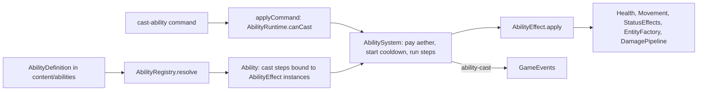

# Abilities, weapons and loadouts

**Purpose.** Read this before you add or change an ability, an ultimate, a variety, a restriction,
a status effect, a weapon, an artifact, a loadout slot or anything about XP and levels. It fixes
the `Ability` contract, the `AbilityDefinition` content shape, the `AbilityEffect` and
`AbilityRestriction` strategies, the per-slot `AbilityRuntime` (cooldown, aether, ultimate
charge), the status-effect and damage pipelines in `combat/`, weapons and artifacts as
definitions, the `Loadout` model with its validator, and `Progression`. The requirements doc's
own acceptance test governs every choice: "adding abilities, changing abilities, adding
restrictions to abilities should all be extremely simple". Everything below is a **sketch**; the
repo has no ability code yet.

## 1. Composition, not subclassing

No ability is a class. An ability is an immutable `AbilityDefinition` (Type Object) that lists
**effects** in order; each effect kind is one stateless `AbilityEffect` strategy resolved through
the `AbilityRegistry`. Varieties, restrictions, scaling and cooldowns are fields on the
definition. This is the research's "fixed set of pre-defined behaviours selected by data"
([research §2](../research/game-architecture-and-performance-research.md#2-oop-entity-hierarchies-vs-ecs-vs-hybrid),
Type Object) rather than the Subclass Sandbox the same section lists (`class Fireball extends
Ability { activate() }`): with a sandbox every ability is a class, every restriction an `if`
inside it and every variety a subclass of a subclass. With composition an ability that recombines
existing effects is **content only**, which is what the requirements ask for (OCP; SRP: an
effect class has one reason to change, a definition another).



One effect vocabulary, many consumers (DRY): abilities and ultimates, artifacts, weapon on-hit
lists, status-effect periodic ticks and boss moves (`BossMoveDefinition.effectId`,
[11-game-ai.md §4.6](11-game-ai.md#46-bosscontroller-miniboss-mvp-greaterboss-mvp-corner-camp-bosses-post-mvp))
all carry `AbilityEffectSpec[]` and run through the same registry.

## 2. `AbilityDefinition` (content)

```ts
// Sketch: packages/core/src/content/abilities/AbilityDefinition.types.ts
export type AbilitySlotKind = 'ability' | 'ultimate' | 'gadget' | 'default-action' | 'passive';
export type AbilityTargeting =
  | { readonly kind: 'self' }
  | { readonly kind: 'aimed'; readonly range: number } // a point from Aim, clamped to range
  | { readonly kind: 'target-unit'; readonly range: number; readonly filter: TargetFilter }
  | { readonly kind: 'directional' }; // dashes: the aim vector, no range

export type AbilityDefinition = {
  readonly id: AbilityId; // 'blade-runner'; never renamed once used
  readonly displayName: string; // 'Death Ray (working title)' lives here, not in code
  readonly classId: LegendId; // abilities are class-specific (game doc); enforced by LoadoutValidator
  readonly slot: AbilitySlotKind;
  readonly cooldownTicks: number; // authored as cooldownSeconds; converted once at load (03 §10)
  readonly aetherCost: number; // 0 for ultimates (charge meter) and passives
  readonly castTicks: number; // wind-up before the first step; 0 = instant
  readonly channelTicks: number; // > 0 locks the caster for the duration (Death Ray, Revive)
  readonly interruptedBy: readonly StatusEffectId[]; // ['stun', 'knockup'] cancels a channel
  readonly targeting: AbilityTargeting;
  readonly effects: readonly AbilityEffectSpec[]; // the cast timeline, in order (§4)
  readonly varieties: readonly AbilityVariety[]; // loadout-selectable patches; [] when none
  readonly restrictions: readonly AbilityRestrictionSpec[]; // predicates as data (§5)
  readonly scaling: Readonly<Record<string, { readonly perLevel: number }>>; // { amount: { perLevel: 0.04 } }
  readonly icon: SpriteRef;
};

export type AbilityVariety = {
  readonly id: VarietyId; // 'physical' | 'magical' for Blade Runner
  readonly displayName: string;
  readonly patches: readonly EffectPatch[]; // { path: [0, 'onEnd'], append: {...} } | { path: [1, 'stacks'], set: 2 }
  readonly unlockLevel?: number; // Ultimate Plus (MVP-if-time): a level-gated variety, Recommendation
};
```

Content files follow [02-code-structure.md §4](02-code-structure.md#4-naming):
`content/abilities/bladeRunner.ts` exports `BLADE_RUNNER` written against `AbilityAuthoring`
(the same shape with seconds instead of ticks, `satisfies` for compile-time checks,
[research §9](../research/game-architecture-and-performance-research.md#9-config-driven-and-data-driven-design));
`abilityCatalogue.ts` lists them. `loadDefaultContent()` builds the catalogues (resolving `extends`
and converting seconds to ticks) and runs `ContentValidator` once with the rule classes listed in
`content/defaultContentRules.ts` (04 §5, DEC-22). Each rule's `check(definition, content)` sees the
whole catalogue, so the rules cover: every `effects[].kind` and `restrictions[].kind` is registered, every
`statusId`, `definitionId` and `projectileId` resolves, every variety patch path exists, each
`LegendDefinition.abilityIds` entry has `slot: 'ability'`, its `ultimateId` has `slot: 'ultimate'`
and its `allowedArtifactIds` have `slot: 'gadget'`. A typo fails at boot, never mid-match.

## 3. `AbilityEffect` strategies

```ts
// Sketch: packages/core/src/abilities/AbilityEffect.ts
export interface AbilityEffect<S extends AbilityEffectSpec = AbilityEffectSpec> {
  readonly kind: S['kind']; // the AbilityRegistry key, e.g. 'knockback'
  validate(spec: S, content: ContentCatalogue): readonly ContentProblem[]; // at load, from a content rule (§2)
  apply(spec: S, cast: CastContext): void; // during AbilitySystem's pass, this tick
}

export type CastContext = {
  readonly casterId: EntityId;
  readonly abilityId: AbilityId;
  readonly slot: AbilitySlot;
  readonly origin: Vec2; // caster position at the step
  readonly facing: Vec2; // unit vector, never an angle (10-physics.md §10)
  readonly aim: Aim; // { point: Vec2; targetId: EntityId | null } from the command
  readonly potency: number; // Progression scaling × status modifiers, computed once per cast
  readonly tick: number;
  readonly rng: Rng; // the seeded stream from SystemContext
  readonly state: GameState;
  readonly damage: DamagePipeline;
  readonly factory: EntityFactory;
  targets(shape: EffectShape, filter: TargetFilter): readonly EntityId[]; // SpatialHash query, id-sorted
};
```

Effects are stateless Flyweights (one instance per kind, like controllers). They call component
methods (`Health.applyDamage`, `Movement.applyImpulse`, `StatusEffects.apply`) and the
`DamagePipeline`, never each other and never a system (rule 12). The catalogue, aligned with
[more-abilities.md §1](../reference/suggestions/more-abilities.md#1-the-abilityeffect-catalogue-these-proposals-compose):

| `kind`       | Class (`abilities/effects/`) | Does                                                                                                    | Key spec fields                                                     | Status                                       |
| ------------ | ---------------------------- | ------------------------------------------------------------------------------------------------------- | ------------------------------------------------------------------- | -------------------------------------------- |
| `damage`     | `DamageEffect`               | Damage to every target in `shape` through `DamagePipeline`                                              | `amount`, `damageType`, `shape`, `falloff?`, `structureMultiplier?` | MVP                                          |
| `heal`       | `HealEffect`                 | Restores base health to allies in `shape`                                                               | `amount` or `fractionOfMax`, `shape`                                | MVP (Revive; Sanctuary proposed)             |
| `buff`       | `BuffEffect`                 | Applies a positive `StatusEffectDefinition` to self or allies                                           | `statusId`, `durationSeconds?`, `stacks?`, `shape`                  | MVP (Veil, Imbue, Berserk, passives)         |
| `debuff`     | `DebuffEffect`               | Applies a negative status to enemies                                                                    | `statusId`, `durationSeconds?`, `stacks?`, `shape`, `filter?`       | MVP (Shockwave, Rip & Tear)                  |
| `dash`       | `DashEffect`                 | Moves the caster along `aim` with swept collision; collects units on the path                           | `distance`, `durationTicks`, `teleport?`, `onPath`, `onEnd`         | MVP (Blade Runner, Fury dash, Meteor Fall)   |
| `knockback`  | `KnockbackEffect`            | Impulse away from `origin` via `Movement.applyImpulse`, scaled by mass; `knockup` adds `airborne`       | `impulse`, `knockup?`, `shape`                                      | MVP (Slam, Shockwave, Nova)                  |
| `zone`       | `ZoneEffect`                 | Spawns an `EffectZone` (`Zone` family, kind `effect-zone`) with a lifetime; children `onEnter`/`onTick` | `shape`, `lifetimeSeconds`, `everyTicks`, `follow?`, `grow?`        | MVP (Death Ray, Nova, flame trail)           |
| `projectile` | `ProjectileEffect`           | Spawns a pooled `Projectile`; children `onHit`; `pierce` or burst                                       | `speed`, `radius`, `range`, `pierce?`, `onHit`                      | MVP (weapons; Hamstring proposed)            |
| `summon`     | `SummonEffect`               | Spawns entities from a definition, owned by the caster, with an expiry (`RemovalCause` `'despawned'`)   | `definitionId`, `count`, `lifetimeSeconds`, `controllerId?`         | MVP-if-time (Soul Orb; Shield Wall proposed) |
| `reveal`     | `RevealEffect`               | Grants allied `Vision` over an area or marks targets                                                    | `shape`, `durationSeconds`, `markStatusId?`                         | post-MVP (Eagle Eye; `Vision` beyond MVP)    |
| `revive`     | `ReviveEffect`               | Returns an intact allied corpse to play at a health fraction                                            | `healthFraction`, `corpseMaxAgeSeconds`, `reviveLockoutSeconds`     | MVP (Magus default action)                   |

Shapes and filters are shared types: `EffectShape` is `self`, `circle { radius }`,
`cone { radius, cosHalfAngle }`, `line { length, width }` or `path` (the dash capsule);
`TargetFilter` is `{ team: 'allies' | 'enemies' | 'all'; includeSelf?; facing?: 'toward-caster';
families? }`. Cones and "facing" are dot products on unit vectors, so they are deterministic across
browsers. Every spec may carry `delaySeconds` (converted to `delayTicks`), which is what turns a
list of effects into a timeline. `EffectZone` is a new concrete `Zone` kind (depth 2) carrying an
`AreaEffect` component (`casterId`, `abilityId`, `varietyId`, step path, `expiresTick`,
`nextTick`; `Recommendation:`) so its state is ids only; a `Projectile` likewise carries a
`payload` naming the weapon attack or the ability step whose `onHit` list runs on impact.

## 4. Composing an ability: two worked examples

`AbilityRegistry.resolve(abilityId, varietyId)` applies the variety's patches to the effect list,
binds each spec to its `AbilityEffect` instance and returns a cached `Ability` (§14). When
`AbilitySystem` starts a cast it creates a `CastInstance` (`abilities/CastInstance.ts`: caster,
aim, the bound steps and their due ticks); each tick it fires the steps whose `delayTicks` have
elapsed, in list order, and drops the instance after the last one. A multi-stage ultimate is
therefore data. Nova (game doc: ring stun with minor knockback, collapse that pulls, explosion
with concussion, blind for enemies looking at you; **MVP**):

```ts
// Sketch: packages/core/src/content/abilities/nova.ts (magnitudes: Recommendation, balancing.md; N/X are placeholders)
const RING = { kind: 'circle', radius: 6 } as const;
export const NOVA = {
  id: 'nova',
  displayName: 'Nova',
  classId: 'magus',
  slot: 'ultimate',
  cooldownSeconds: 0,
  aetherCost: 0,
  castTicks: 0,
  channelTicks: 0,
  interruptedBy: [],
  targeting: { kind: 'self' },
  effects: [
    {
      kind: 'zone',
      shape: RING,
      grow: { from: 1, to: 6 },
      lifetimeSeconds: 2,
      follow: 'caster',
      onEnter: [
        { kind: 'debuff', statusId: 'stun', durationSeconds: 0.5 },
        { kind: 'knockback', impulse: 40 },
      ],
    },
    {
      kind: 'zone',
      delaySeconds: 2,
      shape: RING,
      lifetimeSeconds: 1.5,
      everyTicks: 1,
      onTick: [{ kind: 'debuff', statusId: 'pulled', durationSeconds: 0.1 }],
    },
    {
      kind: 'damage',
      delaySeconds: 3.5,
      shape: RING,
      amount: 300,
      damageType: 'magical',
      falloff: { kind: 'closer-is-more', max: 1.5 },
    },
    { kind: 'knockback', delaySeconds: 3.5, shape: RING, impulse: 80 },
    { kind: 'debuff', delaySeconds: 3.5, shape: RING, statusId: 'concussion', durationSeconds: 3 },
    {
      kind: 'debuff',
      delaySeconds: 3.5,
      shape: RING,
      statusId: 'blind',
      durationSeconds: 1.5,
      filter: { team: 'enemies', facing: 'toward-caster' },
    },
  ],
  varieties: [],
  restrictions: [],
  scaling: { amount: { perLevel: 0.04 } },
  icon: { atlasId: 'abilities', frame: 'nova' },
} satisfies AbilityAuthoring;
```

Blade Runner's Physical and Magical varieties (game doc, **MVP**) are patches over one dash:

```ts
// Sketch: packages/core/src/content/abilities/bladeRunner.ts
const PATH = { kind: 'path' } as const;
const END = { kind: 'circle', radius: 1.5 } as const;
export const BLADE_RUNNER = {
  id: 'blade-runner',
  displayName: 'Blade Runner',
  classId: 'warrior',
  slot: 'ability',
  cooldownSeconds: 12,
  aetherCost: 35, // TUNE: Recommendation in balancing.md
  castTicks: 0,
  channelTicks: 0,
  interruptedBy: [],
  targeting: { kind: 'directional' },
  effects: [
    {
      kind: 'dash',
      distance: 8,
      durationTicks: 9,
      onPath: [{ kind: 'damage', amount: 120, damageType: 'physical', shape: PATH }],
      onEnd: [],
    },
  ],
  varieties: [
    {
      id: 'physical',
      displayName: 'Physical',
      patches: [
        { path: [0, 'onPath'], append: { kind: 'knockback', impulse: 30, shape: PATH } },
        {
          path: [0, 'onEnd'],
          append: { kind: 'debuff', statusId: 'stun', durationSeconds: 0.5, shape: END },
        },
      ],
    },
    {
      id: 'magical',
      displayName: 'Magical',
      patches: [
        { path: [0, 'onPath', 0, 'damageType'], set: 'magical' },
        {
          path: [0, 'onPath'],
          append: {
            kind: 'zone',
            shape: PATH,
            lifetimeSeconds: 3,
            everyTicks: 15,
            onTick: [{ kind: 'debuff', statusId: 'burn' }],
          },
        },
        { path: [0, 'onEnd'], append: { kind: 'debuff', statusId: 'burn', shape: END } },
      ],
    },
  ],
  restrictions: [{ kind: 'not-while-carrying' }],
  scaling: { amount: { perLevel: 0.04 } },
  icon: { atlasId: 'abilities', frame: 'blade-runner' },
} satisfies AbilityAuthoring;
```

Neither needs a class. Death Ray is a channelled `zone` with a `line` shape that follows the
caster's facing (`follow: 'caster-facing'`, `everyTicks: 15`, `channelTicks: 120`); Imbue's
Support variety patches the buff's `shape` from `self` to a circle and lowers its magnitudes; Slam
is `damage` + `knockback { knockup: true }` with `structureMultiplier`. Combos (Slam + Shockwave
explosion, opposing Death Ray lock; **MVP-if-time**) are `ComboRule` listeners on `ability-cast`
in `abilities/combos/` with a `defaultComboRules.ts` list, never code inside either ability.

## 5. `AbilityRestriction` predicates as data

```ts
// Sketch: packages/core/src/abilities/AbilityRestriction.ts
export type AbilityRestrictionSpec =
  | { readonly kind: 'not-while-carrying' }
  | {
      readonly kind: 'near-structure';
      readonly kinds: readonly EntityKind[];
      readonly radius: number;
      readonly team: 'allied' | 'any';
    }
  | { readonly kind: 'requires-target'; readonly filter: TargetFilter }
  | { readonly kind: 'not-under-status'; readonly statusIds: readonly StatusEffectId[] }
  | { readonly kind: 'not-in-enemy-aura' }
  | { readonly kind: 'min-level'; readonly level: number };

export interface AbilityRestriction<S extends AbilityRestrictionSpec = AbilityRestrictionSpec> {
  readonly kind: S['kind'];
  check(
    spec: S,
    caster: Entity,
    state: GameState,
  ): { ok: true } | { ok: false; reason: AbilityRejectReason };
}
```

"Cannot cast while carrying" is `{ kind: 'not-while-carrying' }` (class
`NotWhileCarryingRestriction`, [02 §4](02-code-structure.md#4-naming)); "only near a BuffTower or
the Stronghold" (the upgrade and loadout-change rule, reference 08) is
`{ kind: 'near-structure', kinds: ['buff-tower', 'stronghold'], radius: 8, team: 'allied' }`. A
new **rule** is a class plus a registry line; a new **use** of a rule is a line in a content file.
Class ownership is deliberately not a runtime restriction: `classId` on the definition is checked
once by `LoadoutValidator` (§12), so `AbilityRuntime.canCast` never asks "which class am I?".

## 6. `Abilities`, `AbilityRuntime`, aether and the ultimate meter

```ts
// Sketch: packages/core/src/abilities/AbilityRuntime.ts (one per slot, owned by the Abilities component)
export type AbilitySlot =
  | 'ability-1'
  | 'ability-2'
  | 'ability-3'
  | 'ability-4'
  | 'gadget-1'
  | 'gadget-2'
  | 'default-action';
export const ULTIMATE_SLOT: AbilitySlot = 'ability-4'; // "4 being ultimate" (requirements doc)
export type AbilityRejectReason =
  | 'empty-slot'
  | 'dead'
  | 'on-cooldown'
  | 'not-enough-aether'
  | 'not-charged'
  | 'casting'
  | 'cannot-cast'
  | 'no-target'
  | 'restricted';

export class AbilityRuntime {
  public readonly slot: AbilitySlot;
  public abilityId: AbilityId | null;
  public varietyId: VarietyId | null;
  public cooldownUntilTick: number; // stamped at cast, never decremented per tick
  public charge: number; // 0..1, ULTIMATE_SLOT only; written by ProgressionSystem only
  public pendingCast: Aim | null; // set by applyCommand, consumed by AbilitySystem the same tick
  public canCast(
    ability: Ability,
    caster: Entity,
    state: GameState,
  ): { ok: true } | { ok: false; reason: AbilityRejectReason };
  public reset(tick: number, ability: Ability): void; // loadout change: full cooldown, charge = 0 (game doc)
}

// Sketch: packages/core/src/components/Abilities.ts (04 §3)
export class Abilities {
  public aether: number;
  public maxAether: number;
  public aetherRegenPerTick: number; // scaled by Progression and aura statuses
  public readonly slots: Readonly<Record<AbilitySlot, AbilityRuntime>>;
  public runtime(slot: AbilitySlot): AbilityRuntime;
  public forEachReady(tick: number, fn: (runtime: AbilityRuntime) => void): void;
  public spend(cost: number): void; // throws below zero: an invariant, not a game rule
}
```

Aether is the game doc's mana: a cast needs the cooldown elapsed **and** `aether >= aetherCost`;
`AbilitySystem` adds `aetherRegenPerTick` each tick (`Recommendation:`
[balancing.md](../reference/suggestions/balancing.md#aether-costs-and-cooldowns-for-the-3--1-abilities--mvp):
2/s, +50% inside an allied BuffTower or Stronghold aura). The ultimate uses `charge` instead: it
fills from kills, assists and objective damage, never passively, and loses a small `N%` on death
(`TUNE`, game doc). The rules are data in `content/progression/ultimateCharge.ts`, evaluated by
`ProgressionSystem`, the only writer of `charge`:

```ts
export type UltimateChargeRule =
  | {
      readonly on: 'legend-kill' | 'assist' | 'minion-kill' | 'checkpoint-cleared';
      readonly gain: number;
    }
  | {
      readonly on: 'structure-damage' | 'boss-damage';
      readonly gainPerPercentOfTargetHealth: number;
    }
  | { readonly on: 'death'; readonly loss: number } // TUNE: "a small N%" (game doc); Recommendation 15
  | { readonly on: 'class-switch'; readonly cooldownFraction: readonly [number, number] }; // post-MVP: TUNE 50–100%, never reduces
```

`class-switch` exists so the rule object is ready when mid-match class switching arrives
(**post-MVP**, "needs work" in the game doc); the MVP class is fixed for the match, so nothing
evaluates it yet. Ultimate Plus (**MVP-if-time**) is a variety with `unlockLevel`, not a second
ability.

## 7. Cast lifecycle: `applyCommand` and `AbilitySystem`

1. `InputMapper` (human) or a controller (bot) enqueues `cast-ability { actorId, slot, aim }`
   ([03 §3](03-game-model.md#3-commands)); gadgets are the same command with `slot: 'gadget-1' |
'gadget-2'`, so artifacts need no second path.
2. `CommandApplySystem` → `applyCommand`: the actor is alive and owns the slot;
   `runtime.canCast()` checks cooldown, aether or charge, `casting`, the `cannot-cast` flag on
   `StatusEffects`, targeting range and every restriction in order. Failure emits
   `command-rejected { command, reason }` (the HUD greys the slot with the reason); success sets
   `pendingCast`.
3. `AbilitySystem` (after `AiSystem`, before `MovementSystem`) walks Legends in id order: for each
   `pendingCast` it spends aether or zeroes `charge`, stamps `cooldownUntilTick = tick +
cooldownTicks` (cooldowns start at cast), builds the `CastInstance` and emits `ability-cast {
casterId, abilityId, slot }`; then it advances every live `CastInstance` (wind-up, due steps,
   channel interruption when an `interruptedBy` status is present) and ticks every `EffectZone`
   (its `onTick` children) through the same effects.
4. Effects mutate components and the pipeline; deaths resolve in `DeathSystem`; nothing here calls
   another system.

Passives (`slot: 'passive'`: Wrecking Run, Studious (name pending), Necromancy) are applied once
by `Legend.onSpawn` as permanent `buff` effects, so they are ordinary statuses with modifiers.
The Magus default action (Revive, **MVP**) sits in `default-action` with the `revive` effect and
a `requires-target` restriction on intact corpses (`corpseMaxAgeSeconds`, `TUNE`).

## 8. Status effects

```ts
// Sketch: packages/core/src/content/status-effects/StatusEffectDefinition.types.ts
export type StatusStacking = 'refresh' | 'intensity' | 'duration' | 'independent' | 'permanent';
export type StatusEffectDefinition = {
  readonly id: StatusEffectId;
  readonly displayName: string;
  readonly polarity: 'buff' | 'debuff' | 'form';
  readonly durationTicks: number | null; // null = permanent
  readonly stacking: StatusStacking;
  readonly maxStacks: number;
  readonly controlClass: 'none' | 'soft' | 'hard'; // hard control × the target's controlResistance, then 'control-immune'
  readonly modifiers: readonly StatModifier[]; // { stat: 'moveSpeed', op: 'mul', value: 0.7 } per stack
  readonly flags: readonly StatusFlag[]; // 'cannot-move' | 'cannot-cast' | 'cannot-attack' | 'untargetable' | 'hidden' | 'control-immune'
  readonly periodic: {
    readonly everyTicks: number;
    readonly effects: readonly AbilityEffectSpec[];
  } | null; // bleed, burn
  readonly onExpire: readonly AbilityEffectSpec[]; // e.g. apply 'control-immune' after a stun
  readonly appliesTo: 'units' | 'structures' | 'all';
};

// Sketch: packages/core/src/combat/StatusEffectRuntime.ts (one per active instance in StatusEffects.active)
export class StatusEffectRuntime {
  public readonly statusId: StatusEffectId;
  public readonly sourceId: EntityId;
  public stacks: number;
  public appliedTick: number;
  public expiresTick: number | null;
  /** The only place that knows the stacking modes: one closed switch, one case per mode. */
  public static apply(
    active: StatusEffectRuntime[],
    def: StatusEffectDefinition,
    sourceId: EntityId,
    tick: number,
  ): StatusEffectRuntime;
}
```

`StatusEffectSystem` walks `StatusEffects` components in id order: it fires `periodic` effects
through the registry, expires instances (`status-expired`), runs `onExpire`, and recomputes each
entity's cached modifier table (`StatusEffects.modifier('moveSpeed')`) so `MovementSystem`,
`DamagePipeline` and `AbilityRuntime` each read one number. Mode semantics and the full id table
(bleed, burn, concussion, blind, stun, knockup, crushed, marked, enraged, ascended, invisible,
sundered, slowed, rooted, taunted, pulled, staggered, control-immune, eternal, hallowed,
emboldened, hexed) are in
[more-abilities.md §7](../reference/suggestions/more-abilities.md#7-proposed-status-effects); a
new status is content only, a new stacking mode is one union member and one `case`.

## 9. Combat pipeline (`combat/`)

```ts
// Sketch: packages/core/src/combat/DamagePipeline.ts
export type DamageType = 'physical' | 'magical' | 'true';
export type DamageSource = {
  readonly attackerId: EntityId | null;
  readonly kind: 'weapon' | 'ability' | 'status' | 'structure' | 'environment';
  readonly definitionId: string; // the weapon, ability, status or structure id
};
export class DamagePipeline {
  /** source → outgoing modifiers → incoming modifiers → structure multiplier → shields → base; emits damage-applied. */
  public apply(
    targetId: EntityId,
    amount: number,
    type: DamageType,
    source: DamageSource,
    ctx: SystemContext,
  ): DamageResult;
}
```

The order is fixed and every multiplier is data: attacker statuses (`imbue`, `enraged`, the minion
strength-by-distance curve), target statuses (`sundered`, `marked`, `hexed`), the target's
`damageMultipliers` keyed by the attacker's `damageClass`
([07 §4](07-structures-obstacles-and-destructibles.md#4-gates)), `Collider.isUnbreakable`
(rejects), then `Health.applyDamage`. `DeathResolver` turns an overflow into `entity-died {
entityId, killer: DamageSource }` and records the cause for `DeathSystem` (rule B). That is why
every ability, weapon, status tick and gate fire names a `DamageSource`: "extra effective against
Sentinels" and "reduces protections (stacks)" are modifiers, never branches in `CombatSystem`.

## 10. Weapons

```ts
// Sketch: packages/core/src/content/weapons/WeaponDefinition.types.ts
export type WeaponClass = 'glove' | 'bow' | 'sword' | 'spear' | 'battle-axe' | 'staff';
export type AttackStrategyId = 'melee' | 'ranged-projectile' | 'beam'; // 'beam' reserved (04 §4)
export type WeaponAttack = {
  readonly strategy: AttackStrategyId;
  readonly reach: number;
  readonly damage: number;
  readonly damageType: DamageType;
  readonly intervalTicks: number;
  readonly projectile?: ProjectileSpec;
  readonly onHit: readonly AbilityEffectSpec[];
};
export type WeaponDefinition = {
  readonly id: WeaponId;
  readonly displayName: string;
  readonly weaponClass: WeaponClass;
  readonly attacks: readonly WeaponAttack[]; // first attack whose reach covers the target wins: melee-with-ranged-flex is data
  readonly heavyAttack: (WeaponAttack & { readonly cooldownTicks: number }) | null; // Wuuthrad, Lightbringer
  readonly parry: {
    readonly windowTicks: number;
    readonly onParry: readonly AbilityEffectSpec[];
  } | null;
  readonly grants: readonly StatusEffectId[]; // permanent statuses while equipped (the Magus staff's potency)
  readonly damageClass: string; // key into StructureDefinition.damageMultipliers
  readonly damageMultipliers: Readonly<Record<string, number>>; // { sentinel: 1.5 }: "extra effective against Sentinels" (TUNE)
  readonly allowedClasses: 'any' | readonly LegendId[];
  readonly uniqueTo: LegendId | null;
  readonly sprite: SpriteRef;
};
```

`Combat.weaponId` names the equipped weapon; `CombatSystem` calls the weapon's `AttackStrategy`
(`attack(self, target, weapon, ctx)`,
[04 §4](04-entity-architecture.md#4-strategies-behaviour-that-varies-by-kind)):
`MeleeAttackStrategy` applies `damage` and `onHit` in the tick; `RangedProjectileAttackStrategy`
spawns a pooled `Projectile` whose `payload` names the weapon attack, so `CombatSystem` runs
`onHit` on `projectile-hit`. A heavy attack arrives as `attack-target` with `mode: 'heavy'`
(`Recommendation:` one optional field on the existing command; **MVP-if-time**) and uses its own
cooldown on `Combat`; a parry is a `parrying` status with a window. Non-unique weapons are usable
by any class (reference 07: the class table's bias is a bias); `uniqueTo` locks the class weapons.

| Weapon (`id`)                               | Class      | Attacks (`TUNE`, reference 07)                                                          | Unique to | Status                  |
| ------------------------------------------- | ---------- | --------------------------------------------------------------------------------------- | --------- | ----------------------- |
| Raptor Talons (`raptor-talons`)             | glove      | melee physical; `onHit: bleed`                                                          | —         | MVP                     |
| Obsidian bow (`obsidian-bow`, name pending) | bow        | ranged magical projectile; `onHit: sundered` (stacks)                                   | —         | MVP                     |
| A Fine Line (`a-fine-line`)                 | staff      | melee physical + ranged magical, both `pierce`                                          | —         | MVP                     |
| Staff (`magus-staff`)                       | staff      | melee physical, ranged magical; `grants: ['spell-potency']`                             | magus     | MVP                     |
| Wuuthrad (`wuuthrad`)                       | battle-axe | melee physical, long reach; heavy: `concussion`; `damageMultipliers.sentinel`           | —         | MVP-if-time             |
| Lightbringer (`lightbringer`)               | sword      | melee magical + physical; heavy (cooldown): stun, concussion, blind; parry: blind, stun | —         | MVP-if-time             |
| Short blades (`short-blades`)               | glove      | fast melee; throwable (a persistent projectile, retrieve or regenerate)                 | warrior   | MVP-if-time             |
| Barricades (`barricades`)                   | —          | movement lock, `mass` change, moving collider, knockback absorption                     | sentinel  | post-MVP ("needs work") |

## 11. Artifacts (gadgets Z and C)

An artifact is an `AbilityDefinition` with `slot: 'gadget'` (`ArtifactDefinition =
AbilityDefinition & { slot: 'gadget' }` in `content/artifacts/`); its **modes** (Mortar: impact or
air burst, physical or magical; Soul Orb: Cast Forward as a `summon` turret or Follower as a
`summon` companion) are its `varieties`, chosen in the loadout and applied at spawn, which is the
game doc's "selected before spawn". Casting is `cast-ability { slot: 'gadget-1' }` from the
`gadget-1` / `gadget-2` `InputAction`s; there is no artifact runtime, no artifact system and no
second HUD path (Phase 4.4's done-when). Slots are **MVP**; Mortar and Soul Orb are
**MVP-if-time**; the second Sentinel artifact and the Warrior artifact are INBOX decisions
([more-weapons.md](../reference/suggestions/more-weapons.md)).

## 12. Loadout

```ts
// Sketch: packages/core/src/loadout/Loadout.types.ts
export type LoadoutSlot =
  | 'primary-weapon'
  | 'secondary-weapon'
  | 'passive'
  | 'artifact-1'
  | 'artifact-2'
  | 'armour-set'
  | 'ability-1'
  | 'ability-2'
  | 'ability-3'
  | 'ultimate'
  | 'skin';
export type AbilityChoice = { readonly abilityId: AbilityId; readonly varietyId: VarietyId | null };
export type Loadout = {
  readonly classId: LegendId;
  readonly specId: LegendSpecId | null; // post-MVP specialisation (D11); null in the MVP
  readonly primaryWeaponId: WeaponId; // MVP
  readonly secondaryWeaponId: WeaponId | null; // MVP-if-time
  readonly passiveId: AbilityId | null; // MVP-if-time (Magus: Studious or Necromancy)
  readonly artifacts: readonly [AbilityChoice | null, AbilityChoice | null]; // slots MVP, items MVP-if-time; varietyId = mode
  readonly abilities: readonly [AbilityChoice, AbilityChoice, AbilityChoice]; // MVP
  readonly ultimate: AbilityChoice; // MVP; a choice where a class has two
  readonly armourSetId: string | null; // post-MVP, kept in the type (reference 08)
  readonly skinId: string | null; // post-MVP
};

// Sketch: packages/core/src/loadout/LoadoutValidator.ts
export interface LoadoutRule {
  readonly id: string;
  check(loadout: Loadout, content: ContentCatalogue): readonly LoadoutProblem[];
}
export type LoadoutProblem = {
  readonly slot: LoadoutSlot;
  readonly ruleId: string;
  readonly message: string;
};
export class LoadoutValidator {
  public constructor(private readonly rules: readonly LoadoutRule[]) {}
  public validate(loadout: Loadout, content: ContentCatalogue): readonly LoadoutProblem[]; // every problem, not the first
}
export function validateLoadout(
  loadout: Loadout,
  content: ContentCatalogue,
): readonly LoadoutProblem[]; // public API, default rules
export function autoBuildLoadout(classId: LegendId, content: ContentCatalogue): Loadout; // from LegendDefinition.defaultLoadout
export function repairLoadout(
  saved: Loadout,
  content: ContentCatalogue,
): { loadout: Loadout; repaired: readonly LoadoutSlot[] };
```

Default rules (`loadout/rules/*Rule.ts`, listed in `defaultLoadoutRules.ts`): `ContentExistsRule`
(every id resolves; the others skip unresolved ids), `RequiredSlotsRule`, `ClassOwnsAbilityRule`
(`classId` and slot kind match), `VarietyExistsRule`, `NoDuplicateAbilityRule`,
`WeaponAllowedRule` (`allowedClasses`, `uniqueTo`), `ArtifactClassRule`, `PassiveOwnedRule`. The
same validator runs in core tests, in `EntityFactory` when a Legend spawns (a failure is a
diagnostic event and the factory substitutes `autoBuildLoadout`, reference 08) and in the
`LoadoutScreen` through the public API, so there is one definition of "valid"; bots use
`autoBuildLoadout`, so there is one definition of "sensible". `repairLoadout` is what
`LoadoutRepository` calls when a saved loadout names content that no longer exists. Changing an
ability or the ultimate in-match (**MVP-if-time**) goes through the `Loadout` component's
`apply(loadout)`, which calls `AbilityRuntime.reset` on every changed slot: full cooldown, meter
to zero (game doc).

## 13. Progression

```ts
// Sketch: packages/core/src/components/Progression.ts (04 §3) and content/progression/
export class Progression {
  public xp: number;
  public level: number;
  public readonly curveId: LevelCurveId;
  public upgradeIds: readonly UpgradeId[]; // ability tree, post-MVP: always [] in the MVP
  public addXp(amount: number, curve: LevelCurveDefinition): number; // levels gained; level never decreases
  public potency(scaling: { readonly perLevel: number }): number; // 1 + perLevel × (level − 1)
}
export type LevelCurveDefinition = {
  readonly id: LevelCurveId;
  readonly xpToNext: readonly number[];
  readonly cap: number;
};
export type LevelScalingDefinition = {
  readonly healthPerLevel: number;
  readonly aetherPerLevel: number;
  readonly basicAttackPerLevel: number;
}; // TUNE
```

`ProgressionSystem` listens to `entity-died`, `damage-applied` (assist window, objective damage),
`structure-destroyed` and `checkpoint-cleared`, defers the awards to its own pass, applies XP from
`content/progression/xpSources.ts` (per-source amounts, share radius, damage bias;
`Recommendation:` balancing.md), emits `level-up { entityId, level }`, raises the `Health` base
max and `Abilities.maxAether` by the class's `LevelScalingDefinition`, and applies the
`UltimateChargeRule`s (§6). Ability potency is read at cast time (`CastContext.potency`), so
`AbilitySystem` needs no listener. The **ability tree** (post-MVP, D12) is an extension point,
not a design: an `AbilityUpgradeDefinition` (`{ id, abilityId, tier, unlockLevel, patches }`) is
applied by `AbilityRegistry.resolve` exactly like a variety, `Progression.upgradeIds` records the
choice, and an `upgrade-ability` command carries the `near-structure` restriction from §5; "only
N upgrades per tier" and "forgetting has a cost" become rules on that command. The MVP runtime
does not change when it arrives.

## 14. `AbilityRegistry`: the single place of change

```ts
// Sketch: packages/core/src/abilities/AbilityRegistry.ts
export interface Ability {
  readonly id: AbilityId;
  readonly varietyId: VarietyId | null;
  readonly definition: AbilityDefinition;
  readonly steps: readonly CastStep[]; // { delayTicks, effect: AbilityEffect, spec: AbilityEffectSpec }
  readonly restrictions: readonly {
    readonly rule: AbilityRestriction;
    readonly spec: AbilityRestrictionSpec;
  }[];
}
export class AbilityRegistry {
  public registerEffect(effect: AbilityEffect): void; // throws on a duplicate kind
  public registerRestriction(restriction: AbilityRestriction): void;
  public resolve(
    abilityId: AbilityId,
    varietyId: VarietyId | null,
    upgradeIds?: readonly UpgradeId[],
  ): Ability; // cached Flyweight
}

// Sketch: packages/core/src/abilities/defaultAbilityRegistry.ts: the ONLY file that names effect and restriction classes
export function createDefaultAbilityRegistry(content: ContentCatalogue): AbilityRegistry {
  const registry = new AbilityRegistry(content);
  registry.registerEffect(new DamageEffect());
  registry.registerEffect(new KnockbackEffect());
  // ... one line per effect kind (§3)
  registry.registerRestriction(new NotWhileCarryingRestriction());
  // ... one line per restriction kind (§5)
  return registry;
}
```

`ComposedAbility` is the only MVP implementation of `Ability`, built by `resolve`; the interface
exists so an ability that genuinely cannot be composed could implement it directly later, which
would be an ADR-recorded exception, not a habit. OCP in one sentence: a new ability is a content
file plus a catalogue line; a new effect or restriction kind is one class plus one line here;
`AbilitySystem`, `applyCommand`, the HUD and every other ability stay untouched.

## 15. HUD contract

The HUD never reads core objects. `SnapshotSystem` fills `Snapshot.player`
([03 §5](03-game-model.md#5-snapshot)) for the human Legend:

```ts
// Sketch: packages/core/src/state/Snapshot.types.ts (player part)
export type AbilitySlotSnapshot = {
  readonly slot: AbilitySlot;
  readonly abilityId: AbilityId | null;
  readonly varietyId: VarietyId | null;
  readonly cooldownRemainingTicks: number;
  readonly cooldownTicks: number;
  readonly charge: number | null; // ultimate only
  readonly isReady: boolean;
  readonly blockedBy: AbilityRejectReason | null;
};
export type PlayerSnapshot = {
  readonly entityId: EntityId;
  readonly definitionId: LegendId;
  readonly health: number;
  readonly maxHealth: number;
  readonly aether: number;
  readonly maxAether: number;
  readonly level: number;
  readonly xp: number; // XP earned inside the current level (resets on level-up)
  readonly xpToNext: number; // XP the current level needs to reach the next
  readonly slots: readonly AbilitySlotSnapshot[]; // ability-1..4, gadget-1, gadget-2, default-action, in that order
  readonly statusIds: readonly StatusEffectId[];
};
```

`Match`'s `MatchBridge` publishes it (throttled) as the `hud-state` bridge event into `matchSlice`; `AbilityBar`
(`ui/hud/`) maps `selectAbilitySlots` and renders each slot as its icon, a cooldown sweep and
`<KeyGlyph action={slot.slot} />`. The slot ids `ability-1` … `ability-4`, `gadget-1`, `gadget-2`
are the same string literals as the `InputAction`s in `keybindings.ts`
([09 §3](09-hardware-abstraction.md#3-the-mapping-pipeline-device--inputaction--command)), so the
glyph needs no mapping table and a rebinding updates every prompt with no code change;
`default-action` is a contextual prompt on `<KeyGlyph action="interact" />` (`Recommendation:`).
Display names and icons come from the catalogue the client already loads for the `LoadoutScreen`
(`loadDefaultContent()`), resolved once at match start into the slice, never from entities.
`AetherBar` and `HealthBar` read the same record; `LoadoutScreen` edits a `Loadout` value and calls
`validateLoadout` through the public API.

## 16. Tests

- **Content** (`content/abilities/abilityCatalogue.test.ts`): `validateContent()` passes; every
  effect and restriction kind is registered; every variety patch path resolves; each
  `LegendDefinition` references the right slot kinds.
- **Unit** (`effects/*Effect.test.ts`, `restrictions/*Restriction.test.ts`,
  `AbilityRuntime.test.ts`, `StatusEffectRuntime.test.ts`, `DamagePipeline.test.ts`,
  `LoadoutValidator.test.ts`): one file per class, a minimal `GameState`, assert component calls
  and events; the stacking table is table-driven; the loadout fixture set
  (`loadout/__fixtures__/badLoadouts.ts`) must report every violation.
- **Scenario per ability and variety** (`abilities/scenarios/<abilityId>.test.ts`): drive a real
  `Simulation`, enqueue `cast-ability`, `step()` N ticks, assert the documented effect (Blade
  Runner Physical: the caster moved `distance`, units on the path took damage and an impulse, the
  unit at the end is stunned; Magical: a flame `EffectZone` exists for 3 s and applies `burn`),
  the cooldown and aether accounting, and that `command-rejected` carries the right reason when
  cast early or broke.
- **Determinism** (`abilities/scenarios/determinism.test.ts`): the same seed and command log twice
  give equal `hash()` checkpoints; a replay fixture casting every MVP ability lives in
  `__fixtures__/`
  ([research C3](../research/persistence-input-diagnostics-research.md#c3-testing-a-running-game-properties-replays-golden-hashes-soak-tests)).
- **Litmus** (`abilities/litmus.test.ts`): registers a throwaway `FakeBoltEffect` and a
  `FAKE_BOLT` definition and asserts a cast works with no other change (the Phase 4.2 metric).
- **Invariants** (`diagnostics/invariants/`): `CooldownAndAetherBoundsInvariant` (light),
  `NoCastWhileNotReadyInvariant` (light: every `ability-cast` had a ready runtime),
  `StatusStacksWithinMaxInvariant` (light), `UltimateNeverFillsPassivelyInvariant` (heavy:
  charge deltas match charge events), `LoadoutValidOnSpawnInvariant` (light),
  `LevelMatchesXpInvariant` (heavy).

## 17. Recipes and MVP status

- **Add an ability**: one content file in `content/abilities/` plus its catalogue line; one
  `<Kind>Effect` class plus one `defaultAbilityRegistry.ts` line only if an effect kind is
  missing; a scenario test. Nothing else changes (`new-ability` skill,
  [17 R8](17-extension-recipes.md#r8-add-an-ability)).
- **Add a variety, a restriction use, a status effect, a weapon or an artifact**: content only.
  **Add a restriction kind**: one `<Rule>Restriction` class, one registry line, one test.
- **Add a loadout slot**: one field on `Loadout`, one `LoadoutRule`, one DTO migration
  ([14](14-persistence-and-resources.md)), one `LoadoutScreen` row.

| Item                                                                                                                                                                       | Status                                                                              |
| -------------------------------------------------------------------------------------------------------------------------------------------------------------------------- | ----------------------------------------------------------------------------------- |
| The framework (§2–§9), 3 abilities + ultimate per class, aether, charge rules, XP scaling, `Loadout` + validator + auto-build, `AbilityBar` glyphs                         | **MVP**                                                                             |
| Veil, Blade Runner (both varieties), Rip & Tear, Slam, Imbue (both varieties), Shockwave; one ultimate per class (Fury; Berserk or Meteor Fall; Death Ray or Nova); Revive | **MVP** (third abilities and ultimate picks: INBOX; proposals in more-abilities.md) |
| Raptor Talons, obsidian bow, A Fine Line, Magus staff; gadget slots Z/C                                                                                                    | **MVP**                                                                             |
| Wuuthrad, Lightbringer, Short blades, Mortar, Soul Orb, secondary weapon, passive slot, in-match loadout changes, Ultimate Plus, combos, `summon`                          | **MVP-if-time**                                                                     |
| Ability tree, class-switch penalty, Barricades, Eagle Eye, Firestorm, `reveal`, armour set, skins, weapon abilities (`WeaponDefinition.abilityIds` reuses `Ability`)       | **post-MVP**                                                                        |

## 18. Implementation status

HUD (`feat/hud-and-character-select`, 2026-10-24). §15's `PlayerSnapshot` does not exist in core
yet: `Snapshot` holds `tick`, `phase` and `entities` only. Until `SnapshotSystem` fills
`Snapshot.player` (Phase 4, sprints 4.5 and 4.7), the client's `MatchBridge` projects the HUD
player from the player's `EntitySnapshot` into `PlayerHudSnapshot` (`bridge/hud.types.ts`): the
same fields, every value nullable except the two ids, with health and maximum health live, the
slot list empty and everything else `null` (DEC-17), no
`varietyId` or `statusIds` until a reader needs them, and two presentational slots,
`weaponProgress` and `ultimatePips`, that stay `null` until OQ-63 and OQ-64 give them a rule. Its
TSDoc states the one-to-one mapping to the core type. The record lands in `hudSlice`, not
`matchSlice`; each slot is drawn by `AbilitySlot` through `selectHudSlotView`. The kit's display
names and icons come from the display catalogue the client builds at boot (core's
`loadDisplayContent()` plus its own presentation data, `game/content/hudPresentation.ts`, published
as `content-catalogue`), joined with the player's selection by `selectHudKit`; there is no
`hud-kit` event. The slot display names are `null` and the icons are client-side asset ids until
ability content exists (INBOX HC-Q3). The `xp` and `xpToNext` comments in §15 record the owner's
reading of the XP ring (2026-10-18).

## Related

- [03-game-model.md](03-game-model.md): `cast-ability`, `GameEvents`, `Snapshot.player`, determinism.
- [04-entity-architecture.md](04-entity-architecture.md): `Legend`, `LegendDefinition`, the `Abilities`, `Progression`, `Loadout` and `StatusEffects` components, strategies.
- [07-structures-obstacles-and-destructibles.md](07-structures-obstacles-and-destructibles.md): `Health`, shields, `damageMultipliers`.
- [09-hardware-abstraction.md](09-hardware-abstraction.md) and [13-game-interface.md](13-game-interface.md): `InputAction`s, `<KeyGlyph/>`, `AbilityBar`.
- [11-game-ai.md](11-game-ai.md): bots casting through the same commands; boss moves as effects.
- [15-diagnostics-and-runtime-testing.md](15-diagnostics-and-runtime-testing.md): the invariants in §16.
- [17-extension-recipes.md](17-extension-recipes.md): recipes R8–R10.
- [../reference/game-design/06-abilities-and-progression.md](../reference/game-design/06-abilities-and-progression.md), [07-weapons-and-artifacts.md](../reference/game-design/07-weapons-and-artifacts.md), [08-loadout.md](../reference/game-design/08-loadout.md): the design these sketches implement.
- [../reference/suggestions/more-abilities.md](../reference/suggestions/more-abilities.md) and [balancing.md](../reference/suggestions/balancing.md): the effect catalogue, the status table and the priced values.
- [../plan/phase-4-legends-abilities-and-loadouts.md](../plan/phase-4-legends-abilities-and-loadouts.md): the sprints that build this.
- Research: [game architecture §2, §9](../research/game-architecture-and-performance-research.md); [persistence C3](../research/persistence-input-diagnostics-research.md).
