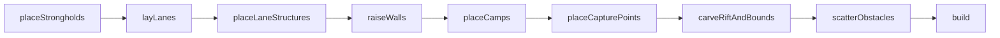

# Map and minimap

**Purpose.** Read this when you add or change anything about where things are on the map
(lanes, towers, walls, camps, capture points, the rift, obstacles), when you touch the runtime
grids that pathing and collision read (`WorldMap`), or when you wonder why the minimap needs no
code for a new structure kind. It records decision D7 (ADR 0009): the map is **generated from
config** by a pure `MapGenerator`; hand-traced coordinates are never the source of truth. All code
below is the design sketch. The generator now exists in `packages/core/src/map/` (branch
`feat/map-generator`, which replaced `feat/map`'s hand-traced `MAP_1`, reviewed in §9). Where the
code differs from a sketch here, §10 says how and why.

## 1. The decision and the litmus test

The requirements doc gives the acceptance test: change `NUM_LANES`, `NUM_SPAWN_TOWERS`,
`NUM_BUFF_TOWERS` in a config file and the map adjusts. We generalise it to a `MapConfig` object
on `GameConfig.map` and one pure function:

```ts
// packages/core/src/map/MapGenerator.ts (sketch)
export class MapGenerator {
  constructor(
    private readonly laneShape: LaneShape,
    private readonly rngFactory: RngFactory,
  ) {}
  /** Pure: same config + seed = same MapDefinition. No Math.random, no Date. */
  generate(config: GameConfig, seed: number): MapDefinition;
}
```

Pure because the generator runs in Node tests, in the client before `Simulation` starts and later
in a Worker with identical output. A class rather than a free function because the `LaneShape`
strategy and the `Rng` factory arrive by constructor injection, so tests can swap them (DIP).

- **MVP**: three straight lanes, 1 `SpawnerTower` + 1 `BuffTower` per lane, one `Stronghold` per
  team inside a wall ring with gates and turrets, 6 camps per side, 3 capture points (middle one
  is the `Cathedral`), the rift, out-of-bounds polygons.
- **MVP-if-time**: corner camps (`cornerCamps`), destructible bridge segments across the rift,
  scattered obstacles (trees, rocks).
- **post-MVP**: curved (Bézier) lanes, several authored presets, fog of war on the minimap.

## 2. Map configuration (`GameConfig.map`)

```ts
// packages/core/src/config/GameConfig.types.ts (sketch, map part only)
export type SymmetryAxis = 'vertical' | 'horizontal'; // 'vertical' = mirror west <-> east

export type MapConfig = {
  readonly numLanes: number; // TUNE: 3 (requirements doc MVP)
  readonly spawnTowersPerLane: number; // TUNE: 1
  readonly buffTowersPerLane: number; // TUNE: 1
  readonly campsPerSide: number; // TUNE: 6; split evenly over the numLanes - 1 corridors
  readonly cornerCamps: number; // TUNE: 4 (game doc "Outer (Corner) Camps"); MVP-if-time
  readonly worldWidth: number; // world units (10-physics.md §1)
  readonly worldHeight: number;
  readonly symmetryAxis: SymmetryAxis; // light on the west, dark on the east (as in feat/map)
  readonly strongholdInset: number; // team edge to stronghold centre
  readonly wallRing: { readonly radius: number; readonly segments: number }; // gates = numLanes
  readonly laneSpread: number; // lateral distance between adjacent lane corridors
  readonly laneWidth: number;
  readonly laneBands: {
    readonly spawner: readonly [number, number]; // t band for front-line towers, TUNE [0.3, 0.45]
    readonly buff: readonly [number, number]; // t band for second-line towers, TUNE [0.12, 0.25]
  };
  readonly rift: { readonly halfWidth: number; readonly bridgeWidth: number };
  readonly obstacleDensity: number; // scattered obstacles per 10k square units, TUNE
};
```

`validateGameConfig()` rejects: `numLanes < 1`; an even `numLanes` (the Cathedral needs a middle
lane; **Recommendation:** keep this rule for the MVP rather than invent an off-lane Cathedral);
`campsPerSide % (numLanes - 1) !== 0`; a `laneSpread` that would put an outer lane outside the wall
ring (every lane must exit through its own gate); any negative size. Errors name the field and the
rule so a config typo fails at boot, not mid-match.

## 3. `MapGenerator` and the `MapBuilder`

`generate` is a Template Method that runs a `MapBuilder` (Builder pattern) step by step. Each
step appends features to the definition under construction and reads only config, the seeded
`Rng` and earlier steps' output. The order is fixed because later geometry depends on earlier:



1. **placeStrongholds**: light at `(strongholdInset, worldHeight / 2)`, dark at its mirror.
2. **layLanes**: lane `i`'s light gate sits on the wall ring at an angle spread evenly over the arc
   facing the enemy; the `LaneShape` strategy traces the lane from that gate to the mirrored dark
   gate. The MVP `StraightLaneShape` returns a 4-point polyline (gate → fan-out point → mirrored
   fan-out point → mirrored gate), so every segment is straight, as the game doc asks ("lanes are
   kept straight to simplify collision detection"). `PolylineLaneShape` (authored paths) and a
   Bézier shape are **post-MVP** implementations of the same interface (OCP: new shape, new class).
3. **placeLaneStructures**: per lane and team, `spawnTowersPerLane` `spawner-tower` features at
   parametric positions `t` spread evenly inside `laneBands.spawner`, and `buffTowersPerLane`
   `buff-tower` features inside `laneBands.buff`. `t` is the arc-length fraction from the team's
   own gate (`t = 0`) to the enemy gate (`t = 1`): "front line" and "second line" are bands, not
   coordinates, so N per lane works for any N.
4. **raiseWalls**: a ring polygon of `wallRing.segments` vertices around each stronghold; the
   segment crossed by lane `i` becomes a `gate` (gate count = lane exits = `numLanes`); the other
   segments are `wall-segment`s; a `turret` sits on every ring vertex.
5. **placeCamps**: each of the `numLanes - 1` corridors between adjacent lanes receives
   `campsPerSide / (numLanes - 1)` `camp` features per side along the corridor midline within the
   team's half; `cornerCamps` `corner-camp` features go in the map corners (MVP-if-time).
6. **placeCapturePoints**: one `capture-point` at `t = 0.5` of each lane; the middle lane's is
   emitted as `cathedral`.
7. **carveRiftAndBounds**: the rift polygon runs along the symmetry axis with a `rift.bridgeWidth`
   gap where each lane crosses it (bridge-segment obstacles fill the gaps when enabled);
   out-of-bounds polygons close the corners.
8. **scatterObstacles**: seeded scatter of tree/rock obstacles on walkable ground away from lanes
   and features; rejected samples still consume the `Rng` in a fixed order, so output is
   reproducible per seed.
9. **build**: assign ids (`light-spawner-tower-lane-0-0`), validate (§7) and freeze.

Symmetry is not a step: every team feature is placed for `light` and mirrored with
`mirror(point, symmetryAxis, size)` from `map/symmetry.ts`. That is the DRY fix for the
hand-traced branch, where each dark coordinate was typed by hand.

```ts
// packages/core/src/map/LaneShape.ts (sketch)
export interface LaneShape {
  trace(lightGate: Vec2, darkGate: Vec2, laneIndex: number, config: MapConfig): readonly Vec2[];
}
// LaneGeometry wraps a traced path: length, pointAt(t), tangentAt(t), corridor polygon.
```

## 4. `MapDefinition` types

The `feat/map` branch already has `MapDefinition`, `MapFeature`, `MapTerrain`, `MapLane`, `Vec2`
and `Polygon`. We keep those names and evolve `MapFeature` into a discriminated union so the kind
carries what `EntityFactory` needs:

```ts
// packages/core/src/map/MapDefinition.types.ts (sketch)
export type MapFeatureKind =
  | 'spawner-tower'
  | 'buff-tower'
  | 'stronghold'
  | 'wall-segment'
  | 'gate'
  | 'turret'
  | 'camp'
  | 'capture-point'
  | 'cathedral'
  | 'corner-camp'
  | 'obstacle';

type FeatureBase = {
  readonly id: string;
  readonly owner: TeamId; // 'light' | 'dark' | 'neutral' from the shared teams module (§9)
  readonly definitionId: string; // content id, e.g. 'spawner-tower', 'oak-tree'
  readonly position: Vec2;
};
export type LaneFeature = FeatureBase & {
  readonly kind: 'spawner-tower' | 'buff-tower' | 'gate' | 'capture-point' | 'cathedral';
  readonly laneIndex: number;
  readonly t: number; // arc-length fraction from the owner's gate
};
export type WallFeature = FeatureBase & {
  readonly kind: 'wall-segment' | 'turret';
  readonly footprint: Polygon; // the segment's collider; turrets use the definition footprint
  readonly ringIndex: number;
};
// StrongholdFeature, CampFeature { corridorIndex } and ObstacleFeature { rotation } follow suit.
export type MapFeature =
  LaneFeature | WallFeature | StrongholdFeature | CampFeature | ObstacleFeature;

export type MapTerrainKind = 'out-of-bounds' | 'rift'; // ground polygons that are not entities
export type MapLane = {
  readonly id: string;
  readonly index: number;
  readonly path: readonly Vec2[];
};
export type MapDefinition = {
  readonly id: string;
  readonly displayName: string;
  readonly width: number;
  readonly height: number;
  readonly seed: number;
  readonly lanes: readonly MapLane[];
  readonly terrain: readonly MapTerrain[];
  readonly features: readonly MapFeature[];
};
```

Each feature kind maps to one entity kind in `EntityRegistry` (Factory). `EntityFactory.fromFeature`
is the only code that reads a feature's kind; adding a kind means one union member, one content
definition and one registry line (the product owner's litmus test).

| Kind            | Owner   | Placed by           | Entity                       | MVP status  |
| --------------- | ------- | ------------------- | ---------------------------- | ----------- |
| `stronghold`    | team    | placeStrongholds    | `Stronghold`                 | MVP         |
| `spawner-tower` | team    | placeLaneStructures | `SpawnerTower`               | MVP         |
| `buff-tower`    | team    | placeLaneStructures | `BuffTower`                  | MVP         |
| `wall-segment`  | team    | raiseWalls          | `WallSegment`                | MVP         |
| `gate`          | team    | raiseWalls          | `Gate`                       | MVP         |
| `turret`        | team    | raiseWalls          | `Turret`                     | MVP         |
| `camp`          | neutral | placeCamps          | `Camp`                       | MVP         |
| `corner-camp`   | neutral | placeCamps          | `Camp`                       | MVP-if-time |
| `capture-point` | neutral | placeCapturePoints  | `CapturePoint` (zone)        | MVP         |
| `cathedral`     | neutral | placeCapturePoints  | `CapturePoint` + `Cathedral` | MVP         |
| `obstacle`      | neutral | scatterObstacles    | `Obstacle`                   | MVP-if-time |

## 5. Authored presets (`content/maps/`)

Designers will want the hand-drawn look of the team sketch. Presets are allowed, but they are
**overrides of generator inputs, never coordinates of features**:

```ts
// packages/core/src/content/maps/map1.ts (sketch of the evolved file)
export const MAP_1_PRESET = {
  id: 'map-1',
  displayName: 'Map 1', // TUNE: placeholder name
  config: { numLanes: 3, laneSpread: 300 }, // partial MapConfig merged over defaults
  laneShape: 'polyline', // selects the LaneShape strategy
  lanePaths: { 'lane-0': [/* light half only; the dark half is mirrored */] },
} satisfies MapPreset;
```

The generator still places towers, gates, camps and capture points by `t` along whatever path a
preset supplies, and `validateMapDefinition` still enforces symmetry. A preset cannot break the
`NUM_LANES` litmus test: `numLanes: 5` with a preset that lists three paths fails validation with
a clear message instead of silently drawing the wrong map.

## 6. `WorldMap` runtime

`WorldMap` is the mutable per-match view of the map that systems read. It is built once from the
`MapDefinition` and updated only through events (never by views or the client):

```ts
// packages/core/src/map/WorldMap.ts (sketch)
export class WorldMap {
  static fromDefinition(def: MapDefinition, cellSize: number): WorldMap;
  readonly cols: number;
  readonly rows: number;
  readonly walkable: Uint8Array; // 1 = walkable
  readonly cost: Uint8Array; // 1..254 movement cost, 255 = blocked (Emerson's cost stamps)
  stampFootprint(footprint: Polygon, cost: number): readonly number[]; // returns dirty cells
  clearFootprint(footprint: Polygon): readonly number[];
  flowField(laneIndex: number, team: TeamId): FlowField; // cached, dirty-flagged
  rebuildDirty(cellBudget: number): void; // time-sliced; PathingSystem calls it each tick
}
export type FlowField = { readonly integration: Uint16Array; readonly direction: Int8Array };
```

- The grid is derived from the definition at load (walls, closed gates, structures and obstacles
  stamp their footprints); it is never hand-authored
  ([research §3](../research/game-architecture-and-performance-research.md#3-pathfinding-and-movement-for-lane-minions-and-large-unit-counts)).
- One flow field per (lane, team), flood-filled from the enemy gate inside the lane corridor;
  `PathingSystem` follows it, Legends use A* on the same grid (`10-physics.md` §9).
- Destructible terrain events (`07-structures-obstacles-and-destructibles.md` §10) re-flag cells
  through `stampFootprint`/`clearFootprint`; affected fields are marked dirty and rebuilt over
  several ticks with a cell budget (Dirty Flag; time slicing as in Supreme Commander 2).
- Typed arrays keep the hot data allocation-free and transferable (D8).

## 7. Generator tests (`packages/core/src/map/MapGenerator.test.ts`)

- **Mirror invariant** (kept from `feat/map`, generalised): for every `light` feature there is
  exactly one `dark` feature of the same kind and `laneIndex`/`t`/`ringIndex` at
  `mirror(position)`; neutral features are self-mirrored or paired. Light is west, dark is east.
- **Counts follow config**: `numLanes = 5, spawnTowersPerLane = 2` yields 5 lanes, 10 spawner
  towers per team, 5 gates per ring, 5 capture points (1 cathedral), `campsPerSide` camps per side.
- **Determinism**: two `generate(config, seed)` calls are deep-equal; a different seed changes
  only obstacle scatter, never team features.
- **Containment**: every point lies inside the world; no team feature overlaps the rift or
  out-of-bounds terrain; every lane crosses its ring exactly at its gate.
- **Validation**: even `numLanes`, uneven camps or a preset with the wrong lane count throws.

## 8. Minimap

The minimap is **the same scene drawn smaller**, not a second scene graph
([research §5](../research/game-architecture-and-performance-research.md#5-canvas-2d-performance)).

- `MinimapView` (`apps/client/src/game/views/MinimapView.ts`, L4) reads the same `Snapshot` that
  `SceneView` reads and walks the same `ViewRegistry`. It draws into the `'minimap'` layer of the
  `Renderer` (an offscreen canvas composited into the `MinimapPanel` slot) at a lower cadence
  (**Recommendation:** every 6th frame, TUNE) and redraws its terrain backdrop only when
  `snapshot.terrainVersion` changes (Dirty Flag).
- `MinimapProjection` (`apps/client/src/game/engine/camera/`) implements the same `Projection`
  port as `Camera` (`worldToScreen`/`screenToWorld`) with a fixed scale, so culling and coordinate
  code is shared and the HUD can turn a minimap click into a world position for a `Command`.
- Every definition (structure, obstacle, unit, zone) may declare a `minimapGlyph`; the base
  `EntityView.drawGlyph` reads it and falls back to `DEFAULT_MINIMAP_GLYPH`. Team colour comes from
  the entity's `team`, not from the glyph.

```ts
// packages/core/src/content/minimapGlyph.types.ts (sketch)
export type MinimapGlyph = {
  readonly shape: 'dot' | 'square' | 'diamond' | 'ring' | 'footprint';
  readonly size: number; // minimap pixels
  readonly colourRole: 'team' | 'neutral' | 'objective' | 'terrain' | 'obstacle';
};

// apps/client/src/game/views/EntityView.ts (sketch)
export abstract class EntityView {
  abstract draw(entity: EntitySnapshot, ctx: DrawContext): void;
  drawGlyph(entity: EntitySnapshot, ctx: DrawContext): void {
    const glyph = ctx.definitions.get(entity.definitionId)?.minimapGlyph ?? DEFAULT_MINIMAP_GLYPH;
    ctx.renderer.drawGlyph(glyph, ctx.projection.worldToScreen(entity.position), entity.team);
  }
}
```

Because the generator emits features from config, `EntityFactory` turns every feature into a
snapshot entity, and `MinimapView` draws every snapshot entity through the registry, the
requirement "new building on map = new building on minimap with no code change" holds **by
construction**. The test that proves it (`MinimapView.test.ts`):

```ts
it('draws one glyph per generated feature: extra config features need no view code', () => {
  const draw = (map: MapConfig) => {
    const sim = Simulation.create({ ...config, map }, SEED);
    const renderer = new RecordingRenderer(); // test double for the Renderer port
    const projection = new MinimapProjection(map, MINIMAP_SIZE);
    new MinimapView(viewRegistry, projection).draw(sim.snapshot(), renderer);
    return { projection, calls: renderer.calls.filter((c) => c.op === 'drawGlyph') };
  };
  const base = draw(config.map);
  const more = draw({ ...config.map, buffTowersPerLane: config.map.buffTowersPerLane + 1 });
  // one extra tower per lane per team
  expect(more.calls.length - base.calls.length).toBe(2 * config.map.numLanes);
  for (const call of more.calls) {
    expect(call.position).toEqual(more.projection.worldToScreen(call.source.position));
  }
});
```

A second test registers a throwaway `StructureDefinition` (`'beacon'`) with a glyph and one
generated feature, and asserts the glyph is drawn without registering any `EntityView` (the
default view handles it). Fog of war on the minimap is **post-MVP**: when enabled, `MinimapView`
filters entities by the player team's `Vision` snapshot before drawing.

## 9. Review notes for the `feat/map` branch

Written for the PR review; the branch is a good first step and most of it survives.
**Status (2026-10-05):** acted on by `feat/map-generator`; see
[the map code audit](../reviews/2026-10-05-map-code-audit.md) for what changed.

**Keep**

- The type names `MapDefinition`, `MapFeature`, `MapTerrain`, `MapLane`, the `readonly` style,
  the TSDoc, and `Vec2`/`Rect`/`Polygon` in `utils/geometry.ts` (they become the shared geometry
  primitives for `10-physics.md`).
- The tests (unique ids, containment, one capital per team, and especially the mirror test); they
  move to `MapGenerator.test.ts` and run against generated output for several configs.
- The convention light = west, dark = east, and the `TUNE` comments on provisional values.

**Change**

- `MAP_1` hard-codes every coordinate; D7 makes the generator the source of truth. Keep the traced
  lane polylines as the `map-1` preset's `lanePaths` (light half only) and drop the hand-typed
  structure positions; towers, camps and capture points come from `t` bands.
- `'team-structure'` is too generic for the factory: split into `spawner-tower`, `buff-tower`,
  `stronghold`, `wall-segment`, `gate`, `turret` (§4). `'capital'` becomes `stronghold`,
  `'side-objective'` becomes `corner-camp`, `'crossing'` becomes bridge-segment `obstacle`s.
- `TeamId` should not live in `content/maps/mapDefinition.ts`; move it to a shared teams module
  (**Recommendation:** `packages/core/src/components/Team.types.ts` exporting
  `TeamId = 'light' | 'dark' | 'neutral'` and `PlayableTeamId`) because units, structures,
  commands and events all need it; `FeatureOwner` then disappears.
- `'capital-wall'` terrain becomes `wall-segment` features (walls have health and colliders, so
  they are entities, not ground). `MapTerrain` keeps `out-of-bounds` and `rift`.
- `index.ts` repeats its header comment; keep one copy. Exporting `MAP_1` as a runtime value will
  become `MAP_1_PRESET` plus `MapGenerator`, and the `index.test.ts` assertion on
  `Object.keys(core)` changes with it.
- File names: `mapDefinition.ts` holds only types, so the repo convention makes it
  `MapDefinition.types.ts` under `map/` (`CONTRIBUTING.md` §3.1).

## 10. Implementation notes (`feat/map-generator`, 2026-10-05)

The generator follows §1–§8 with the differences below. Full reasoning is in
[the map code audit](../reviews/2026-10-05-map-code-audit.md) §4 and §6 (row numbers match).

| #   | Topic                      | As implemented                                                                                                                                                                                                                                                                                                                                                                       | Status                                          |
| --- | -------------------------- | ------------------------------------------------------------------------------------------------------------------------------------------------------------------------------------------------------------------------------------------------------------------------------------------------------------------------------------------------------------------------------------ | ----------------------------------------------- |
| D1  | `MapFeature` (§4)          | Flat: `{ id, kind, team, definitionId, position, minimapGlyph, laneId?, footprint? }` (integration contract §2.2).                                                                                                                                                                                                                                                                   | Contract                                        |
| D2  | Type location (§4, §9)     | `packages/core/src/content/maps/maps.types.ts` (map types, `MapFeatureDefinition`, `MapLayout`, `MapPreset`).                                                                                                                                                                                                                                                                        | Contract                                        |
| D3  | Teams (§9)                 | `packages/core/src/teams/teams.types.ts`: `PlayableTeam`, `Team`.                                                                                                                                                                                                                                                                                                                    | Contract                                        |
| D4  | Minimap (§8)               | `MinimapGlyph` is in `content/maps/maps.types.ts`. `WorldLayer.drawMinimap` (implemented by `MapView`) draws each feature's glyph. `ViewRegistry`/`EntityView.drawGlyph` arrive with session H.                                                                                                                                                                                      | Interim                                         |
| D5  | Camp split (§2, §3 step 5) | `campsPerSide` is spread as evenly as possible over the `numLanes - 1` corridors, leftovers to the middle corridors first. It is not rejected when it does not divide.                                                                                                                                                                                                               | **Pending owner decision** (INBOX DEC-14)       |
| D6  | Presets (§5)               | A preset gives a lane profile (bends `(u, v)` scaled per lane), a rift **width profile** centred on the symmetry axis (one bridge gap is cut per lane) and west out-of-bounds polygons (mirrored), all in fractions of the world size, so `map-1` works for any odd `numLanes` and any world size and the map stays mirror-symmetric (checked by `validateMapDefinition`).           | **Pending owner decision** (INBOX DEC-14)       |
| D7  | Wall ring (§3 step 4)      | Exits are spread evenly over `wallRing.exitArcDegrees` facing the enemy (§3 step 2). A gate is centred on each exit, wall segments fill the remaining arcs (split at `maxSegmentArcDegrees`), turrets stand on every ring corner, so gate count = `numLanes` by construction. A gate narrower than `wallRing.minGateOpening` between its turrets is rejected (today `numLanes` ≤ 7). | **Pending owner decision** (INBOX DEC-14)       |
| D8  | Constructor (§1)           | `new MapGenerator(deps?)` with `layout`, `definitions`, `presets`, `createRng`, `createLaneShape`, all defaulted.                                                                                                                                                                                                                                                                    | Superset                                        |
| D9  | `MapConfig` (§2)           | Contract counts and world size only. Layout knobs are `MapLayout` content (`DEFAULT_MAP_LAYOUT`).                                                                                                                                                                                                                                                                                    | Contract                                        |
| D10 | Kernel stand-ins           | `MapRandom` (mulberry32), a local `MapConfig`/`DEFAULT_MAP_CONFIG` and `validateMapConfig` stand in for session B's `SeededRandom`, `GameConfig` and `validateGameConfig`. `navCellSize` (5 units) is content. `Math.cos`/`Math.sin` live only in `utils/geometry.ts` `polarPoint` until `deterministicMath.ts` exists; a golden hash test catches drift.                            | Interim (`TODO(sholtzman)`, INBOX request to B) |
| D11 | Renderer port (08 §4)      | `engine/render/Renderer.ts` (interface) and `Canvas2dRenderer.ts`. The method set is `feat/map-view`'s plus `drawWorldGlyph`/`drawGlyph`. Layers and sprites come with session H.                                                                                                                                                                                                    | Interim                                         |

## Related

- [03 Game model](./03-game-model.md)
- [07 Structures, obstacles and destructibles](./07-structures-obstacles-and-destructibles.md)
- [08 Game engine](./08-game-engine.md) (render pipeline, `SceneView`, `ViewRegistry`)
- [10 Physics](./10-physics.md) (grid resolution, colliders, `SpatialHash`)
- [11 Game AI](./11-game-ai.md) (flow-field following)
- [17 Extension recipes](./17-extension-recipes.md)
- [Map code audit (2026-10-05)](../reviews/2026-10-05-map-code-audit.md)
- [Research: game architecture and performance](../research/game-architecture-and-performance-research.md)
- [Reference: map](../reference/game-design/05-map.md)
