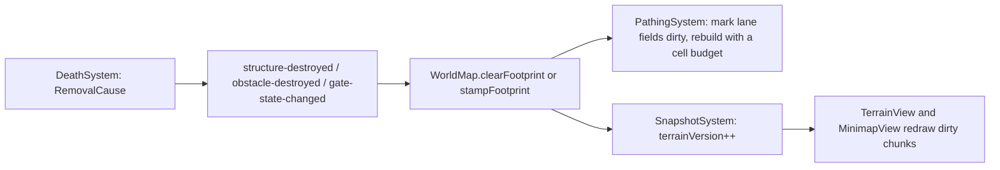

# Structures, obstacles and destructibles

**Purpose.** Read this when you implement or change anything that stands still and can be
damaged: a building, a wall, a gate, a turret, a camp, a capture point, a tree or a bridge. It
defines the `Structure` family (D4, D10), the `Health` component with layered shield bars, the
data-driven breakability rules, the spawner and capture mechanics, obstacles, and how destruction
flows into `WorldMap` and the minimap. Every code block is a sketch; the numbers quoted from the
game doc are `TUNE` values that live in `content/`, never in systems.

## 1. The `Structure` family

`Structure` is the abstract child of `Entity` for static things with health. Subclasses exist only
where lifecycle differs; everything tunable comes from a `StructureDefinition` (Type Object) keyed
by kebab-case id, and behaviour that varies per kind is a component or a strategy chosen from data.

```ts
// packages/core/src/entities/structures/Structure.ts (sketch)
export abstract class Structure extends Entity {
  readonly health: Health; // base + layered shield bars
  readonly collider: Collider; // ConvexPolygon footprint, isUnbreakable from BreakabilityRule
  readonly team: Team; // 'light' | 'dark' | 'neutral' (D10)
  protected constructor(
    id: EntityId,
    readonly definition: StructureDefinition,
  ) {
    super(id);
  }
  /** Template Method hook: subclasses register extra components. */
  protected abstract attachComponents(): void;
}
```

| Class          | Extra components                     | Responsibility                                                                      | MVP status                          |
| -------------- | ------------------------------------ | ----------------------------------------------------------------------------------- | ----------------------------------- |
| `Stronghold`   | `Spawner`, `Aura`                    | Capital; its death ends the match; spawns initial hordes and later waves            | MVP                                 |
| `SpawnerTower` | `Spawner`, `Combat` (self-defence)   | Front line; spawns light hordes every 60 s after the countdown; guards              | MVP                                 |
| `BuffTower`    | `Spawner`, `Aura`, `Combat`          | Second line; team buffs, enemy debuff aura (10% health/damage, TUNE); shield source | MVP                                 |
| `WallSegment`  | none                                 | Ring collider; unbreakable until the rule in §3 passes                              | MVP                                 |
| `Gate`         | `GateState`, `Combat` (fire defence) | Opens for allies/hordes, closes otherwise; burns enemies passing through            | MVP (fire: MVP-if-time)             |
| `Turret`       | `TurretState`, `Combat`              | Auto-fires bolts; Warrior Legends may take manual control                           | MVP (manual: MVP-if-time)           |
| `Camp`         | `Spawner`                            | Neutral spawner for forest/corner camps; activates after cooldown                   | MVP (corner: MVP-if-time)           |
| `Cathedral`    | `Spawner` (gem), `Aura`              | Middle capture point's building; summons the `GreaterBoss` mid-match                | MVP (boss summon: per plan phase 3) |

Not a structure: `CapturePoint` is a `Zone` (no collider, §7). Anti-air buildings and form-change
stations (Ascendance/Enchantment) are **post-MVP** (§14).

## 2. `Health` with layered shield bars

The game doc: per living allied buff tower, a spawner tower gains 125% of its base health, another
buff tower 150%, a wall 200%, each as a separate bar that absorbs damage before the base bar (all
`TUNE`, from "How Buff/Debuff Towers ... Buff Walls and Friendly Structures").

```ts
// packages/core/src/components/Health.ts (sketch)
export type ShieldBar = { readonly sourceId: EntityId; current: number; readonly max: number };
/** Where one hit's damage went (DEC-23): shields, base, and what was left once both were empty. */
export type DamageBreakdown = {
  readonly toShields: number;
  readonly toBase: number;
  readonly overflow: number;
};
export class Health {
  base: number; // current base health
  readonly baseMax: number;
  readonly shields: ShieldBar[]; // one per living allied BuffTower, in tower id order
  get total(): number; // base + sum(shields.current)
  /** Drains shields first (newest bar last), then base, and says where the damage went. */
  applyDamage(amount: number): DamageBreakdown;
  addShield(sourceId: EntityId, max: number): void;
  removeShield(sourceId: EntityId): void; // drops the bar; never touches base or other bars
}
```

Worked example (game doc): a structure with 1000 base health, three allied buff towers alive and a
150% bar each has three bars of 1500. Its total is 1000 + 3 × 1500 = **5500**. The game doc's own
example says 4500, which is the sum of the bars alone; flagged in `reference/suggestions/discrepancies.md`
so the product owner can confirm which reading is intended. Damage of 2000 empties one bar and
takes 500 from the next; base stays 1000. When a buff tower dies, `StructureSystem` calls
`removeShield(towerId)` on every allied structure: the bar vanishes with whatever it had left, base
is untouched, so a tower with low base health is never destroyed by another tower's death (the
doc's stated goal). Bar sizes come from `StructureDefinition.shieldFractions[targetKind]` and are
computed on the base max, not compounded (`1.5 × base` per bar). `DamagePipeline` (combat) calls
`applyDamage`; `Health` is the single place that knows the bar order (SRP).

## 3. Breakability as data

Walls and gates are unbreakable until at least two of the defender's three buff towers are down
(game doc). Because `buffTowersPerLane` and `numLanes` are config, the threshold is a fraction:

```ts
// packages/core/src/content/structures/breakability.types.ts (sketch)
export type BreakabilityRule =
  | { readonly kind: 'always' }
  | { readonly kind: 'never' } // corner-camp crystals
  | { readonly kind: 'allied-buff-towers-down'; readonly fraction: number } // TUNE: 2/3
  | { readonly kind: 'all-of'; readonly rules: readonly BreakabilityRule[] };
```

`StructureSystem.isBreakable(structure)` evaluates the rule each tick against `GameState`:
threshold = `ceil(fraction × buffTowersPerTeam)` (2 of 3 today; 4 of 5 with five lanes). The result
sets `Collider.isUnbreakable` and is emitted as `structure-breakability-changed`, so the
`DamagePipeline` rejects damage to unbreakable targets and `CollisionSystem` runs swept tests
against them (`10-physics.md` §7). New rules are new union members plus one `case` in the
evaluator (OCP).

**Sentinel sprint-through** (MVP-if-time): a Sentinel at full speed (`Movement.speed >=
maxSpeed × sprintThrough.fullSpeedFraction`, TUNE 1.0; the doc says up to 1 minute of straight
running) may pass a _breakable_ wall segment: it takes `selfHealthCost` (TUNE 50%) of its own max
health and deals `segmentDamageFraction` (TUNE 50%; "10,000 health → 5,000 damage") of the segment's
base max health through the normal pipeline (shields absorb first; **Recommendation**, the doc is
silent on shields here). The rule is an `AttackStrategy` on the Sentinel, not a special case in
`CollisionSystem`: the resolver asks `collider.onContact(other)` and the Sentinel's strategy answers
`pass-through` or `block`.

## 4. Gates

```ts
// State pattern; ticks per transition come from content
export type GateState = 'closed' | 'opening' | 'open' | 'closing';
```

- `StructureSystem` opens a gate when an allied unit or horde is within `openRadius` and closes it
  when none is (hysteresis via `closeDelayTicks`); transitions take `transitionTicks` (the doc says
  "slowly"; TUNE).
- While `open` or `opening`, the gate's footprint is cleared from `WorldMap` (§10); while `closed`
  or `closing` it is stamped as blocked and is a swept-test collider.
- Fire defence (MVP-if-time): an enemy inside an open gate's footprint takes `fireDamagePerTick`
  through `DamagePipeline` with source = the gate, so deaths have a cause.
- Damage multipliers per attacker class live in `StructureDefinition.damageMultipliers`
  (`{ 'heavy-mob': 1, sentinel: 1, 'magus-ability': 1, default: 0.1 }`, TUNE from "Heavy Minions,
  Sentinels, and Magus' damage abilities do the most damage to gates"). The pipeline reads them by
  the attacker's `definition.damageClass`; nothing in code names a class.

## 5. Turrets

```ts
export type TurretControl = 'auto' | { readonly kind: 'manual'; readonly legendId: EntityId };
export type AmmoDefinition = {
  readonly id: string; // 'bolt-default' | 'bolt-heavy'
  readonly cooldownTicks: number; // TUNE: default 1 bolt / 5 s (150 ticks), heavy 1 / 10 s (300)
  readonly projectileId: string;
  readonly preferredTargetClasses: readonly string[]; // heavy: ['sentinel', 'heavy-mob']
};
```

`TurretController` (in `ai/`) drives auto mode: acquire the first enemy in range, keep it while
alive and in range, prefer by a data priority list, switch ammo to the first `AmmoDefinition`
whose `preferredTargetClasses` includes the target's class, and aim predictively (target position

- velocity × time-to-impact, solved in two iterations with deterministic vector math, no `atan2`).
  Manual mode (MVP-if-time): an Warrior Legend issues the `turret-toggle-control` and
  `turret-switch-ammo` `InputAction`s (bound to P and T by default, rebindable, never hard-coded);
  the turret then fires where the player aims until they leave, and auto resumes. Ammo is data:
  changing rates or adding a third ammo is a content entry, matching the doc's "couple lines" wish.

## 6. Spawners

```ts
// packages/core/src/components/Spawner.ts (sketch)
export type SpawnTable = readonly { readonly mobId: string; readonly count: number }[];
export type SpawnWave = {
  readonly afterTick: number; // first eligible tick (the 60 s countdown for towers)
  readonly everyTicks: number; // cadence (60 s = 1800 ticks for towers, TUNE)
  readonly table: SpawnTable;
};
export type GuardPlan = {
  readonly table: SpawnTable;
  readonly leashRadius: number;
  readonly respawnTicks: number; // TUNE: 2 minutes = 3600 ticks
};
export class Spawner {
  readonly waves: readonly SpawnWave[];
  readonly guards: GuardPlan | null;
  nextWaveTick: number;
}
```

`SpawnSystem` walks every `Spawner` in id order and emits `spawn-requested` events that
`EntityFactory` fulfils at the end of the tick (deferred spawns, deterministic order); a horde
batch is fulfilled in one step together with its horde record ([18](18-minion-system.md) §3.2):

| Source          | Waves                                                                                   | Guards                                    | MVP status  |
| --------------- | --------------------------------------------------------------------------------------- | ----------------------------------------- | ----------- |
| `Stronghold`    | 3 light hordes of 16 at match start (48 units); later light swarms and heavy mobs       | ranged + melee guards, leash to the walls | MVP         |
| `SpawnerTower`  | 1 light horde every 60 s after the 60 s countdown (TUNE)                                | light mob guards                          | MVP         |
| `BuffTower`     | light and medium swarms (TUNE cadence)                                                  | numerous medium guards                    | MVP         |
| `Camp` (forest) | none; a fixed group after the activation cooldown (TUNE)                                | the group itself, leashed to the camp     | MVP         |
| `Camp` (corner) | a `MiniBoss` + support every 5 min after its death (TUNE); crystal is `never` breakable | boss guards                               | MVP-if-time |
| `Cathedral`     | the gem summons the `GreaterBoss` mid-match via `MatchTimeline`                         | none                                      | phase 3     |

Guards use `GuardController` with `leashRadius` ("don't leave the tower's perimeter") and respawn
after `respawnTicks` (TUNE: 2 minutes = 3600 ticks). Horde sizes are
`GameConfig.match.hordeSizes` (FR-037) and cadences are spawner data (DISC-10); the owner may move
either ([18-minion-system](18-minion-system.md) §10), and the `Stronghold` and `BuffTower` rows
above follow that answer.

## 7. Capture points

`CapturePoint` is a `Zone` with a `Capturable` component; the `Cathedral` structure stands inside
the middle one.

```ts
export class Capturable {
  ownerTeam: Team; // 'neutral' at match start
  progress: number; // -1..1, negative = dark, positive = light (TUNE rate per unit inside)
  checkpoint: 0 | 1 | 2 | 3;
  lockedBy: EntityId | null; // a living MiniBoss locks the zone
}
```

`CaptureSystem`: if exactly one team has units inside and `lockedBy === null`, progress moves
toward that team; crossing a checkpoint threshold spawns that checkpoint's defenders through a
`Spawner` table (1: medium assist mobs; 2: heavy plus light assist mobs; 3: one massive
"Balrog-type" mob) and, when cleared, awards XP shared among nearby allies biased toward the top
damage dealer (`ProgressionSystem` listens to `checkpoint-cleared`). Holding a zone applies
`StatusEffects` from content: ability/ultimate cooldown reduction and, after `levelUpAfterTicks`,
a level-up for that side's lane minions; both are removed on loss. Mini-bosses at the quarter mark
lock the outer zones (`lockedBy`) until they die (`MatchDirector` timeline).

## 8. Structure destruction effects

| Event                          | Effect (all data in content)                                               | MVP status |
| ------------------------------ | -------------------------------------------------------------------------- | ---------- |
| any lane structure destroyed   | `enraged` status on enemy minions in that lane (lane gets harder)          | MVP        |
| `SpawnerTower` destroyed       | stronghold guard table shrinks; walls lose a bar if it was a shield source | MVP        |
| `BuffTower` destroyed          | its shield bars removed everywhere; team buff and enemy debuff aura end    | MVP        |
| `Gate`/`WallSegment` destroyed | footprint cleared; flow fields rebuilt; minimap terrain dirty              | MVP        |
| `Stronghold` destroyed         | `match-ended` with the winner                                              | MVP        |

Every effect is a listener on `structure-destroyed` in the owning system; `StructureSystem` never
calls another system (rule 12).

## 9. Obstacles

`Obstacle` is a concrete entity whose kinds are data:

```ts
// packages/core/src/content/obstacles/ObstacleDefinition.types.ts (sketch)
export type ObstacleDefinition = {
  readonly id: string; // 'oak-tree' | 'boulder' | 'bridge-segment'
  readonly kind: 'tree' | 'rock' | 'bridge-segment';
  readonly footprint: ConvexPolygon;
  readonly health: number | null; // null = unbreakable (isBreakable false)
  readonly isBurnable: boolean;
  readonly fell: FellEffect | null; // { length, damage, trunkWeight }; null = does not fall
  readonly weight: number; // for Carry capacity checks
  readonly minimapGlyph?: MinimapGlyph;
};
```

- Breakable vs unbreakable is the `health` field; unbreakable obstacles are swept-test colliders.
- Burnable obstacles take `burning` status damage (post-MVP unless fire abilities land).
- A fellable tree that dies falls away from its killer: units in the fall capsule take
  `fell.damage`, cells under the trunk are re-flagged (`terrain-changed`, "breaks the ground"), and
  the obstacle becomes a `felled-trunk` obstacle with `weight = trunkWeight` that a unit with
  `Carry.capacity >= weight` can pick up (`Carry` component, `PickUpStrategy` per class:
  Warrior low, Magus medium, Sentinel high; **MVP-if-time**).

## 10. Destructible terrain pipeline



The rebuild is time-sliced (Emerson, [research §3](../research/game-architecture-and-performance-research.md#what-this-means-for-eternalus-a-pipeline-for-300-units));
until a field is rebuilt, units keep following the old field and the collision system keeps them
out of the still-stamped cells, so nothing tunnels during the gap.

## 11. Events and invariants

Emitted (typed `GameEvents`): `structure-damaged`, `shield-bar-removed`,
`structure-breakability-changed`, `structure-destroyed`, `gate-state-changed`,
`turret-control-changed`, `turret-fired`, `spawn-requested`, `capture-progress`,
`checkpoint-cleared`, `capture-point-captured`, `obstacle-destroyed`, `tree-felled`,
`terrain-changed`, `entity-removed { cause: RemovalCause }`.

| Invariant (`diagnostics/`)             | Kind  | Checks                                                                         |
| -------------------------------------- | ----- | ------------------------------------------------------------------------------ |
| `NoPassThroughUnbreakableInvariant`    | light | no `collision-anomaly` for colliders with `isUnbreakable`                      |
| `NoRemovalWithoutCauseInvariant`       | light | every `entity-removed` carries a `RemovalCause` (killer, despawn rule, script) |
| `ShieldBarsMatchLivingTowersInvariant` | heavy | bars on each structure = living allied buff towers                             |
| `HealthWithinBoundsInvariant`          | light | `0 <= base <= baseMax`, every bar `0 <= current <= max`                        |
| `BreakabilityMatchesRuleInvariant`     | heavy | `isUnbreakable` equals the rule evaluated from scratch                         |
| `GateFootprintMatchesStateInvariant`   | heavy | closed gates are stamped in `WorldMap`, open ones are not                      |

These are the requirements doc's runtime checks ("entity passes through an unbreakable object",
"despawns without something else removing it") expressed as `Invariant` classes run by
`InvariantRunner` (see `15-diagnostics-and-runtime-testing.md`).

## 12. Minimap appearance

Every `StructureDefinition` and `ObstacleDefinition` carries an optional `minimapGlyph`
(`06-map-and-minimap.md` §8). `WallSegment`s and towers use team-coloured glyphs; camps neutral
dots; capture points rings whose colour follows `Capturable.ownerTeam`. No view code per kind: the
default `EntityView.drawGlyph` handles all.

## 13. Extension recipe: a new structure type

1. Add a `StructureDefinition` entry in `content/structures/` (health, `shieldFractions`,
   `breakability`, footprint, `damageMultipliers`, optional `spawner`, `minimapGlyph`).
2. Add a subclass under `entities/structures/` **only** if its lifecycle differs (otherwise reuse
   an existing class with the new definition). Depth stays ≤ 3 below `Entity`.
3. Add the kind to `MapFeatureKind` and one `EntityRegistry` line (feature kind → factory).
4. Add a `MapBuilder` step so the generator places it (presets never place features, DEC-14).
5. Optional: an `EntityView` in `ViewRegistry` for the main canvas; the minimap needs nothing.
6. Tests: the definition validates, the mirror test still passes, the minimap glyph test counts it.

Nothing in `StructureSystem`, `DamagePipeline`, `SpawnSystem` or `MinimapView` changes.

## 14. Post-MVP items

- **Anti-air defence** (orange in the game doc): a `Combat` targeting filter on `height > 0` once the
  Flying class exists; the `Turret` class does not change, only an `AmmoDefinition` and a
  `TargetingStrategy`.
- **Form change at buildings** (yellow): an `Interactable` component on `Stronghold`/`BuffTower`
  that emits `form-change-requested`; the Legend side is a `LegendSpecDefinition` swap (D11).
- **Bridges** across the rift as `bridge-segment` obstacles are MVP-if-time; until then the rift
  gaps are plain walkable ground.

## 13. Implementation status

Sprint 1.2 (PR #14) ships the `Structure` base, the `Obstacle` class and layered shields on
`Health`, with these interim differences:

- `Structure` and `Obstacle` use a circle `Collider` from `footprintRadius`; convex polygon
  footprints arrive with the structures in Phase 2. No concrete structure kind or content exists yet.
- `Health` keeps `current`/`max` for the base bar and adds `shields`, `total`, `addShield` and
  `removeShield`; bars stay in source id order.
- `ObstacleDefinition` keeps `kind: 'obstacle'` (the entity class) and moves tree/rock/bridge to
  `obstacleType`; `fell` and `minimapGlyph` arrive with felling and the minimap work.

## Related

- [04 Entity architecture](./04-entity-architecture.md)
- [06 Map and minimap](./06-map-and-minimap.md)
- [10 Physics](./10-physics.md) (colliders, swept tests, `unbreakable` semantics)
- [11 Game AI](./11-game-ai.md) (`GuardController`, `TurretController`)
- [12 Game story and match director](./12-game-story-and-match-director.md) (timeline, bosses)
- [15 Diagnostics and runtime testing](./15-diagnostics-and-runtime-testing.md)
- [17 Extension recipes](./17-extension-recipes.md)
- [Reference: structures and defences](../reference/game-design/03-structures-and-defenses.md)
- [Reference: objectives, capture points and bosses](../reference/game-design/04-objectives-capture-points-and-bosses.md)
