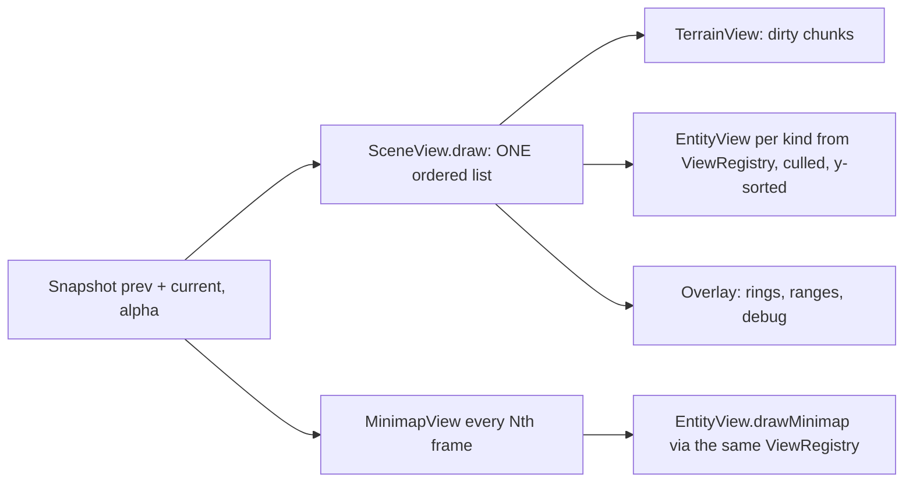

# Game engine

**Purpose.** Read this when you work in `apps/client/src/game/engine/` (the L1 infrastructure
layer), in `game/views/`, or in `game/Match.ts`. It fixes what the engine is (a small set of
generic ports and Canvas 2D adapters), what it is not (it knows nothing about Legends, towers or
lanes), how `Match` composes it with `Simulation`, and the frame and tick budgets we measure
against. D2 (no game engine or framework), D8 (single-threaded simulation) and D9 (30 ticks/s with
interpolation) are decided; this doc applies them. All code is a sketch.

## 1. Scope and rules

- `engine/` is **generic**: it imports no game types, views, input mapping, `Match` or `bridge/`
  (`apps/client/AGENTS.md`). It could drive a different game unchanged; that is the test for
  whether something belongs here.
- Ports are `interface`s; adapters are classes named after the platform API they wrap
  (`RafFrameScheduler`, `Canvas2dRenderer`, `WebAudioOutput`). Only `Canvas2dRenderer` touches
  `CanvasRenderingContext2D` (rule 7).
- Every engine object exposes `destroy()` and is destroyed by its owner; `Match.destroy()` tears
  down the loop, devices, renderer and audio so a rematch rebuilds only the match (Phaser's
  global-services versus per-scene split, [research §10](../research/game-architecture-and-performance-research.md#10-reference-architectures)).
- Subfolders: `loop/`, `render/`, `camera/`, `input/` (see `09-hardware-abstraction.md`), `audio/`,
  `time/`.

## 2. `GameLoop`

The design from `docs/architecture.md` §2 is kept verbatim:

```text
requestAnimationFrame(t)
  accumulator += min(t - lastT, 5 * TICK_MS)   // clamp: a background tab can't freeze the game
  while accumulator >= TICK_MS:
      Match.tick()        // input → Command, Simulation.step(), keep previous + current snapshot
      accumulator -= TICK_MS
  Match.render(alpha = accumulator / TICK_MS)  // views lerp between previous and current
```

```ts
// apps/client/src/game/engine/loop/GameLoop.ts (sketch)
export interface LoopTarget {
  tick(): void;
  render(alpha: number): void;
  crashed(error: unknown): void; // `tick` or `render` threw: the loop has stopped for good; called once
}
export type GameLoopOptions = {
  readonly tickMs: number; // 1000 / 30 (D9)
  readonly maxFrameMs: number; // 5 * tickMs: the clamp
};

export class GameLoop {
  constructor(
    private readonly scheduler: FrameScheduler,
    private readonly target: LoopTarget,
    private readonly options: GameLoopOptions,
  ) {}
  start(): void; // requests the first frame
  stop(): void; // cancels the pending frame; accumulator keeps its remainder
  destroy(): void;
  private onFrame(timestampMs: number): void; // the pseudo-code above
}
```

Why: fixed `dt` keeps the simulation frame-rate independent and replayable; the clamp is the
defence against the spiral of death after a background tab; `alpha` lets views draw between two
ticks so 30 ticks/s looks smooth at 60–144 Hz
([research §1](../research/game-architecture-and-performance-research.md#1-fixed-timestep-interpolation-and-determinism)).
`GameLoop` never reads `performance.now()` itself; it uses the timestamp the scheduler hands it,
so the fake scheduler fully controls time in tests.

## 3. `FrameScheduler` and `Clock`

```ts
// apps/client/src/game/engine/time/FrameScheduler.ts (sketch)
export interface FrameScheduler {
  request(callback: (timestampMs: number) => void): FrameHandle;
  cancel(handle: FrameHandle): void;
}
export class RafFrameScheduler implements FrameScheduler {} // requestAnimationFrame + cancel
export class FakeFrameScheduler implements FrameScheduler {
  advance(ms: number): void; // fires the pending callback with lastTimestamp + ms
  runFrames(count: number, frameMs: number): void;
}
export interface Clock {
  now(): number; // ms, monotonic; PerformanceClock wraps performance.now(), FakeClock is settable
}
```

`FakeFrameScheduler` is how every loop test works: `runFrames(2, 16.7)` must call `tick()` once
and `render()` twice with `alpha` alternating near 0 and 0.5; a single `advance(10_000)` (a tab
coming back from the background) must call `tick()` exactly 5 times (the clamp), never 300.
`Clock` is used only by the profiler (§9) and audio scheduling; core never sees it (rule 8).

## 4. `Renderer` port and `Canvas2dRenderer`

```ts
// apps/client/src/game/engine/render/Renderer.ts (sketch)
export type RenderLayer = 'terrain' | 'entities' | 'overlay' | 'minimap';
export interface Renderer {
  resize(cssWidth: number, cssHeight: number, dpr: number): void;
  beginFrame(): void; // clears 'entities' and 'overlay'; 'terrain' only where chunks are dirty
  layer(name: RenderLayer): void; // subsequent draw calls go to this layer
  drawSprite(sprite: SpriteRef, feet: WorldPoint, size: number): boolean;
  drawPolygon(points: readonly Vec2Like[], style: PolygonStyle): void;
  drawText(text: string, x: number, y: number, style: TextStyle): void;
  drawGlyph(glyph: GlyphSpec, x: number, y: number, colour: string): void; // minimap markers
  markTerrainDirty(chunkX: number, chunkY: number): void;
  endFrame(): void;
  destroy(): void;
}
```

`Canvas2dRenderer` is the only class that calls `getContext('2d')`. Design points, each from
[research §5](../research/game-architecture-and-performance-research.md#5-canvas-2d-performance):

- **Three stacked canvases** (`position: absolute`, z-ordered): terrain (`alpha: false`, holds
  pre-rendered chunks, **Recommendation:** 512 × 512 device pixels each, redrawn only when a chunk
  is flagged dirty by `markTerrainDirty`), entities (cleared every frame), overlay (rings, ranges,
  debug). The minimap layer is an offscreen canvas composited into the HUD's `MinimapPanel` slot.
- **DPR-aware sizing**: backing store = CSS size × `devicePixelRatio`, `ctx.scale(dpr, dpr)`;
  all game code stays in CSS pixels; `resize` is driven by a `ResizeObserver` in `GameCanvas.tsx`.
- **Integer coordinates**: positions are interpolated in world space and rounded once at draw
  time (`(0.5 + n) | 0`), so sub-pixel anti-aliasing never runs.
- **Sprite atlas, no scaling at draw time**: `SpriteRef` is `{ atlasId, frame }`; frames are
  pre-scaled per DPR when the atlas loads, so `drawImage` copies 1:1.
- **Viewport culling**: `SceneView` asks the snapshot's spatial index (`SnapshotSpatialIndex`, a
  copy of the `SpatialHash` tables, `10-physics.md` §5) for entities inside the camera rectangle
  plus a margin; terrain chunks outside the view are skipped.
- **Batching**: draws are grouped by layer then by atlas to limit state changes; `shadowBlur` and
  per-frame text on the entity layer are banned (text lives in React or the overlay).

`WebGlRenderer` is a **post-MVP** alternative behind the same port; views never know.

## 5. `Camera` and projections

```ts
// apps/client/src/game/engine/input/Projection.types.ts (contract)
export interface Projection {
  screenToWorld(p: Vec2Like): Vec2Like; // canvas point (CSS pixels) to world point
}
// apps/client/src/game/engine/Camera.ts (sketch): the following camera
export class Camera {
  follow(target: () => Vec2Like, lerp: number): void; // e.g. the player's Legend, interpolated
  setZoom(z: number): void; // clamped to zoomBounds from settings
  visibleRect(): RectLike; // world-space rectangle used for culling
  update(alpha: number): void; // moves toward the follow target once per frame
}
// apps/client/src/game/MatchCamera.ts: owns a Camera and the free MapExplorer view
export class MatchCamera implements Projection {}
```

`MatchCamera` is the match's `Projection`: it holds the drawing size and turns a canvas point
(CSS pixels) into a world point, so input never needs to know about cameras or screen sizes.

`MinimapProjection` (`engine/camera/`, 06 §8) is a second, smaller thing. It is a per-frame value
object for the local minimap view: a centre, a radius and a screen area. It works in device
pixels, has no `Command`, and does not implement `Projection`. This is a better-than-design
change that the owner signed off (DEC-191); the critic ruled it acceptable. Its `worldAt` mirrors
`MatchCamera.worldAt`, the internal method that the camera's `screenToWorld` wraps by multiplying
with the pixel ratio. Nothing consumes the minimap as a `Projection`, and a minimap click reaches
`MatchViewControls.lookAtMinimapPoint` in device pixels. If an input driver ever needs the minimap as a
`Projection`, add a `screenToWorld` adapter that multiplies by the pixel ratio. Culling is not
shared: the minimap clips to the ring.

## 6. Assets and audio

- `ResourceController` (`apps/client/src/data/resources/`, D3) is the only loader; the engine
  consumes its `AssetCache` (`get(id): ImageBitmap | AudioBuffer | Json`). `Canvas2dRenderer`
  receives the atlases it needs by constructor injection, never fetches.
- `AudioOutput` port (`engine/audio/`): `play(soundId, { volume, pan, loop })`, `stop(handle)`,
  `setBusVolume(bus, level)`, `suspend()`/`resume()` (autoplay policy: resume on first input).
  `WebAudioOutput` wraps `AudioContext`; `NullAudioOutput` is the test double. Sound ids are content
  ids; the mapping event → sound lives in `game/` (`SoundView` listens to `Simulation.on`), not in
  the engine.

## 7. `Match`: the composition root

`Match` (`apps/client/src/game/Match.ts`, L3) is the only place that knows every part by name and
wires them by constructor injection (no Service Locator, no singletons except the store and bus):

```ts
// apps/client/src/game/Match.ts (sketch)
export class Match implements LoopTarget {
  constructor(deps: {
    simulation: Simulation; // from @eternalus/core, built from GameConfig + seed
    world: PreparedWorld; // the generated map and its scenery, prepared in 'match-loading' (DEC-50)
    loop: GameLoop;
    renderer: Renderer;
    camera: Camera;
    devices: readonly InputDevice[];
    inputMapper: InputMapper; // device snapshot → InputAction → Command
    views: { scene: SceneView; minimap: MinimapView };
    bridge: { bus: TypedEventBus<BridgeEventMap>; publishEveryTicks: number };
    profiler: PerfMonitor;
  }) {}
  tick(): void; // poll devices → commands → step → swap prev/current snapshot → publish
  render(alpha: number): void; // camera.update → beginFrame → scene.draw → minimap.draw → endFrame
  destroy(): void;
}
```

Tick sequence: `devices.poll()` → `inputMapper.map(inputSnapshot)` → `simulation.enqueueCommand`
for each `Command` → `simulation.step()` → `previous = current; current = simulation.snapshot()` →
every `publishEveryTicks` (6 = 5 Hz) `Match`'s `MatchBridge` publishes throttled bridge events
(`match-clock`, `hud-state`).
Bots run inside `Simulation` (`AiSystem`), so `Match` treats them and the player alike: one command
stream (Command pattern, rule 9).

## 8. Render pipeline



- `SceneView.draw(prev, current, alpha, camera, renderer)` is the single place that defines draw
  order (`apps/client/AGENTS.md`): terrain layer → entities sorted by interpolated `y` → overlay.
- `ViewRegistry` (Registry pattern) maps entity `kind` → `EntityView`; `DefaultEntityView` draws
  a definition sprite for kinds without a bespoke view. Views read snapshots through `import type`
  only and never mutate state (rule 6). The `EntityView.draw` contract returns
  `number | undefined`: a view may report its rendered height above its anchor for health-bar
  placement. An undefined height uses the snapshot radius.
- Interpolation: views draw `prev + (current - prev) × alpha` for position. The facing uses the
  same blend, scaled back to length 1 (`EntityLayer.turn`), and snaps at the midpoint when the two
  facings are opposite (a zero blend takes `current`). Entities that appeared this tick draw at `current` (no ghost from the
  origin).
- Ground pass: before the `y`-sorted draws, `EntityLayer` has each view's optional `drawGround`
  paint what lies on the ground, such as a structure's aura field (DEC-323 (3), 06 §8), so no unit
  is tinted by a ground fill drawn after it. `EntityDrawState.time` is the moment the frame shows,
  in ticks (the previous snapshot's tick plus the interpolation), for motion the snapshot does not
  hold, such as the aura's particles; the same tick draws the same.
- World health bars: `EntityLayer` has `HealthBarView` draw a unit's bar after every entity of
  its layer, so no entity hides it. Which units show one, and on which side, is decided in `game/`
  by `HealthBarVisibility` (DEC-195), which reads `damage-applied` and `entity-removed` through
  `Simulation.on`, as §6 designs `SoundView`; `Match` injects its rule into the layer, because
  views read only snapshots.
- Fallen Legend bodies: `LegendBodies` (`game/`) reads `entity-removed` with the cause `died`
  through `Simulation.on` and keeps where each Legend last stood, from the latest snapshot; the
  view draws those bodies greyed out for the rest of the match (DEC-295). Presentation only: core
  keeps no bodies, and a respawned Legend is a living entity again.
- `MinimapView` runs at a lower cadence into the `'minimap'` layer (`06-map-and-minimap.md` §8).

## 9. Performance budget and how it is measured

Targets at the MVP cap (144 units per team plus 20 Legends, ~300 units; "engineered for
hundreds"). **Recommendation:** these are the numbers the plan's phase gates check.

| Metric                                                   | Budget                                                                                                                             | Where measured                                                                   |
| -------------------------------------------------------- | ---------------------------------------------------------------------------------------------------------------------------------- | -------------------------------------------------------------------------------- |
| `Simulation.step()` at 300 units                         | ≤ 8 ms (p95)                                                                                                                       | `performance.measure('tick')` in `Match`                                         |
| `Match.render()` at 1080p, DPR 2                         | ≤ 8 ms (p95)                                                                                                                       | `performance.measure('render')`                                                  |
| Frame time                                               | median ≤ one 60 Hz frame; no missed frame, as the missed-frame count below defines it (DEC-328, DEC-336, DEC-368); no LoAF > 50 ms | the `PerfMonitor` frame histogram; `PerformanceObserver('long-animation-frame')` |
| Allocations in hot paths (steering, collision, snapshot) | zero per tick after warm-up                                                                                                        | heap sampling in the Performance panel; soak test counters                       |
| Flow-field rebuild after terrain change                  | ≤ 2 ms per tick (time-sliced)                                                                                                      | `performance.measure('flow-rebuild')` in core via `Logger` timing events         |
| Minimap redraw                                           | ≤ 1 ms every 6th frame                                                                                                             | `performance.measure('minimap')`                                                 |

**Frame terms (DEC-336).** This is the one definition. The plan's gates
([README](../plan/README.md) §5, phase 1, phase 3, phase 6) and rule 7 of the
[UI enhancements plan](../plan/ui-enhancements-plan.md) point here.

- **Frame interval:** the time from one animation frame's timestamp to the next.
- **One 60 Hz frame:** a frame interval of 1/60 s (16.67 ms). Chrome rounds the timestamps of a
  page that is not cross-origin isolated to 0.1 ms, with jitter, so the same frame reads 16.5 to
  16.8 ms there. The game page is such a page (§10), so in the game an interval of at most
  16.8 ms, as Chrome reads it and rounded to the clock's step (0.1 ms), is one 60 Hz frame. On a
  cross-origin isolated page the step is 0.005 ms and the limit is 16.67 ms. Only Chrome is
  measured.
- **Two 60 Hz frames (DEC-368):** twice the one-frame limit: 33.6 ms in the game, 33.34 ms on a
  cross-origin isolated page. No histogram edge is near it, so a gate that uses it reads the median
  from the raw frame intervals.
- **Missed frame:** a frame interval over 25 ms, the midpoint between one 60 Hz frame and two.
  The player sees it as a stutter.
- **Missed-frame count (DEC-368):** the number of missed frames in a gate run. A gate allows none,
  with two exceptions. The count skips the first frame interval after the loop starts or resumes
  (after a pause) or after the page becomes visible again; after a resume that interval is long,
  because no frame ran. Each terrain change in the run may cause one missed frame of up to 50 ms. A
  terrain change is a `structure-destroyed`, `obstacle-destroyed` or `tree-felled` event; a gate
  that opens or closes is not one.

`PerfMonitor` (`engine/time/`) wraps `performance.mark`/`measure` with a `detail.devtools` track,
keeps a fixed-bucket histogram of frame intervals and subscribes a `PerformanceObserver` to
`long-animation-frame` (feature-detected via `supportedEntryTypes`); the `PerfOverlay` HUD reads
it through the bridge store
([research C2](../research/persistence-input-diagnostics-research.md#c2-structured-logging-timing-memory-and-a-developer-overlay)).
The frame histogram has three bucket edges: one 60 Hz frame, 25 ms and 50 ms. Its four buckets
are: at most one 60 Hz frame; over that, up to 25 ms; over 25 ms, up to 50 ms; over 50 ms. The
last two buckets hold the missed frames. `PerfMonitor` does not record the first frame interval
after `GameLoop.start()` or after the page becomes visible again, and it counts the terrain
changes of the run. So `PerfOverlay` reads the frame gates from the histogram: the median is
within one 60 Hz frame when the first bucket holds at least half of the frames; the missed-frame
gate passes when the over-50 ms bucket is empty and the 25–50 ms bucket holds no more frames than
the run had terrain changes. The edges are named constants beside `PerfMonitor`. `PerfMonitor`
rounds each interval to the clock's step (see "One 60 Hz frame") before it picks a bucket, and it
compares whole clock steps (integers), so floating-point noise cannot move a reading over an edge.
One injected isolation flag, which the composition root reads from `crossOriginIsolated`, picks
the step and the first edge (DEC-368).
GC-free hot paths come from pooling (projectiles, particles, events), pre-allocated typed arrays
(spatial hash, flow fields, snapshot buffers) and scratch vectors in steering
([research §6](../research/game-architecture-and-performance-research.md#6-object-pooling-and-gc-avoidance)).
Profile before optimising; struct-of-arrays layouts are adopted only where a measure shows a hot
loop.

## 10. Threading: single-threaded now, Worker-ready later (D8)

The simulation runs on the main thread for the MVP: one thread is easier to test and debug, and
a tick at 300 units should stay far under the 33 ms budget
([research §8](../research/game-architecture-and-performance-research.md#8-web-workers-for-the-simulation)).
The design keeps the move cheap:

- `Simulation` has no DOM access, so it can be instantiated inside a Worker unchanged.
- `Snapshot` is plain data with typed-array buffers for the hot columns (positions, previous
  positions, health, flags), so it can be **transferred** (zero-copy) instead of structured-cloned;
  `Command`s are tiny objects and clone cheaply.
- `Match` talks to the simulation through the `Simulation` facade only; a `WorkerSimulationProxy`
  implementing the same interface would post commands and receive snapshots without touching
  views, the loop or the renderer.
- `SharedArrayBuffer` is not planned (needs cross-origin isolation headers); revisit only if
  snapshots exceed the ~10 KiB per message rule of thumb.

## 11. Implementation status

The selected player's Legend uses atlas frames for idle, movement, and basic attacks.
The renderer prepares destination-size frames lazily in a bounded cache and returns whether
it drew the sprite. The Legend view falls back to the standard drawing when the atlas is
unavailable. The health bar sits above the height a view reports it drew, else above the view's
`visualRadiusOf`, else above the footprint. Only the human player's Legend draws a sprite; the
owner ships this in Phase 3 (DEC-374).

HUD and character select (`feat/hud-and-character-select`, 2026-10-26; DEC-50):

- `Match` receives a prepared world (`MatchDeps.world`: the map from `setup.seed`, generated in
  `match-loading`) and the bridge (`MatchDeps.bridge`, with the capture-point kinds); it builds
  the views, `GameLoop`, `MatchCamera` and `MatchBridge` itself. The browser adapters (renderer,
  frame scheduler, devices, the simulation's logger) are built by `game/createBrowserMatch.ts`,
  the match factory that only `main.tsx` binds, and `MatchHost` owns the window, document and
  canvas listeners, the devices and the ordered teardown.
- The tick has `PlayerCommands` read the intent source (`input.read`) and enqueue `move`, `stop`
  or `attack-target`, steps the simulation, swaps the snapshots and lets `MatchBridge`
  publish; there is no `devices.poll()` or `inputMapper.map` step and no `PerfMonitor` yet.
- The minimap is drawn into the main canvas, clipped to the HUD's ring
  ([06](06-map-and-minimap.md) §10), not into a separate `'minimap'` layer.
- `Match.ts` has 335 lines (`wc -l` at `fcc7c85`), over the ~300-line guideline; a camera or
  explorer collaborator is the split if it grows. (2026-11-02: it had grown to 364; the
  player-intent code moved to `PlayerCommands` (the ~300-line rule, `AGENTS.md`), which leaves
  328.)
- (2026-11-04, `feat/match-director`) The split is built: `MatchViewControls` holds the canvas
  gestures (camera, minimap look-at, roofs, attack on click), and `Match.ts` has 214 lines. The
  player's Legend comes from `Snapshot.match.humanLegendId`, which core sets when it spawns the
  roster's human slot (DEC-173, [12](12-game-story-and-match-director.md) §13). `Match` no longer
  adopts the first spawn of the player's class and team.

Game-loop plan GL-5 (`feat/results-flow`): `Match.tick` calls the match observer's `ended` once,
after the tick on which `MatchBridge` publishes `match-ended`; the world keeps running (DEC-92)
until `MatchState` leaves the phase ([13](13-game-interface.md) §2). A pause overlay still pauses
the loop, but not the timer that leaves the phase (DEC-134).

**2026-11-11 — DEC-238 visual stand-ins.**

[DEC-238](../reference/game-design/13-owner-decisions-log.md#batch-2026-11-10-pr-90-review-visuals) approves these provisional visuals.

### 2026-11-07 — Fantasy minion presentation

The minion kind registrations select separate light, medium and heavy `MinionView` profiles.
Local polygon figures are built once per weight and faction and drawn through `Renderer` at
interpolated positions. Light scouts carry paired blades, medium foot soldiers carry a sword
and kite shield, and broad armored heavies carry a maul. Silver armor, crests and cyan accents
identify Light; dark armor, horns, goblin faces and violet accents identify Dark. Neutral units
use a woodland palette. Visual scale follows snapshot radius; physical radii, balance values,
AI and commands are unchanged. The existing outlined faction footprint and focused-unit ring
remain readable beneath and above the figure respectively. Unregistered mob kinds retain the
family fallback, and minimap marker rendering remains independent of the detailed figures.

### 2026-11-07 — Unit size hierarchy

Minion figure scale and fallback troop-marker scale are presentation constants. All Legend
classes on both teams share a display diameter slightly larger than the largest shipped
minion silhouette; the player uses that same hero presentation, with a close focus ring.
`entityVisualState.ts` supplies view-only radius overrides for the existing marker painters,
without modifying snapshots or changing collision, movement, combat or spawning. The values
live in `MinionView.constants.ts` and `entityViews.constants.ts`; a render regression compares
all three minion weights against all shipped hero classes for both factions. Minimap markers
and the camera retain their existing scales.

### 2026-11-08 — Wider follow view and local atmosphere

The default player camera shows a wider world area, configured by `FOLLOW_VIEW_WIDTH` and
`FOLLOW_VIEW_HEIGHT` in `Match.constants.ts`; tracking, manual zoom and overview keep their
existing behavior. `BiomeAtmosphereView` reads explicitly tagged presentation geometry and
interpolated tick time from `Match`. Molten surfaces pulse subtly; local snowfall, ash, embers
and haze fade toward the region boundary and appear only while the camera follows a player
inside that biome. Free/overview views suppress local weather, and the minimap receives no
atmospheric overlay. Effects use a bounded particle count from the view's companion constants,
create no gameplay entities and use no timers or gameplay RNG.

### 2026-11-16 — Clean Phase 3 presentation follow-up

The follow-up is based directly on Phase 3. Code-drawn unit figures and the display hierarchy
retain the phase-facing chevrons; biome weather remains a renderer-only layer. Generated
character atlases and their resource-budget extensions, and the parallel ability prototype,
are deferred to preserved feature work outside this branch. No independent ability stack or
new raster-art loading path is registered here. The PR gate and requested owner confirmation
remain explicit handoff items; this status note grants neither.

### 2026-11-27 — Legend jump (DEC-390)

`defaultViewRegistry` wraps the Legend family view in `AirborneView`. For a Legend in the air it
draws a ground shadow at the position, then the Legend raised by its height, so the health bar
rises too. `EntityLayer.show` interpolates the height like the position
(`EntityDrawState.height`). The mini map marker stays at the ground position. The team and focus
rings are part of the Legend view, so they rise with it.

## Related

- [01 Layered OOP model](./01-layered-oop-model.md)
- [02 Code structure](./02-code-structure.md)
- [06 Map and minimap](./06-map-and-minimap.md)
- [09 Hardware abstraction](./09-hardware-abstraction.md)
- [10 Physics](./10-physics.md)
- [13 Game interface](./13-game-interface.md) (HUD, `MinimapPanel`, `PerfOverlay`)
- [15 Diagnostics and runtime testing](./15-diagnostics-and-runtime-testing.md)
- [Research: game architecture and performance](../research/game-architecture-and-performance-research.md)
- [Research: persistence, input and diagnostics](../research/persistence-input-diagnostics-research.md)
