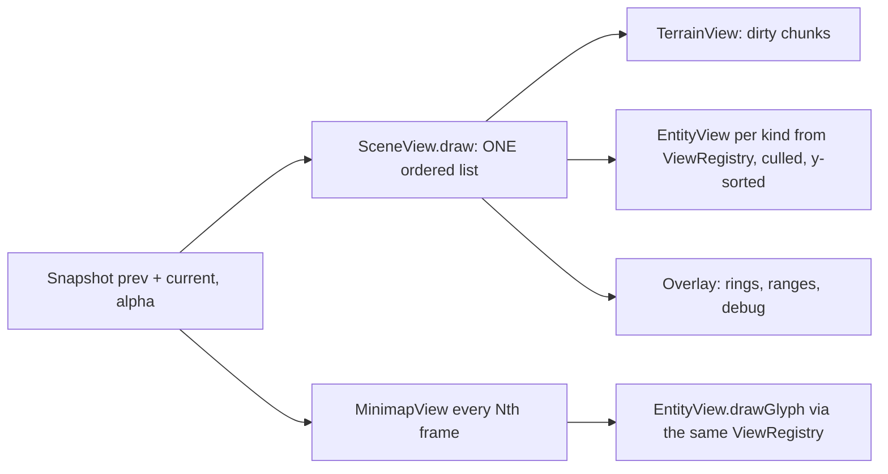

# Game engine

**Purpose.** Read this when you work in `apps/client/src/game/engine/` (the L1 infrastructure
layer), in `game/views/`, or in `game/Match.ts`. It fixes what the engine is (a small set of
generic ports and Canvas 2D adapters), what it is not (it knows nothing about Legends, towers or
lanes), how `Match` composes it with `Simulation`, and the frame and tick budgets we measure
against. D2 (no game engine or framework), D8 (single-threaded simulation) and D9 (30 ticks/s with
interpolation) are decided; this doc applies them. All code is a sketch.

## 1. Scope and rules

- `engine/` is **generic**: it imports no game types, views, input mapping, `Match` or `bridge/`
  (`apps/client/AGENTS.md`). It could drive a different game unchanged; that is the test for
  whether something belongs here.
- Ports are `interface`s; adapters are classes named after the platform API they wrap
  (`RafFrameScheduler`, `Canvas2dRenderer`, `WebAudioOutput`). Only `Canvas2dRenderer` touches
  `CanvasRenderingContext2D` (rule 7).
- Every engine object exposes `destroy()` and is destroyed by its owner; `Match.destroy()` tears
  down the loop, devices, renderer and audio so a rematch rebuilds only the match (Phaser's
  global-services versus per-scene split, [research §10](../research/game-architecture-and-performance-research.md#10-reference-architectures)).
- Subfolders: `loop/`, `render/`, `camera/`, `input/` (see `09-hardware-abstraction.md`), `audio/`,
  `time/`.

## 2. `GameLoop`

The design from `docs/architecture.md` §2 is kept verbatim:

```text
requestAnimationFrame(t)
  accumulator += min(t - lastT, 5 * TICK_MS)   // clamp: a background tab can't freeze the game
  while accumulator >= TICK_MS:
      Match.tick()        // input → Command, Simulation.step(), keep previous + current snapshot
      accumulator -= TICK_MS
  Match.render(alpha = accumulator / TICK_MS)  // views lerp between previous and current
```

```ts
// apps/client/src/game/engine/loop/GameLoop.ts (sketch)
export interface LoopTarget {
  tick(): void;
  render(alpha: number): void;
}
export type GameLoopOptions = {
  readonly tickMs: number; // 1000 / 30 (D9)
  readonly maxFrameMs: number; // 5 * tickMs: the clamp
};

export class GameLoop {
  constructor(
    private readonly scheduler: FrameScheduler,
    private readonly target: LoopTarget,
    private readonly options: GameLoopOptions,
  ) {}
  start(): void; // requests the first frame
  stop(): void; // cancels the pending frame; accumulator keeps its remainder
  destroy(): void;
  private onFrame(timestampMs: number): void; // the pseudo-code above
}
```

Why: fixed `dt` keeps the simulation frame-rate independent and replayable; the clamp is the
defence against the spiral of death after a background tab; `alpha` lets views draw between two
ticks so 30 ticks/s looks smooth at 60–144 Hz
([research §1](../research/game-architecture-and-performance-research.md#1-fixed-timestep-interpolation-and-determinism)).
`GameLoop` never reads `performance.now()` itself; it uses the timestamp the scheduler hands it,
so the fake scheduler fully controls time in tests.

## 3. `FrameScheduler` and `Clock`

```ts
// apps/client/src/game/engine/time/FrameScheduler.ts (sketch)
export interface FrameScheduler {
  request(callback: (timestampMs: number) => void): FrameHandle;
  cancel(handle: FrameHandle): void;
}
export class RafFrameScheduler implements FrameScheduler {} // requestAnimationFrame + cancel
export class FakeFrameScheduler implements FrameScheduler {
  advance(ms: number): void; // fires the pending callback with lastTimestamp + ms
  runFrames(count: number, frameMs: number): void;
}
export interface Clock {
  now(): number; // ms, monotonic; PerformanceClock wraps performance.now(), FakeClock is settable
}
```

`FakeFrameScheduler` is how every loop test works: `runFrames(2, 16.7)` must call `tick()` once
and `render()` twice with `alpha` alternating near 0 and 0.5; a single `advance(10_000)` (a tab
coming back from the background) must call `tick()` exactly 5 times (the clamp), never 300.
`Clock` is used only by the profiler (§9) and audio scheduling; core never sees it (rule 8).

## 4. `Renderer` port and `Canvas2dRenderer`

```ts
// apps/client/src/game/engine/render/Renderer.ts (sketch)
export type RenderLayer = 'terrain' | 'entities' | 'overlay' | 'minimap';
export interface Renderer {
  resize(cssWidth: number, cssHeight: number, dpr: number): void;
  beginFrame(): void; // clears 'entities' and 'overlay'; 'terrain' only where chunks are dirty
  layer(name: RenderLayer): void; // subsequent draw calls go to this layer
  drawSprite(sprite: SpriteRef, x: number, y: number, options?: SpriteOptions): void;
  drawPolygon(points: readonly Vec2Like[], style: PolygonStyle): void;
  drawText(text: string, x: number, y: number, style: TextStyle): void;
  drawGlyph(glyph: GlyphSpec, x: number, y: number, colour: string): void; // minimap markers
  markTerrainDirty(chunkX: number, chunkY: number): void;
  endFrame(): void;
  destroy(): void;
}
```

`Canvas2dRenderer` is the only class that calls `getContext('2d')`. Design points, each from
[research §5](../research/game-architecture-and-performance-research.md#5-canvas-2d-performance):

- **Three stacked canvases** (`position: absolute`, z-ordered): terrain (`alpha: false`, holds
  pre-rendered chunks, **Recommendation:** 512 × 512 device pixels each, redrawn only when a chunk
  is flagged dirty by `markTerrainDirty`), entities (cleared every frame), overlay (rings, ranges,
  debug). The minimap layer is an offscreen canvas composited into the HUD's `MinimapPanel` slot.
- **DPR-aware sizing**: backing store = CSS size × `devicePixelRatio`, `ctx.scale(dpr, dpr)`;
  all game code stays in CSS pixels; `resize` is driven by a `ResizeObserver` in `GameCanvas.tsx`.
- **Integer coordinates**: positions are interpolated in world space and rounded once at draw
  time (`(0.5 + n) | 0`), so sub-pixel anti-aliasing never runs.
- **Sprite atlas, no scaling at draw time**: `SpriteRef` is `{ atlasId, frame }`; frames are
  pre-scaled per DPR when the atlas loads, so `drawImage` copies 1:1.
- **Viewport culling**: `SceneView` asks the snapshot's spatial index (`SnapshotSpatialIndex`, a
  copy of the `SpatialHash` tables, `10-physics.md` §5) for entities inside the camera rectangle
  plus a margin; terrain chunks outside the view are skipped.
- **Batching**: draws are grouped by layer then by atlas to limit state changes; `shadowBlur` and
  per-frame text on the entity layer are banned (text lives in React or the overlay).

`WebGlRenderer` is a **post-MVP** alternative behind the same port; views never know.

## 5. `Camera` and projections

```ts
// apps/client/src/game/engine/camera/Camera.ts (sketch)
export interface Projection {
  worldToScreen(p: Vec2Like): Vec2Like;
  screenToWorld(p: Vec2Like): Vec2Like;
}
export class Camera implements Projection {
  follow(target: () => Vec2Like, lerp: number): void; // e.g. the player's Legend, interpolated
  setZoom(z: number): void; // clamped to zoomBounds from settings
  visibleRect(): RectLike; // world-space rectangle used for culling
  update(alpha: number): void; // moves toward the follow target once per frame
}
export class MinimapProjection implements Projection {} // fixed scale, see 06 §8
```

The same `Projection` port serves the main scene and the minimap, so culling, click-to-world and
range-ring maths are written once (DRY).

## 6. Assets and audio

- `ResourceController` (`apps/client/src/data/resources/`, D3) is the only loader; the engine
  consumes its `AssetCache` (`get(id): ImageBitmap | AudioBuffer | Json`). `Canvas2dRenderer`
  receives the atlases it needs by constructor injection, never fetches.
- `AudioOutput` port (`engine/audio/`): `play(soundId, { volume, pan, loop })`, `stop(handle)`,
  `setBusVolume(bus, level)`, `suspend()`/`resume()` (autoplay policy: resume on first input).
  `WebAudioOutput` wraps `AudioContext`; `NullAudioOutput` is the test double. Sound ids are content
  ids; the mapping event → sound lives in `game/` (`SoundView` listens to `Simulation.on`), not in
  the engine.

## 7. `Match`: the composition root

`Match` (`apps/client/src/game/Match.ts`, L3) is the only place that knows every part by name and
wires them by constructor injection (no Service Locator, no singletons except the store and bus):

```ts
// apps/client/src/game/Match.ts (sketch)
export class Match implements LoopTarget {
  constructor(deps: {
    simulation: Simulation; // from @eternalus/core, built from GameConfig + seed
    loop: GameLoop;
    renderer: Renderer;
    camera: Camera;
    devices: readonly InputDevice[];
    inputMapper: InputMapper; // device snapshot → InputAction → Command
    views: { scene: SceneView; minimap: MinimapView };
    bridge: { bus: TypedEventBus<BridgeEventMap>; publishEveryTicks: number };
    profiler: PerfMonitor;
  }) {}
  tick(): void; // poll devices → commands → step → swap prev/current snapshot → publish
  render(alpha: number): void; // camera.update → beginFrame → scene.draw → minimap.draw → endFrame
  destroy(): void;
}
```

Tick sequence: `devices.poll()` → `inputMapper.map(inputSnapshot)` → `simulation.enqueueCommand`
for each `Command` → `simulation.step()` → `previous = current; current = simulation.snapshot()` →
every `publishEveryTicks` (6 = 5 Hz) `Match`'s `MatchBridge` publishes throttled bridge events
(`match-clock`, `hud-state`).
Bots run inside `Simulation` (`AiSystem`), so `Match` treats them and the player alike: one command
stream (Command pattern, rule 9).

## 8. Render pipeline



- `SceneView.draw(prev, current, alpha, camera, renderer)` is the single place that defines draw
  order (`apps/client/AGENTS.md`): terrain layer → entities sorted by interpolated `y` → overlay.
- `ViewRegistry` (Registry pattern) maps entity `kind` → `EntityView`; `DefaultEntityView` draws
  a definition sprite for kinds without a bespoke view. Views read snapshots through `import type`
  only and never mutate state (rule 6).
- Interpolation: views draw `prev + (current - prev) × alpha` for position and facing; entities
  that appeared this tick draw at `current` (no ghost from the origin).
- `MinimapView` runs at a lower cadence into the `'minimap'` layer (`06-map-and-minimap.md` §8).

## 9. Performance budget and how it is measured

Targets at the MVP cap (144 units per team plus 20 Legends, ~300 units; "engineered for
hundreds"). **Recommendation:** these are the numbers the plan's phase gates check.

| Metric                                                   | Budget                        | Where measured                                                           |
| -------------------------------------------------------- | ----------------------------- | ------------------------------------------------------------------------ |
| `Simulation.step()` at 300 units                         | ≤ 8 ms (p95)                  | `performance.measure('tick')` in `Match`                                 |
| `Match.render()` at 1080p, DPR 2                         | ≤ 8 ms (p95)                  | `performance.measure('render')`                                          |
| Frame time                                               | ≤ 16.7 ms; no LoAF > 50 ms    | `PerformanceObserver('long-animation-frame')`                            |
| Allocations in hot paths (steering, collision, snapshot) | zero per tick after warm-up   | heap sampling in the Performance panel; soak test counters               |
| Flow-field rebuild after terrain change                  | ≤ 2 ms per tick (time-sliced) | `performance.measure('flow-rebuild')` in core via `Logger` timing events |
| Minimap redraw                                           | ≤ 1 ms every 6th frame        | `performance.measure('minimap')`                                         |

`PerfMonitor` (`engine/time/`) wraps `performance.mark`/`measure` with a `detail.devtools` track,
keeps a fixed-bucket frame histogram (< 8, < 16, < 33, < 50, ≥ 50 ms) and subscribes a
`PerformanceObserver` to `long-animation-frame` (feature-detected via `supportedEntryTypes`); the
`PerfOverlay` HUD reads it through the bridge store
([research C2](../research/persistence-input-diagnostics-research.md#c2-structured-logging-timing-memory-and-a-developer-overlay)).
GC-free hot paths come from pooling (projectiles, particles, events), pre-allocated typed arrays
(spatial hash, flow fields, snapshot buffers) and scratch vectors in steering
([research §6](../research/game-architecture-and-performance-research.md#6-object-pooling-and-gc-avoidance)).
Profile before optimising; struct-of-arrays layouts are adopted only where a measure shows a hot
loop.

## 10. Threading: single-threaded now, Worker-ready later (D8)

The simulation runs on the main thread for the MVP: one thread is easier to test and debug, and
a tick at 300 units should stay far under the 33 ms budget
([research §8](../research/game-architecture-and-performance-research.md#8-web-workers-for-the-simulation)).
The design keeps the move cheap:

- `Simulation` has no DOM access, so it can be instantiated inside a Worker unchanged.
- `Snapshot` is plain data with typed-array buffers for the hot columns (positions, previous
  positions, health, flags), so it can be **transferred** (zero-copy) instead of structured-cloned;
  `Command`s are tiny objects and clone cheaply.
- `Match` talks to the simulation through the `Simulation` facade only; a `WorkerSimulationProxy`
  implementing the same interface would post commands and receive snapshots without touching
  views, the loop or the renderer.
- `SharedArrayBuffer` is not planned (needs cross-origin isolation headers); revisit only if
  snapshots exceed the ~10 KiB per message rule of thumb.

## 11. Implementation status

Session H's first pieces (branch `feat/engine-loop-match`) implement §2, §5, §7 and §8 with these
interim differences, each closed by the session named:

- `FrameScheduler`, `RafFrameScheduler`, `FakeFrameScheduler` and `GameLoop` live in
  `game/engine/loop/` (session H's folder); the `Clock` is session D's `SessionClock` in
  `game/engine/time/`. `useMatch` stamps log records with `performance.now()` until it is wired.
- `Camera` keeps its `lookAt`/`visibleArea` API and adds `track` (smooth follow), `zoomTo`
  (clamped), `contains` (culling) and `worldToScreen`/`screenToWorld` with an explicit
  `Viewport`; the `Projection` port and `MinimapProjection` arrive with the minimap work.
- `ViewRegistry` resolves kind, then family, then `DefaultEntityView`, and reports each unknown kind
  once; `LegendView` is the placeholder Legend look. Entity markers on the minimap are the
  minimap work's (SCRUM-151); `EntityLayer.drawMinimap` draws nothing until then.
- `Match` takes the player's intent through an `IntentSource` port (`IdleIntentSource` until the
  input session F); no `InputMapper`, `MatchBridge` or `PerfMonitor` yet, and no `MatchScreen`
  (sessions D, E, G). `GameCanvas` owns the `Match` through `useMatch`, which replaced
  `useMapCanvas`. The player's Legend spawns with a `dev-spawn` command until `SpawnSystem` exists.
- `Canvas2dRenderer` scales X and Y separately, so a window that is not 16:9 stretches the
  following camera's 64 × 36 m view.

## Related

- [01 Layered OOP model](./01-layered-oop-model.md)
- [02 Code structure](./02-code-structure.md)
- [06 Map and minimap](./06-map-and-minimap.md)
- [09 Hardware abstraction](./09-hardware-abstraction.md)
- [10 Physics](./10-physics.md)
- [13 Game interface](./13-game-interface.md) (HUD, `MinimapPanel`, `PerfOverlay`)
- [15 Diagnostics and runtime testing](./15-diagnostics-and-runtime-testing.md)
- [Research: game architecture and performance](../research/game-architecture-and-performance-research.md)
- [Research: persistence, input and diagnostics](../research/persistence-input-diagnostics-research.md)
