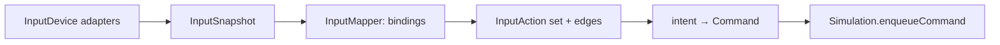

# Hardware abstraction

**Purpose.** Read this when the game needs to talk to something outside itself: a keyboard, a
mouse, a gamepad, a screen, a speaker, a clock, a database or a log. The hardware abstraction
layer (HAL) is the set of **ports** (TypeScript interfaces owned by the game side) and
**adapters** (classes that wrap one browser API each). Everything above the ports is platform
agnostic; a Unity or Unreal port later replaces only this layer (§10). Input facts below come from
[research §B](../research/persistence-input-diagnostics-research.md#b1-platform-facts); code is a
sketch.

## 1. Ports and adapters

| Port (interface) | Adapters (MVP)                  | Test double            | Later                                       | Lives in                                                                               |
| ---------------- | ------------------------------- | ---------------------- | ------------------------------------------- | -------------------------------------------------------------------------------------- |
| `InputDevice`    | `KeyboardDevice`, `MouseDevice` | `FakeInputDevice`      | `GamepadDevice` (post-MVP, port exists now) | `game/engine/input/`                                                                   |
| `Renderer`       | `Canvas2dRenderer`              | `RecordingRenderer`    | `WebGlRenderer`                             | `game/engine/render/`                                                                  |
| `AudioOutput`    | `WebAudioOutput`                | `NullAudioOutput`      | spatial audio                               | `game/engine/audio/`                                                                   |
| `FrameScheduler` | `RafFrameScheduler`             | `FakeFrameScheduler`   | Worker `requestAnimationFrame`              | `game/engine/time/`                                                                    |
| `Clock`          | `PerformanceClock`              | `FakeClock`            |                                             | `game/engine/time/`                                                                    |
| `StorageAdapter` | `IndexedDbStorageAdapter`       | `MemoryStorageAdapter` | `HttpStorageAdapter`                        | `data/persistence/`                                                                    |
| `LogSink`        | `ConsoleSink`, `RingBufferSink` | `RingBufferSink`       | `OverlaySink`, remote                       | `data/logging/` (**Recommendation:** under `data/`; ADR if the team prefers `engine/`) |

Rules that make this a layer and not a folder:

- A port is defined next to its adapters but **owned by its consumer**: `Match`, views and
  `PersistenceController` depend on the interface, never on `KeyboardDevice` or `indexedDB` (DIP).
- One adapter wraps one platform API. `KeyboardDevice` does not know about mice; `Canvas2dRenderer`
  does not know about audio (SRP). Adding a platform is adding an adapter (OCP).
- Adapters are dumb: no game vocabulary (no "ability 1", no "Legend"). Interpretation happens in
  `game/input/InputMapper` (§3) and in views.
- Every adapter has `attach()`/`detach()` or `destroy()`; owners destroy what they create.

## 2. Input devices

```ts
// apps/client/src/game/engine/input/InputDevice.ts (sketch)
export type InputSnapshot = {
  readonly keys: ReadonlySet<string>; // KeyboardEvent.code values currently held
  readonly keyLabels: ReadonlyMap<string, string>; // code → KeyboardEvent.key at press (glyphs)
  readonly mouseButtons: number; // PointerEvent.buttons: 1 left, 2 right, 4 middle, 8 X1, 16 X2
  readonly pointer: { readonly x: number; readonly y: number } | null; // CSS px on the canvas
  readonly wheel: number; // accumulated since last poll
  readonly gamepads: readonly GamepadState[]; // by index; empty until a pad is used
};
export interface InputDevice {
  attach(target: EventTarget): void;
  detach(): void;
  poll(): void; // called once per frame by Match before mapping
  writeInto(snapshot: MutableInputSnapshot): void; // devices merge into one snapshot
  releaseAll(): void; // blur / visibilitychange
}
```

- **`KeyboardDevice`** keys on `KeyboardEvent.code` (physical key, layout independent: the right
  choice for gamepad-like controls) and records `KeyboardEvent.key` as the label for prompts;
  tracks `keydown`/`keyup` rather than auto-repeat (`event.repeat` is ignored); calls
  `preventDefault()` only for bound codes and never for `Tab`, `F5`, `F12` or Ctrl/Meta chords;
  falls back to `key` when `code === ''` (mobile virtual keyboards).
- **`MouseDevice`** listens to pointer events on the canvas (`pointerdown/up/move`, pointer capture
  while a button is held), reads side buttons from the `buttons` bitmask (8 = X1/back, 16 =
  X2/forward), cancels `auxclick` (middle-click new tab) and `pointerdown` for non-primary
  buttons (autoscroll/paste), and cancels `contextmenu` so right-click is a game button. Users may
  swap buttons at OS level; we never assume which physical button is "left".
- **`GamepadDevice`** (post-MVP; the class is a stub that satisfies the port) polls
  `navigator.getGamepads()` every frame, keys pads by `index`, reads `buttons[i].pressed`/`value`
  and `axes[i]` with a per-binding deadzone, and trusts `mapping === 'standard'` (0–3 face buttons,
  4/5 shoulders, 6/7 triggers, 12–15 d-pad, axes 0/1 left stick). Pads appear only after a user
  gesture, so the settings screen shows "press any button" before listing them.
- **Focus loss**: `Match` subscribes to `window` `blur` and `document` `visibilitychange`
  (hidden) and calls `releaseAll()` on every device, because no `keyup` arrives for keys held
  across a focus loss. The loop's clamp handles the time gap.
- `navigator.keyboard.lock()` is progressive enhancement only (guarded by `'keyboard' in
navigator`), used for fullscreen matches so Ctrl+W does not close the tab.

## 3. The mapping pipeline: device → `InputAction` → `Command`



```ts
// apps/client/src/bridge/Binding.types.ts (sketch; the type contracts, shared with ui/ for <KeyGlyph/>)
export const INPUT_ACTIONS = [
  'move-up',
  'move-down',
  'move-left',
  'move-right',
  'attack',
  'ability-1',
  'ability-2',
  'ability-3',
  'ability-4',
  'gadget-1',
  'gadget-2',
  'interact',
  'turret-toggle-control',
  'turret-switch-ammo',
  'camera-zoom-in',
  'camera-zoom-out',
  'toggle-developer-menu',
] as const; // the full list is in 13 §6.1
export type InputAction = (typeof INPUT_ACTIONS)[number];

export type InputChord =
  | { readonly device: 'keyboard'; readonly code: string; readonly modifiers?: readonly string[] }
  | { readonly device: 'mouse'; readonly button: 0 | 1 | 2 | 3 | 4 }
  | { readonly device: 'gamepad'; readonly button: number }
  | {
      readonly device: 'gamepad-axis';
      readonly axis: number;
      readonly sign: -1 | 1;
      readonly deadzone: number;
    };

export type Binding = { readonly action: InputAction; readonly chords: readonly InputChord[] };

// apps/client/src/game/input/keybindings.ts (sketch; the only place defaults are bound)
export const DEFAULT_CHORDS: Readonly<Record<InputAction, readonly InputChord[]>> = {
  'move-up': [{ device: 'keyboard', code: 'KeyW' }],
  'ability-4': [{ device: 'keyboard', code: 'Digit4' }], // 4 = ultimate
  'gadget-1': [{ device: 'keyboard', code: 'KeyZ' }],
  attack: [{ device: 'mouse', button: 0 }],
  // ... one entry per action; a missing entry is a compile error
};
```

`InputMapper` (`game/input/InputMapper.ts`) holds the current `readonly Binding[]` (defaults
merged with the profile's saved bindings from the `settings` store) and does two things per frame:
`resolve(snapshot): ActionState` (which actions are held, pressed this frame, released this
frame; an action is active if **any** chord of any device matches) and `toIntent(actionState,
projection): InputIntent` (movement axes become one normalised move vector; edges become the
`cast` slot (`ability-1` … `gadget-2`) and the `attack` aim with the pointer resolved through
`Camera.screenToWorld`). `Match` enqueues the intent as one `intent` command and
`PlayerController` turns it into `move`, `cast-ability { slot }` and `attack-target` commands
(13 §6.2). Bots produce the same `Command` objects, so the
simulation never knows a human is present (Command pattern,
[research §B2](../research/persistence-input-diagnostics-research.md#b2-rebinding-ux-and-data-representation)).

Rebinding is pure data flow: the settings screen enters listen mode, the next `keydown`
(ignoring `repeat` and `Escape`), `pointerdown` or gamepad pressed-edge becomes a chord, conflicts
are detected with a `Map<chordKey, InputAction>`, and the new `Binding[]` is saved as a versioned
DTO and pushed to `InputMapper.setBindings`. Prompts never hard-code keys: `<KeyGlyph
action="ability-1" />` renders the label (`keyLabels` for keyboard, a glyph table by gamepad
family) of the current binding, so tutorials update themselves (requirements doc). The mouse side
button for a gadget is `{ device: 'mouse', button: 3 }`, no special case.

## 4. Display

The `Renderer` port (`08-game-engine.md` §4) is the display abstraction: views call
`drawSprite`/`drawPolygon`/`drawText`/`drawGlyph` on named layers and never see a canvas.
`Canvas2dRenderer` handles DPR (backing store × `devicePixelRatio`, context scaled), resize
(`ResizeObserver` on the canvas host, re-baking terrain chunks on size change), and the layered
canvases. Fullscreen and pointer lock are adapter concerns (`DisplayHost`, **Recommendation:** a
tiny adapter over `requestFullscreen`), not view concerns. A `WebGlRenderer` is post-MVP and
must pass the same contract suite (§9).

## 5. Audio

`AudioOutput` (`08-game-engine.md` §6): `play`, `stop`, `setBusVolume('master' | 'sfx' |
'music')`, `suspend`, `resume`. `WebAudioOutput` owns the single `AudioContext` and the decoded
buffers from `AssetCache`; it resumes the context on the first user gesture (autoplay policy) and
exposes nothing Web-Audio-specific. `NullAudioOutput` records calls for tests.

## 6. Time

`FrameScheduler` and `Clock` (`08-game-engine.md` §3). The simulation counts ticks only; every
wall-clock read on the client goes through `Clock`, so tests inject `FakeClock` and there is no
`Date.now()` outside the adapters (mirrors rule 8 on the client side).

## 7. Storage

```ts
// apps/client/src/data/persistence/StorageAdapter.ts (sketch)
export interface StorageAdapter {
  open(schema: StorageSchema): Promise<void>; // runs migrations to schema.version
  get<T>(store: StoreName, key: IDBValidKey): Promise<T | undefined>;
  getAll<T>(store: StoreName, index?: IndexQuery): Promise<readonly T[]>;
  transaction(
    stores: readonly StoreName[],
    mode: 'readonly' | 'readwrite',
    work: (tx: StorageTx) => Promise<void>, // Unit of Work: one IndexedDB transaction
  ): Promise<void>;
  estimate(): Promise<{ usage: number; quota: number } | null>;
  close(): void;
}
```

`IndexedDbStorageAdapter` is the only file that touches `indexedDB` (D3); `MemoryStorageAdapter`
backs unit tests and the `?memory` dev flag; `HttpStorageAdapter` is the post-MVP path to a
server with the same repositories on top. Repositories and `PersistenceController` see only DTOs
and this port
([research §A3](../research/persistence-input-diagnostics-research.md#a3-patterns-repository-unit-of-work-facade-dtos-migrations-replays)).

## 8. Logging sinks

Core defines the `Logger` port and emits `LogRecord`s (OpenTelemetry-style severity numbers,
tick, entity id, system). The client injects sinks that implement `LogSink { write(record):
void }`: `ConsoleSink` is the only file allowed to call `console` (with a named
`eslint-disable` and reason), `RingBufferSink` keeps the last N records for bug reports and the
`PerfOverlay`, `OverlaySink` mirrors warnings into the HUD in development. Filtering by category
and minimum severity is a sink option, not a logger concern
([research C2](../research/persistence-input-diagnostics-research.md#c2-structured-logging-timing-memory-and-a-developer-overlay)).

## 9. Contract tests: one suite per port

Every port ships a shared Vitest suite that each adapter (and each test double) must pass. The
suite is a function that takes a factory, so adding an adapter means adding one `describe` line:

```ts
// apps/client/src/game/engine/input/InputDevice.contract.ts (sketch)
export function describeInputDevice(name: string, make: () => InputDeviceHarness): void {
  describe(`${name} InputDevice contract`, () => {
    it('reports a held key/button after press and clears it after release', () => {});
    it('never leaves anything held after releaseAll()', () => {});
    it('does not report auto-repeat as a new press', () => {});
    it('stops emitting after detach()', () => {});
    it('merges into a snapshot without overwriting other devices', () => {});
  });
}
// KeyboardDevice.test.ts:  describeInputDevice('KeyboardDevice', () => makeKeyboardHarness());
```

| Port             | Contract highlights                                                                                                                                            |
| ---------------- | -------------------------------------------------------------------------------------------------------------------------------------------------------------- |
| `InputDevice`    | press/release symmetry, `releaseAll`, no repeat, detach silence, snapshot merge                                                                                |
| `Renderer`       | `beginFrame` before draws, layer switching, DPR resize keeps CSS coordinates, `destroy` idempotent                                                             |
| `AudioOutput`    | `play` returns a handle, `stop` on unknown handle is a no-op, `suspend` then `resume` restores volume                                                          |
| `FrameScheduler` | callback receives a monotonic timestamp, `cancel` prevents the callback, one callback per `request`                                                            |
| `Clock`          | monotonic, non-decreasing                                                                                                                                      |
| `StorageAdapter` | `open` migrates to the schema version, `get` after `put` round-trips a structured-cloneable DTO, transactions are atomic on failure, `close` then `open` works |
| `LogSink`        | accepts every severity, applies its filter, never throws on odd payloads                                                                                       |

DOM-backed adapters run the suite under a `jsdom`/`happy-dom` environment in Vitest
(**Recommendation:** needs the team's dependency approval); the doubles run in plain Node. The
suites live next to the port file and are imported by each adapter's test, so an adapter cannot be
merged without proving it honours the port ("if tests don't actually connect, they don't exist").

## 10. Porting to Unity or Unreal

The requirements doc's long-term goal is to move to a real engine without starting over. This
layer is the seam:

- **Replaced**: every adapter here (input, renderer, audio, scheduler, clock, storage, sinks) and
  the React UI. In C#/C++ they become thin wrappers over the engine's input system, sprite/mesh
  renderer, audio mixer, `Update()` loop and save system.
- **Translated, not redesigned**: `packages/core` (entities, components, systems, content, map
  generation, AI, physics), `Match` and the views' draw-order logic, because none of them reference
  a browser API. Ports keep their names; only the language changes.
- What makes that true today: rule 1 (core has no DOM), rule 7 (one class touches the canvas),
  the `Command` stream (input is data), content by id (assets are looked up, never imported), and
  the contract suites (they become the acceptance tests for the new adapters).

## 11. Implementation status

The keyboard slice (branch `feat/player-input`) implements §2 and §3 for movement, with these
interim differences:

- `InputSnapshot` has only `keys` and `keyLabels`; the mouse, wheel and gamepad fields arrive with
  their devices. `InputDevice` has no `poll()` yet (the keyboard is event-driven; the gamepad
  needs it). There is no `MouseDevice`, `FakeInputDevice` or shared contract suite yet;
  `KeyboardDevice.test.ts` covers the contract's five rules.
- `InputMapper` indexes keyboard chords by code itself (no injected `BindingResolver`) and leaves
  `aim` empty until the mouse and `Projection` exist. `toIntent` takes no projection yet.
- `DeviceIntentSource` merges the devices and feeds `Match` through its `IntentSource` port.
  `Match` turns the intent's `move` into `move`/`stop` commands itself until core's
  `PlayerController` handles the `intent` command (11 §4.1); see `INBOX.md`.
- `useMatch` releases the devices on `blur` and hidden `visibilitychange` and binds the `wasd`
  preset until the settings screen supplies the player's saved bindings.

## Related

- [01 Layered OOP model](./01-layered-oop-model.md)
- [08 Game engine](./08-game-engine.md)
- [13 Game interface](./13-game-interface.md) (settings screen, `<KeyGlyph/>`, rebinding UX)
- [14 Persistence and resources](./14-persistence-and-resources.md)
- [15 Diagnostics and runtime testing](./15-diagnostics-and-runtime-testing.md)
- [Research: persistence, input and diagnostics](../research/persistence-input-diagnostics-research.md)
- [Reference: controls](../reference/game-design/09-controls.md)
