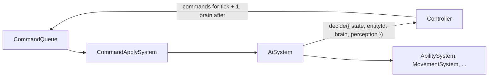

# Game AI

**Purpose.** Read this when you add, change or tune anything that decides on behalf of a
non-player entity: bot Legends, minions, tower guards, turrets, bosses and the enemy Rover. It
defines the `Controller` contract in `packages/core/src/ai/`, how controllers perceive the world,
how they stay deterministic and cheap, how sim mode works, and the recipe for adding a controller
without touching the existing ones. No AI code exists yet; every snippet below is a sketch.

## 1. Where AI sits

- Layer L2 (Domain), folder `packages/core/src/ai/`. Import rule (02 §2, core `AGENTS.md`): `ai/` may
  import only `state/`, `commands/`, `content/` and `teams/` types and `utils/`. Spatial queries and flow fields
  reach a controller through `GameState`; its content values (aggro rules, formations,
  difficulties) come through its constructor, injected by `Simulation` when it fills the
  registry. Never through value imports (DIP); only `content/` types are imported.
- One system, `AiSystem`, runs second in the `SystemPipeline`, right after `CommandApplySystem`.
  It asks each due controller for decisions and enqueues them in the `CommandQueue` for the next
  tick. Controllers never mutate state, never call systems and never compute paths.
- Controllers decide _what_ (attack X, move to Y, cast Z); systems decide _how_ (`PathingSystem`,
  `MovementSystem`, `AbilitySystem`, `CombatSystem`). The human and every bot share one `Command`
  vocabulary (Command pattern), which is why replays, sim mode and the developer menu need no
  special cases [research §7](../research/game-architecture-and-performance-research.md#7-game-ai-for-bots).



## 2. The Controller contract

```ts
// packages/core/src/ai/Controller.types.ts (sketch)
export type ControllerId =
  'player' | 'bot-legend' | 'minion' | 'guard' | 'turret' | 'boss' | 'rover';

export type DecisionInput = {
  state: GameState;
  entityId: EntityId;
  brain: Brain;
  perception: Perception;
};
export type Decision = { commands: readonly Command[]; memory: AiMemory; rngState: RngState };

export interface Controller {
  /** Kebab-case id used by content definitions and by the ControllerRegistry. */
  readonly id: ControllerId;
  /** Decide for one entity. Reads state only; returns next tick's commands and the brain after. */
  decide(input: DecisionInput): Decision;
}
```

- Controllers are **stateless strategies**: one shared instance per `ControllerId` (Flyweight).
  Everything a controller remembers between decisions lives in `state.ai.brains` as plain data,
  so it is hashed by `StateHasher`, snapshotted and replayed like any other state ("state is the
  single source of truth", rule 10). A controller never writes it: `decide` returns the memory and
  RNG state after the decision and `AiSystem` writes them back, so controllers stay pure.

```ts
// packages/core/src/state/AiState.types.ts (sketch)
export type Brain = {
  readonly controllerId: ControllerId;
  readonly profileId: AiProfileId; // content: aggro rules, cadence, difficulty
  readonly memory: AiMemory; // controller-specific plain data: FSM state, target, timers
  readonly rngState: RngState; // this brain's own seeded stream (see §5)
};
```

- `ControllerRegistry` (Registry pattern) maps `ControllerId` to the instance. `EntityFactory`
  attaches a `Brain` when the definition names a controller (`LegendDefinition.controller`,
  `MobDefinition.controller`, `TurretDefinition.controller`, `BossDefinition.controller`).
- `AiProfileDefinition` in `content/ai/profiles/` carries every number a controller uses (aggro
  rules, cadence, difficulty). Controllers contain no numbers.
- SOLID: `AiSystem` depends only on the `Controller` abstraction (DIP); each controller has one
  reason to change (SRP); a new controller is a class plus a registry line (OCP); any controller
  can stand in for another inside `AiSystem` (LSP).

## 3. Perception: SpatialHash queries only

Controllers never scan `state.entities`. They query `state.space`, the read-only query interface
that `SpatialHash` exposes on the state (see [10-physics](./10-physics.md)), through a thin
`Perception` helper in `ai/perception/`:

```ts
// packages/core/src/ai/perception/Perception.types.ts (sketch)
export type UnitFilter = {
  readonly hostileTo?: Team;
  readonly kinds?: readonly EntityKind[];
  readonly aliveOnly?: boolean;
};

export interface Perception {
  /** Ids sorted ascending, so iteration order never depends on hash layout. */
  unitsWithin(center: Vec2, radius: number, filter: UnitFilter): readonly EntityId[];
  structuresWithin(center: Vec2, radius: number, filter: UnitFilter): readonly EntityId[];
  nearest(center: Vec2, radius: number, filter: UnitFilter): EntityId | null;
}
```

Rules: radii come from the entity's `Vision` component or its profile, never "everything"; a
query touches at most the 9 surrounding cells
[research §4](../research/game-architecture-and-performance-research.md#4-spatial-partitioning-and-collision);
results are id-sorted. Fog of war is **post-MVP**; `Vision` is its extension point.

## 4. Controllers

The build order of every controller below except `PlayerController`, `TurretController` and
`BossController` is the [minion system plan](../plan/minion-system-plan.md) §1.1 (MS-28 of doc 18);
this section stays their design. Bosses are not controlled by the minion system: `BossController`
is built in Phase 3 sprint 3.6.

### 4.1 PlayerController (MVP)

The human's Legend has a brain too. The client's `InputMapper` turns device state into an
`InputIntent` (movement axes, aim point, edge-triggered actions) and enqueues it as one `intent`
command per tick, only when it changes. `CommandApplySystem` stores it in the brain's memory;
`PlayerController.decide` reads it and emits the same gameplay commands a bot would (`move`,
`attack-target`, `cast-ability` (gadget slots included), `pick-up`, `throw`). Why: one place validates what a
Legend may do (`applyCommand`), the replay log records device-agnostic intents, and sim mode is
a one-line controller swap. The cost is one tick (33 ms at 30 Hz) between intent and effect.
`Recommendation:` accept it for the top-down MVP; if playtests notice it, translate `intent`
inside `CommandApplySystem` for the human only, as a documented special case.

### 4.2 BotLegendController (MVP)

A behaviour tree ticked at about 5 Hz: `AiSystem` evaluates it when
`(tick + entityId) % 6 === 0`, so 20 Legends cost roughly 3–4 tree evaluations per tick
[research §7](../research/game-architecture-and-performance-research.md#7-game-ai-for-bots).
The node library in `ai/bt/` stays small: `Sequence`, `Selector`, `ActiveSelector` (re-checks
higher-priority branches), `Condition`, `Action`, `Cooldown` decorator; nodes return
`'success' | 'failure' | 'running'`. Conditions read state; actions emit commands. The `laner`
tree (root `ActiveSelector`):

1. `Survive`: health below `retreatHealthFraction` → move to the nearest allied tower or the
   Stronghold; use a defensive ability if it scores.
2. `Fight`: a hostile unit inside `engageRadius` → the `UtilityScorer` picks target and action.
3. `Push`: advance with the lane's horde toward the next enemy structure; attack structures when
   no units are in range.
4. `Regroup`: return to the lane corridor.

Utility scoring (`ai/utility/`): `Consideration`s (distance, target health fraction, threat,
cooldown ready, aether cost, allies nearby) return 0..1; a `UtilityScorer` combines them with
weights from a `BotDifficultyDefinition`. Weighted-random picks use the brain's RNG stream.
Difficulty is data in `content/ai/difficulties/` (`easy`, `normal`, `hard`, `rover`):
`reactionDelayTicks`, `aimErrorRadius`, `abilityUseChance`, `retreatHealthFraction`,
`utilityWeights`, all `TUNE`. Roles: `laner` (**MVP**); `jungler` and `support` (**post-MVP**)
are additional trees selected by data, not new controllers.

### 4.3 MinionController (MVP)

The minion state machine, lane movement and lane objectives are owned by
[18-minion-system](18-minion-system.md) §6. This section keeps the aggro content it reads.

Aggro rules are content (`AggroRuleDefinition` in `content/ai/aggro/`), seeded from published MOBA
rules as `TUNE` starting points
[research §7](../research/game-architecture-and-performance-research.md#7-game-ai-for-bots):
acquisition radius 500 units in both League and Dota (our world units differ, so scale to the
map); League's priority list (1) enemy Legends attacking an allied Legend, (2) enemy minions
attacking an allied Legend, (3) enemy minions attacking an allied minion, (4) enemy turrets
attacking an allied minion, (5) closest enemy minion, (6) closest enemy Legend; Dota's aggro
duration 2.3 s (≈ 69 ticks) and cooldown 3 s (90 ticks). "Call for help": an enemy Legend that
basic-attacks an allied Legend inside the radius becomes priority 1.

```ts
// packages/core/src/content/ai/aggro/lane-minion.ts (sketch)
export const laneMinionAggro = {
  acquisitionRadius: 500, // TUNE: League/Dota reference; world units to be scaled
  priority: [
    'legend-attacking-ally-legend',
    'minion-attacking-ally-legend',
    'minion-attacking-ally-minion',
    'turret-attacking-ally-minion',
    'closest-minion',
    'closest-legend',
    'lane-objective', // the horde's next standing structure (18 §6.2)
  ],
  reevaluateEveryTicks: 15, // TUNE
  leashRadius: 700, // TUNE
  aggroDurationTicks: 69, // TUNE: Dota 2.3 s
  aggroCooldownTicks: 90, // TUNE: Dota 3 s
  ghostFirstWaveTicks: 0, // 0 = off; League ghosts the first wave for 18–28 s
} satisfies AggroRuleDefinition;
```

Ghosted first wave (**MVP-if-time**, `Recommendation:`): while `ghostFirstWaveTicks` runs after
the countdown, minions ignore Legends as targets, so the three opening hordes meet mid-lane before
a Legend can bait them. Minion strength scaling with distance from home and the "enraged" buff
after a structure falls (game doc) are `CombatSystem`/`StatusEffectSystem` content, not AI.

### 4.4 GuardController (MVP)

Owned by [18-minion-system](18-minion-system.md) §7.

### 4.5 TurretController (MVP; manual control MVP-if-time)

Memory `{ targetId, ammo, nextShotTick, occupantId }`. Rules from the game doc and League's
turret behaviour
[research §7](../research/game-architecture-and-performance-research.md#7-game-ai-for-bots):

- First-in-range stickiness: keep the target until it dies or leaves range; on re-acquire use the
  profile's priority list.
- Defend-ally override: an enemy Legend that damages an allied Legend within `defendAllyRange`
  (`TUNE`, League uses 1400) becomes the target immediately.
- Predictive aim: `aimPoint = targetPos + targetVel * (distance / projectileSpeed)`, one
  refinement iteration, vectors only (no `atan2`).
- Ammo choice: `heavy` when the target kind is listed in `preferredAgainst` (Sentinel, HeavyMob),
  else `default`; 1 bolt per 10 s heavy, 1 per 5 s default (`TUNE`, game doc). Ammo is content
  (`content/weapons/turret-bolt-*.ts`), so "ammo specifics can change" is a data edit.
- Manual control (**MVP-if-time**): when an Warrior Legend occupies the turret (`occupantId`), the
  controller yields; the occupant's `PlayerController` emits `fire-turret` and `switch-ammo`.

### 4.6 BossController (MiniBoss MVP, GreaterBoss MVP, corner-camp bosses post-MVP)

One controller serves `MiniBoss` and `GreaterBoss` ("Eternal", rename pending); the differences
are `BossDefinition` data (Type Object). Multi-move FSM `roam → telegraph → execute → recover`;
moves are `BossMoveDefinition[]` (`telegraphTicks`, `cooldownTicks`, `range`, `effectId` → an
`AbilityEffect` strategy) chosen by utility (distance, targets inside the area, cooldown ready)
with a seeded weighted pick. "Never stands still" (game doc): `roam` picks a new point inside the
zone every cadence. Zone-restricted: the brain's `zoneId` binds it to a `CapturePoint` area and
it leashes back like a guard. Targets anyone: the filter is `team !== 'neutral'` with a bias
toward the highest recent damage dealer. `CaptureSystem`, not AI, blocks capture while a bound
boss lives.

### 4.7 RoverController (MVP, enemy Rover)

The hard bot (game doc: "reacts to structure health and mirrors or targets the player"; ideas in
[mechanics-ideas](../reference/suggestions/mechanics-ideas.md)). It composes the
`BotLegendController` node library with a Rover root and extra considerations:
`StructurePressure` (allied structure health per lane → defend the weakest lane),
`HumanProximity` and `HumanVulnerability` (the human's id is `state.match.humanLegendId`; hunt
when the advantage score clears a threshold, otherwise mirror the human's lane), `LaneAdvantage`
(push where the enemy is thinnest). Difficulty preset `rover`: lowest reaction delay, zero aim
error, highest weights; cadence every 3rd tick. `Recommendation:` the allied Rover runs
`BotLegendController` with role `rover` (defend the weakest lane) rather than the mirroring tree.

## 5. Determinism

- Every brain owns an RNG stream: `rngState` is seeded from `hash(matchSeed, entityId)`
  (splitmix32 seeding an sfc32 stream in `utils/SeededRandom`, behind the `Rng` port) and advanced
  only by that brain, so adding a bot never shifts another bot's rolls. The stream state is part
  of `GameState` and therefore of the state hash.
- No wall clock, no `Date`, no timers: every delay is a tick count (`reactionDelayTicks`).
- Decisions become next-tick commands through `CommandQueue`; nothing is applied mid-decision.
- `AiSystem` iterates brains in ascending `EntityId`; perception results are id-sorted;
  comparators break ties by id; steering and aim use vectors, never angles, because
  transcendental `Math` functions are engine-dependent
  [research §1](../research/game-architecture-and-performance-research.md#1-fixed-timestep-interpolation-and-determinism).
- Two runs with the same seed and command log produce the same bot commands; a test asserts it
  (§8).

## 6. Cost control

| Controller   | Cadence (ticks) | Why                                                                     |
| ------------ | --------------- | ----------------------------------------------------------------------- |
| `player`     | 1               | Latency                                                                 |
| `bot-legend` | 6 (5 Hz)        | Behaviour-tree literature: "every other frame or at 5 Hz" [research §7] |
| `rover`      | 3               | One per team; the hard bot may think faster                             |
| `minion`     | 5               | Targets re-evaluated between windups; movement is per-tick in systems   |
| `guard`      | 10              | Mostly idle                                                             |
| `turret`     | 2               | Predictive aim wants fresh velocity                                     |
| `boss`       | 3               | Few instances                                                           |

All cadences are `TUNE` values in `content/ai/cadence.ts` (`Recommendation:` starting points).
Staggering: a brain is due when `(tick + entityId) % cadence === 0`, which spreads 288 mobs and
20 Legends across ticks instead of bunching them. Budget: `AiSystem` takes `maxDecisionsPerTick`
(`TUNE`; `Recommendation:` 96, since 288 mobs / 5 plus Legends and turrets is about 70) and stops
when it is spent; the round-robin cursor lives in `state.ai.cursor`, so deferral is deterministic
and the skipped brains go first next tick. A decision is atomic and cheap: radius-bounded queries,
no allocation in hot paths, scratch vectors reused. Heavy work (flow fields, A\*) belongs to
`PathingSystem`, which time-slices its rebuilds
[research §3](../research/game-architecture-and-performance-research.md#3-pathfinding-and-movement-for-lane-minions-and-large-unit-counts).

## 7. Sim mode (MVP)

`MatchConfig.humanLegendId: EntityId | null`. With `null`, every Legend gets `bot-legend` (or
`rover`) and nobody reads input: the match plays itself. This is a first-class feature, not a
debug hack. Soak tests ([15-diagnostics](./15-diagnostics-and-runtime-testing.md)) run sim mode
headless in Node for thousands of ticks; balancing runs many seeds and compares `MatchResult`s;
the developer menu's "remove/add user-controlled Legend" (requirements: "sim game") is a
`dev-set-controller` command `{ entityId, controllerId }` applied by `CommandApplySystem`, so the
switch is recorded in the replay like everything else.

## 8. Testability

- Unit tests per controller with fake state: `ai/testing/buildTestState()` builds a minimal
  `GameState` with a handful of entities and a stub `Perception`; tests assert the returned
  decision, e.g. `expect(minion.decide(input).commands).toEqual([{ type: 'attack-target', actorId, targetId }])`.
- FSM transition tests are table-driven (`from`, event, expected `to`); BT tests cover each node
  class and the tree with stub conditions; considerations are pure functions of numbers.
- Scenario tests in `ai/scenarios/*.test.ts` drive a real `Simulation` in sim mode: "a minion
  within acquisition radius of an enemy Legend attacks within N ticks", "a guard returns after
  leaving its perimeter", "a turret switches to a Legend that hits an ally".
- Determinism test: the same seed twice yields identical command logs and `StateHasher`
  checkpoints.
- Tests read `TUNE` numbers from content too; no duplicated constants.

## 9. Extension recipe: a new controller

1. Add `packages/core/src/ai/<Name>Controller.ts` implementing `Controller`, with
   `<Name>Controller.types.ts` for its `AiMemory` shape.
2. Add the content: an `AiProfileDefinition` in `content/ai/profiles/<name>.ts` and the definition
   field that names it (`controller: '<kebab-id>'`).
3. Add one line to `ControllerRegistry`.
4. Add `<Name>Controller.test.ts` and, if match behaviour changes, a scenario test.

Nothing else changes. A new aggro rule is content only; a new BT node is `ai/bt/<Node>.ts` plus
a test; a new consideration is `ai/utility/<Name>Consideration.ts` plus a weight in the
difficulty data. Reserved extension points (**post-MVP**): `canTargetAir` in aggro data for the
Flying class, the `Vision` component for fog of war, `jungler`/`support` trees, mounts as a
`MovementStrategy`. GOAP and HTN are not planned: a small fixed action vocabulary suits FSM, BT
and utility better
[research §7](../research/game-architecture-and-performance-research.md#7-game-ai-for-bots).

## 10. Implementation status

Minion plan pull request M2a builds §1–§3, §5 and §6 with these differences, each closed by the
work named:

- `AiSystem` lives in `ai/` and fits the `System` contract by shape; `Simulation` puts it first in
  the pipeline, because `systems/` may not import `ai/` (where it lives is the owner's open
  PROTO-01 question). It is second, after `CommandApplySystem` (§1), once that system heads the
  pipeline; until then, `Simulation.step()` applies the queued commands before it (03,
  implementation status).
- `EntityFactory` cannot reach the state, so a unit whose definition names a `controller` gets a
  `ControllerBinding` component at spawn, and `AiSystem` creates its brain the first tick it sees
  it.
- The stagger hashes the string id (`(tick + fnv1a(id)) % cadence`); a budget-deferred queue in
  `state.ai` replaces the round-robin cursor, with the same order (deferred first, then id order).
- The registry holds `MinionController` (M2b) and `BotLegendController` (M3); the other
  controllers are absent until their phases, so it is a partial map.
- `BotLegendController` (M3) plays the `laner` tree of §4.2 with the nodes it needs
  (`ai/bt/`: `Sequence`, `ActiveSelector`, `Condition`, `Action`; `Selector` and `Cooldown` join
  with their first use) and a `UtilityScorer` (`ai/utility/`) over two considerations, closeness
  and weakness, picking the best score with an id tie-break (no weighted-random pick yet). A
  `BotDifficultyDefinition` (`content/ai/difficulties/`) holds only the knobs the tree reads;
  `reactionDelayTicks`, `aimErrorRadius` and `abilityUseChance` join with aiming and abilities.
  A bot gets its controller from its spawn (`Placement.controller`), with its lane in the brain's
  starting memory, rather than from its Legend definition.
- A brain's `profileId` names the controller's own content directly: an `AggroRuleDefinition`
  (`content/ai/aggro/`) for `MinionController`, a `BotDifficultyDefinition`
  (`content/ai/difficulties/`) for `BotLegendController`. The `AiProfileDefinition` of §2, which
  would group aggro, cadence and difficulty under one id, arrives when a controller needs more
  than one of them. `AiSystem.assertRegistered` checks each definition's profile at construction.
- A definition that names an unregistered controller stops `Simulation` at construction (shipped
  content) or the first tick `AiSystem` sees the entity (injected content).
- `Perception` has `unitsWithin` and `nearest`; `structuresWithin` waits for structure entities
  (M2c).

## Related

- [03-game-model](./03-game-model.md)
- [04-entity-architecture](./04-entity-architecture.md)
- [10-physics](./10-physics.md)
- [12-game-story-and-match-director](./12-game-story-and-match-director.md)
- [15-diagnostics-and-runtime-testing](./15-diagnostics-and-runtime-testing.md)
- [17-extension-recipes](./17-extension-recipes.md)
- [Entities and units (reference)](../reference/game-design/02-entities-and-units.md)
- [Structures and defences (reference)](../reference/game-design/03-structures-and-defenses.md)
- [Objectives, capture points and bosses (reference)](../reference/game-design/04-objectives-capture-points-and-bosses.md)
- [Mechanics ideas (suggestions)](../reference/suggestions/mechanics-ideas.md)
- [Research: game AI for bots](../research/game-architecture-and-performance-research.md#7-game-ai-for-bots)
- [Plan: phase 3, minions, hordes and AI](../plan/phase-3-minions-hordes-and-ai.md)
