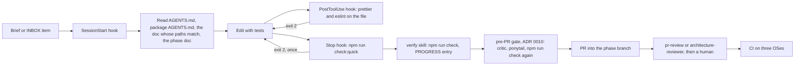

# Agentic harness

**Purpose.** Read this before you change any part of the agent harness (an instruction file, a
permission rule, a hook, a skill, a subagent, a template, the inbox or the progress file), or
when you want to know why it is shaped the way it is. It describes the harness that exists in
the repository today, by path and purpose, and maps it onto the published patterns it borrows
from ([../research/agentic-harness-research.md](../research/agentic-harness-research.md)). The
operating manual is [../agents/README.md](../agents/README.md) (entry points, reading order, the
task loop), [../agents/tool-setup.md](../agents/tool-setup.md) (every config key and how to
verify a hook) and [../agents/checklists.md](../agents/checklists.md); the requirements it
satisfies are AI-01 to AI-12 in
[../requirements/04-agentic-instructions.md](../requirements/04-agentic-instructions.md).

## 1. The shape of the harness

A harness is everything around the model that makes its output land where the architecture
says: **guides** that feed forward (instruction files, skills, templates, the reading order) and
**sensors** that feed back (hooks, linters, tests, a reviewer), each either computational
(deterministic and cheap) or inferential (a model, expensive)
([research §4](../research/agentic-harness-research.md#4-openais-harness-engineering-and-other-2026-sources),
Böckeler). Four findings decided the shape: prose rules are weakly followed and cost tokens, so
every rule that can be a script is a script; a long instruction file crowds out the task, so
`AGENTS.md` is a table of contents; agents "reliably skew positive when grading their own work",
so a separate evaluator reads every diff
([research §3](../research/agentic-harness-research.md#3-anthropic-engineering-guidance)); and
harnesses rot, so every control names the failure it prevents (§11). One session:

## 2. The files, by path and purpose

| Path                                                                           | Purpose                                                                                                                                                                                            | Kind    |
| ------------------------------------------------------------------------------ | -------------------------------------------------------------------------------------------------------------------------------------------------------------------------------------------------- | ------- |
| `AGENTS.md`                                                                    | The canonical rules: definition of done, git rules, forbidden actions, the architecture rules, where code goes, coding standards, testing, commands (ceiling about 150 lines)                      | guide   |
| `packages/core/AGENTS.md`, `apps/client/AGENTS.md`                             | Package boundaries, planned folder tables with may-import lists, "adding code", tests; the closest file to the edited file applies on top of the root                                              | guide   |
| `CLAUDE.md` (root, `packages/core/`, `apps/client/`)                           | `@AGENTS.md` and nothing else; Claude Code expands the import at launch relative to the importing file                                                                                             | pointer |
| `GEMINI.md` (root and packages), `.gemini/settings.json`                       | Two-line pointers; `context.fileName: ["AGENTS.md", "GEMINI.md"]` makes Gemini CLI and Antigravity load `AGENTS.md` as context                                                                     | pointer |
| `.github/copilot-instructions.md`                                              | The six most-broken rules restated for Copilot's agent and code review; `.github/instructions/` is intentionally unused                                                                            | guide   |
| `.claude/settings.json`                                                        | `permissions.allow` / `permissions.deny` and the three hooks (§4); committed, so every clone gets the same gates                                                                                   | sensor  |
| `scripts/hooks/hookInput.mjs`                                                  | Shared helpers: parse the JSON on stdin (never throw), resolve the repo root and the edited file, `run()` with timeout and `CI=1`, `tail()` for short output                                       | infra   |
| `scripts/hooks/session-start.mjs`                                              | `SessionStart`: branch (warns on `main`), the reading order, open `INBOX.md` items, the last `PROGRESS.md` entry, the done-when reminder                                                           | guide   |
| `scripts/hooks/post-edit.mjs`                                                  | `PostToolUse` on `Edit\|Write`: Prettier, then ESLint with zero warnings on the touched file; exit 2 surfaces findings                                                                             | sensor  |
| `scripts/hooks/stop-check.mjs`                                                 | `Stop`: `npm run check:quick`; exit 2 blocks the stop once; `stop_hook_active` loop guard                                                                                                          | sensor  |
| `.claude/skills/<name>/SKILL.md` (nine)                                        | The procedures of §5: `new-entity`, `new-system`, `new-ability`, `new-screen`, `new-content`, `pr-review`, `doc-gardening`, `verify`, `adr`                                                        | guide   |
| `.agents/README.md`, `.agents/skills/<name>/SKILL.md`                          | Pointer stubs so Codex, Gemini CLI, Antigravity and Cursor discover the same nine skills; the procedure lives only in `.claude/skills/`                                                            | pointer |
| `.claude/agents/architecture-reviewer.md`, `test-writer.md`, `doc-gardener.md` | The subagents of §6: a read-only evaluator, a tests-only writer, a docs maintainer                                                                                                                 | sensor  |
| `docs/agents/README.md`                                                        | Entry points per tool, the reading order, the task loop, enforced-by-tooling versus review                                                                                                         | guide   |
| `docs/agents/running-agents.md`                                                | For humans: scoping, branches and worktrees, INBOX and PROGRESS, reviewing an AI PR, recovering from a bad change                                                                                  | guide   |
| `docs/agents/tool-setup.md`                                                    | Line-by-line meaning of every committed config key per tool, and the commands that prove a hook runs (its `paths` covers `.claude/**`, `.agents/**`, `.gemini/**`, `scripts/hooks/**`)             | guide   |
| `docs/agents/task-brief-template.md`, `.github/ISSUE_TEMPLATE/task-brief.md`   | The brief (§9) as a prompt and as an issue, with a worked example                                                                                                                                  | guide   |
| `.github/ISSUE_TEMPLATE/bug-report.md`, `.github/pull_request_template.md`     | A defect with a deterministic reproduction (seed, replay, command log); the PR checklist (`npm run check`, tests, no guardrail change without an ADR, no dependency without approval, scope, docs) | guide   |
| `docs/agents/checklists.md`                                                    | Definition of Done, the AI-PR review checklist, the architecture review checklist, the phase exit checklist                                                                                        | sensor  |
| `INBOX.md`                                                                     | The product owner's queue: decisions needed, requests, feedback, done (§7)                                                                                                                         | memory  |
| `docs/plan/PROGRESS.md`                                                        | The append-only session log (§7)                                                                                                                                                                   | memory  |
| `docs/plan/phase-<n>-*.md`                                                     | The sprint checklists: the feature list with pass/fail (§7)                                                                                                                                        | memory  |
| `.githooks/pre-commit`, `.githooks/pre-push`                                   | `npm run check:quick` for every human and every tool, hooks or not (`core.hooksPath`)                                                                                                              | sensor  |
| `.github/workflows/ci.yml`                                                     | `npm run check` as named steps on Ubuntu, macOS and Windows (§8)                                                                                                                                   | sensor  |
| `scripts/docs/check-docs.mjs`                                                  | Frontmatter, relative links and index validation behind `npm run docs:check`, inside `npm run check` and CI (§8)                                                                                   | sensor  |

## 3. Instruction files: one canonical `AGENTS.md`, thin pointers

Root `AGENTS.md` is the only place rules are written. It holds the definition of done, the git
rules, the forbidden actions, the architecture rules (restated with the planned folder
names in [01 §4](01-layered-oop-model.md#4-the-architecture-rules)), the "where code goes"
table, the coding standards, the testing rules and the commands; everything longer lives in
`docs/` and is linked. This is OpenAI's "map, not a 1,000-page manual" (about 100 lines as a
table of contents) and the ETH result that repository overviews cost tokens without helping
(research §4). One known leftover: the root file still carries a short "Architecture (planned)"
list.

Tool-specific files never contain rules. How each tool family enters:

| Tool                         | Reads the rules through                                                                       | Skills                  | Hooks and permissions                                                                                                             |
| ---------------------------- | --------------------------------------------------------------------------------------------- | ----------------------- | --------------------------------------------------------------------------------------------------------------------------------- |
| Claude Code                  | `CLAUDE.md` = `@AGENTS.md` at the root and in both packages                                   | `.claude/skills/`       | `.claude/settings.json`; `.claude/settings.local.json` for personal overrides (gitignored)                                        |
| OpenAI Codex / ChatGPT       | `AGENTS.md` natively (root to cwd chain)                                                      | `.agents/skills/` stubs | None committed; `.codex/hooks.json` uses the same event names and JSON shape, so `scripts/hooks/*.mjs` are reusable (research §2) |
| Gemini CLI / Antigravity CLI | `.gemini/settings.json` lists `AGENTS.md` and `GEMINI.md`; Antigravity reads both natively    | `.agents/skills/`       | None                                                                                                                              |
| GitHub Copilot               | `AGENTS.md` natively (nearest file wins); `.github/copilot-instructions.md` for the six rules | none                    | CI only                                                                                                                           |
| Cursor                       | `AGENTS.md` natively, root and nested                                                         | both skill folders      | None                                                                                                                              |

`.github/instructions/*.instructions.md` and `.cursor/rules/` are deliberately absent: a second
copy of a rule drifts, and every tool above already reads `AGENTS.md`.

## 4. `.claude/settings.json`: permissions and hooks

**Permissions.** `permissions.allow` pre-approves the quality gate and inspection so an agent
runs the checks without a prompt, which is the only way to be sure it runs them: `Read`, `Edit`,
`Write`; `Bash(npm run check)`, `check:*`, `test`, `test:*`, `lint`, `lint:*`, `typecheck`,
`knip`, `format`, `format:*`, `docs:*`, `build`, `dev`; `npx prettier|eslint|vitest *`; read-only
git (`status`, `diff`, `log`, `branch`, `show`, `worktree list`). `permissions.deny` blocks what
a human must do or decide: every form of `git push`, `git commit --no-verify` and `-n`,
`git reset --hard`, `git checkout main` and `git switch main`, `git branch -D`, `rm -rf`; reading
`.env*`, `dist/` and `coverage/` (secrets and build output stay out of context); editing
`package-lock.json`, `.githooks/` and `.github/workflows/` (guardrail files change through an
ADR, [../process/guardrails.md](../process/guardrails.md) §4). The rules are pattern-based and
best-effort (`git -C . push` is not matched), so the git hooks and CI remain the hard gate; deny
rules apply before the workspace-trust dialog, allow rules after it (research §2).

**Hooks.** All three are `type: command` in exec form (`"command": "node", "args": [...]`) so
they spawn on Windows without a shell, and all read one JSON object on stdin (`tool_name`,
`tool_input.file_path`, `cwd`, `stop_hook_active`) through `scripts/hooks/hookInput.mjs`, which
never throws on empty or malformed input, runs commands with `CI=1` and `FORCE_COLOR=0`, uses a
shell only on Windows so `npm.cmd` resolves, and trims output with `tail()` so the model sees the
last lines rather than a wall of text.

| Event (matcher)               | Script (timeout)           | Does                                                                                                                                                                                                                                                                        | Exit codes                                                                                                         |
| ----------------------------- | -------------------------- | --------------------------------------------------------------------------------------------------------------------------------------------------------------------------------------------------------------------------------------------------------------------------- | ------------------------------------------------------------------------------------------------------------------ |
| `SessionStart`                | `session-start.mjs` (30 s) | Prints the branch and warns on `main`; the reading order (`AGENTS.md`, the package `AGENTS.md`, the architecture doc whose `paths` matches, the phase doc); the number of open `- [ ]` items in `INBOX.md`; the last `###` heading of `PROGRESS.md`; the done-when reminder | Always 0; stdout becomes context                                                                                   |
| `PostToolUse` (`Edit\|Write`) | `post-edit.mjs` (120 s)    | `prettier --write` on `.ts .tsx .js .mjs .cjs .json .md .css .yml .yaml`, then `eslint --max-warnings 0` on `.ts .tsx .js .mjs .cjs`; only for files inside the repo                                                                                                        | 0 when clean; Prettier trouble is reported on stderr and never blocks; an ESLint failure exits 2 with the findings |
| `Stop`                        | `stop-check.mjs` (300 s)   | `npm run check:quick` (typecheck + lint, the same command as the git hooks)                                                                                                                                                                                                 | 0 on pass; 2 with the failure tail; 0 immediately when `stop_hook_active` is `true`                                |

**Exit-code semantics.** Claude Code treats exit code 2 as the only blocking code; any other
non-zero code is a non-blocking error (research §2), and what "block" means depends on the
event. On `Stop`, exit 2 prevents the agent from ending its turn and feeds stderr back as the
next thing to fix, which turns "declare done" into "make `check:quick` pass" (the "deterministic
gate" of Anthropic's best practices, research §3). On `PostToolUse` the edit has already
happened, so exit 2 cannot undo it and only shows stderr to the model, which is the lint-on-save
loop we want: the finding arrives while the file is still in context. `SessionStart` output is
context, so it always exits 0. The loop guard: when a `Stop` was already blocked, Claude Code
re-invokes the hook with `stop_hook_active: true` and the script exits 0, so the gate blocks
**once** per stop and an unfixable failure (a broken toolchain, a missing `node_modules`) cannot
trap the agent; the failure stays visible in the transcript, in the git hooks and in CI. Hooks
are tested both ways by hand ([../agents/tool-setup.md](../agents/tool-setup.md) §6: pipe a JSON
object to the script, check the exit code); a hook that blocks for the wrong reason is worse
than no hook.

## 5. Skills: the recipes as procedures

`.claude/skills/<name>/SKILL.md` holds one procedure each, written against the architecture
docs so an agent and a teammate follow the same steps. Frontmatter uses only the portable fields
(`name`, `description`, `allowed-tools`, `disable-model-invocation`), so the files are valid
under the Agent Skills spec too (research §7); `.agents/skills/<name>/SKILL.md` are stubs that
point at the canonical file so Codex, Gemini/Antigravity and Cursor discover the same set.
Skills auto-trigger on their `description`, or `/name` invokes them; every one ends with
`npm run check`, a `PROGRESS.md` entry and "no commits unless asked".

| Skill           | Encodes                                                                                                                                                     | Follows                     | Recipes in 17                 |
| --------------- | ----------------------------------------------------------------------------------------------------------------------------------------------------------- | --------------------------- | ----------------------------- |
| `new-entity`    | Content first, a class only for unique behaviour, one `EntityRegistry` line, tests, docs; **stop and report** if a second registry or a `switch` is needed  | 04, 06, 17                  | R1–R7, R14                    |
| `new-system`    | `<Name>System` in `systems/`, one `SystemPipeline` line, a component or strategy instead of a `switch`, deterministic tests, an invariant                   | 02, 03, 17                  | R11–R13, R16–R18, R23         |
| `new-ability`   | A content definition, one `AbilityEffect` class only if no kind fits, restrictions as data, scenario tests; the HUD does not change                         | 05, 17                      | R8–R10                        |
| `new-screen`    | Folder choice, a CSS module, bridge event to slice to selector, `<KeyGlyph/>`, server-render tests, one mounting place                                      | 13, `apps/client/AGENTS.md` | R19–R21, R24                  |
| `new-content`   | Definitions and `GameConfig` values only; ids never renamed; `TUNE`; validation tests; the `numLanes` litmus test                                           | 03 §10, 04 §5               | R2, R3, R6, R15, R26          |
| `pr-review`     | The AI-PR and architecture checklists as findings by severity with a verdict; `allowed-tools` limits it to reading, `git diff/log/show` and `npm run check` | checklists, 01, 02, 03      | "what else changed?"          |
| `doc-gardening` | `npm run docs:check`, stale `last-reviewed`, the single-place-of-change claims, `AGENTS.md` length, `npm run docs:index`                                    | frontmatter schema, 02      | the Docs line                 |
| `verify`        | `git status --short`, `npm run check`, the verbatim tail per failing step, then the PROGRESS entry; read-only `allowed-tools`                               | `AGENTS.md`                 | the last step of every recipe |
| `adr`           | Next number, template copy, `proposed` status, the guardrails table row; `disable-model-invocation: true`, so only a human runs `/adr`                      | guardrails §4               | a fourth kind of change       |

## 6. Subagents: the evaluator pattern

`.claude/agents/` defines three subagents, all `model: inherit`. `architecture-reviewer` (tools
`Read, Grep, Glob, Bash`; it never edits, formats or fixes) takes the diff and `npm run check`,
then checks in order `AGENTS.md`, the package `AGENTS.md`, [02](02-code-structure.md)
(placement and may-import lists), [01](01-layered-oop-model.md) (layer rules),
[03](03-game-model.md) (determinism, commands, events), the doc whose `paths` matches the touched
files and `checklists.md`, and reports a verdict plus findings by severity with `file:line`, the
rule violated and a fix; if it finds nothing it says what it checked. `test-writer` writes tests
only and stops when a seam is missing instead of touching production code. `doc-gardener` runs
the `doc-gardening` skill on a schedule or after large merges.

The reviewer exists because generators grade themselves generously: Anthropic's harness work
found agents "reliably skew positive when grading their own work" and recommends a skeptical
evaluator separate from the generator (research §3); the same section warns that reviewers
over-report by construction, so ours is told to report correctness and scope gaps only, and one
2026 ablation found a second reviewer agent lowering success (research §4, second-hand), which is
why the reviewer's output on a PR goes to a human rather than back into an automatic fix loop;
before the PR, the pre-PR critic's violations do go back to the author for rework
([ADR 0010](../decisions/0010-pre-pr-critic-and-ponytail-gate.md)). The
review step is not optional ([../agents/README.md](../agents/README.md) §3): the author agent is
never the only reviewer, and a human walks the checklist before merge (AI-05, AI-07).

## 7. Memory between sessions

Context is per session; the repository is the memory (OpenAI: "anything it can't access
in-context while running effectively doesn't exist", research §4). Three files carry it:

- `INBOX.md` (root, committed, no frontmatter) is the product owner's queue: decisions needed
  (`DEC-nn`), requests, feedback, done. Saying "file updated" tells the agent to
  treat the open items as its prompt, in order; an item leaves only when implemented and
  confirmed. The session-start hook prints the open count.
- `docs/plan/PROGRESS.md` is the append-only log: one `###` entry per session or PR (date,
  phase/sprint, branch, who plus tool) with exactly three bullets: what was done, checks run
  verbatim, next step. The hook prints the last heading; the `verify` skill appends the entry.
- The phase docs' sprint checklists are the feature list with pass/fail: every task line has an
  owner, a test and a done-when, and an agent ticks a box only for work it verified with a
  passing check in that session (AI-12).

| Anthropic's long-running-agent pattern (research §3) | Here                                                                                                                          |
| ---------------------------------------------------- | ----------------------------------------------------------------------------------------------------------------------------- |
| A feature list with `passes: false` entries (JSON)   | The `- [ ]` lines of `docs/plan/phase-<n>-*.md`; `Recommendation:` a `docs/plan/<task>.json` for long unattended runs (AI-12) |
| A progress file plus the git log                     | `docs/plan/PROGRESS.md`; task branches; `git log` is the reviewer's first step                                                |
| An `init.sh` run at session start                    | `scripts/hooks/session-start.mjs`, plus `npm ci` per checkout                                                                 |
| One feature per session                              | One concern per task, one task per branch and worktree (§9)                                                                   |
| Self-verification with real tooling                  | The ladder in §8; tests are the oracle because the core is deterministic and headless                                         |
| A separate evaluator                                 | `pr-review`, `architecture-reviewer`, then a human                                                                            |
| Git as the recovery mechanism                        | Revert, never patch on top ([../agents/running-agents.md](../agents/running-agents.md) §5)                                    |

OpenAI's harness-engineering patterns (research §4) map the same way: `AGENTS.md` as a table of
contents (§3); `docs/` as the system of record, navigable by the frontmatter `paths` that name
the code each doc governs and by the index in `docs/README.md`; architecture enforced by linters
whose messages contain the fix (`core must be deterministic: use a seeded RNG` today, the
per-folder boundaries of §10 next); plans as versioned artifacts (the phase docs and PROGRESS);
and a recurring doc-gardening agent (`doc-gardener`, `npm run docs:check`). Making the app
legible to the agent is covered for the core (headless `Simulation`, replays) and the views
(`RecordingRenderer`) and not yet for the browser (no MCP, §10).

## 8. The verification ladder

Each rung catches one class of error and re-enters the model's context as text. The order is by
cost: a failure lower down makes the higher rungs noise.

| Rung | Command                                               | Catches                                                                                                                                                  | Runs in                                                                               |
| ---- | ----------------------------------------------------- | -------------------------------------------------------------------------------------------------------------------------------------------------------- | ------------------------------------------------------------------------------------- |
| 1    | `prettier --write` + `eslint --max-warnings 0 <file>` | Style; `any` and unsafe types; `console`; banned imports and `Math.random` in core; `.only`/`.skip`                                                      | `post-edit.mjs` after every edit                                                      |
| 2    | `npm run typecheck` (`tsc -b`, project references)    | Type errors; core referencing the client; DOM or Node types in core                                                                                      | `stop-check.mjs`; `.githooks/pre-commit` and `pre-push` (`check:quick` = rungs 2 + 3) |
| 3    | `npm run lint` (whole tree)                           | Rung 1 in the files the agent did not touch                                                                                                              | same                                                                                  |
| 4    | `npm run knip`                                        | Unused files, exports, types and dependencies: a class that no registry line reaches is dead code                                                        | `npm run check`                                                                       |
| 5    | `npm run test:coverage`                               | Behaviour, determinism (seeded shuffle), contract suites; coverage thresholds that only go up                                                            | `npm run check`; the `test-writer` subagent                                           |
| 6    | `npm run build`                                       | `tsc -b` emit plus the Vite build                                                                                                                        | `npm run check`                                                                       |
| 7    | `npm run docs:check` (`scripts/docs/check-docs.mjs`)  | Frontmatter keys and values, `title` equals the H1, relative links resolve, the index in `docs/README.md` is in sync, `last-reviewed` older than 90 days | `npm run check` and a named CI step                                                   |
| 8    | `.github/workflows/ci.yml`                            | The same steps as `npm run check`, one named step per tool, on Ubuntu, macOS and Windows; `npm ci` proves the lockfile                                   | Every push and PR; branch protection makes it binding                                 |

`npm run check` (`format:check`, `lint`, `typecheck`, `knip`, `test:coverage`, `build`, and
`docs:check`) is the definition of done, and the agent quotes its verbatim tail in
its final message and in the PR (AI-11). What the ladder enforces and what review still catches:

| Enforced by tooling                                                                                        | Checked in review (`pr-review`, `architecture-reviewer`, a human)                        |
| ---------------------------------------------------------------------------------------------------------- | ---------------------------------------------------------------------------------------- |
| Strict TypeScript, no `any`, no ts-comments, zero warnings, no `console`                                   | Placement in the right layer and folder; SOLID and DRY; a strategy instead of a `switch` |
| Core purity: no React, Redux or client imports, no `Math.random` (ESLint); no DOM or Node types (tsconfig) | Determinism beyond the lint rules: iteration order, comparator-less sorts, wall clock    |
| Test integrity (`.only`/`.skip` banned, every test asserts); coverage thresholds                           | Tests assert behaviour, not lines; no product decision made by an agent                  |
| knip, Prettier, LF endings, lockfile sync, exact versions, the docs check                                  | Docs and frontmatter updated; the PROGRESS entry; scope discipline                       |
| Per-file lint after edits; `check:quick` before stopping and on commit and push                            | Commit messages, the PR description, an ADR when a guardrail changes                     |

## 9. Parallel agents and prompt hygiene

**Worktrees.** One concern per task, one task per branch, one branch per worktree, so parallel
agents never share a working directory or half-finished edits. Branch off the current
`phase/<n>-<name>` (D5): `git worktree add .worktrees/<task> -b feat/<task> phase/<n>-<name>`,
or `claude --worktree <name>` (which creates `.claude/worktrees/<name>` on `worktree-<name>`).
Run `npm ci` in each worktree; do not share `node_modules` through `worktree.symlinkDirectories`,
because npm workspaces would resolve `@eternalus/core` to the main checkout's copy (research §6).
`.worktrees/` and `.claude/worktrees/` are gitignored (`Recommendation:` add `.gemini/worktrees/`
beside them). Give parallel agents disjoint file sets; the reviewer runs in the worktree of the
task it reviews; a feature that spans core and client is a stack of two PRs on the phase branch.

**Prompts.** Every task starts from the brief in
[../agents/task-brief-template.md](../agents/task-brief-template.md) or the
`.github/ISSUE_TEMPLATE/task-brief.md` issue: one concern; the phase/sprint line; the location
per [02](02-code-structure.md); the source (FR-/NFR- ids, a reference section, an ADR; no
product decisions inside the task); acceptance criteria a reviewer can check; tests; docs;
**out of scope** (what not to touch, which is what stops drive-by refactors); and **done when**
(`npm run check` passes, a PR into the phase branch, a PROGRESS entry). Bugs use
`bug-report.md`, which demands a deterministic reproduction (seed, replay id, command log).
Agents read three documents, not everything (AI-06), and start a fresh context between unrelated
tasks; a design or product question is answered in `INBOX.md` or an ADR before the task is
handed over, never inside it.

## 10. Known gaps and Phase 1 work

- **Client-side import boundaries.** ESLint bans React, Redux and the client in core and
  `Math.random` in core; rules 3, 5, 6 and 7 of `AGENTS.md` (`ui/` imports only `bridge/`, views
  import core types only, only `Canvas2dRenderer` touches the 2D context) are review-only. The
  per-folder `no-restricted-imports` and `no-restricted-syntax` blocks are sketched in
  [02 §11](02-code-structure.md#11-how-knip-and-eslint-relate-to-the-tree) and
  [research §5](../research/agentic-harness-research.md#5-verification-patterns) and land as the
  folders appear in Phase 1, with messages that name the fix; sibling-system imports in
  `core/systems/` and the `ai/` may-import list join them.
- **Import-cycle detection.** `tsc -b` and the current ESLint config do not catch cycles inside a
  package. Either `dependency-cruiser` (one devDependency, human approval per `AGENTS.md`) or a
  short Node script over the TypeScript compiler API (research §5); decided by ADR.
- **Coverage ratchet automation.** Thresholds only go up (guardrails §2) but are raised by hand;
  the plan is `thresholds.autoUpdate: true` for local runs only, with the raised numbers
  committed in the same PR (sprint 1.5 lists the first ratchet: core 80 to 82, client 45/50 to
  55/55).
- **Other tools.** No `.codex/hooks.json` is committed (added by ADR when someone uses Codex
  daily); no browser MCP (`.mcp.json`) for driving the running game, which is an optional
  dependency decision (research §3).

## 11. Maintenance rules

1. Every control (a rule line, a permission entry, a hook, a skill step) names the failure it
   prevents and an expiry condition, recorded in
   [../process/guardrails.md](../process/guardrails.md); adding one is a PR that cites the
   incident (AI-10; Osmani's ratchet and marmelab's "don't let the harness rot", research §4).
2. Prefer a script to a sentence: a rule the agent already follows becomes a hook or a lint; a
   rule that cannot be checked is a candidate for deletion.
3. Hooks are tested both ways (must block, must allow) with the stdin commands in
   [../agents/tool-setup.md](../agents/tool-setup.md) §6 after any change to `scripts/hooks/` or
   `.claude/settings.json`, on macOS, Linux and Windows.
4. `AGENTS.md` stays under about 150 lines and frontmatter-free; detail moves into linked docs,
   never out of the repository. `CLAUDE.md` and `GEMINI.md` stay pointers.
5. Skills keep the portable frontmatter fields only; a new skill gets its `.agents/skills/` stub
   in the same PR; a procedure lives in exactly one place.
6. Guardrail files (`eslint.config.js`, the tsconfigs, `vitest.config.ts`, `.githooks/`, CI,
   `.claude/settings.json`) change only through an ADR (`/adr`), never by an agent on its own.
7. Audit the harness at each docs-gardening pass and after each model release: "every component
   in a harness encodes an assumption about what the model can't do on its own" (research §3);
   delete dead scaffolding first, then add.
8. Scripts stay tool-neutral (`scripts/hooks/*.mjs` read the shared JSON shape) so a Codex or
   Gemini configuration can call the same files unchanged.

## Related

- [../agents/README.md](../agents/README.md): the harness overview, entry points and the task loop.
- [../agents/tool-setup.md](../agents/tool-setup.md): every config key explained, and how to verify a hook.
- [../agents/running-agents.md](../agents/running-agents.md), [../agents/checklists.md](../agents/checklists.md), [../agents/task-brief-template.md](../agents/task-brief-template.md): scoping, review and the brief.
- [../requirements/04-agentic-instructions.md](../requirements/04-agentic-instructions.md): AI-01 to AI-12, the requirements this harness satisfies.
- [../process/guardrails.md](../process/guardrails.md): the guardrail table, the coverage ratchet and how a guardrail changes.
- [../plan/phase-0-documentation-and-harness.md](../plan/phase-0-documentation-and-harness.md): sprint 0.4, the harness scaffold checklist.
- [02-code-structure.md](02-code-structure.md) §11 and [17-extension-recipes.md](17-extension-recipes.md): the lint boundaries to add and the recipes the skills run.
- Research: [agentic harness §2–§7](../research/agentic-harness-research.md).
