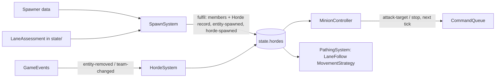

# Minion system

**Purpose.** Read this before you touch mobs, hordes, tower guards, spawning or the lanes bot
Legends play. It owns how a horde comes to exist, marches up its lane in formation, fights and
dies; how guards hold their towers; and how match setup gives bot Legends their lanes. The build
order is the [minion system plan](../plan/minion-system-plan.md). Doc [11](11-game-ai.md) still
owns the `Controller` contract, perception, determinism, cost control and the bot Legend behaviour
tree; this doc builds on them and never restates them.

**Entity legend.** The entity types this system implements, with their `EntityKind` and family
from doc [04 §1](04-entity-architecture.md#1-the-family-tree):

| Entity type        | `EntityKind`                         | Family   | What this system does with it                                                                                                                                                         | Controller               |
| ------------------ | ------------------------------------ | -------- | ------------------------------------------------------------------------------------------------------------------------------------------------------------------------------------- | ------------------------ |
| Light lane minion  | `light-mob`                          | `Mob`    | Spawned in hordes by the Stronghold (opening hordes) and SpawnerTowers; marches, fights, dies                                                                                         | `MinionController`       |
| Medium lane minion | `medium-mob`                         | `Mob`    | Spawned in hordes by BuffTowers                                                                                                                                                       | `MinionController`       |
| Heavy lane minion  | `heavy-mob`                          | `Mob`    | Spawned in hordes by the Stronghold down the worst lane                                                                                                                               | `MinionController`       |
| Tower guard        | a `Mob` kind with a guard definition | `Mob`    | Light guards at SpawnerTowers, medium at BuffTowers, ranged and melee at the Stronghold; spawned and respawned by the structure's `GuardPlan`; hold its perimeter; belong to no horde | `GuardController`        |
| Camp mob           | a `Mob` kind with a camp definition  | `Mob`    | Forest camps (corner: MVP-if-time) spawn their group after the camp's cooldown (07 §6); held by `GuardController` with the camp as home (§7.1); in no horde                           | `GuardController`        |
| Zone defender      | a `Mob` kind from a checkpoint table | `Mob`    | Spawned when a capture point crosses a checkpoint (07 §7); held by `GuardController` with the capture point as home (§7.1); in no horde                                               | `GuardController`        |
| Bot Legend (laner) | `warrior`, `sentinel`, `magus`       | `Legend` | Gets a lane at match setup (§8); the doc 11 laner tree plays it                                                                                                                       | `BotLegendController`    |
| Horde              | none (not an entity)                 | —        | The composite that groups lane minions: members, leader, formation, lane progress                                                                                                     | `HordeSystem` (a system) |

**Scheduled here, designed elsewhere (MS-28).** The Rover (11 §4.7; it takes no lane, §8), the
bot Legends' behaviour tree and ability use (11 §4.2) and A\* for Legends (10 §9) are built by the
[minion system plan](../plan/minion-system-plan.md) (M3, M8), but this doc does not restate their
design.

**Not handled here: bosses (MS-28).** The minion system never controls a boss. `MiniBoss`,
`GreaterBoss` and their `BossController` (11 §4.6) are built in Phase 3 sprint 3.6, and their
spawns come from the `MatchDirector` timeline and the `Cathedral` spawner (docs 07 and 12).

**Not handled here.** Turrets and `TurretController` (built with the `Turret`, 07 §5, Phase 2
sprint 2.3), projectiles, zones and capture logic, and the human player's Legend. Structures
(`stronghold`, `spawner-tower`, `buff-tower`, `gate`) are only consumed: they host spawners and
guards and are the lane objectives (§6.2), but doc 07 implements them. The minion modifiers **zone
level-up** (MVP, a `CaptureSystem` reward, 07 §7) and **Ascend** (MVP-if-time, a Legend-kill
reward) belong to their reward systems, not to this doc.

**Implementation status (2026-10-30).** Minion plan phase M1 (marching) is built: the three lane
minions (`content/mobs/`), the `ranks` formation, `HordeStore`, `LaneRoutes` and the team spawn
counters on `GameState`, `assessLanes`, `HordeSystem`, `SpatialHash`, `LaneFollowMovementStrategy`
with `PathingSystem`, and `SpawnSystem` with the DISC-10 waves and the one-step fulfilment;
`Simulation` takes the map as an option. The PROTO-01 escort, its `AiSystem` and its `Brain` are
deleted (DEC-35). Pull request M2a adds brains, the `Controller` contract and `AiSystem`,
`state.space` with `Perception`, `HordeMembershipConsistentInvariant` and developer-menu horde
spawns (§3.5). Phase M4's lane flow fields are built as well (`map/LaneFlowFields`, the
Stronghold-to-gate ground included), and `LaneFollowMovementStrategy` follows them where the line to
its target is blocked (§5.2). Pull request M2b adds `MinionController` (§6.1) with the `lane-minion`
aggro content and the shared ranking helper `ai/aggroRank`, minion attacks from `balancing.md`,
`stop` clearing the attack target (MS-26), the chase in `PathingSystem` (§5.2) and the anchor
holding while the leader engages (§4). Pull request M3 adds the bot laners (§8):
`SimulationOptions.roster` (the bot Legends, spawned when the match is built at their own end of
their lane, in ranks), `assignLanes` for MS-20 (bots in roster order, up to `legendsPerLane`), a
spawn's own controller and starting memory (`Placement.controller`, holding the lane) and
`BotLegendController` playing doc 11 §4.2's laner tree. The Rover waits for its controller (M8).
Pull request M5a adds the MVP minion modifiers (MS-16): `MinionStrengthStep` in the damage steps
(strength by distance, floored at base stats per DISC-24, its base-stat point moving toward the
enemy for each lane tower the enemy has lost there) and `EnragedSystem`, its own system right after
`SpawnSystem` (one `enraged` stack per lost SpawnerTower or BuffTower on the lane; the losses are
kept per team and lane in `TeamState.towersLostByLane`, which the strength step reads too). Lane
objectives, gate holding and guards (M2c onward) wait for structure entities. The damage pipeline
(`combat/DamagePipeline`) is built; structures have only the `Structure` base class, with no
Stronghold, tower or gate kind yet. The pull requests and interim stand-ins are in the [minion
system plan](../plan/minion-system-plan.md) §2–§3.

## 1. Decisions

Made in the minion design sessions of 2026-10-14 and 2026-10-15 and in the owner's PR #33 review
of 2026-10-16. MS-5, MS-6, MS-14, MS-17, MS-18, MS-21 and MS-22 were withdrawn in that review
(formation replaced the loose flock; the goal seam and redirection moved to the post-MVP backlog;
the build split moved to the plan).

| #     | Decision                                                                                                                                                                    | Where      |
| ----- | --------------------------------------------------------------------------------------------------------------------------------------------------------------------------- | ---------- |
| MS-1  | All minion, horde and bot behaviour is scripted and deterministic in core. No model or network in the loop.                                                                 | all        |
| MS-2  | This doc owns hordes, minion and guard behaviour and the spawn flow; doc 04 §7 and doc 11 §4.3–4.4 point here.                                                              | all        |
| MS-3  | Superseded by MS-28. Was: lane hordes, tower guards and bot lanes only; camps, bosses, turrets and checkpoint spawns stay in docs 07, 11 and 12.                            | legend     |
| MS-4  | A horde marches as a group and fights as individuals; survivors re-form and march on.                                                                                       | §4, §5, §6 |
| MS-7  | Lane following targets the lane's flow field (10 §9).                                                                                                                       | §5         |
| MS-8  | Spawning follows the full DISC-10 schedule.                                                                                                                                 | §3         |
| MS-9  | The worst lane is one `LaneAssessment` over the game doc's terms, shared by every consumer. **Open**: the owner signs off the terms, weights and tie-break (§10).           | §3.3       |
| MS-10 | A spawn that only partly fits under the unit cap spawns the members that fit and counts the rest as suppressed.                                                             | §3.4       |
| MS-11 | Target priority is doc 11's League-style aggro list, as content.                                                                                                            | §6         |
| MS-12 | Hordes attack structures in lane order; a horde holds at a gate that is not breakable yet.                                                                                  | §6.2       |
| MS-13 | Guards follow the doc 11 baseline; the owner's Tower Guardians refinement is guard content plus a second idle rule.                                                         | §7         |
| MS-15 | No team commander, goal seam or lane redirection in the MVP; all are [post-MVP backlog](../plan/backlog-post-mvp.md) items.                                                 | backlog    |
| MS-16 | Minion modifiers keep their own status: strength by distance (MVP-full, DISC-24) and enraged (MVP) ship with the MVP; minion XP and the ghosted first wave are MVP-if-time. | plan       |
| MS-19 | Steering follows 10 §9: separation from all neighbours, and obstacle and wall avoidance always outrank keeping a formation slot.                                            | §5.2       |
| MS-20 | Match setup fills each lane with bot Legends up to `GameConfig.match.legendsPerLane`, counting the human's Legend in its lane; the Rover takes no lane.                     | §8         |
| MS-23 | **Owner, DEC-43.** A horde marches in formation; members break formation to fight and to steer around obstacles, and re-form afterwards. Shape and spacing are content.     | §5.1       |
| MS-24 | **Owner, DEC-44.** A horde advances up its lane toward the enemy from where it spawns; it turns aside only to attack an enemy that is right there.                          | §3.2, §4   |
| MS-25 | **Owner, DEC-45, DEC-46.** Every lane minion spawns as part of a horde, developer-menu spawns included; no mob exists without its horde record.                             | §3.2, §3.5 |
| MS-26 | A mob disengages with `stop`, which clears both heading and attack target (03 §3).                                                                                          | §6.1       |
| MS-27 | Controllers own target selection: minions and guards rank candidates in `ai/`, not through a `TargetingStrategy`.                                                           | §6.1       |
| MS-28 | **Owner, 2026-10-27 (amends DEC-47).** The minion plan schedules every AI-driven enemy except bosses; camp mobs and zone defenders are leashed guards (§7.1).               | §7.1, plan |

## 2. Where it sits

All of it is layer L2 (`packages/core`). Folders follow
[02](02-code-structure.md): controllers in `ai/`, systems in `systems/`, the horde record and the
lane assessment in `state/`, the movement strategy in `entities/strategies/`, numbers in
`content/` and `config/`, `SpatialHash` in `physics/`.



- **State is the truth.** Hordes are plain data in `GameState` (`state.hordes`, 03 §2), hashed by
  `StateHasher` and carried in snapshots (rule 10). Systems talk through `GameEvents` (rule 12),
  using the event names of [03](03-game-model.md)'s catalogue.
- **Controllers decide what, systems decide how** (11 §1). `MinionController` picks targets and
  states; `PathingSystem` (10 §9) calls each mob's `MovementStrategy` for next tick's velocity.
- **Every change of intent is a `Command`** (03 §3), so replays, sim mode and the developer menu
  need no special cases.
- **Ids and lanes.** Wherever this doc says "lowest id" or "id order", it means string order of
  `EntityId`, the total order of 03 §2 (never numeric). A lane is always named by `MapLane.id`, as
  in the horde events' payload; `MapLane.index` is used only to order lanes.

## 3. Spawning

### 3.1 Sources and schedule

`Spawner` is a component on the spawning structure; its data shape is doc
[07 §6](07-structures-obstacles-and-destructibles.md#6-spawners). The schedule is the owner's
DISC-10 (decisions log): SpawnerTower light hordes, BuffTower medium hordes, Stronghold heavy
hordes down the worst lane. The opening hordes are the `countdown` row of doc
[12 §2](12-game-story-and-match-director.md#2-matchphase-and-the-state-pattern), counted by
`GameConfig.match.initialHordesPerTeam`. Horde sizes per weight class are
`GameConfig.match.hordeSizes` (FR-037) and cadences are spawner data (`SpawnWave.everyTicks`,
DISC-10); the owner may move either (§10). This doc names where the numbers live and never
copies them.

### 3.2 `SpawnSystem` and the spawn pipeline

Each tick, in `Spawner` id order: when `tick >= nextWaveTick`, `SpawnSystem` picks the lane (the
spawner's own lane, or §3.3 for the Stronghold's heavy horde), checks the cap (§3.4), queues one
**horde request** `{ hordeId, team, laneId, weightClass, origin, members }` and advances
`nextWaveTick`. A suppressed batch is never queued, so the schedule does not drift.

The request is fulfilled at the end of the tick (deferred spawns, 07 §6) in **one step**: the
members are created through `EntityFactory`, the `Horde` record (§4) is inserted into
`state.hordes`, and only then are `entity-spawned` (per member) and
`horde-spawned { hordeId, lane, team, memberIds }` emitted. No listener creates the record, so no
mob ever exists without its horde (MS-25).

**Pipeline positions.** `CommandApplySystem` → `AiSystem` → `HordeSystem` → `MovementSystem` →
`PathingSystem` → `CollisionSystem` (10 §9) → … → `SpawnSystem` (schedule and fulfilment) → `EnragedSystem` (MS-16) → `DeathSystem`
→ `InvariantSystem` → `SnapshotSystem`. A horde spawned on tick N has its members and record when
the invariants and the snapshot of tick N run, and its first decisions in tick N+1.

**Where a horde starts.** The members spawn at the origin (the spawning structure). The horde's
`progress` (§4) starts at the point of its lane nearest the origin, so a horde spawned at a tower
partway along the lane advances from there toward the enemy and never walks back to its own gate
(MS-24). For a Stronghold horde the nearest lane point is the lane's start at the team's gate, so
its members first walk from inside the wall ring out through the gate to their slots. The lane's
flow-field corridor (10 §9) therefore includes the ground between the Stronghold and its gates.

**Guards** use the same system: `GuardPlan` (07 §6) spawns and respawns guards (§7).

### 3.3 The worst lane (MS-9)

The game doc defines the worst-off lane as the one with the "lowest structure damage, lost the most
structures, pushed furthest back" (source game doc, Outer camps; reference 04 §"Outer camps"). This
is one query, `assessLanes(state, team, weights)` in `state/LaneAssessment.ts`, a pure function
over `GameState`; lane lengths and the per-lane structure lists come from `state.world` (03 §2),
and the weights are a parameter, so it imports only `state/` and content types (which `state/`
may import); a caller in `match/` types its weights by `assessLanes`' parameter. It lives there so both of its consumers can reach it: `SpawnSystem`
(`systems/`, the Stronghold's scheduled heavy horde, DISC-10) and the corner-camp boss reward wave
(`match/`, doc 12 §7), which 02 §2 allows to import only `state/`, `config/` and `utils/`; a `match/` caller receives its
weights from the composition root (`Simulation`), never by importing `content/`.

Every term runs from 0 (best) to 1 (worst) and is computed per lane from the team's point of view:

```ts
// packages/core/src/state/LaneAssessment.ts (sketch)
score(lane) =
  weights.damageNotDealt * damageNotDealt(lane) + // enemy lane structures' remaining effective health / their starting total
  weights.structuresLost * structuresLost(lane) + // own lane structures destroyed / own lane structures at match start
  weights.pushedBack * pushedBack(lane); //          how far past the midpoint the deepest enemy horde is, / half the lane length
```

- **damageNotDealt** captures offence: a lane where the team has hurt nothing scores 1. It reads
  the `Health` (with shield bars) of the enemy structures on that lane; a destroyed one counts as
  0 remaining.
- **structuresLost** captures defence already lost: towers and the wall gate on the team's side of
  that lane. A ratio, so lanes that started with different structure counts compare fairly.
- **pushedBack** captures the front line now: `max(0, deepest enemy horde progress − L/2) / (L/2)`
  for lane length `L`, from the enemy hordes on that lane in `state.hordes`. It is 0 while every
  enemy horde is on its own half. It reads horde positions, not unit counts, so weight classes
  count the same. Legends are left out: they roam between lanes, and the game doc's terms are
  about structures and the front line.
- **Choice** (`Recommendation:`, part of §10 item 1). The highest score wins; ties go to the lane nearest the middle
  (`floor(numLanes / 2)` by `MapLane.index`), then to the lower index. At match start every lane
  ties (each term is 1, 0, 0), so the first heavy horde goes down the middle lane with no extra
  config value.
- **Weights** are content (`TUNE`, `Recommendation:` one third each), passed in by the caller.
- **numLanes 3 and 5.** Every term is per lane and normalised, so the lane count only changes how
  many lanes are scored; the middle tie-break uses the actual count.
- **Cost.** Evaluated only on the tick a consumer needs it (a heavy horde every DISC-10 interval, a
  boss reward). It walks each lane's structure list (§6.2) and `state.hordes` once: O(lane
  structures + hordes), no unit scan and no spatial query.

**Worked example** (equal weights, scores for Light; with `numLanes` 5 the same states on lanes
`L1`–`L3` choose the same lanes shifted by one, and an all-tie picks `L2`). `numLanes` 3, lanes `L0`–`L2`:

| State                                                                                                                  | `L0`                        | `L1`                     | `L2`                     | Chosen                                               |
| ---------------------------------------------------------------------------------------------------------------------- | --------------------------- | ------------------------ | ------------------------ | ---------------------------------------------------- |
| Match start                                                                                                            | (1 + 0 + 0) / 3 = 0.33      | 0.33                     | 0.33                     | `L1` (tie, middle)                                   |
| Light lost 1 of 3 structures on `L0`, a Dark horde is 80 % down `L0`; Light took half the health of Dark's `L2` towers | (1 + 0.33 + 0.6) / 3 = 0.64 | (1 + 0 + 0) / 3 = 0.33   | (0.5 + 0 + 0) / 3 = 0.17 | `L0`                                                 |
| Dark hordes 75 % down both `L0` and `L2`; Light took half the health of Dark's `L1` towers                             | (1 + 0 + 0.5) / 3 = 0.5     | (0.5 + 0 + 0) / 3 = 0.17 | (1 + 0 + 0.5) / 3 = 0.5  | `L0` (tie, equally far from the middle, lower index) |

### 3.4 Unit cap (MS-10)

Before each batch `SpawnSystem` checks `GameConfig.limits.maxUnitsPerTeam`. If only part of the
batch fits, it spawns that many; if none fits, no horde is created. `spawn-suppressed` is a
**counter, not an event**: `TeamState` (03 §2) keeps `unitsRequested` and `unitsSuppressed` per
team, both hashed, which `TeamUnitCapInvariant` (15), the developer menu (13 §4) and the
suppressed-share metric read.

### 3.5 Developer-menu spawns

`dev-spawn-mobs { team, definitionId, count, origin }` (13 §4) goes through the same horde
request and fulfilment, so its mobs are one horde too. The lane comes from the origin: a structure
id → that structure's lane; `{ lane, t }` → that lane; the cursor → the lane whose path is nearest
the point (ties by `MapLane.index`). `progress` starts at the lane point nearest the origin, as in
§3.2. The cap clips it like any batch.

## 4. The `Horde` composite

A horde is **not** an entity (04 §7, FR-037); it is a record in `state.hordes`, which is the only
record of membership: mobs carry no `hordeId`, `state.hordes.hordeOf(id)` finds a mob's horde, and
the store refuses to file a mob under two hordes, so there is no back-pointer to drift
(`HordeMembershipConsistentInvariant`, 15, checks the records):

```ts
// packages/core/src/state/Horde.types.ts (sketch)
export type HordeId = string;
export type Horde = {
  readonly id: HordeId;
  readonly team: Team;
  readonly weightClass: 'light' | 'medium' | 'heavy'; // the hordeSizes keys
  readonly lane: string; // MapLane.id
  readonly formationId: string; // content, §5.1
  readonly memberIds: readonly EntityId[]; // string order
  readonly leaderId: EntityId;
  readonly progress: number; // world units along the lane path, measured from the horde's own gate
};
```

`HordeSystem` (SRP: membership, leader and lane progress; it never creates records, §3.2):

- **Membership.** On `entity-removed` (death, `dev-removed` or any other cause) and on
  `team-changed` (a revived or converted mob leaves its old horde) it removes the member on its next pass (03 §4), so a member removed late in tick N leaves
  the record at the start of tick N+1; `HordeMembershipConsistentInvariant` accepts members in
  `entities.removedThisTick`. `AiSystem` runs before that pass, so a controller may see a
  removed id for one tick and treats it as absent. If the leader left, the lowest surviving id becomes leader. At zero members it removes the record and
  emits `horde-dissolved`.
- **Progress.** `progress` is the horde's **formation anchor**, the lane point the formation is
  laid out around (§5.1). While the leader has no attack target (`Combat.targetId` empty), `HordeSystem` advances it by the march
  speed (the slowest member's `maxSpeed`, times a `TUNE` content factor), but never past the hold
  distance in front of the horde's next standing objective (§6.2), so the horde gathers there.
  While the leader has one, the anchor holds. At the lane's end the horde stays
  until it dies or the enemy Stronghold falls.

## 5. Movement

### 5.1 Formation (MS-23)

A formation is content by id (`content/mobs/formations/`, `TUNE`), named by the horde. The
default, `ranks`, is a block: the leader at the front centre, the other members in ranks of
`ranksWidth` abreast behind it, `slotSpacing` apart.

- **Slots are derived, never stored.** A member's slot comes from its index in `memberIds` (the
  leader excluded): rank `floor(i / ranksWidth) + 1`, file `i % ranksWidth − (ranksWidth − 1) / 2`, so
  the block is centred on the lane. The offset is `−forward × rank × slotSpacing + right × file × slotSpacing`, where `forward` is
  the lane's direction at `progress` and `right` its perpendicular, as vectors (ADR 0012). When a
  member dies the ranks close up on the next tick, with no bookkeeping. The slot function lives in
  `state/formationSlot.ts`, the one folder that `systems/` (`PathingSystem`) and `ai/`
  (`MinionController`, which checks arrival at the slot) may both import.
- **Another shape** (wedge, column) is a new formation entry and its slot function, not a change to
  `HordeSystem` or the strategy.

### 5.2 Lane following and steering

`LaneFollowMovementStrategy` is a `MovementStrategy` (04 §4), chosen by the mob definition and
called by `PathingSystem` (10 §9). `PathingSystem` reads the mob's `Combat.targetId`, which only
`attack-target` sets and `stop` clears, and hands the strategy the target and an arrival radius
(the attack reach), so the strategy never reads components:

| Mob state (§6.1) | `Combat.targetId` | Steering target                                                                    |
| ---------------- | ----------------- | ---------------------------------------------------------------------------------- |
| marching         | none              | its formation slot around the anchor, with arrival                                 |
| engaging         | set               | the target, with arrival at attack reach; formation is broken                      |
| returning        | none              | its formation slot again; the controller switches it to marching on arrival (§6.1) |

- `PathingSystem` combines the strategy's target with the rest of 10 §9 by priority: **obstacle
  and wall avoidance**, then **separation from all neighbours** (through `SpatialHash`,
  [10 §5](10-physics.md#5-broad-phase-spatialhash), id-ordered), then the strategy's target, then
  the lane flow field when the straight line to the slot is blocked (MS-19). An engaging mob never
  follows the lane field, which leads to the lane's end rather than to its target: where the line to
  its target is blocked it holds, keeping obstacle avoidance first. The final heading, separation
  included, is checked the same way, so no push steers a mob onto unwalkable ground. A mob blocked
  by terrain leaves its slot and returns to it once clear, because keeping the slot is never the
  top priority.
- Vectors only, no angles (ADR 0012). All distances and factors are content (`TUNE`). The
  strategy never queries the whole entity list; steering cost per mob is one bounded neighbour
  query.

## 6. Minion behaviour

### 6.1 `MinionController`

A state machine per mob, `marching → engaging → returning → marching`, with memory
`{ fsm, targetId, aggroUntilTick, cooldownUntilTick, leashAnchor }` in its brain (11 §2). It runs at
the minion cadence of 11 §6. Target selection lives here (MS-27): the ranking is a pure helper in
`ai/` that `GuardController` shares; it is not a `TargetingStrategy`.

- **marching:** no command; the movement strategy keeps the mob in its slot.
- **acquire** (at cadence): candidates from `Perception.unitsWithin(pos, acquisitionRadius,
{ hostileTo: team })` plus the horde's next objective (§6.2); ranked by the aggro priority list,
  then distance, then id. Switch only to a strictly higher priority. The list and its numbers are
  the `AggroRuleDefinition` content of 11 §4.3 (League's order, Dota's aggro duration and
  cooldown, all `TUNE`), including "call for help".
- **engaging:** one `attack-target { targetId }` on entering (and on each switch). From then on
  the attack is `CombatSystem`'s job (05) and the chase is the movement strategy's (§5.2). It ends
  when the target dies, the mob leaves `leashRadius` of `leashAnchor`, or `aggroDurationTicks`
  elapse.
- **returning:** one `stop { actorId }` on entering, which clears the attack target (MS-26), so the
  mob neither keeps hitting nor keeps chasing. The strategy steers it back to its slot; within
  `reformDistance` of the slot it is `marching` again, with `aggroCooldownTicks` before it may
  re-acquire.

The leash anchor is the mob's position when it left `marching`, so a mob never chases a Legend
across the map.

### 6.2 Lane-order objectives (MS-12)

Each lane has an ordered list of each team's structures along it (towers, then the wall gate, then
the Stronghold). The list is part of the `WorldMap` structures index (03 §2), built once when the
map is built and read by `HordeSystem`, `MinionController` and `LaneAssessment`. A horde's **next
objective** is the first enemy structure on its lane, in its marching direction, that still stands.
It ranks as `lane-objective`, the last entry of the aggro priority list (11 §4.3), so minions
in range attack it when no unit outranks it.

- **A gate that is not breakable yet** (the DISC-09 threshold, 07 §3): the horde holds in front of
  it and minions fight whatever comes in range. When `structure-breakability-changed` makes it
  breakable, it becomes the objective.
- When the objective falls (`structure-destroyed`), the next one in the list takes over and the
  anchor advances again.

## 7. Guards

Tower guards (light guards at a `SpawnerTower`, "numerous" medium guards at a `BuffTower`, ranged
and melee guards at the `Stronghold`, per the game doc) are Mobs owned by their structure's
`Spawner`; they belong to no horde.

- `GuardController` runs `holding → engaging → returning → holding`. It reuses the acquire, engage
  and return logic of §6.1 through a shared `LeashBehaviour` helper (DRY), including `stop` to
  disengage.
- The differences are data: the leash is measured from the home structure, its radius is the
  structure's `GuardPlan.leashRadius` (07 §6; game doc: guards "don't leave the tower's
  perimeter") and the idle state holds the guard's post near the structure.
- Guards move with `LeashedChaseMovementStrategy` (04 §4; 10 §9's "seek/arrival inside their
  leash"): chase the target `PathingSystem` hands it (from `Combat.targetId`, §5.2) while one is
  set, otherwise return to the post.
- `GuardWithinLeashInvariant` (15 §3) checks that no guard is farther than `leashRadius` plus a
  `TUNE` tolerance (the distance it can cover between two decisions) from its structure.
- Spawning and respawning are the structure's `GuardPlan`, run by `SpawnSystem`, never controller
  logic (SRP). A lost SpawnerTower shrinks the Stronghold's guard table (DISC-21, 07 §8).

The owner's Tower Guardians refinement (four specialised heavy guards per tower, ranged and melee,
a fixed radius, never chase, replacement after a delay; decisions log, MVP-if-time) is guard
content plus a second idle rule, not a new controller.

### 7.1 Camp mobs and checkpoint defenders (MS-28)

Forest camp mobs (corner camps are MVP-if-time) and checkpoint assist defenders are leashed
guards too, so they reuse `GuardController`, `LeashBehaviour` and `LeashedChaseMovementStrategy`
without a new controller. Only the home changes, and it is data on the spawning `Spawner`'s
`GuardPlan` (07 §6):

- **Camp mobs.** The home is the `Camp` structure and the leash its `GuardPlan.leashRadius`. When
  the group spawns and respawns is the camp's spawner data (07 §6), never controller logic. When
  the last one dies, the match learns of it through `camp-cleared` (Phase 3 sprint 3.4), which M6
  adds to 03's event catalogue; `Recommendation:` `SpawnSystem` emits it, since it owns the
  camp's spawner. Its rewards belong to `ProgressionSystem`, not to AI.
- **Zone defenders (checkpoint assist spawns).** `CaptureSystem` asks for a checkpoint's table (07 §7) and
  `SpawnSystem` fulfils it like any other spawn. The home is the `CapturePoint`. Defenders fight
  for the team that owns the capture point (owner, 2026-10-27). Their leash radius is open (§10,
  item 4); `Recommendation:` the leash is the zone's radius, so a capture cannot be dragged away
  from its defenders.
- Neither kind joins a horde (MS-25 covers lane minions only). A mob on a team counts against that
  team's unit cap (§3.4).
- `GuardWithinLeashInvariant` (15 §3) is defined for tower guards, measured from the structure's
  `GuardPlan.leashRadius`. Covering camp mobs and checkpoint defenders changes that definition and
  its tests (M6); defenders stay uncovered until their leash radius is decided (§10, item 4).

## 8. Bot Legends: lane assignment (MS-20)

The laner behaviour tree, its utility scoring and difficulty data stay in doc
[11 §4.2](11-game-ai.md#42-botlegendcontroller-mvp); its `Push` branch needs a lane, and this is
where it comes from.

- At match setup each team's lanes are filled in `MapLane.index` order up to
  `GameConfig.match.legendsPerLane`. The human's Legend counts against the lane it starts on. Bot
  laners are placed in roster order (the order match setup lists them; ids sort as strings, so
  `entity-10` would come before `entity-9`) into the lane with the fewest Legends, lowest index
  first.
- The Rover (`RoverController`, 11 §4.7) takes no lane.
- The lane is stored as the `MapLane.id` in the bot-Legend `AiMemory` (11 §2) and does not change
  during the match.

## 9. Tests

Per doc 11 §8, plus:

- Spawn pipeline: a horde request yields its members and its record in the same tick, with
  the horde record in `state.hordes` before `entity-spawned`; developer-menu spawns form a horde for each origin kind.
- `HordeSystem`: member removal on `entity-removed` and `team-changed`; leader promotion in string
  order; dissolve at zero; the anchor holds at a standing objective and while the leader engages;
  a tower-spawned horde advances from the tower, never back toward its own gate.
- `SpawnSystem`: every DISC-10 source fires on its tick; a partial batch at the cap spawns what
  fits and counts the rest in `unitsSuppressed`.
- `LaneAssessment`: the worked-example states give the chosen lanes above, for `numLanes` 3 and
  their shifted versions for 5.
- `LaneFollowMovementStrategy`: a horde walks a lane in formation with no overlap beyond a
  tolerance and no allocation per unit; a member blocked by an obstacle leaves its slot and
  re-forms.
- `MinionController` and `GuardController`: table-driven transitions; `returning` emits `stop` and
  the target is cleared; gate holding until `structure-breakability-changed`.
- `GuardWithinLeashInvariant`: a test that deliberately drags a guard past its leash triggers it.
- Camp mobs and checkpoint defenders (§7.1): a camp is inert before its cooldown and emits
  `camp-cleared` when emptied; each checkpoint spawns its listed composition; a camp mob or
  defender pulled past its home's leash returns.
- Lane assignment: `legendsPerLane` is respected with the human counted and the Rover excluded.
- Determinism: the same seed and command log give the same hash with hordes, guards and bots.

## 10. Open questions for the owner

1. **The worst lane (MS-9).** Sign off the three terms, their weights and the middle-lane
   tie-break in §3.3 (the first heavy horde goes down the middle lane), or name others.
2. **Horde size and cadence.** Size: (a) `GameConfig.match.hordeSizes` only,
   (b) counts in each spawner's wave table only, or (c) a horde definition in content (composition,
   size and formation per horde type) referenced by spawners. Cadence: per spawner
   (`SpawnWave.everyTicks`, DISC-10) or one `MatchConfig.hordeSpawnIntervalSeconds` (03 §10, 12 §2).
   §3.1 and 07 §6's source table rows follow the answer.
3. **PROTO-01, part 2 (`INBOX.md`).** May `AiSystem` live in `systems/`, or must it stay in `ai/`?
   It bears on §2's folder list.
4. **Checkpoint defenders' leash (§7.1).** Does a defender's leash follow the capture zone (its
   radius), or a radius of its own in the checkpoint table? And a point no team owns yet: are its
   defenders neutral (`Recommendation:`)? MS-28 itself and the defenders' team are decided.

## Related

- [Minion system plan](../plan/minion-system-plan.md): the build phases, blockers and interim stand-ins.
- [03-game-model](03-game-model.md): the event catalogue, commands, determinism.
- [04-entity-architecture](04-entity-architecture.md): the `Mob` family, strategies, the factory.
- [07-structures-obstacles-and-destructibles](07-structures-obstacles-and-destructibles.md): `Spawner`, `GuardPlan`, breakability, gates.
- [10-physics](10-physics.md): `SpatialHash`, collision, steering and pathing interplay.
- [11-game-ai](11-game-ai.md): the controller contract, perception, determinism, cost, the bot tree.
- [12-game-story-and-match-director](12-game-story-and-match-director.md): the match phases and the opening hordes.
- [15-diagnostics-and-runtime-testing](15-diagnostics-and-runtime-testing.md): the horde, guard-leash and unit-cap invariants.
- [Entities and units (reference)](../reference/game-design/02-entities-and-units.md)
- [Owner decisions log](../reference/game-design/13-owner-decisions-log.md): DISC-09, DISC-10, DISC-21, DISC-24, DEC-35.
