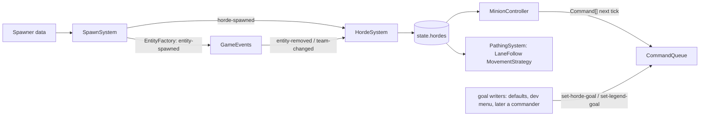

# Minion system

**Purpose.** Read this before you touch mobs, hordes, tower guards, spawning or the goals of bot
Legends. It owns how a horde comes to exist, moves down its lane, fights and dies; how guards hold
their towers; and the **goal seam**, the state fields through which any decision maker (the
scripted rules today, a team commander or an external model later) tells hordes and bot Legends
what to do. The build order, five phases M1 to M5 with their blockers and interim stand-ins, is the
[minion system plan](../plan/minion-system-plan.md). Doc [11](11-game-ai.md) still
owns the `Controller` contract, perception, determinism, cost control and the bot Legend behaviour
tree; this doc builds on them and never restates them.

**Entity legend.** The entity types this system implements, with their `EntityKind` and family
from doc [04 §1](04-entity-architecture.md#1-the-family-tree):

| Entity type        | `EntityKind`                         | Family   | What this system does with it                                                                                                                                                         | Controller               | Phase |
| ------------------ | ------------------------------------ | -------- | ------------------------------------------------------------------------------------------------------------------------------------------------------------------------------------- | ------------------------ | ----- |
| Light lane minion  | `light-mob`                          | `Mob`    | Spawned in hordes by the Stronghold (opening hordes) and SpawnerTowers; marches, fights, dies                                                                                         | `MinionController`       | M1–M2 |
| Medium lane minion | `medium-mob`                         | `Mob`    | Spawned in hordes by BuffTowers                                                                                                                                                       | `MinionController`       | M1–M2 |
| Heavy lane minion  | `heavy-mob`                          | `Mob`    | Spawned in hordes by the Stronghold down the worst lane                                                                                                                               | `MinionController`       | M1–M2 |
| Tower guard        | a `Mob` kind with a guard definition | `Mob`    | Light guards at SpawnerTowers, medium at BuffTowers, ranged and melee at the Stronghold; spawned and respawned by the structure's `GuardPlan`; hold its perimeter; belong to no horde | `GuardController`        | M2    |
| Bot Legend (laner) | `warrior`, `sentinel`, `magus`       | `Legend` | Gets a lane at setup and an optional goal; the doc 11 laner tree plays it                                                                                                             | `BotLegendController`    | M3    |
| Enemy Rover        | `warrior`, `sentinel`, `magus`       | `Legend` | The hard bot on the enemy team, using the same goal seam                                                                                                                              | `RoverController`        | M5    |
| Horde              | none (not an entity)                 | —        | The composite that groups lane minions: members, leader, lane progress, goal                                                                                                          | `HordeSystem` (a system) | M1    |

**Not handled here.** Bosses (`mini-boss`, `greater-boss`) and their `BossController`, neutral camp
units, turrets, projectiles, zones and the human player's Legend are out of scope; docs 07, 11 and
12 own them. Structures (`stronghold`, `spawner-tower`, `buff-tower`, `gate`) are only consumed: they
host spawners and guards and are the lane objectives (§6.2), but doc 07 implements them. The minion
modifiers **zone level-up** (MVP, a `CaptureSystem` reward, 07 §7) and **Ascend** (MVP-if-time, a
Legend-kill reward) belong to their reward systems, not to this doc.

**Implementation status (2026-10-15).** Nothing in this doc is built. The prototype escort
(`PROTOTYPE(PROTO-01)`: `ai/FollowLeaderController.ts`, `components/Brain.ts`,
`content/ai/followLeaderProfile.ts`, `content/mobs/lightMinion.ts`) stands in and is deleted in M1
(DEC-35). The damage pipeline, structures and `SpatialHash` do not exist yet. Until a phase lands, its
interim stand-ins are listed in the [minion system plan](../plan/minion-system-plan.md) §2.

## 1. Decisions

Made in the minion design sessions of 2026-10-14 and 2026-10-15.

| #     | Decision                                                                                                                                                                                                                                        | Where    |
| ----- | ----------------------------------------------------------------------------------------------------------------------------------------------------------------------------------------------------------------------------------------------- | -------- |
| MS-1  | All minion, horde and bot behaviour is scripted and deterministic in core. No model or network in the loop; an external decision maker is a later writer of the goal seam (§9).                                                                 | §9       |
| MS-2  | This doc owns hordes, minion and guard behaviour and the spawn flow; doc 04 §7 and doc 11 §4.3–4.4 point here.                                                                                                                                  | all      |
| MS-3  | Scope: lane hordes, tower guards, bot Legends' goals. Neutral camps, bosses and turrets stay in docs 07, 11 and 12.                                                                                                                             | legend   |
| MS-4  | A horde marches as a group and fights as individuals; survivors rejoin and march on.                                                                                                                                                            | §4, §6   |
| MS-5  | A horde is a loose flock behind its leader; no formation slots.                                                                                                                                                                                 | §5       |
| MS-6  | A horde stays on its spawn lane until M4; redirection to another lane then arrives through one command any writer may issue.                                                                                                                    | §10      |
| MS-7  | The target is flow-field lane following (10 §9); lane polylines stand in until M4.                                                                                                                                                              | §5, plan |
| MS-8  | The full DISC-10 spawn schedule is in M1.                                                                                                                                                                                                       | §3       |
| MS-9  | The worst lane is a weighted mix of towers lost and enemy pressure on the lane.                                                                                                                                                                 | §3.3     |
| MS-10 | A spawn that only partly fits under the unit cap spawns the members that fit and records the rest as suppressed.                                                                                                                                | §3.4     |
| MS-11 | Target priority is doc 11's League-style aggro list, as content.                                                                                                                                                                                | §6       |
| MS-12 | Hordes attack structures in lane order; a horde holds at a gate that is not breakable yet.                                                                                                                                                      | §6.2     |
| MS-13 | Guards follow the doc 11 baseline; the owner's Tower Guardians refinement is M5.                                                                                                                                                                | §7       |
| MS-14 | Bot Legends get a small goal union in their brain; the laner tree reads it. Only the laner is in scope before M5; the Rover is M5.                                                                                                              | §8       |
| MS-15 | No team commander in the MVP; the goal seam is the extension point.                                                                                                                                                                             | §9       |
| MS-16 | Minion modifiers are M5. Each keeps its own status: strength by distance (MVP-full, DISC-24) and enraged (MVP) must land before the MVP ships; minion XP and the ghosted first wave stay MVP-if-time.                                           | plan     |
| MS-17 | Dependencies: the damage pipeline (Phase 2 sprint 2.2) and structures (sprint 2.1) are built by other developers and consumed here. The minion work builds `SpatialHash` (Phase 1 sprint 1.3) and `Spawner`/`SpawnSystem` (Phase 2 sprint 2.7). | plan     |
| MS-18 | Medium and heavy mob stats start as `TUNE` placeholders in content, scaled from the light minion, until balancing.                                                                                                                              | plan     |
| MS-19 | Steering separates a mob only from same-team neighbours. Collision (10 §8) still pushes every pair apart, so before combat (M1) opposing hordes jostle past each other.                                                                         | §5.1     |
| MS-20 | A bot with no goal plays the lane match setup gave it; setup spreads each team's bots evenly across lanes.                                                                                                                                      | §8       |
| MS-21 | `Survive` outranks any set goal, and a goal clears itself when it can no longer apply.                                                                                                                                                          | §8       |
| MS-22 | In the MVP only the developer menu and tests redirect hordes; gameplay writers are post-MVP.                                                                                                                                                    | §10      |

## 2. Where it sits

All of it is layer L2 (`packages/core`). Folders follow
[02](02-code-structure.md): controllers in `ai/`, systems in `systems/`, the horde
record and goal types in `state/`, the movement strategy in `entities/strategies/`, numbers in
`content/` and `config/`, `SpatialHash` in `physics/`.



- **State is the truth.** Hordes and goals are plain data in `GameState`, hashed by
  `StateHasher` and carried in snapshots (rule 10). Systems talk through `GameEvents` (rule 12),
  using the event names of [03](03-game-model.md)'s catalogue.
- **Controllers decide what, systems decide how** (11 §1). `MinionController` picks targets and
  states; `PathingSystem` (10 §9) calls each mob's `MovementStrategy` for next tick's velocity.
- **Every change of intent is a `Command`**, including goal changes, so replays, sim mode and the
  developer menu need no special cases (03 §3).
- **Imports.** The goal types live in `state/`, which `ai/`, `systems/` and `commands/` may all
  import (02 §"may import"); nothing in `state/` imports `ai/`.

## 3. Spawning

### 3.1 Sources and schedule

`Spawner` is a component on the spawning structure; its data shape is doc
[07 §6](07-structures-obstacles-and-destructibles.md#6-spawners). The schedule is
the owner's DISC-10 (decisions log): SpawnerTower light hordes, BuffTower medium hordes, Stronghold
heavy hordes down the worst lane, with cadences as `TUNE` data in the spawner definitions. The
opening hordes are the `countdown` row of doc
[12 §2](12-game-story-and-match-director.md#2-matchphase-and-the-state-pattern),
counted by `GameConfig.match.initialHordesPerTeam`. Horde sizes per weight class are
`GameConfig.match.hordeSizes`. This doc names where the numbers live and never copies them.

### 3.2 `SpawnSystem`

Each tick, in `Spawner` id order: when `tick >= nextWaveTick`, `SpawnSystem` picks the lane (§3.3),
checks the cap (§3.4), emits `spawn-requested` for the batch and advances `nextWaveTick`.
`EntityFactory` fulfils the request at the end of the tick (deferred spawns, 07 §6), each member
emitting `entity-spawned`; once the batch is fulfilled, `SpawnSystem` emits
`horde-spawned { hordeId, lane, team, memberIds }` (03) with the new ids. A
`Spawner` never spawns loose mobs: every lane mob belongs to a horde. The origin is the
spawning structure; the horde walks `MapDefinition.lanes[laneIndex].path` from its own team's gate
(the path runs Light gate to Dark gate, so Dark walks it reversed).

**Guards** use the same system: `GuardPlan` (07 §6) spawns and respawns guards (§7).

### 3.3 The worst lane (MS-9)

`worstLane(team)` scores every lane and returns the highest score; ties go to the lowest lane
index. It is a pure function in `systems/` over state, replaceable by a strategy if the rule
changes. Both terms run from 0 to 1:

```ts
// packages/core/src/systems/worstLane.ts (sketch)
score(lane) =
  weights.towersLost * towersLost(lane) + // own lane structures destroyed / own lane structures
  weights.enemyPressure * enemyPressure(lane); // enemy units on the team's half of the lane / the most on any lane
```

- **Towers lost** counts the team's own structures on that lane (towers and the wall gate) that
  have been destroyed, over how many the lane started with.
- **Enemy pressure** counts enemy units on the team's half of that lane: hordes by their lane,
  enemy Legends by their nearest lane path. It is divided by the largest count on any lane, so the
  busiest lane scores 1.
- **Weights** are content in `content/ai/` (`TUNE`; `Recommendation:` 0.5 each).
- **When every lane scores 0** (no tower lost, no enemy on the team's half, as at match start), it
  returns `GameConfig.match.fallbackWorstLane` (`TUNE`; `Recommendation:` the middle lane).
- This serves only the Stronghold's scheduled heavy horde (DISC-10). The corner-camp mini-boss
  reward wave, which doc 12 §7 sends down the worst lane through a content-weighted
  `LaneAssessment`, is boss logic and out of scope here; it may call this function or keep its own.

### 3.4 Unit cap (MS-10)

Before each batch `SpawnSystem` checks `GameConfig.limits.maxUnitsPerTeam`. If only part of the
batch fits, it spawns that many and counts the rest as `spawn-suppressed`, the cap diagnostic that
docs 13 and 15 already use (`TeamUnitCapInvariant`); if none fits, no horde is created. A
suppressed batch is never queued, so the schedule does not drift.

## 4. The `Horde` composite

A horde is **not** an entity (ADR 0006); it is a record in `state.hordes`, and each member mob
carries the back-pointer `hordeId` that `HordeMembershipConsistentInvariant` (15) checks:

```ts
// packages/core/src/state/Horde.types.ts (sketch)
export type HordeId = string;
export type HordeGoal = { readonly kind: 'push-lane' }; // M4 adds 'move-to-lane' (§10)
export type Horde = {
  readonly id: HordeId;
  readonly team: Team;
  readonly weightClass: 'light' | 'medium' | 'heavy';
  readonly lane: string; // MapLane.id, as in the horde events' payload; goals use MapLane.index
  readonly memberIds: readonly EntityId[]; // ascending
  readonly leaderId: EntityId;
  readonly progress: number; // how far the leader is along its lane
  readonly goal: HordeGoal; // §9
};
```

`HordeSystem` (SRP: membership and lane progress):

- **Creation.** On `horde-spawned` it adds the record: members sorted, leader = lowest id,
  `progress` at the lane start, `goal` = `{ kind: 'push-lane' }`, and sets each member's `hordeId`.
- **Membership.** On `entity-removed` (death, `dev-removed` or any other cause) and on
  `team-changed` (a revived or converted mob leaves its old horde) it removes the member. If the
  leader left, the lowest surviving id becomes leader. At zero members it removes the record and
  emits `horde-dissolved`.
- **Progress.** It advances the leader's `progress` along the lane, but never past the horde's
  next standing objective (§6.2), so the horde gathers in front of it. At the lane's end the horde
  stays until it dies or the enemy Stronghold falls.

## 5. Movement

### 5.1 Lane following

`LaneFollowMovementStrategy` is a `MovementStrategy` (04 §4), chosen by the mob definition and
called by `PathingSystem` (10 §9):

- **Leader:** follow the lane toward the next point after `progress`. The target is the lane's
  flow field (10 §9); the plan lists the polyline stand-in used until M4.
- **Members:** seek the leader when farther than `followDistance`, and otherwise keep their speed.
- **Everyone:** add separation from **same-team** neighbours inside `separationRadius` (MS-19),
  queried through `SpatialHash`
  ([10 §5](10-physics.md#5-broad-phase-spatialhash)), with ID-ordered results.
- Vectors only, no angles (ADR 0012). All distances and weights are content in `content/ai/`
  (`TUNE`), in the shape the prototype's follow-leader profile proved.

The strategy never queries the whole entity list; steering cost per mob is one bounded neighbour
query. Enemies are not steered apart, but `CollisionSystem` (10 §8) still pushes every pair of
units apart, so before combat opposing hordes jostle past each other; from M2 they stop to fight
(§6).

## 6. Minion behaviour

### 6.1 `MinionController`

A state machine per mob, `marching → engaging → returning → marching`, with memory
`{ fsm, targetId, aggroUntilTick, cooldownUntilTick, leashAnchor }` in its brain (11 §2). It runs at
the minion cadence of 11 §6.

- **marching:** no command; the movement strategy carries the mob with its horde.
- **acquire** (at cadence): candidates from `Perception.unitsWithin(pos, acquisitionRadius,
{ hostileTo: team })` plus structures; ranked by the aggro priority list, then distance, then id.
  Switch only to a strictly higher priority. The list and its numbers are the
  `AggroRuleDefinition` content sketched in 11 §4.3 (League's order, Dota's aggro duration and
  cooldown, all `TUNE`), including "call for help".
- **engaging:** `attack-target { targetId }` until the target dies, the mob leaves `leashRadius`
  of `leashAnchor`, or `aggroDurationTicks` elapse. The attack itself is the damage pipeline's job
  (05).
- **returning:** move back toward the leader; on reaching `followDistance`, `marching`, with
  `aggroCooldownTicks` before it may re-acquire.

The leash anchor is the mob's position when it left `marching`, so a mob never chases a Legend
across the map.

### 6.2 Lane-order objectives (MS-12)

Each lane has an ordered list of the enemy structures along it (towers, then the wall gate, then
the Stronghold), built once from the map. A horde's **next objective** is the first one still
standing. Minions in range attack it when no unit outranks it in the aggro list.

- **A gate that is not breakable yet** (the DISC-09 threshold, 07 §3): the horde holds in front of
  it and minions fight whatever comes in range. When `structure-breakability-changed` makes it
  breakable, it becomes the objective.
- When the objective falls (`structure-destroyed`), the next one in the list takes over and the
  leader advances again.

## 7. Guards

Tower guards (light guards at a `SpawnerTower`, "numerous" medium guards at a `BuffTower`, ranged
and melee guards at the `Stronghold`, per the game doc) are Mobs owned by their structure's
`Spawner`; they belong to no horde.

- `GuardController` runs `holding → engaging → returning → holding`. It reuses the acquire, engage
  and return logic of §6.1 through a shared `LeashBehaviour` helper (DRY).
- The differences are data: the anchor is the home structure, the leash is the structure's
  `GuardPlan.leashRadius` (07 §6; game doc: guards "don't leave the tower's perimeter") and the
  idle state holds position.
- Spawning and respawning are the structure's `GuardPlan`, run by `SpawnSystem`, never controller
  logic (SRP). A lost SpawnerTower shrinks the Stronghold's guard table (DISC-21, 07 §8).

**M5:** the owner's Tower Guardians refinement (four specialised heavy guards per tower, ranged and
melee, a fixed radius, never chase, replacement after a delay; decisions log, MVP-if-time) is guard
content plus a second idle rule, not a new controller.

## 8. Bot Legends: the goal union

The laner behaviour tree, its utility scoring and difficulty data stay in doc
[11 §4.2](11-game-ai.md#42-botlegendcontroller-mvp). This doc adds the seam, a
type next to the brain in `state/` (11 §2):

```ts
// packages/core/src/state/AiState.types.ts (sketch, beside Brain)
export type LegendGoal =
  | { readonly kind: 'push-lane'; readonly laneIndex: number }
  | { readonly kind: 'defend'; readonly structureId: EntityId }
  | { readonly kind: 'retreat' }
  | { readonly kind: 'hunt'; readonly targetId: EntityId };
```

- **Lane without a goal (MS-20).** Match setup spreads each team's bot Legends evenly across the
  lanes (lowest lane first, ties by id) and stores the lane in the brain; a bot keeps it unless a
  goal moves it.
- The brain holds `goal: LegendGoal | null`. With `null` the tree chooses for itself, as doc 11
  describes; with a goal set, the root's `Push` and `Regroup` branches serve that goal instead.
  `Survive` always outranks a goal, so no writer can order a bot to die.
- A goal is set only by `set-legend-goal { actorId, goal }`, validated by its handler: the actor is
  a bot Legend (never the human's), the target exists, the lane index is in range, the structure is
  the bot's own for `defend`. An invalid goal is rejected with a reason, never thrown (AK-4).
- A goal clears itself when it can no longer apply (the hunted target dies, the defended structure
  falls), and the bot returns to choosing for itself.

## 9. The goal seam

Hordes and bot Legends each carry one goal field, and only commands change it. That is the whole
extension point for anything that decides at team level:

| Writer                                         | When          | How                                         |
| ---------------------------------------------- | ------------- | ------------------------------------------- |
| Built-in defaults (`push-lane`, `null`)        | M1, M3        | Set at spawn and at match setup             |
| Developer menu                                 | M3, M4        | The same commands, recorded in the replay   |
| A scripted team commander                      | post-MVP      | A system emitting the commands at a cadence |
| An external model (for example over WebSocket) | post-MVP, ADR | A client adapter enqueuing the commands     |

Because every writer goes through the same commands, validation, replays and tests hold for all of
them. An external model would also need an ADR, since `AGENTS.md` rules out a server today and
ADR 0016 covers only the Duel; it never runs inside core.

## 10. Redirection

`HordeGoal` gains a second member:

```ts
// packages/core/src/state/Horde.types.ts (sketch)
export type HordeGoal =
  { readonly kind: 'push-lane' } | { readonly kind: 'move-to-lane'; readonly laneIndex: number };
```

- `set-horde-goal { hordeId, goal }` is the one way to redirect (MS-6). Its handler checks that the
  horde exists and the lane index is in range. In the MVP only the developer menu and tests issue
  it (MS-22).
- **Paths.** Beside the flow fields per lane and team (10 §9), a field leads from the
  Unknown onto each lane's corridor, so a redirected horde can cross the wilderness.
  `Recommendation:` one extra field per (target lane, team), built and time-sliced like the others.
  When the leader reaches the target corridor, the horde's lane and `progress` switch to the new
  lane and its goal returns to `push-lane`.

## 11. Tests

Per doc 11 §8, plus:

- `HordeSystem`: creation on `horde-spawned`; member removal on `entity-removed` and
  `team-changed`; leader promotion; dissolve at zero; progress held at a standing objective.
- `SpawnSystem`: every DISC-10 source fires on its tick; the heavy horde picks the highest-scoring
  lane, ties go to the lowest index, and an all-zero score gives the fallback lane; a partial batch
  at the cap spawns what fits and counts the rest as `spawn-suppressed`.
- `LaneFollowMovementStrategy`: a horde walks a lane with no same-team overlap beyond a tolerance
  and no allocation per unit.
- `MinionController` and `GuardController`: table-driven transitions; gate holding until
  `structure-breakability-changed`.
- Goal commands: valid goals apply on the next tick, invalid ones (including a goal for the human's
  Legend) are rejected with a reason.
- Determinism: the same seed and command log give the same hash with hordes, guards and bots.

## 12. Open questions for the owner

None.

## Related

- [Minion system plan](../plan/minion-system-plan.md): the build phases M1 to M5, blockers and interim stand-ins.
- [03-game-model](03-game-model.md): the event catalogue, commands, determinism.
- [04-entity-architecture](04-entity-architecture.md): the `Mob` family, strategies, the factory.
- [07-structures-obstacles-and-destructibles](07-structures-obstacles-and-destructibles.md): `Spawner`, `GuardPlan`, breakability, gates.
- [10-physics](10-physics.md): `SpatialHash`, collision, steering and pathing interplay.
- [11-game-ai](11-game-ai.md): the controller contract, perception, determinism, cost, the bot tree.
- [12-game-story-and-match-director](12-game-story-and-match-director.md): the match phases and the opening hordes.
- [15-diagnostics-and-runtime-testing](15-diagnostics-and-runtime-testing.md): the horde and unit-cap invariants.
- [Entities and units (reference)](../reference/game-design/02-entities-and-units.md)
- [Owner decisions log](../reference/game-design/13-owner-decisions-log.md): DISC-09, DISC-10, DISC-21, DISC-24, DEC-35.
