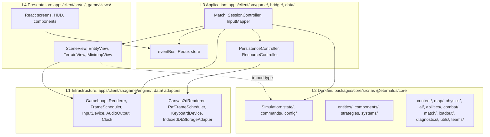

# Architecture

**Purpose.** Read this first when you need to know how Eternalus is built or where a design
question is answered. The seventeen docs in this folder are the system of record for the
architecture; every snippet in them is a labelled **sketch** or **contract**, never copied code,
and `AGENTS.md` carries only the rules that fit on one screen and links here. This page gives
the layered model in one picture, the reading orders, an index of
every doc with the code it governs, the register of decisions already made (do not reopen
them) and what survives a move to a real engine.

## 1. The model on one screen

Four layers, numbered by how much they know about the game; imports point downwards only
([01-layered-oop-model.md](01-layered-oop-model.md)). L2 is a plain TypeScript package with no
browser in it, L1 is a tiny generic engine with no game in it, L3 wires them together, and L4
only draws what L3 publishes.

Inside L2 the folders stack the same way, `utils/` and `config/` at the bottom and
`Simulation.ts` on top ([02](02-code-structure.md) §2). Entities are a shallow taxonomy (at most
three levels below `Entity`) carrying components; behaviour that varies by kind is a strategy,
per-tick logic is a system, and every tunable is a content definition keyed by a kebab-case id
([04](04-entity-architecture.md)). Everything is built to pass the product owner's test: **new
idea? add a class (and a content entry, and a registry line); nothing else changes** ([17](17-extension-recipes.md)).

## 2. Reading order

**Humans.** [01](01-layered-oop-model.md) (layers, ports, rules) → [02](02-code-structure.md)
(the tree, naming, the registries) → [03](03-game-model.md) (state, commands, events,
determinism, config) → [04](04-entity-architecture.md) (families, components, strategies,
definitions) → then the theme you need:

| Theme                      | Docs                                                                                                                                      |
| -------------------------- | ----------------------------------------------------------------------------------------------------------------------------------------- |
| Gameplay content and rules | [05](05-abilities-weapons-and-loadouts.md), [07](07-structures-obstacles-and-destructibles.md), [12](12-game-story-and-match-director.md) |
| World and space            | [06](06-map-and-minimap.md), [10](10-physics.md)                                                                                          |
| Engine and platform        | [08](08-game-engine.md), [09](09-hardware-abstraction.md)                                                                                 |
| Bots                       | [11](11-game-ai.md)                                                                                                                       |
| Client: UI and data        | [13](13-game-interface.md), [14](14-persistence-and-resources.md)                                                                         |
| Runtime checks and testing | [15](15-diagnostics-and-runtime-testing.md)                                                                                               |
| Working with coding agents | [16](16-agentic-harness.md), then [../agents/README.md](../agents/README.md)                                                              |
| Adding anything            | [17](17-extension-recipes.md)                                                                                                             |

**Agents.** [02](02-code-structure.md) → the doc whose `paths` frontmatter matches the files you
will touch (the table below, or `grep -l "paths:" docs/architecture/*.md`) → the matching
recipe in [17](17-extension-recipes.md). Then the current phase doc and the last `PROGRESS.md`
entry, per [../agents/README.md](../agents/README.md) §2. Read three documents, not seventeen.

## 3. The documents

| Doc                                                                                          | What it is for                                                                                                                                                                   | `paths` it governs                                                                                                                                                     |
| -------------------------------------------------------------------------------------------- | -------------------------------------------------------------------------------------------------------------------------------------------------------------------------------- | ---------------------------------------------------------------------------------------------------------------------------------------------------------------------- |
| [01-layered-oop-model.md](01-layered-oop-model.md)                                           | The four layers, who may import whom, ports and adapters, the architecture rules, engine portability, SOLID per boundary                                                         | `packages/core/src/**`, `apps/client/src/**`                                                                                                                           |
| [02-code-structure.md](02-code-structure.md)                                                 | The planned folder tree with may-import lists, naming and companion files, the public API, the registries, "I am adding X"                                                       | `packages/core/src/**`, `apps/client/src/**`, `eslint.config.js`, `knip.json`                                                                                          |
| [03-game-model.md](03-game-model.md)                                                         | One tick end to end, `GameState`, `Command`, `GameEvents`, `Snapshot`, the `Simulation` facade, determinism, replays, `GameConfig`                                               | `packages/core/src/{state,commands,config}/**`, `packages/core/src/Simulation.ts`                                                                                      |
| [04-entity-architecture.md](04-entity-architecture.md)                                       | The family tree, `Entity` lifecycle, components, strategies, Type Object definitions, factory and registry, hordes, D10, D11                                                     | `packages/core/src/{entities,components,content}/**`                                                                                                                   |
| [05-abilities-weapons-and-loadouts.md](05-abilities-weapons-and-loadouts.md)                 | Abilities as content plus effect and restriction strategies, status effects, the damage pipeline, weapons, artifacts, loadouts, progression                                      | `packages/core/src/{abilities,combat,loadout}/**`, `packages/core/src/content/{abilities,weapons}/**`                                                                  |
| [06-map-and-minimap.md](06-map-and-minimap.md)                                               | `MapGenerator` from config (D7), `MapDefinition`, `WorldMap`, presets, and why the minimap needs no code per feature                                                             | `packages/core/src/{map,content/maps,teams}/**`, `apps/client/src/game/views/{MiniMapView,MapView}*`                                                                   |
| [07-structures-obstacles-and-destructibles.md](07-structures-obstacles-and-destructibles.md) | The `Structure` family, layered shields, breakability as data, gates, turrets, spawners, capture points, obstacles, destructible terrain                                         | `packages/core/src/entities/structures/**`, `Obstacle*`, the `Health`/`Spawner`/`Capturable`/`Carry` components, the structure systems, structure and obstacle content |
| [08-game-engine.md](08-game-engine.md)                                                       | `GameLoop`, `FrameScheduler`, `Renderer`, `Camera`, audio, clock, `Match`, the render pipeline, the performance budget, D8                                                       | `apps/client/src/game/engine/**`, `apps/client/src/game/views/**`, `apps/client/src/game/Match.ts`                                                                     |
| [09-hardware-abstraction.md](09-hardware-abstraction.md)                                     | Ports and adapters for input, display, audio, time, storage and logging; device → `InputAction` → `Command`; contract tests                                                      | `apps/client/src/game/engine/**`, `apps/client/src/game/input/**`, the `StorageAdapter` port and adapters                                                              |
| [10-physics.md](10-physics.md)                                                               | Kinematics, momentum and knockback, carry weight, shapes, `SpatialHash`, SAT and swept tests, `CollisionResolver`, deterministic math                                            | `packages/core/src/physics/**`, `Movement`/`Collider`/`Carry`, `MovementSystem`, `CollisionSystem`, `deterministicMath`                                                |
| [11-game-ai.md](11-game-ai.md)                                                               | The `Controller` contract, perception, the seven controllers, determinism and cost rules, sim mode                                                                               | `packages/core/src/ai/**`, `packages/core/src/content/ai/**`                                                                                                           |
| [12-game-story-and-match-director.md](12-game-story-and-match-director.md)                   | `MatchDirector` over `MatchPhase`, `MatchTimeline` as data, scoring, victory, boss rewards, announcer and lore hooks, `MatchResult`                                              | `packages/core/src/match/**`                                                                                                                                           |
| [13-game-interface.md](13-game-interface.md)                                                 | `SessionController`, screens and HUD, the developer menu, the bridge, keybindings and `<KeyGlyph/>`, styling and accessibility                                                   | `apps/client/src/ui/**`, `apps/client/src/bridge/**`, `apps/client/src/game/input/**`                                                                                  |
| [14-persistence-and-resources.md](14-persistence-and-resources.md)                           | `PersistenceController`, repositories, `StorageAdapter`, migrations, DTOs with quarantine, quota, replays, `ResourceController`                                                  | `apps/client/src/data/**`                                                                                                                                              |
| [15-diagnostics-and-runtime-testing.md](15-diagnostics-and-runtime-testing.md)               | `Invariant` and `InvariantRunner`, the invariant catalogue, the `Logger` port and sinks, violations on screen, performance instrumentation, replay-hash, soak and property tests | `packages/core/src/diagnostics/**`                                                                                                                                     |
| [16-agentic-harness.md](16-agentic-harness.md)                                               | The agent harness by path and purpose: instruction files, permissions and hooks, skills, subagents, memory files, the verification ladder                                        | `.claude/**`, `.agents/**`, `scripts/hooks/**`, `docs/agents/**`                                                                                                       |
| [17-extension-recipes.md](17-extension-recipes.md)                                           | Twenty-six recipes (files, registry line, tests, docs, skill) and the anti-recipes                                                                                               | The registry files: `default*.ts`, the catalogues, `Command.types.ts`, `GameEvents.types.ts`, `keybindings.ts`, `store.ts`, `events.ts`, `migrations.ts`, `App.tsx`    |

## 4. Decisions register

Decided with the product owner; cite as "decided", do not reopen. ADRs 0003–0009 are part of
the Phase 0 PR (DISC-55 tracks that `docs/decisions/` held only 0000–0002 before it).

| #   | Decision                                                                                                                                            | Recorded in                                                                                    | Applied by                                                                               |
| --- | --------------------------------------------------------------------------------------------------------------------------------------------------- | ---------------------------------------------------------------------------------------------- | ---------------------------------------------------------------------------------------- |
| D1  | Full TypeScript everywhere, strict; interfaces and abstract classes map onto C# and C++ later                                                       | [ADR 0003](../decisions/)                                                                      | [01 §5](01-layered-oop-model.md#5-engine-portability), 02                                |
| D2  | React + Redux Toolkit + Vite for menus and HUD; the game is a custom Canvas 2D engine; no game engine or framework                                  | [ADR 0004](../decisions/)                                                                      | 08, 13                                                                                   |
| D3  | IndexedDB behind one `PersistenceController` with repositories and a `StorageAdapter` port; assets through one `ResourceController`; no server      | [ADR 0005](../decisions/)                                                                      | 14, 09 §7                                                                                |
| D4  | Entity model: shallow inheritance (max 3 below `Entity`) + components + strategies + systems + Type Object definitions                              | [ADR 0006](../decisions/)                                                                      | 04                                                                                       |
| D5  | Phase branching: `phase/<n>-<name>` integration branches, task branches into them, one PR per phase into `main`                                     | [ADR 0007](../decisions/)                                                                      | [../process/git-workflow.md](../process/git-workflow.md), 16 §9                          |
| D6  | Docs under `docs/` with the fixed tree and YAML frontmatter on every doc                                                                            | [ADR 0008](../decisions/)                                                                      | this folder, [../README.md](../README.md)                                                |
| D7  | The map is generated from config by a pure `MapGenerator`; hand-traced coordinates are never the source of truth                                    | [ADR 0009](../decisions/)                                                                      | 06                                                                                       |
| D8  | Single-threaded simulation on the main thread for the MVP; snapshots structured-clone-safe so a Worker move is cheap                                | [08 §10](08-game-engine.md#10-threading-single-threaded-now-worker-ready-later-d8)             | 03 §5, 08                                                                                |
| D9  | Fixed 30 ticks/s simulation; render at display rate with interpolation                                                                              | [03 §7](03-game-model.md#7-the-fixed-timestep-contract), [08 §2](08-game-engine.md#2-gameloop) | 03, 08                                                                                   |
| D10 | Team is a component, not a class; neutral things are `team: 'neutral'` (`Camp` structures, `Boss` units), because revives and ascension change team | [ADR 0006](../decisions/)                                                                      | [04 §8](04-entity-architecture.md#8-team-is-a-property-not-a-class-d10)                  |
| D11 | Sub-classes are post-MVP, modelled as `LegendSpecDefinition` data consumed by the class; a subclass only for unique behaviour                       | [ADR 0006](../decisions/)                                                                      | [04 §9](04-entity-architecture.md#9-sub-classes-and-specialisations-d11-post-mvp), 17 R2 |
| D12 | Flying class, mounts, anti-air, form change, ability tree, controller support and first-person are post-MVP with explicit extension points          | [../plan/backlog-post-mvp.md](../plan/backlog-post-mvp.md)                                     | 17 §10, 07 §14, 11 §9                                                                    |

## 5. What survives an engine port

The long-term goal is a translation into a real engine in another language, not a rewrite
([01 §5](01-layered-oop-model.md#5-engine-portability)). **Survives, line by line:** all of L2,
which is the entity families and components, the strategies, the systems and their order, the
`Command` union, `GameEvents`, `GameState` and `Snapshot`, `MapGenerator`, the physics maths,
the AI controllers, `MatchDirector`, the invariants, the content definitions and `GameConfig`
(interfaces become C# interfaces or C++ abstract classes, string-literal unions become enums,
content tables become data assets). **Re-implemented against the same port:** `Renderer`,
`FrameScheduler`, `InputDevice`, `AudioOutput`, `StorageAdapter`, the `Logger` sinks, one adapter
each. **Disposable:** React, Redux, the bridge, CSS Modules, `Canvas2dRenderer`,
`RafFrameScheduler`, the browser devices, `IndexedDbStorageAdapter`, Vite and npm.

## 6. Conventions every doc follows

Frontmatter per [../README.md](../README.md) (`title` matches the H1; `paths` names the code
the doc governs, which is how agents find it); a **Purpose** paragraph first, a **Related** list
last; code is a labelled TypeScript sketch using the names in [02](02-code-structure.md); every
item carries an MVP tag (**MVP**, **MVP-if-time**, **post-MVP**, **removed**); tuning values
carry `TUNE` and their source, inventions carry `Recommendation:`; research is cited by section;
and every design names the SOLID principle it serves and its single place of change.

## Related

- [../requirements/README.md](../requirements/README.md): the principles, coding rules and MVP requirements these designs realise.
- [../plan/README.md](../plan/README.md): the phases that build them, sprint by sprint.
- [../reference/README.md](../reference/README.md): the game design and the requirements source, with status tags and suggestions.
- [../decisions/](../decisions/): the ADRs behind the decisions register.
- [../research/README.md](../research/README.md): the reports the docs cite.
- [../agents/README.md](../agents/README.md): how coding agents enter the repo and read this folder.
- [../../AGENTS.md](../../AGENTS.md): the one-screen rules that point here.
