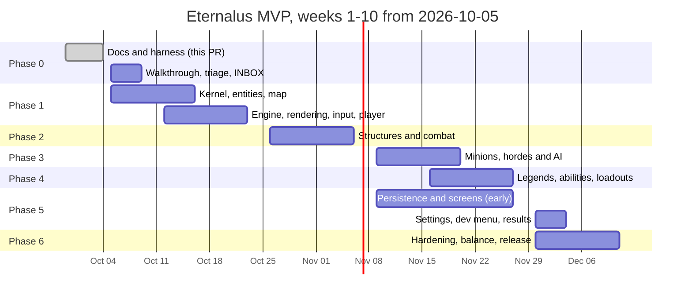

# Delivery plan

## Purpose

Read this when you need to know where the project is, what to work on next, or whether a
feature is still in scope. It is the roadmap for the COMP 7082 MVP: seven phases (0–6), one
document per phase, each phase split into sprints (two weeks each since 2026-10-03) with checklists, tests and a
measurable success metric. The phase docs are the working documents; this file is the map and
the rulebook. Progress is logged in [PROGRESS.md](PROGRESS.md). Anything outside the MVP lives
in [backlog-post-mvp.md](backlog-post-mvp.md).

## 0. Re-cut of 2026-10-03 (overrides the dates below)

The product owner answered the Phase 0 INBOX ([decisions log](../reference/game-design/13-owner-decisions-log.md)):
the **presentation is on 2026-11-27**, sprints are **two weeks**, and reviewers are chosen by
the feature owner when opening a PR. That leaves eight working weeks from 2026-10-05, so the
phases below keep their content and exit criteria but run as **two parallel tracks** across
four sprint windows, with a feature freeze on **2026-11-20**:

| Sprint | Dates           | Track A — core simulation (`packages/core`, engine)                                                         | Track B — client shell (`apps/client` screens, HUD, settings, persistence)                                                                |
| ------ | --------------- | ----------------------------------------------------------------------------------------------------------- | ----------------------------------------------------------------------------------------------------------------------------------------- |
| S1     | Oct 5 – Oct 16  | Phase 1: kernel (config, RNG, state, commands, events, hasher), map audit → `MapGenerator`, entity base     | Session shell + home screen, match-flow screens (loading, character select, pre-launch, match loading), HUD draft, settings + keybindings |
| S2     | Oct 19 – Oct 30 | Phase 1 close (engine loop, `Match`, views, input → player moves on the generated map) + Phase 2 structures | Persistence (IndexedDB behind `PersistenceController`), loadouts + profile screens, developer menu v1                                     |
| S3     | Nov 2 – Nov 13  | Phase 3: hordes, flow fields, controllers, match timeline, sim mode                                         | Phase 4 HUD pieces (ability bar, name tags with bot icon), results screen, in-match settings overlay                                      |
| S4     | Nov 16 – Nov 27 | Phase 4: three classes, MVP abilities, weapons, XP; **freeze Nov 20**; Phase 6 hardening Nov 20–27          | Art/audio pass, docs gardening, course deliverables, demo script                                                                          |

Tracks merge into the same phase branches (Track B work lands in the open phase branch of
the moment, stacked per `../process/git-workflow.md` §3). The MVP cut order (DEC-07) applies
from the end: corner camps → manual turret control → pick-up/throw → art polish. The sprint
checklists in the phase docs stay the task source; their week numbers are superseded by this
table. Session-level work packages for S1 are in
[`../agents/prompts/2026-10-03-ultracode-sessions.md`](../agents/prompts/2026-10-03-ultracode-sessions.md).

## 1. How phases, sprints and tasks work

- **Phase** = one long-lived integration branch `phase/<n>-<name>` and one PR into `main`
  (decided, D5, ADR 0007 in [docs/decisions/](../decisions/)). A phase is **done**
  when every exit criterion in its doc is met, its metrics pass, and its PR is merged to `main`
  by the `main` maintainer.
- **Sprint** = a two-week work package (DEC-05, 2026-10-03; the phase docs still say one week per sprint — read two) with an owner (one or two people plus their agents),
  a checklist of tasks, the tests those tasks must add, and one **success metric** a reviewer
  can measure without asking the author. Sprints of the same phase run in parallel when their
  dependency line allows it; the calendar week is the unit, not the sequence number.
- **Task** = one checkbox in a sprint: one task branch (`feat/…`, `fix/…`, `docs/…`) PR'd into
  the phase branch, small enough for one agent session. Every task states **tests to write**
  and **done when**. An agent picks a task, writes its task brief
  ([template](../agents/task-brief-template.md)), works on its own branch and worktree, runs
  `npm run check`, and appends an entry to [PROGRESS.md](PROGRESS.md).
- **Stacking.** While a phase PR waits for review, the next phase branches from that phase
  branch and merges it forward (`git merge phase/<n-1>`) whenever it moves. The PR order into
  `main` never changes. `Recommendation:` a sprint whose dependencies are already merged may
  start early in its own phase branch (Phase 5 persistence work is the intended case); the
  phase PR still queues behind the earlier phase.
- **Traceability.** Each phase doc lists the functional-requirement areas it delivers from
  [06-mvp-requirements.md](../requirements/06-mvp-requirements.md) ("FR: map & minimap",
  "FR: controls & rebinding", ...). The FR identifiers are being written in parallel; refer to
  areas until they are final.
- **Humans decide, agents build.** Product and design decisions go to the product owner (via
  `INBOX.md`), never to an agent. Agents never commit, push or merge unless asked
  ([AGENTS.md](../../AGENTS.md)).

## 2. Phase table

Dates assume the term's last working week ends **2026-12-11** (10 working weeks from
2026-10-05). **Assumption:** the exact course end date is unknown; if the deliverable date is
earlier, the cut lines in §4 apply from the end.

| #   | Phase                           | Goal                                                                                                      | Weeks                      | Exit criterion (short form)                                                                       | Branch                                   |
| --- | ------------------------------- | --------------------------------------------------------------------------------------------------------- | -------------------------- | ------------------------------------------------------------------------------------------------- | ---------------------------------------- |
| 0   | Documentation and harness       | Every teammate and agent can find the design, the rules and the plan; the harness gates agent work        | Week 0–1 (Sep 29–Oct 9)    | Docs tree complete, `npm run check` green incl. docs check, team walkthrough held, INBOX answered | `docs/phase-0-foundation`                |
| 1   | Simulation kernel and world     | A deterministic simulation with a config-generated map, rendered at 60 fps, with one movable placeholder  | Weeks 1–3 (Oct 5–23)       | Replay test green for 10 seeds × 3000 ticks; `numLanes` 3→5 regenerates map and minimap in tests  | `phase/1-simulation-kernel-and-world`    |
| 2   | Structures and combat           | Towers, strongholds, walls, gates, turrets, damage, projectiles, capture points and spawning schedule     | Weeks 4–5 (Oct 26–Nov 6)   | Shield math matches the worked example; zero pass-through anomalies in a 10-minute soak           | `phase/2-structures-and-combat`          |
| 3   | Minions, hordes and AI          | Lane hordes, flow fields, minion/guard/boss/bot controllers, the match timeline, sim mode                 | Weeks 6–7 (Nov 9–20)       | Tick ≤ 8 ms with 144 units/team + 20 Legends; bot-vs-bot match completes; determinism holds       | `phase/3-minions-hordes-and-ai`          |
| 4   | Legends, abilities and loadouts | Three classes, the MVP ability set, ultimates, weapons/artifacts, loadouts, XP scaling, ability HUD       | Weeks 7–8 (Nov 16–27)      | Every MVP ability has a passing scenario test; a human plays each class end to end                | `phase/4-legends-abilities-and-loadouts` |
| 5   | Meta UI and persistence         | Boot, menu, loadout, profile, settings (rebinding), about; IndexedDB persistence; complete developer menu | Weeks 6–9 (Nov 9–Dec 4)    | Persistence contract tests pass on memory + IDB fake; W→ArrowUp rebinding updates prompts         | `phase/5-meta-ui-and-persistence`        |
| 6   | Hardening, balance and release  | Performance and balance passes, art/audio, soak corpus in CI, docs gardening, course deliverables, tag    | Weeks 9–10 (Nov 30–Dec 11) | `v0.1.0-mvp` tagged from green `main`; report, presentation and demo delivered                    | `phase/6-hardening-balance-and-release`  |

Phase docs: [0](phase-0-documentation-and-harness.md) · [1](phase-1-simulation-kernel-and-world.md) ·
[2](phase-2-structures-and-combat.md) · [3](phase-3-minions-hordes-and-ai.md) ·
[4](phase-4-legends-abilities-and-loadouts.md) · [5](phase-5-meta-ui-and-persistence.md) ·
[6](phase-6-hardening-balance-and-release.md) · [post-MVP backlog](backlog-post-mvp.md).

## 3. Timeline sketch

The two lanes are deliberate: the **sim lane** (core) runs Phases 1 → 2 → 3 → 4 on the critical
path; the **client lane** (engine, views, UI, persistence) runs Phase 1 sprints 1.4–1.5, the
Phase 2 views sprint, and then Phase 5 early. Phase 6 is everyone.

## 4. MVP cut lines

- **MVP-core** (the minimum demoable lane game; never cut): config-generated map + minimap;
  deterministic 30 TPS simulation with replay; two strongholds with walls, one SpawnerTower and
  one BuffTower per lane; hordes marching and fighting down straight lanes; 10 v 10 Legends with
  one human (any one class) and bots; three capture points; win by destroying the enemy
  Stronghold; boot menu → match → results; settings with rebinding; developer menu (add/remove
  Legends, spawn units, sim mode); runtime invariant logging.
- **MVP-full** (everything in the requirements MVP list, see
  [11-mvp-scope.md](../reference/game-design/11-mvp-scope.md)): MVP-core plus all three classes
  with their MVP abilities and ultimates, XP scaling of abilities/health/aether, loadouts saved
  to a profile, profile with match history and achievement hooks, six forest camps per side,
  quarter-mark mini-bosses, the mid-game GreaterBoss, gates and turrets, a loading screen and an
  about screen.
- **Cut order if late** (first cut first; each cut is a product-owner decision logged in
  `INBOX.md` and [PROGRESS.md](PROGRESS.md)):
  1. Art and audio polish (keep placeholder shapes; MVP art is low-poly/pixel anyway).
  2. Pick-up/throw (**MVP-if-time** in the game doc).
  3. Turret manual control (keep auto-fire; the `TurretController` seam stays).
  4. Corner camps (**MVP-if-time**, [backlog](backlog-post-mvp.md)).
  5. Mini-bosses on outer lanes (capture points stay; `BossController` seam stays).
  6. GreaterBoss ("Eternal") mid-game (the Cathedral stays a capture point).
  7. Achievement hooks in the profile (match history stays).
  8. Loadout variety (one weapon per class, fixed abilities; the `Loadout` model stays).
  9. Replays saved to IndexedDB (keep in-memory replay for tests).
  10. Magus Revive default action (the class stays; Revive becomes an ability stub).

Nothing below line 10 is cut without an explicit team decision; the class count (3), the
generated map, determinism and the developer menu are the requirements' non-negotiables.

## 5. Metrics dashboard

Targets are project-level; the phase docs say when each is first measured. Numbers marked
`Recommendation:` were set by the architect, not by the source documents.

| Metric                            | Target                                                                                                     | Measured by                                                     | First gate | Status (2026-09-30) |
| --------------------------------- | ---------------------------------------------------------------------------------------------------------- | --------------------------------------------------------------- | ---------- | ------------------- |
| Determinism replay test           | Same seed + command log → identical `StateHasher` hash every 100 ticks, 10 seeds × 3000 ticks              | `npm run test` (replay fixtures in core)                        | Phase 1    | not started         |
| Simulation tick time              | ≤ 8 ms per tick at 30 TPS with 144 units/team + 20 Legends on the reference dev laptop (`Recommendation:`) | `PerfOverlay` histogram; headless bench in `npm run bench` (P3) | Phase 3    | not started         |
| Render frame rate                 | 60 fps: median frame ≤ 16.7 ms, no frame > 50 ms during a 60 s match segment (`Recommendation:`)           | `PerfOverlay` + long-animation-frame observer                   | Phase 1    | not started         |
| Coverage thresholds               | core ≥ 80% now → 85% end of Phase 2 → 90% end of Phase 6; client ≥ 45/50% now → 55% P1 → 65% P5 → 70% P6   | `npm run test:coverage` (ratchet, only goes up)                 | Every PR   | core 80, client 45  |
| Lint                              | Zero warnings, zero `eslint-disable` without a named rule and reason                                       | `npm run lint`                                                  | Every PR   | green               |
| Docs check                        | Frontmatter valid on every `docs/**/*.md`, relative links resolve, index in sync                           | `npm run check` (docs step)                                     | Phase 0    | in this PR          |
| Open invariant violations in soak | 0 violations in a 10-minute headless soak (18,000 ticks) with all invariants at `heavy`                    | `npm run test:soak`                                             | Phase 2    | not started         |
| Team-agreed design walkthrough    | Held, minutes in [PROGRESS.md](PROGRESS.md), every INBOX decision answered or scheduled                    | Meeting                                                         | Phase 0    | scheduled           |
| Config-driven map                 | `numLanes` 3→5 and tower counts regenerate map, nav grid, flow fields and minimap in tests, no code change | `MapGenerator` + `MinimapView` tests                            | Phase 1    | not started         |
| Bot-vs-bot match                  | Sim mode match (no human) reaches a `MatchResult` within the timeline cap, deterministic                   | `npm run test:soak`                                             | Phase 3    | not started         |
| Persistence contract              | Same repository test suite passes on `MemoryStorageAdapter` and an IndexedDB fake                          | `npm run test` (client)                                         | Phase 5    | not started         |
| Release                           | `v0.1.0-mvp` tag on green `main`; demo script runs start to finish                                         | CI + demo rehearsal                                             | Phase 6    | not started         |

## 6. Roles per phase

Five students plus agents. Names known today: **Sam Holtzman** (product owner, lead architect,
`sholtzman`) and **SamarjitBhogal** (`main` maintainer, merges phase PRs, Phase 0 reviewer). The
lead architect reconciles the `feat/map` code with the architecture; its author, **Aryan
Walanj**, reviews those changes (DEC-04). The other lanes are assigned at the Phase 0
walkthrough; record them in [PROGRESS.md](PROGRESS.md).

| Phase | Builds                                     | Reviews architecture and design                 | Reviews tests and guardrails | Merges to `main` |
| ----- | ------------------------------------------ | ----------------------------------------------- | ---------------------------- | ---------------- |
| 0     | sholtzman + agents                         | whole team (walkthrough)                        | SamarjitBhogal               | SamarjitBhogal   |
| 1     | sim lane (2) + client lane (2) + map owner | sholtzman                                       | one reviewer per lane        | SamarjitBhogal   |
| 2     | sim lane + client views owner              | sholtzman                                       | client lane lead             | SamarjitBhogal   |
| 3     | sim lane (AI owner + pathing owner)        | sholtzman                                       | map owner                    | SamarjitBhogal   |
| 4     | sim lane + HUD owner                       | sholtzman + product owner sign-off on abilities | AI owner                     | SamarjitBhogal   |
| 5     | client lane (persistence owner + UI owner) | sholtzman                                       | sim lane lead                | SamarjitBhogal   |
| 6     | everyone                                   | sholtzman                                       | SamarjitBhogal               | SamarjitBhogal   |

Every phase PR needs one human approval plus green CI on three OSes; an agent-written
`architecture-reviewer` pass is advisory ([running-agents.md](../agents/running-agents.md)).
`Recommendation:` name a deputy maintainer for `main` so a single absence cannot block a merge.

## 7. Risks and mitigations

| Risk                                                | Likelihood | Mitigation                                                                                                                                                                                                                                 |
| --------------------------------------------------- | ---------- | ------------------------------------------------------------------------------------------------------------------------------------------------------------------------------------------------------------------------------------------ |
| Scope: the game doc is far bigger than 10 weeks     | high       | Cut lines (§4); highlight statuses copied into every reference doc; product owner triages `INBOX.md` weekly; post-MVP backlog keeps ideas without keeping them in scope.                                                                   |
| Five people plus agents merging into one branch     | high       | One task per branch and worktree; disjoint file sets per sprint; phase branch merged forward daily; small PRs; `SystemPipeline` registration and `EntityRegistry` lines are the only shared hot spots (append-only, one line per feature). |
| Determinism bugs found late                         | medium     | Hash every 100 ticks from Phase 1; replay fixtures grow with every bug fix; lint bans on `Math.random`, `Date`, timers and unwrapped `Math.sin/cos/atan2` in core; ID-ordered iteration rule.                                              |
| Performance misses the 144-per-team target          | medium     | Budgets set in Phase 1 (300 dummies ≤ 4 ms); `SpatialHash`, flow fields, pooling from the start; `PerfOverlay` in every build; Phase 6 profiling pass with a written budget per system.                                                    |
| Course deadlines and other courses                  | high       | Weekly sprint metric review; the MVP-core line is demoable from Phase 3; Phase 6 reserves a full week for deliverables; no new features after 2026-12-04.                                                                                  |
| `main` ownership bottleneck                         | medium     | Branch protection with one approval; deputy maintainer; phase PRs opened early as drafts so review is incremental.                                                                                                                         |
| Agent-generated code drifting from the architecture | medium     | Boundary lint rules per folder, coverage ratchet, the reviewer checklist, `docs/architecture/` as the system of record, weekly docs gardening.                                                                                             |
| Instructor rejects React/Redux for the UI           | low        | UI is isolated behind `bridge/`; confirmation is a Phase 0 exit item; fallback is DOM screens fed by the same event bus (one week of rework at most).                                                                                      |
| Unlicensed assets                                   | low        | Only team-made or licensed assets, tracked in the `AssetManifest`; placeholder shapes until Phase 6.                                                                                                                                       |

## Related

- [phase-0-documentation-and-harness.md](phase-0-documentation-and-harness.md)
- [phase-1-simulation-kernel-and-world.md](phase-1-simulation-kernel-and-world.md)
- [phase-2-structures-and-combat.md](phase-2-structures-and-combat.md)
- [phase-3-minions-hordes-and-ai.md](phase-3-minions-hordes-and-ai.md)
- [phase-4-legends-abilities-and-loadouts.md](phase-4-legends-abilities-and-loadouts.md)
- [phase-5-meta-ui-and-persistence.md](phase-5-meta-ui-and-persistence.md)
- [phase-6-hardening-balance-and-release.md](phase-6-hardening-balance-and-release.md)
- [backlog-post-mvp.md](backlog-post-mvp.md)
- [PROGRESS.md](PROGRESS.md)
- [../requirements/06-mvp-requirements.md](../requirements/06-mvp-requirements.md)
- [../process/git-workflow.md](../process/git-workflow.md)
- [../process/sdlc.md](../process/sdlc.md)
- [../architecture/README.md](../architecture/README.md)
