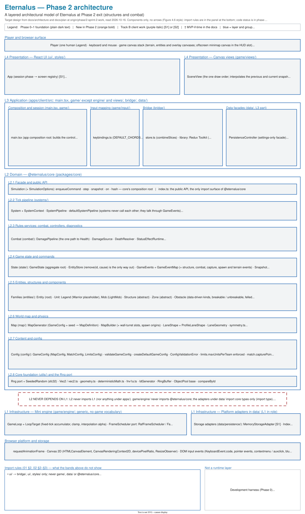
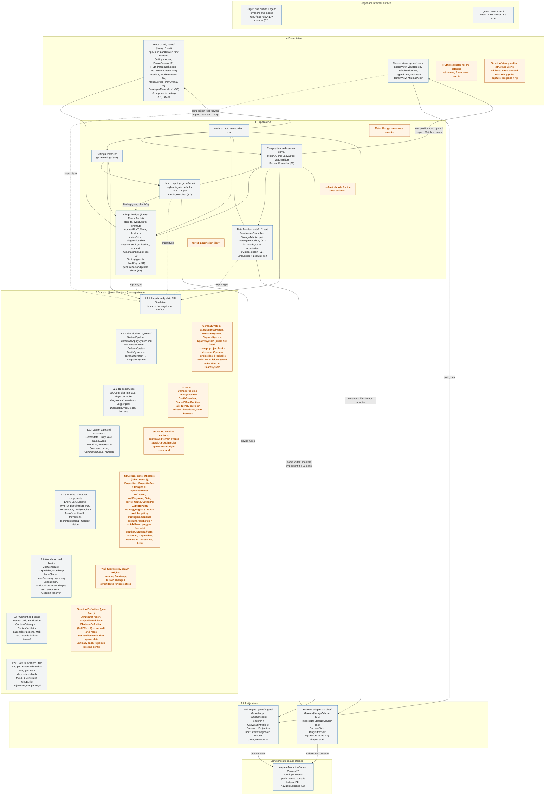

# Phase 2 — Layered architecture diagram

## Purpose

This page draws the whole Eternalus architecture at Phase 2 (structures and combat) exit as
horizontal layers, in the style of Sommerville's Figure 4.6 ("An architectural model of a document
retrieval system"): the Phase 0–1 foundations, the Phase 2 additions, and the Track B client work
that the accepted plan ([README.md](README.md) §0) schedules into sprint windows S1 and S2. It was
drawn from `docs/architecture/` and `docs/plan/` as they stood on `origin/phase/2-sprint-2-work`
on 2026-10-16. Where it differs from those docs, the docs are right.

## Diagram

The editable source is [phase-2-architecture.drawio](phase-2-architecture.drawio) (uncompressed
draw.io XML). After an edit, export the SVG again with
`draw.io -x -f svg --svg-theme light --embed-svg-fonts false -o docs/plan/phase-2-architecture.svg docs/plan/phase-2-architecture.drawio`.
Leaving out `--embed-svg-fonts false` makes draw.io 28 embed a PNG copy of every label, which takes
the file from about 70 KB to about 7 MB.

## Legend

- **Plain dark text:** a Phase 0–1 foundation. This includes the Phase 1 items that are still
  open, because Phase 2 depends on them.
- **Orange bold:** new in Phase 2 (sprints 2.1–2.9 in
  [phase-2-structures-and-combat.md](phase-2-structures-and-combat.md)).
- **Purple italic with `[S1]` or `[S2]`:** Track B client work in sprint window S1 or S2.
- **†:** MVP-if-time in the docs.
- **Blue:** layer, box and group labels.
- An item takes the colour of the plan sprint that schedules it, even when its code appeared
  earlier. An item scheduled both in a Phase 1 sprint and by Track B (for example
  `keybindings.ts`, the Redux store, `main.tsx`) is drawn as Phase 1.
- Like Figure 4.6, the figure has no arrows. The import rules are in its bottom panel and in the
  Mermaid view below.

## Allowed imports (Mermaid view)

This view shows the same bands, plus the arrows that the figure leaves out:

- A solid arrow means "may import".
- A dotted arrow labelled `import type` means a type-only import.
- The plain line between the data facades and their adapters means "same folder": the adapters
  implement ports that L3 owns.
- Arrows into core point at L2.1, because the client imports core only through
  `@eternalus/core`.
- L2 has no outgoing import arrow. Its only outgoing links are two invisible `~~~` layout links
  from L2.8 to L1. They keep L1 below L2; they are not imports. The other `~~~` links only keep
  the bands in order.
- The L1 adapters under `data/` import core types only. Their node label and the figure's banner
  say so instead of an arrow, because an arrow from L1 up to L2.1 would run through L2 and read
  as an import inside core.
- Orange nodes are Phase 2; `(S1)`/`(S2)` marks Track B work; † marks MVP-if-time.

Inside L2 the arrows are not drawn; the may-import column of
[02-code-structure.md](../architecture/02-code-structure.md) §2 gives them. Two points the
sub-band order hides:

- **Imports that point up the sub-band order** (both type-only):
  - `entities/` → `state/` types (L2.5 → L2.4).
  - `physics/` → `components/` types (L2.6 → L2.5).
- **Open conflicts with the 02 §2 lists:**
  - Core `AGENTS.md` forbids `systems/` → `ai/` and `ai/` → `content/` types.
  - The invariants need `diagnostics/` → `components/`.
  - `commands/` → `components/` is forbidden.
  - `GameState.world` needs `state/` → `map/`: allowed for types since the #38 fix (F7d, 02 §2).

## Not shown (later phases / proposed)

The figure leaves these out:

- **Phase 3:**
  - `Horde`, `HordeSystem`, `MediumMob`, `HeavyMob`.
  - `PathingSystem`, flow fields and the `WorldMap` cost grid.
  - `AiSystem`, `ControllerRegistry`, `Perception`.
  - The minion, guard, boss, bot-Legend and rover controllers.
  - `match/` (`MatchDirector`, `MatchDirectorSystem`, scoring, victory) and sim mode.
  - The finished `MatchClock` (with the match phase) and `Scoreboard` (with scores), sprint 3.5.
- **Phase 4:**
  - `abilities/` and `AbilitySystem`.
  - `loadout/`, progression, `Carry` and `PickUpStrategy`.
  - The finished `AbilityBar` and `AetherBar` (sprint 4.7).
  - The `Sentinel` and `Magus` classes (sprint 4.1).
- **Phase 5 beyond S2:**
  - `ResourceController` and asset loading.
  - A `BootScreen` with real progress.
  - The finished `DeveloperMenu` and `PerfOverlay` v2.
  - `OverlaySink`, which 09 §1 lists as later.
- **Track B S3:** the results screen (a `ResultsScreen` shell already exists) and name tags with
  the bot icon.
- **Phase 6:** audio, the per-system `Profiler` wrap, `BalanceHarness`, `ErrorBoundary` and the
  art pass.
- **Post-MVP:** `GamepadDevice`, `WebGlRenderer`, `HttpStorageAdapter`, `WorkerSimulationProxy`,
  fog of war and the Flying class.
- **Proposed only (not accepted):**
  - ADR 0016 (server-authoritative Duel).
  - ADR 0017 (balanced asymmetric camps).
  - The multiplayer plan's §5 re-cut.
- **Demo-only:** `MapExplorer` and the PROTO-01 escort.
- **Phase 0:** it built only tooling. That tooling appears as a side note, not as a layer.

## Drawing choices

Where the docs disagree or are silent, the figure does this:

- **Phase 1 work still open is drawn as foundation.** This covers `CollisionSystem`, physics,
  `TerrainView`, `MatchBridge`, `MatchScreen`, `PlayerController`, `PerfOverlay`, `DeveloperMenu`
  v0 and `ObjectPool`. Plan [README.md](README.md) §0 closes Phase 1 in S2, and
  [phase-2-structures-and-combat.md](phase-2-structures-and-combat.md) depends on it.
- **`Structure`, `Zone`, `Obstacle` and `Projectile` are orange.** Sprints 2.1, 2.6, 2.5 and 2.3
  schedule them, and 04 says structures and zones get concrete kinds in Phases 2 and 3. Their base
  classes already shipped in sprint 1.2 (07 and 04, Implementation status).
- **`Legend` shows only the Warrior placeholder.** Phase 1 sprint 1.2 schedules only a
  placeholder `Warrior` and its definition. Phase 4 sprint 4.1 schedules the `Warrior`,
  `Sentinel` and `Magus` classes, so `Sentinel` and `Magus` are left out, although placeholder
  kinds for them already exist in code (04, Implementation status).
- **System order.** Only the documented positions are drawn: `CommandApplySystem` first
  (03 §1), Movement → Collision (10 §9), Death → Invariant → Snapshot last (12 §1, 03 §5). The
  five Phase 2 systems have no documented position, so they are drawn without an order.
- **The `Controller` interface is Phase 1.** It sits beside `PlayerController`, because sprint 1.5's
  `InputMapper` → `PlayerController` task is done when "bots and the player share the
  `Controller` interface". Phase 3 sprint 3.3 schedules it again, together with `AiSystem`.
  `TurretController` is orange (sprint 2.3).
- **`AiSystem` is not drawn.** It is the system that would run `TurretController`, and Phase 3
  sprint 3.3 schedules it. Phase 2 has no scheduled seam that runs turrets.
- **`BreakabilityRule` is content data that `StructureSystem` evaluates** (07 §3), not a strategy
  as sprint 2.1 says. Sprint 2.1 itself says it follows 07.
- **The Sentinel sprint-through rule is an `AttackStrategy`** (07 §3), not a `BreakabilityRule`
  strategy as sprint 2.4 says.
- **The turret action ids are in `bridge/Binding.types.ts`** (`INPUT_ACTIONS`), and their
  default chords are in `game/input/keybindings.ts`, as 13 §6.1 has it. 02 §3 instead puts
  `INPUT_ACTIONS` in `keybindings.ts`.
- **The turret actions are not named.** Sprint 2.3 says `turret-enter`/`turret-exit`, while 07 §5
  and 13 §6.1 say `turret-toggle-control`. Both lists have `turret-switch-ammo`.
- **† marks the items the docs call MVP-if-time:**
  - The Sentinel sprint-through rule (07 §3).
  - Manual turret control (07 §1, 13 §6.1). It is the only one of these on the MVP cut list
    (cut 3 in plan README §4).
  - Gate fire (07 §1, §4).
  - Felled trees and their `FellEffect`. 04 §1 gives `Obstacle` "felling, burning, throwing
    MVP-if-time", and 04 §5 marks `ObstacleDefinition.fallDamage` MVP-if-time.
- **The spawn schedule is `GameConfig.match.timeline`, with `MatchTimelineEntry` in `config/`**
  (02 §9, 03 §10, 12 §1), not "a `MatchTimeline` content table" as sprint 2.7 says.
- **Turret ammo is `AmmoDefinition`** (07 §5), not weapons content as 11 §4.5 has it.
- **Zone tuning is described as "zone radii and rates"** (sprint 2.6), not named, because
  `ZoneDefinition` exists only in code.
- **`DamageSource` sits in `combat/`** (02 §2, 05 §9), although the code defines it in
  `state/GameEvents.types.ts`. `DeathResolver` is drawn as 05 §9 and 03 §4 have it.
- **`DamageStep` and `FriendlyFireStep` are not drawn.** They exist only on the unmerged
  `feat/combat-damage-pipeline` branch.
- **`Circle` and `ConvexPolygon` sit in `physics/`** (02 §2, 10 §4). The code has only a circle
  shape, in `components/Collider.types.ts`; `ConvexPolygon` does not exist in code yet.
- **The engine clock is `Clock` / `PerformanceClock` / `FakeClock`** (01 §3, 02 §3, 08, 09).
  13 §2 and the code call it `SessionClock`, so the docs disagree. The Sprint 1 audit's AC-23
  proposes adopting `SessionClock`, but that is not accepted yet.
- **The team component is `TeamMembership`.** 04 §3 says `Team`, but the type `Team` owns that
  name (04, Implementation status).
- **`MatchBridge` sits in `game/`** (13 §1, 12 §8), not in `bridge/` as the S1 contract has it.
- **`GameCanvas.tsx` is drawn only as the owner of the canvas elements.** Who creates the `Match`
  and owns its lifetime is left out. 13 §2 has `SessionController.createMatch`, while
  `apps/client/AGENTS.md` and the code have `GameCanvas`. The Sprint 1 audit leaves this open
  (AC-25).
- **Two composition roots import upward.** `Match` imports the views (01 §1). `main.tsx` imports
  `ui/App.tsx`, because it is the only place `game/` and `ui/` meet (13 §1). `main.tsx` also
  constructs the storage adapter and injects it (01 §3).
- **`SettingsController` is its own node in the Mermaid view.** `game/settings/` may import only
  core, `game/input/` and `bridge/`, and it reaches persistence through a structural port (02 §3).
- **React and Redux Toolkit are noted as libraries in the boxes that use them**: React in `ui/`,
  Redux Toolkit in `bridge/` (01 §2, ADR 0004). They are not platform items. ADR 0004 was
  accepted in Phase 0, so they carry no Track B tag.
- **Slices take their sprint.**
  - `matchSlice` is Phase 1 sprint 1.4.
  - `diagnosticsSlice` feeds `PerfOverlay` v1 (sprint 1.5).
  - The other S1 slices are purple: session D of the S1 work package created them (§2.6 of that
    work package).
  - `hooks.ts` (sprint 1.4's typed hooks) and `Binding.types.ts` (sprint 1.5's `InputAction`
    ids) are Phase 1; `chordKey.ts` is S1.
- **The S1 HUD draft is session G** of the S1 work package
  ([2026-10-03-ultracode-sessions.md](../agents/prompts/2026-10-03-ultracode-sessions.md);
  plan §0 S1 "HUD draft"):
  - It covers `HealthBar`, `AetherBar`, `XpBar`/`LevelBadge`, `AbilityBar`, `MinimapPanel`,
    `MatchClock`, `Scoreboard`, `Announcer`, `NameTag`, and `PerfOverlay` and `DeveloperMenu`
    stubs.
  - The figure draws them as one "HUD draft placeholders [S1]" group. That group includes
    `MinimapPanel`, because no Phase 1 sprint names it.
  - `PerfOverlay` v1 and `DeveloperMenu` v0 are drawn at Phase 1 sprint 1.5, which names them.
    The structure `HealthBar` and the `Announcer` events are Phase 2 (sprint 2.8).
  - The finished versions of the others are under "Not shown".
- **`PauseOverlay` is drawn once, as S1.** S1 session F built it (13 §10), and it embeds the
  settings screen (S1 work package, session F item 4), which makes it the in-match settings
  overlay. Plan §0 lists that overlay again under S3; the figure reads that as finishing it. The
  results screen is S3 and is left out.
- **`LoadoutScreen` and `ProfileScreen` are S2** (plan §0). Loadout editing needs Phase 4
  (`validateLoadout`) and match history needs Phase 3 (`MatchResult`), so at Phase 2 exit they can
  only be persistence-backed shells.
- **What "developer menu v1" and "Persistence" contain is undefined.** The `DeveloperMenu` is
  drawn without its controls, and persistence is drawn as all of Phase 5 sprint 5.1.
- **`ui/components/` lists only the names that 13 §1 and the code share** (`KeyGlyph`, `Prompt`,
  `Button`).
- **Names that the docs disagree on are described, not spelled.** This covers the developer
  "spawn from origin" command (03 vs 13 §4), the capture events (plan vs 03 vs 07) and the new
  `RemovalCause` members. `DamagePipeline`'s stages differ between the plan and 05, so they are
  not listed.
- **The map contract types are drawn with `map/`**, although they live in
  `content/maps/maps.types.ts` (06 §4).
- **The interim seams are not drawn.** These are `IntentSource`/`DeviceIntentSource`, the
  code-only `useMatch` hook, the scenery builders that are currently in core (an audit blocker),
  and the PROTO-01 prototypes.
- **`data/logging/` is drawn**, from 09 §1 and 15 §4, although 01 §1 and 02 §3 do not list it.
  `OverlaySink` is left out because 09 §1 lists it as later.
- **The figure shows no numbers.** The shield-bar worked example is disputed between the plan and
  07 §2, and its values live in `content/`.

## Implementation status

At `origin/phase/2-sprint-2-work` (its code is identical to `phase/1-simulation-kernel-and-world`):

- **Phase 2 in code.** Few of the orange items exist. The base classes of `Structure`, `Zone`,
  `Obstacle` and `Projectile` shipped early, in sprint 1.2; structures and obstacles still use a
  circle collider. The shield API on `Health` also exists. The `StructureDefinition`,
  `ProjectileDefinition`, `ObstacleDefinition` and `ZoneDefinition` types are partial.
- **Phase 2 on a branch.** `CombatSystem`, `DamagePipeline`, `StrategyRegistry`,
  `MeleeAttackStrategy`, the `Combat` component, the attack-target handler and
  `NoDeathWithoutKillerInvariant` exist only on the unmerged `feat/combat-damage-pipeline`.
- **Phase 0–1 drawn but designed only:**
  - `CommandApplySystem` and `SnapshotSystem` (`Simulation.step()` and `GameState.snapshot()`
    stand in).
  - `CollisionSystem` and all of `physics/`.
  - `PlayerController` and the `Controller` interface. Only a PROTO-01 prototype of the interface
    exists, and it is due for deletion.
  - `MatchBridge`, `PerfOverlay`, `DeveloperMenu` and `PerfMonitor`.
  - `TerrainView` (`MapView` and `SceneryView` stand in) and `MinimapProjection`.
  - `ObjectPool`, `compareById` and three Phase 1 invariants.
- **Phase 0–1 interim gaps:**
  - `GameState` has no `world` or `teams` yet.
  - `Match` takes intent through an interim `IntentSource`, and `GameCanvas` creates it through
    `useMatch`.
  - The minimap view is `MiniMapView`.
  - Placeholder `Sentinel` and `Magus` classes and definitions already exist.
  - The clock is `SessionClock`.
- **Track B:**
  - The match-flow screens are `PlaceholderScreen`s, and `LoadoutScreen` and `ProfileScreen` are
    read-only shells.
  - Of the S1 HUD work, only session F's `PauseOverlay` exists. Session G's placeholders and its
    `MatchScreen` are not built: in the code tree, `ui/hud/` holds only `PauseOverlay`, and
    `ui/screens/` has no `MatchScreen`.
  - `PersistenceController` covers settings only.
  - Not built: the S2 repositories, `IndexedDbStorageAdapter`, eviction, export, and the
    persistence, profile and diagnostics slices.

## Related

- [phase-2-structures-and-combat.md](phase-2-structures-and-combat.md)
- [README.md](README.md)
- [../architecture/01-layered-oop-model.md](../architecture/01-layered-oop-model.md)
- [../architecture/02-code-structure.md](../architecture/02-code-structure.md)
- [../architecture/07-structures-obstacles-and-destructibles.md](../architecture/07-structures-obstacles-and-destructibles.md)
- [../architecture/13-game-interface.md](../architecture/13-game-interface.md)
- [../architecture/14-persistence-and-resources.md](../architecture/14-persistence-and-resources.md)
