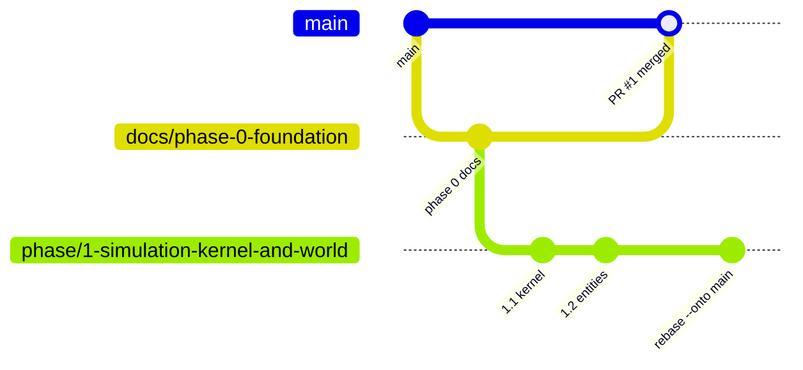

# Git workflow

**Purpose.** Read this before you create a branch, open a pull request or merge. It implements
ADR 0007: nothing reaches `main` until a phase of the plan is done, task work is reviewed inside
the phase, and the next phase starts while the previous phase's PR waits for approval. The
commit conventions themselves are in `CONTRIBUTING.md` §7; this doc is about branches and PRs.

## 1. Roles

- `main` is owned by **SamarjitBhogal** (repository admin). It is protected: PR required, one
  approval, green CI on three OSes, linear history, no force-push (`guardrails.md` §5).
- **Sam Holtzman** is product owner and lead architect: owns the plan, the phase branches,
  the ADRs and the INBOX.
- Every phase PR has a named reviewer (Phase 0: SamarjitBhogal). Task PRs inside a phase are
  reviewed by any teammate plus, for agent-written code, the `pr-review` skill or the
  `architecture-reviewer` subagent first.

## 2. Branch types

| Branch                  | Base                                  | Merges into           | Lifetime  | Naming                                                              |
| ----------------------- | ------------------------------------- | --------------------- | --------- | ------------------------------------------------------------------- |
| `main`                  | —                                     | —                     | forever   | —                                                                   |
| Phase branch            | `main` (or the previous phase branch) | `main` (one PR)       | one phase | `phase/<n>-<kebab-name>` e.g. `phase/1-simulation-kernel-and-world` |
| Task branch             | the current phase branch              | the phase branch (PR) | days      | `feat/`, `fix/`, `docs/`, `refactor/`, `chore/` + short name        |
| Phase 0 (documentation) | `main`                                | `main`                | this PR   | `docs/phase-0-foundation`                                           |
| Agent worktree branch   | the phase branch                      | the phase branch (PR) | one task  | same as task branches; worktree in `.worktrees/<task>`              |

Phase names come from `docs/plan/README.md`. Task branches never branch from `main` while a
phase is open.

## 3. The stacked-phase procedure

The rule "work continues as if the PR were approved" is implemented by stacking:



1. **Open the phase PR** from `phase/<n>` (or `docs/phase-0-foundation`) into `main`; assign
   the reviewer; paste the phase doc's demo script and checklist into the PR body.
2. **Start the next phase immediately** from the tip of the waiting branch:

   ```bash
   git switch phase/0-foundation              # the branch whose PR is waiting
   git switch -c phase/1-simulation-kernel-and-world
   git push -u origin phase/1-simulation-kernel-and-world
   ```

3. **Work inside phase 1** on task branches off `phase/1-…`; task PRs target `phase/1-…`.
4. **When the phase 0 PR merges** (squash-merge rewrites history), re-base the stacked branch
   onto `main` in one command, telling git which old commits to drop:

   ```bash
   git fetch origin
   git switch phase/1-simulation-kernel-and-world
   git rebase --onto origin/main docs/phase-0-foundation phase/1-simulation-kernel-and-world
   git push --force-with-lease origin phase/1-simulation-kernel-and-world   # the ONLY allowed force-push, on a phase branch, announced in chat first
   ```

   Open task branches inside phase 1 then rebase onto the updated phase branch
   (`git rebase phase/1-…`). If the repository allows "rebase and merge" or a merge commit
   for phase PRs, no rewrite happens and step 4 is a plain `git merge origin/main`.

5. **If the phase PR is rejected** with changes requested: fix on the phase branch (or a
   `fix/` branch into it). The stacked phase picks the fixes up at the next rebase. Never
   patch `main` directly.

## 4. Task flow (humans and agents)

```bash
git switch phase/2-structures-and-combat && git pull
git switch -c feat/health-shield-bars
# implement + tests; npm run check must pass
git add -A && git commit -m "feat(core): add Health component with layered shield bars"
git push -u origin feat/health-shield-bars
# open PR → base: phase/2-structures-and-combat; fill the PR template; link the issue
```

- Small PRs, squash-merged into the phase branch after one approval and green CI.
- Agents commit only when asked in that task, and never push (`.claude/settings.json` denies
  it); the human pushes and opens the PR.
- Parallel agents: one worktree per task (`docs/agents/running-agents.md` §3).
- Rebase task branches on the phase branch before review if they fall behind; never
  force-push a branch someone else has checked out without saying so.

## 5. Pull-request rules

- Title = the squash commit message: Conventional Commits with an allowed scope
  (`core`, `client`, `ui`, `engine`, `bridge`, `ai`, `tooling`, `ci`, `docs`, `deps`).
- Body = the template (`.github/pull_request_template.md`): summary, why, how tested,
  checklist. Guardrail changes link an ADR; new dependencies are justified per line.
- Reviewers walk `docs/agents/checklists.md` §2 for AI-written code.
- A phase PR additionally includes: the phase exit checklist (§4 of the same file), the
  measured success metrics, and the changelog entry in `docs/changelog/`.
- CI must be green on ubuntu, macos and windows. No `--no-verify`, ever.

## 6. Tags and releases

- Tag `main` after each phase merge: `v0.<phase>.0` (e.g. `v0.1.0` after Phase 1) and
  `v0.1.0-mvp` at the end of Phase 6. Tags are created by the `main` owner.
- Hotfixes to `main` after a tag are `fix/` PRs into `main` and are cherry-picked into the
  open phase branch the same day.

## 7. Commands agents may and may not run

| Allowed (read-only or local)                                  | Forbidden for agents                                        |
| ------------------------------------------------------------- | ----------------------------------------------------------- |
| `git status`, `git diff`, `git log`, `git branch`, `git show` | `git push` (any form), `git commit --no-verify`             |
| `git switch -c <task> <phase>` when asked to branch           | `git reset --hard`, `git checkout main`, `git branch -D`    |
| `git commit` when the human asked in the current task         | `git rebase`/`git merge` unless explicitly asked, `git tag` |

## Related

- [ADR 0007](../decisions/0007-phase-branching-model.md)
- [`CONTRIBUTING.md` §7](../../CONTRIBUTING.md)
- [`guardrails.md`](guardrails.md)
- [`../plan/README.md`](../plan/README.md)
- [`../agents/checklists.md`](../agents/checklists.md)
