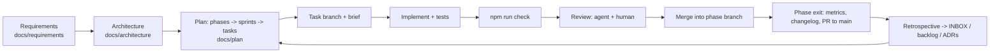

# Software development life cycle

**Purpose.** Read this to see the whole process in one place: what a phase, a sprint and a
task are, which artefact each step produces, who signs what, and where AI agents fit. The
engineering standards behind it are `docs/requirements/05-engineering-standards.md`; the
schedule is `docs/plan/README.md`.

## 1. Shape of the project

- **Phase** (1–3 weeks): a coherent capability with exit criteria and measurable success
  metrics, delivered on a `phase/<n>-<name>` branch and merged into `main` by one PR.
- **Sprint** (1 week): a checklist inside the phase doc; each line is a task with a test and a
  done-when. The Monday sync re-cuts the sprint if the previous one slipped.
- **Task**: one concern, one branch, one PR, one brief
  (`docs/agents/task-brief-template.md` or the GitHub issue template).

## 2. Artefacts and where they live

| Step            | Artefact                                                            | Owner           |
| --------------- | ------------------------------------------------------------------- | --------------- |
| Requirement     | FR-/NFR- row in `docs/requirements/06-mvp-requirements.md`          | Product owner   |
| Design decision | ADR in `docs/decisions/` (`/adr` skill drafts; PO accepts)          | Lead architect  |
| Design          | Architecture doc with `paths` frontmatter in `docs/architecture/`   | Lead architect  |
| Plan            | Phase doc checklist in `docs/plan/`                                 | Product owner   |
| Task            | Issue (task-brief template) or INBOX item                           | Anyone          |
| Code + tests    | Task branch; `npm run check` green                                  | Implementer     |
| Progress        | Entry in `docs/plan/PROGRESS.md`                                    | Implementer     |
| Review          | PR review (checklists §2/§3)                                        | Reviewer        |
| Change record   | `docs/changelog/<date>-<topic>.md` per phase (and per large change) | Implementer     |
| Phase exit      | Metrics recorded in PROGRESS; phase PR to `main`; tag               | PO + main owner |
| Retro           | Notes → INBOX items, backlog rows, ADRs, guardrail proposals        | Team            |

## 3. Definition of Done

A task is done when all of `CONTRIBUTING.md` §8 holds, restated for agents in
`docs/agents/checklists.md` §1: acceptance criteria met, `npm run check` green and reported
verbatim, tests next to code, no guardrail weakened, numbers in content, registries used,
docs + frontmatter + PROGRESS updated, PR opened against the phase branch.

## 4. Reviews

- **Task PR**: one teammate approval (ES-13; for agent PRs a human, AI-07); agent-written code
  gets a `pr-review` / `architecture-reviewer` pass first (agents grade their own work
  generously). CodeRabbit then reviews it by the same skill and can block it, but never
  approves; taste, design and architecture decisions go to the product owner (ADR 0018).
- **Architecture review**: any new folder, family, port or registry goes through
  checklist §3 before code is written, usually as a short design note in the PR or an ADR.
- **Phase PR**: the named phase reviewer walks checklist §4 with the demo script; the `main`
  owner merges and tags.

## 5. Ceremonies (lightweight, remote-friendly)

| When               | What                                                           | Output                         |
| ------------------ | -------------------------------------------------------------- | ------------------------------ |
| Monday (30 min)    | Sprint cut: pick checklist lines, assign owners, note blockers | Owners on checklist lines      |
| Daily (async)      | PROGRESS.md entries; blockers in chat                          | Up-to-date PROGRESS            |
| Friday (30 min)    | Demo of merged work; metrics check; re-cut if late             | Metrics in PROGRESS            |
| Phase end (60 min) | Exit checklist, retrospective, next-phase kickoff              | Changelog, INBOX/backlog, ADRs |

## 6. Change control

- Guardrails (lint rules, thresholds, hooks, CI, tsconfig, `.claude/settings.json`) change
  only through an ADR and a PR that updates `guardrails.md` in the same change.
- Requirements change through the product owner: a new or edited FR row, then the phase
  doc, then tasks. Agents never change requirements or make product decisions.
- Dependencies: none added unless a person other than the author approves each one in their
  own review or comment on the PR (ADR 0018).
- Every non-trivial change gets a changelog entry saying what changed, what was added or
  removed, and why (the Phase 0 entry is the model).

## 7. Quality gates in order

`npm run check` = format → lint (zero warnings) → typecheck (`tsc -b`) → knip → tests with
coverage thresholds → build → docs check. Git hooks run the quick subset; CI runs everything
on Linux and Windows; Claude Code hooks run per-file lint after edits and the quick gate before an
agent stops. Details: `guardrails.md`.

## Related

- [`../plan/README.md`](../plan/README.md)
- [`git-workflow.md`](git-workflow.md)
- [`guardrails.md`](guardrails.md)
- [`../agents/checklists.md`](../agents/checklists.md)
- [`../requirements/05-engineering-standards.md`](../requirements/05-engineering-standards.md)
