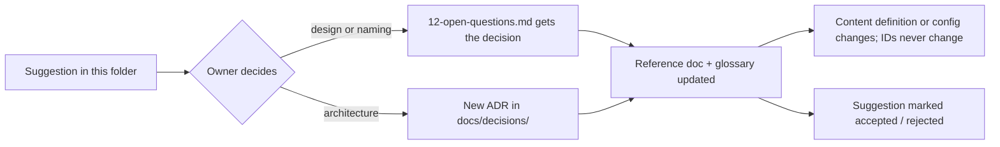

# Suggestions

**Purpose.** Read this when you want to know what the files in `docs/reference/suggestions/` are, how much authority they carry (none, until accepted), and what happens to a suggestion once the product owner decides on it. Agents: read this before citing anything in this folder as a requirement.

## What a suggestion is

A suggestion is a proposal written by the engineering side for the product owner (Sam Holtzman) to accept, reject, amend or defer. Every item in this folder follows the same shape:

- a **proposal** that is specific (a name, a number, a formula, a rule),
- a one-line **rationale**,
- where useful, **2–4 options** with a recommended pick,
- an **MVP status** (MVP, MVP-if-time, post-MVP, removed) and an item **status** (proposed, accepted, rejected, deferred).

Numbers quoted from the requirements doc or the game doc carry a `TUNE` marker and their source. Numbers that we invented are labelled `Recommendation:`. Nothing here overrides the reference docs, the requirements docs, or the decisions in the writer brief and the ADRs. `AGENTS.md` still applies: agents never make product or game-design decisions, so an agent that finds a suggestion useful asks the owner instead of implementing it.

## How a suggestion is accepted

1. The owner reads the item and picks an option (or writes a different answer).
2. The decision is written down in exactly one place: `../game-design/12-open-questions.md` for design and naming decisions, or a new ADR under `../../decisions/` (copy `0000-template.md`) when the decision changes the architecture, a guardrail or a dependency.
3. The reference doc that owns the topic is updated to state the decision as fact (for example `../game-design/01-classes-and-subclasses.md` for a class name, `../glossary.md` for any renamed term). The suggestion item is marked `accepted` with a link to where the decision lives, or `rejected` with a one-line reason. Rejected items stay in the file so the same idea is not proposed twice.
4. Code follows the docs, never the other way round: display names and tuning values change in `packages/core/src/content/`; kebab-case content IDs are never renamed once a save or a release stores them (`CONTRIBUTING.md` §2); a class identifier rename is a mechanical IDE rename (see `naming.md`, "In-code naming convention").

Decisions that only the owner can make are collected at the end of `discrepancies.md` and copied into the root `INBOX.md` so they are not lost.

## Index

| File                 | What it proposes                                                                                                                                                                                                                                                                                                                                                                            |
| -------------------- | ------------------------------------------------------------------------------------------------------------------------------------------------------------------------------------------------------------------------------------------------------------------------------------------------------------------------------------------------------------------------------------------- |
| `naming.md`          | Themed names for every placeholder (classes, sub-classes, forms, hordes, towers, screens, abilities, weapons, gem, medals, dev menu) and the in-code naming convention that keeps renames cheap                                                                                                                                                                                             |
| `balancing.md`       | Horde sizes and cadence, minion strength curve, enraged buff, structure health and shields, turrets, wall sprint, capture XP, bosses, aether and cooldowns, XP curve, Eternal multipliers, the balance-knob catalogue, and how to test balance headlessly                                                                                                                                   |
| `more-abilities.md`  | The `AbilityEffect` catalogue every proposal composes; 3–5 additional abilities and one alternative ultimate per MVP class (Hamstring, Shield Wall and Sanctuary recommended for the empty third slot); post-MVP ideas for the Flying class and the sub-classes; the proposed status-effect table with duration and stack semantics                                                         |
| `more-weapons.md`    | Two or three additional named weapons per weapon class with passives, heavy attacks and lore lines; additional artifacts per MVP class (Ashen Bomb, Warhorn, Aether Well); the recommended MVP catalogue; and the idea-pending proposal for weapon "abilities" without active slots (weapon = stats + on-hit effects + one heavy attack)                                                    |
| `mechanics-ideas.md` | Minimal versions or cuts for open mechanics: form change (cut; the Eternal form uses the same definition swap), the capital's summoner, pick-up/throw tiers, the class-switch ultimate penalty formula, the Rover bot behaviour spec with difficulty knobs, sim mode as a first-class testing feature, ten cheap achievements, the match history record and the developer menu command list |
| `discrepancies.md`   | Every discrepancy, contradiction or ambiguity between the requirements doc, the game doc, the repo scaffold and the Phase 0 docs (DISC-01 … DISC-63) with where it lives, a proposed resolution and a decided/open status, ending with the list of decisions the product owner still owes                                                                                                   |

## Adding a suggestion

Add it to the file that owns the topic (create a new file only for a new topic, and add it to the index above). Keep the shape described in "What a suggestion is". Use the canonical vocabulary from `../glossary.md` (for example horde, Stronghold, BuffTower, SpawnerTower, minion, Legend, aether), tag the MVP status, and mark invented numbers `Recommendation:`.

## Related

- `../game-design/12-open-questions.md` — where accepted design and naming decisions are recorded
- `../game-design/00-overview-and-status-legend.md` — the MVP status legend used by every item here
- `../glossary.md` — canonical vocabulary
- `../../decisions/0000-template.md` — ADR template for architecture-affecting decisions
- `../../architecture/17-extension-recipes.md` — the "new idea = new class + content entry + registry line" recipes that accepted suggestions turn into
- `../../../INBOX.md` — open decisions for the product owner
