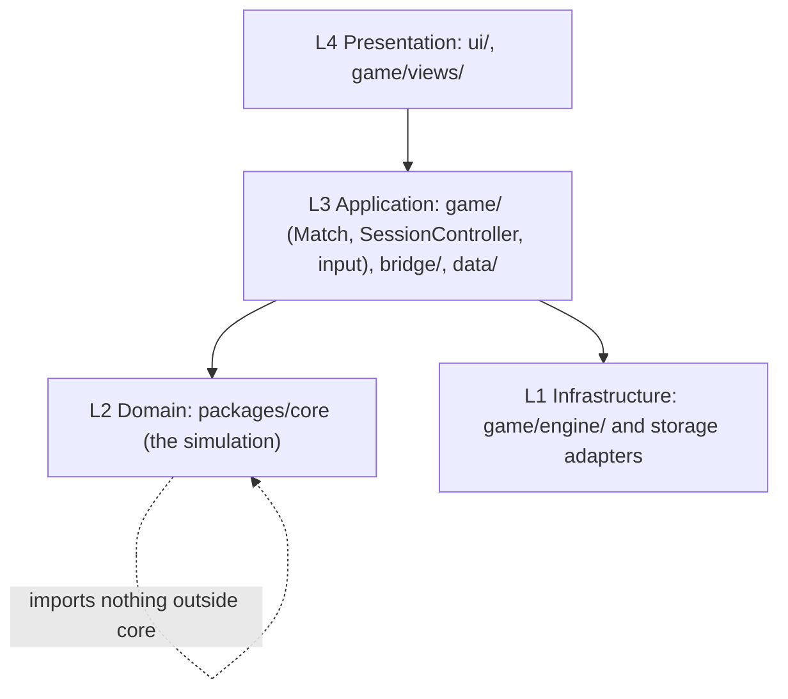

# Architecture principles

Purpose: Read this when you design a new subsystem, review a design or PR for architectural fit,
or need to know _why_ a rule in [`AGENTS.md`](../../AGENTS.md) exists. Each principle is a
requirement with an ID (`AP-nn`) that ADRs, plan docs and PRs cite. The mechanical rules that
implement them (import boundaries, naming, file layout) live in
[`CONTRIBUTING.md`](../../CONTRIBUTING.md) and `AGENTS.md`; this document says what must be true
and why, and links to the architecture doc that designs it. The product owner's mandate that
drives all of it is in [the source requirements](source/requirements-of-architecture.md):
"NO TIGHT COUPLING. NO HARDCODING. NO MAGIC NUMBERS", "new idea? add a new class!", and "we are
essentially translating to a new surface rather than restarting from 0".

## How to read a principle

Each entry has four parts. **Requirement**: what must be true, in terms a reviewer can check.
**Why**: the force behind it. **Verified by**: the tool or review step that catches a violation;
"review" means the checklist in [`../agents/checklists.md`](../agents/checklists.md). **Realised
in**: the architecture doc that designs it. Where automated verification does not exist yet, the
entry says so and gives a `Recommendation:` the team can accept through an ADR.

## The layers

The four layers below are the canonical vocabulary (full definition in
[`../architecture/01-layered-oop-model.md`](../architecture/01-layered-oop-model.md)). A layer
depends only on itself and on lower layers, never upward.

## Principles

### AP-01 Layered OOP model with downward-only dependencies

- **Requirement.** Every module belongs to exactly one layer and imports only from its own layer
  or a lower one. `packages/core` imports nothing outside itself; the client imports core only as
  `@eternalus/core`; `ui/` imports only `bridge/`, `ui/` and `styles/`; `game/engine/` imports
  nothing from `views/`, `input/`, `Match` or `bridge/`; no import cycles anywhere. The one-line
  versions of these rules are `AGENTS.md` architecture rules 1–7.
- **Why.** The simulation must run headless (tests, replays, a future Worker) and the
  presentation and infrastructure must be replaceable (AP-11). Layering turns "where does this
  go?" into a lookup and is what makes the rest of this list checkable.
- **Verified by.** `tsc -b` project references (only `client → core` can resolve), ESLint
  `no-restricted-imports` in core, core's tsconfig without DOM or Node libraries. The client-side
  boundaries are review-only today. Recommendation: per-folder ESLint boundary rules and an
  import-cycle check as listed in
  [`../research/agentic-harness-research.md#5-verification-patterns`](../research/agentic-harness-research.md#5-verification-patterns).
- **Realised in.** [`01-layered-oop-model.md`](../architecture/01-layered-oop-model.md),
  [`02-code-structure.md`](../architecture/02-code-structure.md).

### AP-02 Ports and adapters for every platform touchpoint

- **Requirement.** Every interaction with the browser or host (frames, canvas, audio, input
  devices, storage, wall-clock time, logging, randomness, asset fetching) goes through a port
  (`interface`) with one production adapter and one test double: `FrameScheduler` →
  `RafFrameScheduler` / fake scheduler; `Renderer` → `Canvas2dRenderer` / recording renderer;
  `StorageAdapter` → `IndexedDbStorageAdapter` / `MemoryStorageAdapter`; `AudioOutput` →
  `WebAudioOutput` / null output; `Logger` and `Rng` in core with injected implementations. Domain
  and application code depend on the port only.
- **Why.** This is the "hardware abstraction" the product owner asked for. It is what makes a
  full match runnable in Node, and it is the seam along which the game will be translated to a
  real engine.
- **Verified by.** Core compiles with `types: []` and `lib: ES2023` (guardrail "core has no
  platform types"); contract tests run the same suite against every adapter of a port (ES-02);
  review checks that any new browser API use sits in `game/engine/` or `data/`.
- **Realised in.** [`09-hardware-abstraction.md`](../architecture/09-hardware-abstraction.md),
  [`08-game-engine.md`](../architecture/08-game-engine.md),
  [`14-persistence-and-resources.md`](../architecture/14-persistence-and-resources.md).

### AP-03 Deterministic, command-driven simulation

- **Requirement.** The same seed and the same ordered command stream produce an identical
  `GameState` (identical `StateHasher` output) at every tick, on the same engine. Core measures
  time only in ticks at a fixed 30 ticks/s (decided, D9), draws randomness only from
  `SeededRandom` owned by `GameState`, iterates entities in ID order with pure comparators, defers
  spawns and removals to the end of the tick, and mutates state only through `Command`s applied at
  the start of a tick. Player input and bots are both `Command` producers.
- **Why.** Replays, golden-hash regression tests, reproducible bug reports and cheap headless soak
  tests all depend on it, and it keeps a later Worker or networked move possible. The JavaScript
  pitfalls (unseedable `Math.random`, implementation-dependent transcendental functions, `Map`
  iteration order, ill-formed comparators) are catalogued in
  [`../research/game-architecture-and-performance-research.md#determinism-pitfalls-specific-to-javascript`](../research/game-architecture-and-performance-research.md#determinism-pitfalls-specific-to-javascript).
- **Verified by.** ESLint `no-restricted-properties` (`Math.random`), core's tsconfig (no timers,
  no `Date` use in practice), replay-hash tests and the run-twice test in ES-04, review for
  iteration order and comparators. Recommendation: lint `Math.sin/cos/atan2/pow/exp` in core
  outside `utils/`.
- **Realised in.** [`03-game-model.md`](../architecture/03-game-model.md),
  [`08-game-engine.md`](../architecture/08-game-engine.md).

### AP-04 Single source of truth with immutable snapshots

- **Requirement.** `GameState` is the only mutable game data. Everything outside core (canvas
  views, minimap, React HUD and screens, persistence, developer menu) reads immutable snapshots
  produced by `SnapshotSystem`; React reads a throttled copy through the single Redux store in
  `bridge/`. Snapshots are plain, structured-clone-safe data (decided, D8) holding previous and
  current tick positions for interpolation.
- **Why.** Two sources of truth desync rendering and UI from the rules. One snapshot feeding every
  view is also what makes the minimap follow the map for free (AP-05, FR-017) and what keeps a
  Worker move cheap.
- **Verified by.** The `ui/` import rule; `game/views/` may `import type` only from core; a test
  that `structuredClone(snapshot)` round-trips without loss; review.
- **Realised in.** [`03-game-model.md`](../architecture/03-game-model.md),
  [`13-game-interface.md`](../architecture/13-game-interface.md).

### AP-05 Data-driven content and config-driven world

- **Requirement.** Every tunable value and display name is a content definition (Type Object)
  under `packages/core/src/content/`, keyed by a kebab-case ID and validated by `validateContent()`.
  The world is generated by a pure `MapGenerator` from `GameConfig` and a seed (decided, D7).
  Litmus test: changing `numLanes`, `spawnTowersPerLane` and `buffTowersPerLane` in config yields
  a consistent map, minimap, flow fields, spawners and AI with **no code change**.
- **Why.** "NO HARDCODING. NO MAGIC NUMBERS" and the product owner's three-values example. It lets
  designers tune without touching logic, keeps IDs stable across renames (CP-13) and lets content
  move to JSON or an editor later. Evidence for the pattern (OpenRA, 0 A.D., Type Object) is in
  [`../research/game-architecture-and-performance-research.md#9-config-driven-and-data-driven-design`](../research/game-architecture-and-performance-research.md#9-config-driven-and-data-driven-design).
- **Verified by.** `MapGenerator` tests parameterised over config values; `validateGameConfig()`
  and `validateContent()` tests; content tables typed with `satisfies`; review for numeric literals
  in gameplay code (CP-09).
- **Realised in.** [`06-map-and-minimap.md`](../architecture/06-map-and-minimap.md),
  [`04-entity-architecture.md`](../architecture/04-entity-architecture.md),
  [`17-extension-recipes.md`](../architecture/17-extension-recipes.md).

### AP-06 Event-driven communication between systems

- **Requirement.** Systems never import or call each other. They read and write `GameState` and
  communicate through typed `GameEvents`; the only coupling between systems is their order in
  `SystemPipeline`, which is declared in one place. Core exposes events to the client through
  `Simulation.on()`; the client reaches React only through the `bridge/` event bus and store.
- **Why.** Independent, reorderable, individually testable systems; a new system is one class and
  one registration line (AP-09). An unknown event name is a type error, not a runtime surprise.
- **Verified by.** Typed event map (`tsc`); review. Recommendation: an ESLint `no-restricted-imports`
  regex banning sibling `*System` imports inside `systems/`.
- **Realised in.** [`03-game-model.md`](../architecture/03-game-model.md).

### AP-07 Composition first, shallow inheritance for taxonomy

- **Requirement.** Inheritance expresses taxonomy only, at most three levels below `Entity`
  (decided, D4). State lives in components, per-kind behaviour in strategies selected from
  content, per-tick logic in systems, and kinds in definitions. Team is a component, never a class
  (decided, D10: revived or ascended units change team). Sub-classes are data specialisations
  (`LegendSpecDefinition`), with a subclass only when behaviour is unique (decided, D11).
- **Why.** The source document's inheritance tree is honoured as taxonomy without deep
  hierarchies; deep trees are what make renames, new kinds and cross-cutting features expensive.
  Rationale and reference engines in
  [`../research/game-architecture-and-performance-research.md#2-oop-entity-hierarchies-vs-ecs-vs-hybrid`](../research/game-architecture-and-performance-research.md#2-oop-entity-hierarchies-vs-ecs-vs-hybrid).
- **Verified by.** Review (`CONTRIBUTING.md` §3). Recommendation: a structural test that walks the
  exported entity classes and fails above depth 3.
- **Realised in.** [`04-entity-architecture.md`](../architecture/04-entity-architecture.md).

### AP-08 Single access controllers for persistence and resources

- **Requirement.** `PersistenceController` is the only module that opens IndexedDB, and
  `ResourceController` the only module that fetches and decodes assets (decided, D3). Both are
  facades over repositories/loaders that sit behind ports; nothing else touches `indexedDB`,
  `localStorage`, `fetch` for assets, `createImageBitmap` or `decodeAudioData`.
- **Why.** "Single Access with a Controller in front": one place for schema versions, migrations,
  quota and failure handling, caching, and the eventual translation to an engine's asset and save
  systems.
- **Verified by.** Review; contract tests against `MemoryStorageAdapter`. Recommendation: ESLint
  `no-restricted-globals`/`no-restricted-syntax` for `indexedDB` and asset `fetch` outside
  `apps/client/src/data/`.
- **Realised in.** [`14-persistence-and-resources.md`](../architecture/14-persistence-and-resources.md).

### AP-09 Registries are the single place of change (OCP)

- **Requirement.** Every open-ended family (entity kinds, abilities, status effects, strategies,
  views, commands, systems, screens, repositories) is registered in exactly one registry or ordered
  list: `EntityRegistry`, `AbilityRegistry`, `ViewRegistry`, `SystemPipeline`, the `Command`
  union. Adding a member is a new class or definition plus one registry line; no `switch` over a
  kind may exist in more than one place.
- **Why.** The product owner's litmus test: "new idea? add a new class (and a content entry, and a
  registry line), nothing else changes". It keeps every change additive and reviewable by diff.
- **Verified by.** Review question "what else changed?"; each extension recipe lists the expected
  diff; knip flags a class that was never registered as dead code.
- **Realised in.** [`17-extension-recipes.md`](../architecture/17-extension-recipes.md),
  [`04-entity-architecture.md`](../architecture/04-entity-architecture.md).

### AP-10 Dependency injection through constructors; no singletons beyond the bridge

- **Requirement.** Collaborators are passed in through constructors; `Match` is the composition
  root of a match and `SessionController` of the session. No module-level mutable state, no
  service locator, no `static` registries mutated at import time. The only singletons are the
  Redux store and the event bus in `apps/client/src/bridge/`.
- **Why.** Injectable dependencies are what let tests swap adapters (AP-02), make dependencies
  visible in signatures, and let a rematch tear down and rebuild only match-scoped objects.
- **Verified by.** Review; tests that construct systems and controllers with fakes are the proof
  that injection works.
- **Realised in.** [`01-layered-oop-model.md`](../architecture/01-layered-oop-model.md),
  [`13-game-interface.md`](../architecture/13-game-interface.md).

### AP-11 Engine portability: translate, do not restart

- **Requirement.** The portable set, all in core, must run a full bot-versus-bot match in Node with
  no browser API: rules, entities, components, systems, commands, events, content, config, map
  generation, physics maths, AI controllers, `MatchDirector`, diagnostics. The disposable set is
  everything behind a port: `Canvas2dRenderer`, React screens and HUD, `IndexedDbStorageAdapter`,
  `RafFrameScheduler`, `WebAudioOutput`, DOM input devices. No gameplay rule may live in the
  disposable set.
- **Why.** The long-term goal is a real engine and another language. Core must survive as the
  specification and translation source, so "we are essentially translating to a new surface".
- **Verified by.** Core's tsconfig (`types: []`); a headless full-match test in core (ES-02);
  review that `engine/` and `ui/` contain no rules.
- **Realised in.** [`01-layered-oop-model.md`](../architecture/01-layered-oop-model.md),
  [`09-hardware-abstraction.md`](../architecture/09-hardware-abstraction.md).

### AP-12 Observability is built in

- **Requirement.** The running game monitors itself: an `InvariantRunner` (light invariants every
  tick, heavy ones every N ticks), structured logging through the `Logger` port with a ring buffer
  of recent commands and events attached to every violation, a per-tick state hash, and replay
  recording (seed + command log). Entities are removed only with a `RemovalCause`; deaths carry a
  killer or cause. Violations are `DiagnosticEvent`s, never silent.
- **Why.** "Testing is extremely important; not just when developing, but while the game is
  running", with the product owner's list of anomalies to log (through-wall movement, orphan
  despawns, deaths without a killer). Design-by-contract evidence in
  [`../research/persistence-input-diagnostics-research.md#c1-contracts-invariants-and-post-mortem-context`](../research/persistence-input-diagnostics-research.md#c1-contracts-invariants-and-post-mortem-context).
- **Verified by.** A test per invariant that fires on a synthetic violation; the soak test; review
  that removals and deaths carry causes.
- **Realised in.** [`15-diagnostics-and-runtime-testing.md`](../architecture/15-diagnostics-and-runtime-testing.md).

### AP-13 Performance budgets are requirements

- **Requirement.** 30 ticks/s with 144 units per team plus structures and projectiles, rendering at
  the display rate (60 fps target), with no allocation in per-tick hot paths (pools, pre-allocated
  typed arrays, reused scratch vectors) and staggered AI evaluation. The numbers are in ES-05 and
  are measured, not assumed.
- **Why.** "max 144 units per team; shouldnt crash ... should be able to support hundreds per
  team". Techniques and evidence in
  [`../research/game-architecture-and-performance-research.md#6-object-pooling-and-gc-avoidance`](../research/game-architecture-and-performance-research.md#6-object-pooling-and-gc-avoidance).
- **Verified by.** A headless tick-timing test at the cap; `performance.mark/measure` and a
  long-animation-frame observer surfaced in the perf overlay; profiling before optimising.
- **Realised in.** [`08-game-engine.md`](../architecture/08-game-engine.md),
  [`10-physics.md`](../architecture/10-physics.md), [`11-game-ai.md`](../architecture/11-game-ai.md).

### AP-14 Secure and reliable for a browser-only game

- **Requirement.** The threat model is local tampering, malformed persisted or imported data, and
  the supply chain. Therefore: every record read from storage or an import file is validated
  against a versioned DTO schema before use; the page ships a Content Security Policy without
  `unsafe-eval`; no `eval`, `new Function`, `innerHTML` or `dangerouslySetInnerHTML` with user
  data; `npm audit` at level `high` (already in `.npmrc`); React error boundaries around every
  screen and the match; persistence failure degrades to `MemoryStorageAdapter` with a visible
  warning; no secrets in the repository.
- **Why.** Without a server, the browser is the trust boundary and a reliability failure is the
  user's lost profile.
- **Verified by.** DTO validation tests with corrupt fixtures; error boundary tests; the CI install
  step and `.npmrc`; review of `index.html` CSP and of any string-to-DOM code.
- **Realised in.** [`14-persistence-and-resources.md`](../architecture/14-persistence-and-resources.md),
  [`13-game-interface.md`](../architecture/13-game-interface.md),
  [`15-diagnostics-and-runtime-testing.md`](../architecture/15-diagnostics-and-runtime-testing.md).

### AP-15 Explicit extension points for post-MVP features

- **Requirement.** For every deferred feature (decided, D12: Flying class, mounts, anti-air, form
  change, ability tree, controller support, first/third person; D11 sub-classes; multiple maps)
  the architecture names the seam it plugs into (a registry, port, definition field or component)
  and nothing in MVP code precludes it. Seams are interfaces and data, not speculative
  implementations (CP-07).
- **Why.** "We build in excess with perfect engineering ... so that adding in totally new features
  (e.g., mounts, form changes, etc.) should be as simple as adding a new programming class".
- **Verified by.** A recipe per deferred feature in the extension recipes; review of new code
  against the named seams.
- **Realised in.** [`17-extension-recipes.md`](../architecture/17-extension-recipes.md),
  [`../plan/backlog-post-mvp.md`](../plan/backlog-post-mvp.md).

## Related

- [`02-coding-principles.md`](02-coding-principles.md): the code-level counterpart (SOLID, DRY, patterns)
- [`05-engineering-standards.md`](05-engineering-standards.md): budgets, tests and verification that back these principles
- [`06-mvp-requirements.md`](06-mvp-requirements.md): the NFRs that cite these principles
- [`../architecture/README.md`](../architecture/README.md): the docs that realise them
- [`../../AGENTS.md`](../../AGENTS.md) and [`../../CONTRIBUTING.md`](../../CONTRIBUTING.md): the one-line rules and conventions
- [`../research/game-architecture-and-performance-research.md`](../research/game-architecture-and-performance-research.md): evidence
