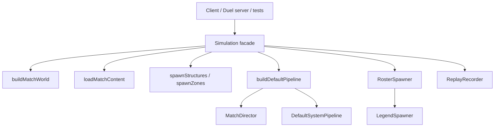

# Simulation refactor (2026-11-25)

## Purpose

Read this to understand why `packages/core/src/simulation/` exists and what belongs in it, or
before adding match setup code to `Simulation`. It records one refactor on branch
`refactor/simulation-split`: **why** `Simulation.ts` had become a monolith, **what** was moved
where, and **how** the move was proven not to change behaviour. It is a dated record and is not
updated afterwards; the design it leaves behind is described in
[03-game-model §6](../architecture/03-game-model.md#6-the-simulation-facade) and
[02-code-structure §2](../architecture/02-code-structure.md#2-packagescoresrc-l2-domain).

## 1. Why: how a facade became a monolith

`Simulation` is core's composition root and its only public entry point (architecture 03 §6):
the client, the Duel server, the tests and the replay harness all drive it through
`enqueueCommand`, `step`, `snapshot` and `hash`. It started on 2026-10-06 as a 97-line facade.
Every later feature needed some setup at match start, and the cheapest place for setup was the
constructor:

| Date       | Commit     | Lines | Commit subject                                                                         |
| ---------- | ---------- | ----- | -------------------------------------------------------------------------------------- |
| 2026-10-06 | `c6c50062` | 97    | feat(core): add the Simulation facade, SystemPipeline and replay harness               |
| 2026-10-17 | `508eea07` | 113   | feat(core): march lane hordes in formation (minion plan M1)                            |
| 2026-10-25 | `c2d9d1e9` | 231   | fix(ai): apply the M3 critic findings                                                  |
| 2026-11-02 | `8fe97636` | 441   | fix(core): replay types stay in diagnostics' layer; exact replay assertion             |
| 2026-11-04 | `7c5e80fe` | 629   | refactor(core): DefaultInvariantRunner takes an options object                         |
| 2026-11-09 | `ec73ad3b` | 674   | feat(core): let zones be guard homes                                                   |
| 2026-11-20 | `177d1ac7` | 746   | refactor(core): build the timeline frame once and hand the countdown tick to GameState |
| 2026-11-25 | phase head | 761   | (before this refactor)                                                                 |

Lines are the file's length at a selection of the commits that touched it. Over the same
period the file gained bot rosters, map objects and structures, zones, replay recording, the match
director, scoring and the Duel, each adding setup to the constructor.

72 non-merge commits touched the file
(`git log --oneline --no-merges 67dbae61 -- packages/core/src/Simulation.ts | wc -l`). No single change was wrong; each one took the shortest path. Together
they produced the code smells below.

### Smell inventory (before)

| Smell                         | Where                                                                                                                                                                                                                                                                                                 |
| ----------------------------- | ----------------------------------------------------------------------------------------------------------------------------------------------------------------------------------------------------------------------------------------------------------------------------------------------------- |
| **Large class**               | 761 lines against the project limit of about 300 (NFR-003).                                                                                                                                                                                                                                           |
| **Long method**               | A 165-line constructor against the limit of about 60 (NFR-003).                                                                                                                                                                                                                                       |
| **Too many responsibilities** | One class validated config, built the world, filtered the Duel arena, loaded content, built the entity factory, spawned structures and zones, wired the AI, built the pipeline, spawned the roster, recorded replays and ran the tick (NFR-001, single responsibility).                               |
| **Static helper sprawl**      | 12 `private static` helpers (`spawnRoster`, `planLanes`, `humanSlotsOf`, `spawnSlot`, `controllerOf`, `strongholdOf`, `spawnStructures`, `spawnZones`, `buildWorld`, `withStructures`, `createControllers`, `defaultContent`): functions that used no instance state, a sign they belonged elsewhere. |
| **Fan-out**                   | 74 import statements: a change almost anywhere in core touched this file.                                                                                                                                                                                                                             |
| **Hidden collaborator**       | Replay recording (setup, command log, checkpoints) was three loose fields plus logic in `step()`, not an object that could be tested alone.                                                                                                                                                           |
| **Untestable in isolation**   | Roster spawning rules (caps, lane assignment, human seats) could only be tested by building a whole `Simulation`.                                                                                                                                                                                     |

The project's own requirements forbid this: NFR-001 ("no monoliths") and NFR-003 (file and
function size). The features and NFR report (PR #174, open when this was written) named it as the largest open
maintainability item.

### Why this file, and why now

- It is the biggest file in the codebase and the one most features touch, so it slows every
  future change the most.
- It is the composition root: the one place allowed to import everything. A file like that grows
  unless its parts have a home of their own.
- It is safe to refactor: the simulation is deterministic (NFR-018), so equal state hashes prove
  equal behaviour (section 3).

## 2. What: the new structure

`Simulation` keeps its public API unchanged and becomes a facade plus a short constructor that
**sequences** the build. Each step of the build moved to its own module in a new folder,
`packages/core/src/simulation/`:

| New module                                | Kind      | Responsibility                                                                                                                          | Taken from                                                                                                |
| ----------------------------------------- | --------- | --------------------------------------------------------------------------------------------------------------------------------------- | --------------------------------------------------------------------------------------------------------- |
| `RosterSpawner.ts` (+ `.types.ts`)        | class     | Checks a roster against the caps and controllers, assigns lanes, spawns each Legend in formation or at its Stronghold, seats the humans | `spawnRoster`, `planLanes`, `humanSlotsOf`, `spawnSlot`, `controllerOf`, `strongholdOf`                   |
| `ReplayRecorder.ts` (+ test)              | class     | Keeps the replay setup, the external command log and the checkpoint hashes; exports a `Replay`                                          | the `setup`, `commandLog` and `checkpoints` fields, `recordCheckpoint`, part of `step` and `exportReplay` |
| `buildMatchWorld.ts`                      | function  | The match world, the neighbour index and A\* from the map                                                                               | `buildWorld`                                                                                              |
| `spawnMapEntities.ts`                     | functions | `spawnStructures` and `spawnZones`: the entities the map places before the pipeline exists                                              | `spawnStructures`, `spawnZones`                                                                           |
| `matchContent.ts` (+ `.types.ts`)         | function  | `loadMatchContent`: level curves, weapons, controllers, unit content and the one `EntityFactory`, each injected or loaded               | `createControllers`, `defaultContent`, `withStructures` and 12 constructor lines                          |
| `buildDefaultPipeline.ts` (+ `.types.ts`) | function  | The shipped pipeline with its match director, invariants, bots and collisions; starts the director                                      | the 45-line `systems === undefined` branch of the constructor                                             |

Two small pieces stayed in `Simulation` as private methods because they bind to its own state:
`attachWorldObjects` and `logRejectedCommands`. The Duel arena filter became the one remaining
static helper, `matchMapObjects`.

### Design choices

- **A new folder, `simulation/`, not `match/` or `entities/`.** These parts import from almost
  every layer (AI, systems, entities, content, diagnostics). Core's folder rules
  (`packages/core/AGENTS.md`) allow that only for the composition root, so the parts sit beside
  it with the same import rights and are imported only by `Simulation.ts`. Putting
  `RosterSpawner` in `match/` would have broken `match/`'s import list. The owner signed the folder off
  as built (DEC-356).
- **Classes where there is state, functions where there is none** (NFR-001, CONTRIBUTING §3.1).
  `RosterSpawner` and `ReplayRecorder` hold collaborators or data, so they are classes; the
  builders are pure functions of their inputs.
- **No new abstraction layers.** No interfaces, factories or registries were added: each part has
  one implementation and one caller, so an interface would be speculative (ponytail, ADR 0010).
- **Construction order is preserved exactly.** Order is behaviour here: entity ids come from one
  counter, and listeners must exist before the spawns they hear. The constructor keeps the same
  sequence: world → state → content and factory → structures → zones → world objects → pipeline
  and director → roster → zone announcements → first checkpoint.
- **The public API did not change.** `src/index.ts` and `Simulation.types.ts` are untouched, so
  the client, the Duel server and every test compile without edits.

### Module diagram (after)

## 3. How: proving nothing changed

A refactor must not change behaviour. Because the simulation is deterministic, the proof is
mechanical: the same setup and seed must produce the same `StateHasher` hash at every tick.

1. **Golden baseline first.** Before any code moved, a temporary test built five scenarios and
   recorded their state hashes every 150 ticks, the replay checkpoints and the entity count, as
   a Vitest snapshot:
   - a full match on a generated map with map objects and a 20-Legend roster (9 laners and a
     Rover per team, one human), 1,800 ticks;
   - a Duel, 900 ticks;
   - no map; a map without map objects and a small roster; a custom empty pipeline.
2. **Extract in small steps.** Each module was moved out on its own, keeping the code inside it
   as it was (same statements, same order); only the call sites changed.
3. **Compare after each step.** The snapshot was re-run after the main extraction, after the
   content extraction and after the pre-PR critic's fixes. Each time all scenarios matched the
   baseline and the snapshot file stayed **byte-identical**. The temporary test was then deleted; the permanent guard is the existing
   `Simulation.replay.test.ts` and its fixture `diagnostics/__fixtures__/wanderSeed7.replay.ts`,
   which replays a recorded match and checks every checkpoint hash.
4. **Full suite.** All core tests pass (1,830 before, plus the new `ReplayRecorder` and
   `RosterSpawner` tests), and
   `npm run check` passes (section 5).

Two new unit tests cover what could only be tested through a whole `Simulation` before:

- `simulation/ReplayRecorder.test.ts`: setup fields kept only when present, checkpoints only on
  checkpoint ticks (hashing only then), and an exported command log that is a copy.
- `simulation/RosterSpawner.test.ts`: an empty roster, a roster without a map, bots and a seated
  human, two humans on one team, a lone human off the player team, the `legendsPerTeam` cap, a
  bot that is not a Legend, and a human slot that cannot spawn (logged, the rest spawns).

The other parts (`buildMatchWorld`, `spawnMapEntities`, `matchContent`, `buildDefaultPipeline`)
only moved; they stay covered through the `Simulation.*.test.ts` suites.

## 4. Results

| Metric                      | Before | After                         |
| --------------------------- | ------ | ----------------------------- |
| `Simulation.ts` lines       | 761    | 264                           |
| Constructor lines           | 165    | 65                            |
| `private static` helpers    | 12     | 1                             |
| Import statements           | 74     | 39                            |
| Largest new module          | n/a    | `RosterSpawner.ts`, 242 lines |
| Public API changes          | n/a    | none                          |
| State hashes in 5 scenarios | n/a    | identical                     |

`Simulation.ts` is now under the 300-line limit. The constructor is 65 lines, close to the
60-line guide: 13 of them are one property per line of the `buildDefaultPipeline` options object,
which a further split would only move, not remove. On the critic's advice the pipeline takes the
`MatchContent` object whole instead of its four parts.

## 5. Checks

`npm run check` on Node 24.21 → exit 0 (core 1841, protocol 31, client 2186, server 163 tests; "Documentation check passed."),
as recorded in `docs/plan/progress/2026-11-25-2359-refactor-simulation-split.md`. The new
`simulation/` folder has 100 % line coverage.

## 6. Lessons

- **A composition root needs a home for its parts**, or it absorbs every feature's setup. The
  `simulation/` folder is that home: new setup goes there as a function or class, and the
  constructor gains one line.
- **Static helpers are a smell signal.** Twelve private statics that touched no instance state
  were twelve functions waiting for a module.
- **Determinism makes refactoring cheap.** A snapshot of hashes turned "I think nothing changed"
  into a byte-for-byte comparison.
- **Size limits work only when checked.** NFR-003 was reviewed by hand, so the file crossed 300,
  then 500, then 700 lines without anything failing. A lint rule for file length (for example
  ESLint `max-lines` at about 300 for `packages/core/src`) would catch the next one; it is a
  guardrail change, so it needs an ADR.

## Related

- [03-game-model §6](../architecture/03-game-model.md#6-the-simulation-facade): the `Simulation`
  facade.
- [02-code-structure §2](../architecture/02-code-structure.md#2-packagescoresrc-l2-domain): the
  `simulation/` folder and its import rights.
- The features and NFR report (PR #174, open when this was written): where this refactor was identified (NFR-001, NFR-003).
